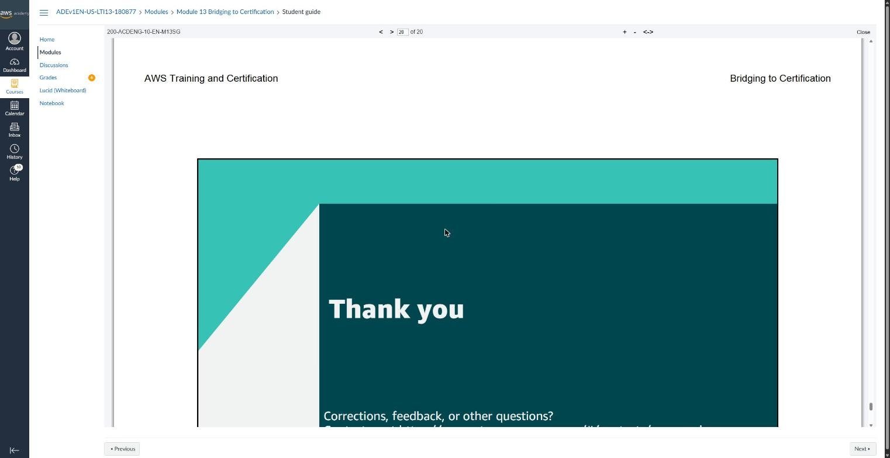

# Module 13 — Bridging to Certification

**Actividad de Moodle:** *AWS Academy Data Engineering — Module 13: Bridging to Certification* ·
**Semana 13** (abre 09/11, cierra 13/11/2026) · **Andres Felipe Cespedes Rondon**

> **Estado del módulo:** ✅ completado en AWS Academy (Canvas, curso 180877) el 09/11/2026. Se leyó la
> guía del estudiante completa, las 20 páginas (evidencia al final). El módulo no tiene knowledge check.

## 1. De qué trata el módulo

Es el puente entre el curso y las certificaciones de AWS. Presenta dos exámenes y los recursos para
prepararlos, y aclara algo importante: **el curso cubre aspectos de cada dominio, pero no alcanza por sí
solo para aprobar**. Es un paso más del camino.

| Certificación | Qué valida | Para quién |
|---|---|---|
| **AWS Certified Data Engineer – Associate** | Implementar pipelines de datos y monitorear, resolver problemas y optimizar su costo y rendimiento con buenas prácticas: ingerir y transformar datos, orquestar pipelines, diseñar modelos de datos, gestionar el ciclo de vida y asegurar la calidad | Personas con experiencia en ingeniería de datos |
| **AWS Certified Machine Learning – Specialty** | Diseñar, construir, entrenar, ajustar, desplegar y mantener soluciones de ML en AWS | Quienes desarrollan o corren cargas de ML o deep learning |

**Beneficios de certificarse** (según la guía): badge digital, 50 % de descuento para la recertificación
u otro examen, invitaciones a eventos (re:Invent, Summits), la comunidad AWS Certified en LinkedIn y la
tienda AWS Certified.

## 2. Recursos para prepararse

| Recurso | Para qué sirve | Cómo usarlo |
|---|---|---|
| **Exam Guide** | Lo que se espera que sepa el candidato y el temario por dominio, con servicios en alcance y fuera de alcance | Detectar los temas flojos y enfocar el estudio |
| **Sample Exam Questions** | Preguntas con el formato real y sus respuestas | Acostumbrarse al estilo; repasar con las fuentes del solucionario lo que se erró |
| **AWS Well-Architected** | Los pilares del framework y sus whitepapers | Conocer los conceptos clave de cada pilar |
| **Whitepapers, guías y FAQs** | Contenido técnico de AWS y las preguntas frecuentes de cada servicio | Ampliar en los servicios del curso |
| **Exam readiness / Exam Prep Plan** | Cursos (*Standard Exam Prep Plan: Data Engineer – Associate*) que repasan cada dominio, cómo interpretar las preguntas y cómo armar un plan de estudio | Antes de agendar el examen |
| **AWS Skill Builder** (skillbuilder.aws) | Más de 500 cursos gratuitos y los **practice question sets oficiales y gratuitos** | Medir si uno está listo |
| **AWS Training and Certification** (aws.training) | Agendar exámenes, historial, badges y beneficios | Para la logística |
| **Documentación de AWS** | Guías de usuario y desarrollador, referencias de API y tutoriales | La sección *Getting started* de cada servicio |

## 3. Aplicado a este curso: qué ya practicamos para el Data Engineer – Associate

La certificación pide implementar y operar pipelines con buenas prácticas de costo y rendimiento. En el
semestre ya se hizo trabajo práctico sobre cada parte, siempre medido en AWS:

| Lo que pide la certificación | Dónde lo practicamos |
|---|---|
| **Ingerir y transformar datos** | Streaming con **Kinesis** (productores, consumidores, Lambda, Firehose a S3, *resharding*, *enhanced fan-out*); batch con **PySpark en EMR** (Taller Taxis y Parcial 2: limpieza de 2 millones de reservas, idéntica al oráculo) |
| **Orquestar y automatizar** | Steps de EMR con autoterminación, Lambdas disparadas por el stream, scripts reproducibles en CloudShell |
| **Gestionar el almacenamiento y el modelo de datos** | Data lake en **S3** con Parquet particionado; **Glue Data Catalog** por DDL y con crawlers; *partition projection*; modelo dimensional del Parcial 1 |
| **Consultar y optimizar costo y rendimiento** | **Athena**: Parquet escaneó 142 veces menos que el texto (German Credit) y una partición de un mes, 280 KB contra un tope de 1,8 MB (Parcial 2); dimensionamiento de shards; proyecciones de costo |
| **Monitorear y resolver problemas** | Métricas de **CloudWatch** (`IncomingRecords`, `ReadProvisionedThroughputExceeded`); un EMR de un nodo trabado en YARN; triggers de Lambda que tardan en arrancar |
| **Seguridad y gobierno** | `LabRole` e instance profiles en vez de claves, credenciales nunca en el repositorio, security groups mínimos |

**Próximos pasos personales:** leer la *Exam Guide* del Data Engineer – Associate, resolver el
*practice question set* oficial en Skill Builder para encontrar los dominios flojos, y repasar con las
FAQs de los servicios que el curso tocó menos (Redshift, Step Functions, Lake Formation).

## Evidencia

Guía del estudiante del módulo 13 abierta en Canvas, en la **página 20 de 20** (cierre del módulo):

