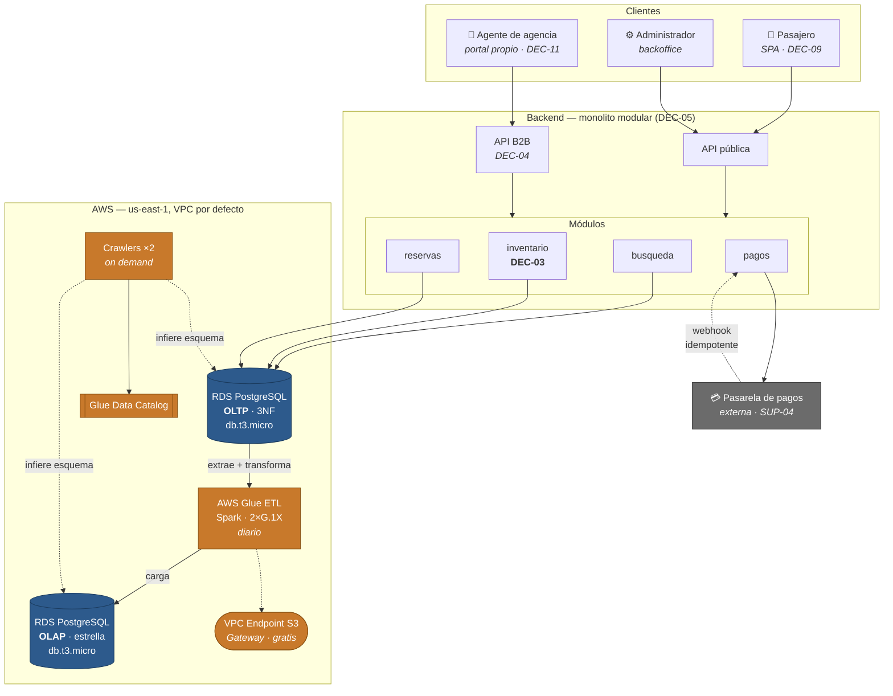
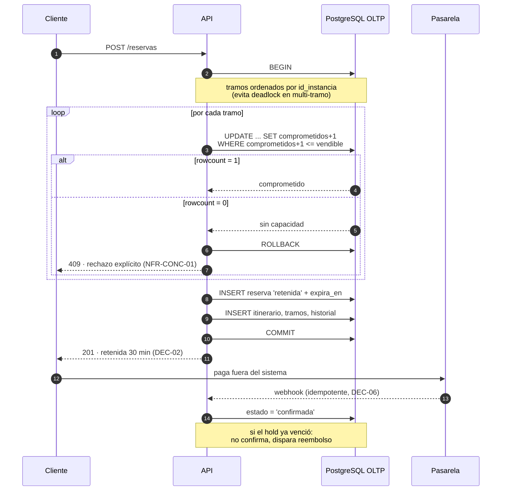
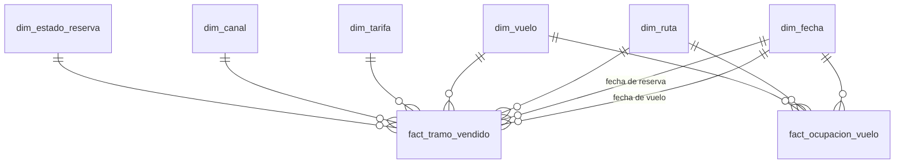

# Diagramas de arquitectura

> Entregable de 5.7: *"diagrama de arquitectura actualizado que muestre ambas bases,
> el proceso ETL y su relación con el Glue Data Catalog"*.

---

## 1. Arquitectura general

> **Vista de diseño (06/09).** La arquitectura tal como quedó desplegada en AWS —con la EC2 de la
> aplicación, el ETL en Python y el job de Glue que puebla `raw/` y `processed/`— está en
> [`arquitectura-aws-desplegada.png`](arquitectura-aws-desplegada.png) y en la sección 5.7.
> Dos diferencias con este diagrama, declaradas como desviaciones en 5.7: el ETL OLTP → OLAP
> corre en la EC2 y no en Glue, y las dos bases quedan en el catálogo **a través de sus copias
> en S3** (3 crawlers, uno por zona), no con crawlers JDBC directos sobre las bases.

**Lo que muestra este diagrama y hay que poder defender:**

- **Una sola base transaccional** para los dos canales: el inventario es único, así que un
  pasajero web y una agencia compiten por el mismo asiento sin coordinación adicional.
- **La analítica nunca toca el OLTP** (`DEC-08`). La flecha va del OLTP al ETL y del ETL al
  OLAP; no hay ninguna flecha de reportes hacia el OLTP.
- **La pasarela está fuera del recuadro de AWS**: el sistema no ve datos de tarjeta
  (`SUP-04`, `NFR-SEG-01`).
- **El VPC Endpoint es lo que evita el NAT Gateway** y su costo por hora.

---

## 2. Flujo de una reserva — dónde actúa cada decisión

---

## 3. Modelo dimensional del OLAP — constelación

**Dos hechos, no uno.** Las preguntas de `FR-19` tienen granos distintos: ingresos y
cancelaciones se miden por **tramo vendido**; la ocupación, por **instancia de vuelo**. Un
único hecho a grano de tramo no conocería los vuelos que no vendieron nada — y ésos son
justamente los que hacen bajar el promedio de ocupación.

Las dimensiones compartidas (`dim_fecha`, `dim_ruta`, `dim_vuelo`) hacen que esto sea una
**constelación**, no dos estrellas independientes: se puede cruzar ocupación con ingresos
por la misma ruta y la misma fecha.

---

## 4. Modelo entidad-relación del OLTP

El diagrama Crow's Foot completo está en
[`../documento/03-modelo-er.md`](../documento/03-modelo-er.md#diagrama-entidad-relación),
junto al diccionario de datos de las 14 entidades.

---

> Los diagramas están en Mermaid: se renderizan solos en GitHub y viven en texto plano, así
> que versionan y se revisan con `git diff` como cualquier otro archivo del repo. Para
> exportarlos a imagen: [mermaid.live](https://mermaid.live).
