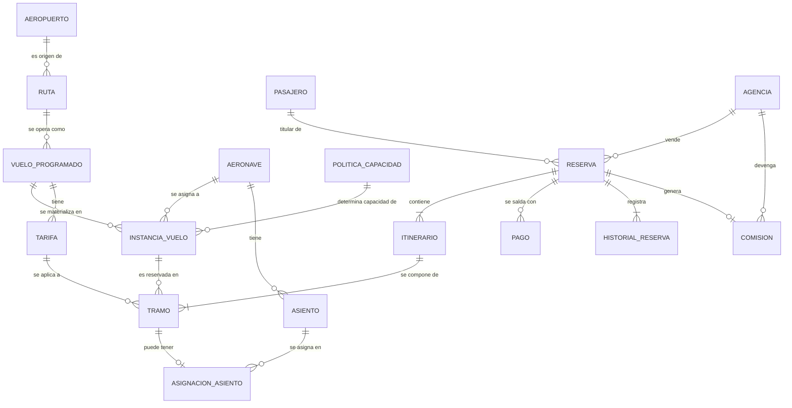

# 5.3 Modelo entidad-relación

> **Estado:** 🟡 borrador — 06/09
> **Peso en la rúbrica:** 15%
> **Notación:** Crow's Foot (consistente en todo el diagrama)

## Qué exige la rúbrica

| Nivel | Criterio |
|---|---|
| Insuficiente | No resuelve escalas ni control de sobreventa |
| Aceptable | Modelo funcional pero con decisiones injustificadas |
| **Sobresaliente** | **Modelo coherente que resuelve explícitamente escalas, vuelos recurrentes e inventario de asientos, con justificación** |

Los tres nudos del nivel Sobresaliente son innegociables.

---

## Los tres nudos, desatados

### 1. Multi-tramo y escalas → `DEC-01`

**Decisión: `Itinerario` es una entidad propia entre `Reserva` y `Tramo`.**

```
Reserva ──1:N──▶ Itinerario ──1:N──▶ Tramo ──N:1──▶ InstanciaVuelo
```

Tres niveles, y cada uno existe por un motivo distinto:

- **`Reserva`** es la unidad **comercial**: un pago, un código de reserva, un titular.
- **`Itinerario`** es la unidad **de viaje**: ida y vuelta son dos itinerarios de la misma reserva.
- **`Tramo`** es la unidad **operativa**: un vuelo concreto, con su clase y su tarifa aplicada.

**Alternativa descartada:** `Reserva ──1:N──▶ Vuelo` directo. Es más simple, pero no tiene
dónde alojar el **orden** de los tramos ni la distinción ida/vuelta, y obliga a inferir la
conexión comparando horarios. Tampoco admite que un tramo lo opere otra aerolínea
(*codeshare*), porque el operador sería un atributo de una relación sin entidad.

> Es el modelo que usa la industria real: PNR → Ticket → Cupón, uno por tramo.

### 2. Vuelos recurrentes → `VueloProgramado` vs `InstanciaVuelo`

**Decisión: dos entidades separadas.**

| Entidad | Qué representa | Ejemplo |
|---|---|---|
| `VueloProgramado` | La **regla**: un vuelo que se repite | *AV-8020, BOG→MDE, sale 07:30, lunes a viernes, vigente ene–dic* |
| `InstanciaVuelo` | El **hecho**: ese vuelo en una fecha concreta | *AV-8020 del 12/09/2026, aeronave HK-4812, 24 asientos vendidos* |

**Por qué es forzoso separarlas.** Todo lo que cambia por fecha —la aeronave asignada, los
asientos vendidos, el estado (programado / en vuelo / cancelado)— **no puede vivir en la
regla**. Si se guardara todo en una sola entidad `Vuelo`, o se repite la definición de la ruta
y el horario 365 veces al año, o no hay dónde poner el inventario del martes.

**Y tiene una consecuencia directa sobre la concurrencia:** el bloqueo de `DEC-03` se toma
sobre la **instancia**, no sobre el programado. Dos personas comprando el vuelo del martes no
compiten con las que compran el del miércoles.

### 3. Inventario de asientos → vive en `InstanciaVuelo`

**Decisión: el inventario es un contador versionado en `InstanciaVuelo`, no una fila por asiento.**

```
InstanciaVuelo
  ├── capacidad_vendible_eco     ← f(capacidad_física, política)   FR-17
  ├── capacidad_vendible_bus
  ├── asientos_comprometidos_eco ← confirmados + retenidos vigentes
  ├── asientos_comprometidos_bus
  └── version                    ← columna del bloqueo optimista   DEC-03
```

El invariante que el sistema garantiza (`FR-07`, `NFR-CONC-01`) es:

```
asientos_comprometidos ≤ capacidad_vendible
```

**Nótese contra qué se compara: contra la capacidad *vendible*, no contra la física.** Es la
materialización de `FR-17`, y es lo que permite que *"ahora hay overbooking del 5 %"* sea un
cambio de parámetro y no un rediseño.

**Alternativa descartada:** una fila por asiento con estado (`libre`/`retenido`/`vendido`), y
la venta como un `UPDATE` sobre la primera fila libre. Es intuitivo y da asignación de asiento
gratis, pero:

- La contención pasa a ser **por asiento**, no por vuelo: dos compradores que quieren
  *cualquier* asiento pelean por la misma fila concreta sin necesidad.
- Obliga a materializar 180 filas por cada instancia de vuelo, ~10.800 por día (`SUP-01`),
  para representar algo que un contador resuelve con dos enteros.
- Acopla **vender** con **asignar asiento**, que son dos momentos distintos del negocio.

### 4. Asignación de asiento → separada de la compra

**Decisión: se vende *capacidad*, se asigna *asiento* después (check-in), en `AsignacionAsiento`.**

> ⚠️ **Ésta es la decisión de esta sección que conviene que confirmes** — las otras tres
> estaban prácticamente forzadas por el enunciado y por `DEC-01`/`DEC-03`; ésta es una
> elección real con alternativa legítima.

Motivos:

1. **Es lo que hace el negocio real.** Se compra el derecho a volar; el asiento se elige en el
   check-in, o se paga aparte.
2. **Simplifica la concurrencia.** Comprar compite por un contador; elegir asiento compite por
   una fila específica. Separarlos evita que la operación crítica cargue con el conflicto de la
   accesoria.
3. **Deja la puerta abierta al asiento como producto vendible** sin tocar el núcleo.

**Alternativa:** asignar el asiento en la compra. Más simple para el usuario, pero mete la
selección de asiento dentro de la transacción crítica de `FR-07`.

### 5. Nivel de normalización → 3NF en OLTP, desnormalizado en OLAP

El enunciado pregunta qué nivel se justifica *"dado que este modelo alimenta tanto el sistema
transaccional como el pipeline de Big Data"*. **La respuesta es que no hay un solo nivel, y
ésa es precisamente la razón de ser de la sección 5.7.**

| | OLTP (transaccional) | OLAP (analítico) |
|---|---|---|
| Normalización | **3NF** | **Desnormalizado** (esquema estrella) |
| Optimizado para | Escrituras concurrentes, integridad | Lecturas agregadas sobre históricos |
| Por qué | Cada dato en un solo lugar → sin anomalías de actualización, y el bloqueo de `DEC-03` toca una fila | Los joins de `FR-19` (ocupación por ruta, ingresos por tarifa) sobre 3NF cruzarían 6 tablas por consulta |

Forzar un solo modelo para ambos usos penaliza alguno de los dos: un OLTP desnormalizado
sufre anomalías y amplía la contención; un OLAP en 3NF hace lento cada reporte. **La copia vía
ETL a una segunda base (5.7) no es un capricho del enunciado: es la consecuencia de esta
decisión de modelado.**

---

## Diagrama entidad-relación



> Cardinalidades en Crow's Foot: `||` uno y sólo uno · `|{` uno o muchos · `o{` cero o muchos · `o|` cero o uno.
> Versión exportable del diagrama en `../diagramas/modelo-er.*`.

---

## Diccionario de datos

### `AEROPUERTO`
| Atributo | Tipo | Nulo | Descripción |
|---|---|---|---|
| `codigo_iata` **PK** | CHAR(3) | No | Código IATA (BOG, MDE) |
| `nombre` | VARCHAR(120) | No | Nombre del aeropuerto |
| `ciudad`, `pais` | VARCHAR(80) | No | Ubicación |
| `zona_horaria` | VARCHAR(40) | No | IANA (`America/Bogota`). **Necesario**: sin esto no se calcula duración real de conexión |

### `RUTA`
| Atributo | Tipo | Nulo | Descripción |
|---|---|---|---|
| `id_ruta` **PK** | BIGINT | No | |
| `origen` **FK** → AEROPUERTO | CHAR(3) | No | |
| `destino` **FK** → AEROPUERTO | CHAR(3) | No | |
| `duracion_estimada_min` | INT | No | Base para validar tiempos mínimos de conexión (`FR-02`) |

*Restricción: `origen <> destino`; único por (origen, destino).*

### `AERONAVE`
| Atributo | Tipo | Nulo | Descripción |
|---|---|---|---|
| `matricula` **PK** | VARCHAR(10) | No | |
| `modelo` | VARCHAR(60) | No | |
| `capacidad_fisica_eco` | INT | No | **Capacidad física.** No es la vendible |
| `capacidad_fisica_bus` | INT | No | |

### `VUELO_PROGRAMADO` — la *regla*
| Atributo | Tipo | Nulo | Descripción |
|---|---|---|---|
| `id_vuelo_prog` **PK** | BIGINT | No | |
| `numero_vuelo` | VARCHAR(8) | No | Designador comercial (AV-8020) |
| `id_ruta` **FK** | BIGINT | No | |
| `hora_salida_local`, `hora_llegada_local` | TIME | No | Hora, sin fecha: es la regla |
| `dias_operacion` | VARCHAR(7) | No | Máscara `LMXJVSD` |
| `vigencia_desde`, `vigencia_hasta` | DATE | No | Temporada comercial |

### `INSTANCIA_VUELO` — el *hecho*, y el corazón de la concurrencia
| Atributo | Tipo | Nulo | Descripción |
|---|---|---|---|
| `id_instancia` **PK** | BIGINT | No | |
| `id_vuelo_prog` **FK** | BIGINT | No | |
| `fecha_operacion` | DATE | No | |
| `matricula` **FK** → AERONAVE | VARCHAR(10) | Sí | Puede asignarse después |
| `capacidad_vendible_eco` | INT | No | **`= f(capacidad_física, política)`** — `FR-17` |
| `capacidad_vendible_bus` | INT | No | |
| `asientos_comprometidos_eco` | INT | No | Confirmados **+ retenidos vigentes** |
| `asientos_comprometidos_bus` | INT | No | |
| `version` | BIGINT | No | **Columna del bloqueo optimista** — `DEC-03` |
| `estado` | ENUM | No | `programado` / `en_vuelo` / `aterrizado` / `cancelado` |

*Restricción de negocio (`FR-07`): `asientos_comprometidos_* ≤ capacidad_vendible_*`. Único por (id_vuelo_prog, fecha_operacion).*

### `POLITICA_CAPACIDAD` — lo que hace parametrizable el overbooking
| Atributo | Tipo | Nulo | Descripción |
|---|---|---|---|
| `id_politica` **PK** | BIGINT | No | |
| `ambito` | ENUM | No | `global` / `ruta` / `vuelo_programado` |
| `id_referencia` | BIGINT | Sí | A qué aplica, según ámbito |
| `factor_sobreventa` | DECIMAL(4,3) | No | **1.000 = sin overbooking.** 1.050 = 5 % |
| `vigencia_desde`, `vigencia_hasta` | DATE | No | |

> Esta entidad es la respuesta preparada a *"ahora se permite overbooking"*. Sin ella, esa
> variación exigiría tocar el modelo; con ella, es una fila nueva.

### `TARIFA`
| Atributo | Tipo | Nulo | Descripción |
|---|---|---|---|
| `id_tarifa` **PK** | BIGINT | No | |
| `id_vuelo_prog` **FK** | BIGINT | No | |
| `clase` | ENUM | No | `economica` / `business` |
| `antelacion_min_dias`, `antelacion_max_dias` | INT | No | Ventana de compra (`FR-03`) |
| `precio_base` | DECIMAL(12,2) | No | |
| `moneda` | CHAR(3) | No | `SUP-08`: se guarda aunque hoy sea siempre COP |
| `penalidad_cambio` | DECIMAL(12,2) | No | `SUP-06`, `FR-10`. Parámetro, no constante |

### `PASAJERO`
| Atributo | Tipo | Nulo | Descripción |
|---|---|---|---|
| `id_pasajero` **PK** | BIGINT | No | |
| `tipo_documento`, `numero_documento` | VARCHAR | No | Único combinado |
| `nombre`, `apellido` | VARCHAR(80) | No | **Cifrado en reposo** — `NFR-SEG-02` |
| `email`, `telefono` | VARCHAR(120) | No | Cifrado en reposo |
| `anonimizado_en` | TIMESTAMP | Sí | Soporta derecho al olvido sin borrar hechos contables |

### `AGENCIA`
| Atributo | Tipo | Nulo | Descripción |
|---|---|---|---|
| `id_agencia` **PK** | BIGINT | No | |
| `nombre`, `nit` | VARCHAR | No | |
| `porcentaje_comision` | DECIMAL(5,2) | No | `FR-14` |
| `descuento_negociado` | DECIMAL(5,2) | No | `FR-13` |
| `minutos_retencion` | INT | No | **`FR-15`**: plazo mayor que el del pasajero |

### `RESERVA`
| Atributo | Tipo | Nulo | Descripción |
|---|---|---|---|
| `id_reserva` **PK** | BIGINT | No | |
| `codigo_reserva` | CHAR(6) | No | PNR, único. Lo que usa el pasajero (`FR-11`) |
| `id_pasajero` **FK** | BIGINT | No | |
| `id_agencia` **FK** | BIGINT | Sí | Nulo = venta directa. **Distingue el canal** |
| `estado` | ENUM | No | `retenida` / `confirmada` / `cancelada` / `expirada` |
| `creada_en` | TIMESTAMP | No | |
| `expira_en` | TIMESTAMP | Sí | **Sólo si `retenida`** — `DEC-02`, `NFR-CONC-02` |
| `monto_total`, `moneda` | DECIMAL/CHAR | No | |

### `ITINERARIO`
| Atributo | Tipo | Nulo | Descripción |
|---|---|---|---|
| `id_itinerario` **PK** | BIGINT | No | |
| `id_reserva` **FK** | BIGINT | No | |
| `sentido` | ENUM | No | `ida` / `vuelta` |
| `orden` | SMALLINT | No | Para itinerarios múltiples |

### `TRAMO` — la unidad operativa
| Atributo | Tipo | Nulo | Descripción |
|---|---|---|---|
| `id_tramo` **PK** | BIGINT | No | |
| `id_itinerario` **FK** | BIGINT | No | |
| `id_instancia` **FK** → INSTANCIA_VUELO | BIGINT | No | |
| `orden` | SMALLINT | No | **Secuencia dentro del itinerario**: resuelve las escalas |
| `clase` | ENUM | No | |
| `id_tarifa` **FK** | BIGINT | No | Tarifa aplicada |
| `precio_aplicado` | DECIMAL(12,2) | No | **Congelado al reservar**: la tarifa puede cambiar después |
| `operado_por` | VARCHAR(60) | Sí | Transportista. Nulo = propio. **Prepara codeshare** |

### `PAGO`
| Atributo | Tipo | Nulo | Descripción |
|---|---|---|---|
| `id_pago` **PK** | BIGINT | No | |
| `id_reserva` **FK** | BIGINT | No | |
| `id_transaccion_pasarela` | VARCHAR(80) | No | **Referencia externa** |
| `estado` | ENUM | No | `pendiente` / `aprobado` / `rechazado` / `reembolsado` |
| `monto`, `moneda` | DECIMAL/CHAR | No | |

> ⚠️ **No hay ninguna columna de datos de tarjeta, y es deliberado** (`SUP-04`,
> `NFR-SEG-01`). Su ausencia es una decisión de arquitectura con motivo regulatorio.

### `HISTORIAL_RESERVA` — append-only
| Atributo | Tipo | Nulo | Descripción |
|---|---|---|---|
| `id_historial` **PK** | BIGINT | No | |
| `id_reserva` **FK** | BIGINT | No | |
| `estado_anterior`, `estado_nuevo` | ENUM | Sí/No | |
| `actor_tipo`, `actor_id` | VARCHAR | No | Quién lo hizo (`NFR-AUD-01`) |
| `motivo` | VARCHAR(200) | Sí | |
| `ocurrido_en` | TIMESTAMP | No | |

*Sin `UPDATE` ni `DELETE`: sólo inserción. Es la fuente de los patrones de cancelación de `FR-19`.*

### `ASIENTO` y `ASIGNACION_ASIENTO`
| `ASIENTO` | Tipo | Descripción |
|---|---|---|
| `id_asiento` **PK** | BIGINT | |
| `matricula` **FK** | VARCHAR(10) | Pertenece a la aeronave, no al vuelo |
| `fila`, `columna`, `clase` | | `12A`, económica |

| `ASIGNACION_ASIENTO` | Tipo | Descripción |
|---|---|---|
| `id_asignacion` **PK** | BIGINT | |
| `id_tramo` **FK** | BIGINT | Único |
| `id_asiento` **FK** | BIGINT | |
| `asignado_en` | TIMESTAMP | Momento del check-in |

*Único por (id_asiento, instancia de vuelo del tramo): un asiento, un pasajero, por vuelo.*

### `COMISION`
| Atributo | Tipo | Descripción |
|---|---|---|
| `id_comision` **PK** | BIGINT | |
| `id_reserva` **FK**, `id_agencia` **FK** | BIGINT | `FR-14` |
| `monto` | DECIMAL(12,2) | Congelado al confirmar |
| `estado_liquidacion` | ENUM | `devengada` / `liquidada` |

---

## Trazabilidad: qué requisito origina cada decisión

| Decisión de modelado | Requisito que la origina |
|---|---|
| `Itinerario` como entidad (`DEC-01`) | `FR-02` (escalas) |
| `VueloProgramado` / `InstanciaVuelo` | `FR-16` (vuelos que se repiten), `NFR-CONC-01` |
| Contador + `version` en `InstanciaVuelo` | `FR-07`, `NFR-CONC-01`, `DEC-03` |
| `capacidad_vendible` ≠ `capacidad_fisica` | **`FR-17`** |
| `expira_en` en `Reserva` | `FR-05`, `NFR-CONC-02`, `DEC-02` |
| `id_agencia` nulable + `minutos_retencion` | `FR-13`, `FR-15`, `DEC-04` |
| `Pago` sin datos de tarjeta | `SUP-04`, `NFR-SEG-01` |
| `HistorialReserva` append-only | `NFR-AUD-01`, `FR-18` |
| `anonimizado_en` en `Pasajero` | `NFR-SEG-02`, derecho al olvido |
| 3NF en OLTP / estrella en OLAP | `FR-19`, y motiva toda la sección 5.7 |

## Defensa: qué se rompe si esto cambia (§7)

| Si cambia… | Qué se toca | Costo | Alternativa ya considerada |
|---|---|---|---|
| **Overbooking del 5 %** | Una fila en `POLITICA_CAPACIDAD`. **Ninguna tabla cambia**, ningún invariante se reescribe | **Nulo** | Invariante contra `capacidad_fisica`: descartado precisamente por esto |
| **Codeshare con otra aerolínea** | El atributo `operado_por` en `TRAMO` **ya existe**. Se agrega la aerolínea al catálogo | **Bajo** | `Reserva → Vuelo` directo: no tendría dónde poner el operador por tramo |
| **El asiento pasa a venderse en la compra** | `ASIGNACION_ASIENTO` se crea junto al `TRAMO` en vez de en el check-in. **El modelo no cambia**, cambia el momento de la inserción | Bajo | Es la alternativa evaluada en el nudo 4 |
| **Viajero frecuente** | Entidades nuevas colgando de `PASAJERO` y una dimensión más en `TARIFA`. **No toca inventario ni concurrencia** | Medio, aislado | Excluido en `SUP-05` |
| **Volumen ×100** | Nada estructural. `INSTANCIA_VUELO` se particiona por `fecha_operacion`; el histórico se archiva. La contención **no** crece: sigue siendo por vuelo | Medio, operativo | Fila por asiento: habría multiplicado el problema por 180 |
| **Derecho al olvido de un pasajero** | `anonimizado_en` **ya está**: se borran los datos personales y se conservan los hechos. Las reservas siguen contando para ocupación e ingresos | **Bajo** | Borrado en cascada: rompería la contabilidad y la liquidación de comisiones |
| **Un tramo se cancela pero el resto vuela** | `TRAMO` tiene identidad propia, así que puede cancelarse solo. Con `Reserva → Vuelo` directo habría que cancelar todo | **Bajo** | Es la segunda ventaja comprada con `DEC-01` |
