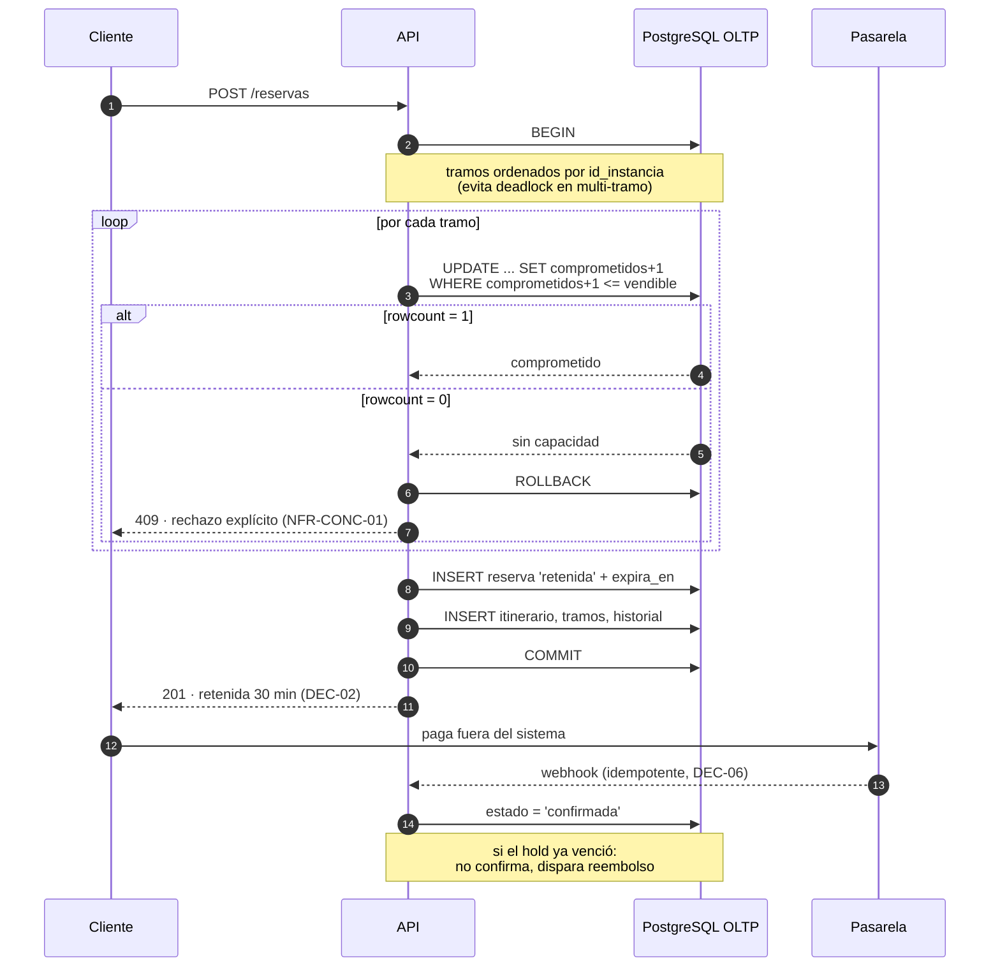

# 5.4 Arquitectura backend

> **Estado:** 🟡 decisiones cerradas 06/09 · redacción final tras implementar 5.6
> **Peso en la rúbrica:** 15% (compartido con 5.5)

**Por qué se redactó en dos tiempos:** las decisiones se cerraron antes de programar, porque
eran el input de 5.6; los ajustes que aparecieron al implementar se declaran al final de esta
sección. Escribir la sección entera antes de tocar código obliga a reescribirla o a ocultar
los ajustes.

## Qué exige la rúbrica para "Sobresaliente"

> *"Cada decisión conecta explícitamente con un NFR o FR específico, especialmente el
> manejo de concurrencia."*

---

## Tabla de decisiones

| ID | Decisión | Alternativa descartada | Requisito que la sustenta | Justificación |
|---|---|---|---|---|
| `DEC-01` | **Itinerario como entidad** entre Reserva y Tramo | `Reserva → Vuelo` directo | `FR-02` | Sin entidad intermedia no hay dónde alojar el orden de los tramos ni el operador por tramo. Detalle en 5.3 |
| `DEC-02` | **Hold temporal**: la reserva nace `retenida` con vencimiento y pasa a `confirmada` al acreditarse el pago | Pago atómico con la reserva | `FR-04`, `FR-05`, `FR-15`, `RSK-05` | Desacopla la disponibilidad del sistema de la de la pasarela. Habilita el plazo diferenciado que necesitan las agencias |
| `DEC-03` | **Bloqueo optimista con reintentos** sobre `InstanciaVuelo` | Bloqueo pesimista · cola por vuelo | **`NFR-CONC-01`**, `FR-07` | No serializa las ventas del mismo vuelo, que es justo lo que duele en el pico de `SUP-03` |
| `DEC-04` | **API B2B separada** sobre el mismo núcleo | Misma API con rol distinto | `FR-12`–`FR-15`, `NFR-SEG-02` | Contratos, autenticación y límites distintos, sin duplicar reglas de negocio |
| `DEC-05` | **Monolito modular**: un solo desplegable con módulos de frontera explícita | Microservicios por dominio | **`NFR-CONC-01`**, `SUP-01` | Ver el análisis ⬇: partir en servicios convertiría el invariante de inventario en una transacción distribuida |
| `DEC-06` | **Pago delegado íntegramente**, confirmado por *webhook* idempotente | Manejar parte del flujo de cobro | `SUP-04`, `NFR-SEG-01` | Mantiene el alcance PCI en el mínimo. La idempotencia es obligatoria: los webhooks se reintentan |
| `DEC-07` | **Expiración de holds en dos capas**: barrido programado + filtrado perezoso en lectura | Sólo un job periódico | `NFR-CONC-02`, `RSK-05` | El barrido garantiza la liberación; el filtrado evita que un hold vencido cuente aunque el barrido no haya pasado |
| `DEC-08` | **Analítica sobre base separada**, nunca sobre la transaccional | Reportes contra el OLTP | `NFR-PERF-01`, `NFR-CONC-01`, `FR-19` | Un reporte de ocupación compitiendo con las reservas degrada las dos cosas. Es el puente a 5.7 |

---

## Preguntas guía — respondidas

### ¿Monolito o servicios separados? → `DEC-05`

**Monolito modular.** Y el argumento decisivo no es la simplicidad: **es el propio requisito
de concurrencia.**

Una reserva multi-tramo tiene que comprometer inventario en **N `InstanciaVuelo` a la vez, de
forma todo-o-nada**. Si un pasajero reserva BOG→MDE→MIA y hay lugar en el primer tramo pero no
en el segundo, no puede quedar medio confirmado.

| | Monolito | Servicios separados |
|---|---|---|
| Comprometer N tramos | **Una transacción local.** `COMMIT` o `ROLLBACK` | Transacción distribuida: *saga* con compensaciones |
| Garantía sobre `NFR-CONC-01` | **Atomicidad real** del motor | Consistencia **eventual**: existe una ventana donde el tramo 1 está tomado y el 2 falló |
| Costo de operar | Un desplegable | N servicios, N pipelines, observabilidad distribuida |

`NFR-CONC-01` exige *"exactamente M, nunca M+1"*. **La consistencia eventual no puede
garantizar eso**: puede converger a un estado correcto, pero admite una ventana intermedia
donde el invariante no se cumple. Partir el sistema en servicios obligaría a debilitar el
requisito más importante del trabajo para ganar una escalabilidad que `SUP-01` no pide.

Y la escala lo confirma: 250 reservas/minuto en pico (`SUP-03`) son ~4 por segundo. Una sola
instancia de aplicación las atiende sin transpirar. **El cuello de botella real es la lectura**
(`NFR-ESC-01`), y eso se resuelve con caché y réplicas, no partiendo el dominio.

**Módulos con frontera explícita** (`busqueda`, `reservas`, `inventario`, `pagos`, `agencias`,
`administracion`): comunicación sólo por interfaces públicas del módulo, sin acceso cruzado a
tablas. Si mañana el volumen lo justifica, `busqueda` es lo primero que se extrae — es de sólo
lectura y no participa del invariante.

### ¿Cómo se garantiza que no se sobrevenda? → `DEC-03`

**Bloqueo optimista con reintentos.** El mecanismo concreto:

```sql
UPDATE instancia_vuelo
   SET asientos_comprometidos_eco = asientos_comprometidos_eco + :n,
       version                    = version + 1
 WHERE id_instancia = :id
   AND version      = :version_leida
   AND asientos_comprometidos_eco + :n <= capacidad_vendible_eco;
```

**Dónde vive exactamente la garantía.** La condición
`asientos_comprometidos + n <= capacidad_vendible` está **dentro del `UPDATE`**, así que el
motor la evalúa con la fila bloqueada durante la escritura. Dos transacciones simultáneas se
serializan en ese punto: la segunda ve el valor ya actualizado por la primera. Nunca hay
lectura sucia ni condición de carrera.

- **1 fila afectada** → comprometido.
- **0 filas** → o bien cambió la `version` (alguien más tocó la instancia: **reintentar**,
  hasta 3 veces con espera exponencial), o bien ya no hay capacidad (**rechazar** con
  `409 Conflict` y un mensaje explícito, que es lo que `NFR-CONC-01` exige).

Distinguir ambos casos requiere una relectura tras el fallo. Es el costo del enfoque
optimista, y se paga sólo en el camino infeliz.

**El detalle que casi nadie ve: el orden de bloqueo.** Con reservas multi-tramo, dos
transacciones que toquen las mismas instancias en orden distinto se abrazan en un *deadlock*.
Se evita **actualizando siempre en orden ascendente de `id_instancia`**. Es una línea de
código y elimina una clase entera de fallos intermitentes.

**Por qué no las alternativas:**

| Alternativa | Por qué se descartó |
|---|---|
| **Bloqueo pesimista** (`SELECT FOR UPDATE`) | Correcto y más fácil de explicar, pero **serializa todas las ventas del mismo vuelo**. En el pico de `SUP-03` —que es cuando muchos compran el mismo vuelo— es exactamente el peor momento para hacer cola |
| **Cola que serializa por vuelo** | Escala y desacopla, pero vuelve **asíncrona** la respuesta ("tu reserva está en proceso"), suma un componente a operar, y no aporta nada a la escala de `SUP-01` |

La contención del enfoque optimista depende de **cuántos compiten por el mismo vuelo**, no del
volumen total. Con 60 vuelos diarios y 250 reservas/min repartidas entre ellos, los reintentos
son raros. Si en el futuro un vuelo concreto se volviera muy disputado, la cola es la salida
natural — y por eso queda documentada, no descartada para siempre.

### ¿Cómo se integra el pago? → `DEC-06`

**Delegado por completo** (`SUP-04`). El sistema nunca ve datos de tarjeta.

```
1. POST /reservas              → reserva `retenida`, inventario comprometido, expira_en = ahora + 30 min
2. Se crea la intención de pago en la pasarela → el cliente paga fuera del sistema
3. Webhook de la pasarela      → transición a `confirmada`
4. Si no llega en el plazo     → DEC-07 expira la reserva y libera inventario
```

Dos exigencias que esto impone:

**Idempotencia (obligatoria).** Las pasarelas reintentan los webhooks. El mismo
`id_transaccion_pasarela` debe procesarse una sola vez: se guarda con restricción de unicidad
y el reintento es un no-op que responde `200`. Sin esto, un reintento confirmaría dos veces.

**El caso feo: el pago llega después de que expiró el hold.** Es real y hay que responderlo.
El manejador del webhook **revalida la capacidad** antes de confirmar:

- Si todavía hay lugar → se confirma igual (el cliente pagó, y el inventario estaba).
- Si ya no hay → **no se confirma**: se dispara el reembolso automático y se notifica.

Es preferible reembolsar a un pasajero que incumplir `FR-07`. La alternativa —confirmar
igual— sería vender un asiento que no existe, que es precisamente lo que todo el diseño evita.

### ¿Cómo se exponen los servicios a las agencias? → `DEC-04`

**Una API B2B separada sobre el mismo núcleo de dominio.**

| | API pública | API B2B |
|---|---|---|
| Autenticación | Sesión / JWT de usuario | **Credenciales de cliente por agencia**, rotables (`FR-12`) |
| Precios | Tarifa pública | Tarifa con **descuento negociado** (`FR-13`) |
| Retención | 30 min | **Configurable por agencia** (`FR-15`) |
| Límite de uso | Por sesión | Por agencia, contractual |
| Comisión | — | Se devenga por venta (`FR-14`) |

Lo que **no** se duplica: búsqueda, inventario, reglas de tarifa, invariante de sobreventa.
Ambas APIs llaman a los mismos módulos. La agencia no es un rol dentro de la API pública
porque su **contrato** es distinto —versionado, límites y ciclo de vida propios—, no sólo
sus permisos.

Consecuencia para `NFR-CONC-01`: como el inventario es único y compartido, **un pasajero web y
una agencia compiten por el mismo asiento sin ninguna coordinación adicional**. Un inventario
segmentado por canal —la alternativa— fragmentaría la disponibilidad y dejaría asientos sin
vender en un canal mientras se agotan en otro.

### ¿Cómo se relaciona con el pipeline de Big Data? → `DEC-08`

**La analítica nunca consulta la base transaccional.** Ésa es la decisión, y tiene un motivo
de concurrencia, no de comodidad:

Una consulta de *"ocupación por ruta del último trimestre"* (`FR-19`) recorre millones de
filas históricas. Corriéndola contra el OLTP:

- Compite por I/O y memoria con las reservas en curso → rompe `NFR-PERF-01`.
- Mantiene abiertas lecturas largas sobre `InstanciaVuelo` → aumenta la contención que
  `DEC-03` busca minimizar.

```
        ESCRITURA                                    LECTURA ANALÍTICA
   ┌──────────────────┐                          ┌────────────────────┐
   │  OLTP PostgreSQL │  ──────── ETL ────────►  │  OLAP PostgreSQL   │
   │  3NF · DEC-03    │                          │  estrella · FR-19  │
   └──────────────────┘                          └────────────────────┘
            │                                              │
            └──── copias en S3, catalogadas en Glue ───────┘
```

Cómo quedó implementado cada tramo —dónde corre el ETL y cómo llegan las dos bases al Glue
Data Catalog— se detalla en 5.7.

Las fuentes naturales del ETL ya existen en el modelo de 5.3: `HISTORIAL_RESERVA`
(append-only) da los patrones de cancelación, y `TRAMO` + `INSTANCIA_VUELO` dan ocupación e
ingresos. **El diseño de 5.3 ya preparó el terreno para 5.7.**

---

## Flujo de una reserva — dónde actúa cada decisión



## Ajustes que aparecieron durante la implementación

Implementar 5.6 no contradijo ninguna decisión de esta sección, pero precisó dos. Un ajuste no es
un error: es información que el diseño previo no tenía.

| Qué cambió | Por qué | Documento actualizado |
|---|---|---|
| **El pool de conexiones pasa a ser parte del mecanismo de `DEC-03`**, no un detalle de infraestructura | La primera versión de la API compartía una sola conexión. La prueba de concurrencia habría pasado **por el motivo equivocado**: sin conexiones paralelas no hay carrera que ganar, y el bloqueo optimista nunca se habría puesto a prueba | 5.4 (esta tabla) · 5.6 |
| **La expiración de holds pasa a dos capas** (`DEC-07`): barrido programado + filtrado perezoso en la lectura | Con sólo el barrido periódico queda una ventana en la que un hold vencido sigue contando como ocupado, y la búsqueda muestra menos asientos de los que hay | 5.4 — `DEC-07` |

Un tercer ajuste de 5.6 —`id_canal = 0` para la venta directa en el OLAP— es una transformación
del ETL y no toca el backend: se documenta en 5.7.

---

## Defensa: qué se rompe si esto cambia (§7)

| Si cambia… | Qué se toca | Costo | Alternativa ya considerada |
|---|---|---|---|
| **Overbooking del 5 %** | Nada del backend. La condición del `UPDATE` compara contra `capacidad_vendible`, que se calcula desde `POLITICA_CAPACIDAD` | **Nulo** | Comparar contra capacidad física: descartado en `FR-17` |
| **Un vuelo concreto se vuelve muy disputado y los reintentos se disparan** | Se pasa **ese vuelo** a cola serializada. El resto sigue optimista. La frontera del módulo `inventario` permite convivir con dos estrategias | Medio, acotado | La cola quedó documentada como alternativa, no descartada |
| **Hay que escalar a 10× el tráfico** | Réplicas de lectura + caché de disponibilidad. El módulo `busqueda` es el primero en extraerse: es de sólo lectura y no toca el invariante | Medio | Microservicios desde el inicio: costo de saga sin necesidad (`DEC-05`) |
| **La pasarela de pagos cae** | El hold sobrevive y vence solo (`DEC-02`, `DEC-07`). Las reservas nuevas se siguen creando `retenidas`; sólo se posterga la confirmación | **Bajo** — es el beneficio comprado con `DEC-02` | Pago atómico: la caída de la pasarela tiraría toda venta nueva |
| **Se exige confirmación instantánea sin webhook** | Cobro síncrono en la petición. Acopla el tiempo de respuesta al de la pasarela y pone en riesgo `NFR-PERF-01` | Medio | Es el modelo que `DEC-06` descartó |
| **Las agencias piden un SLA distinto al de la web** | La API B2B ya está separada: se le puede dar cuota, prioridad e infraestructura propias sin tocar la pública | **Bajo** | Rol dentro de la misma API: no permitiría diferenciar el SLA |
| **La analítica debe ser en tiempo real, no por lotes** | Cambia la frecuencia del ETL, o se pasa a CDC. **No cambia** el backend: la frontera de `DEC-08` sigue valiendo | Medio, aislado en 5.7 | Consultar el OLTP directamente: descartado por `NFR-PERF-01` |
