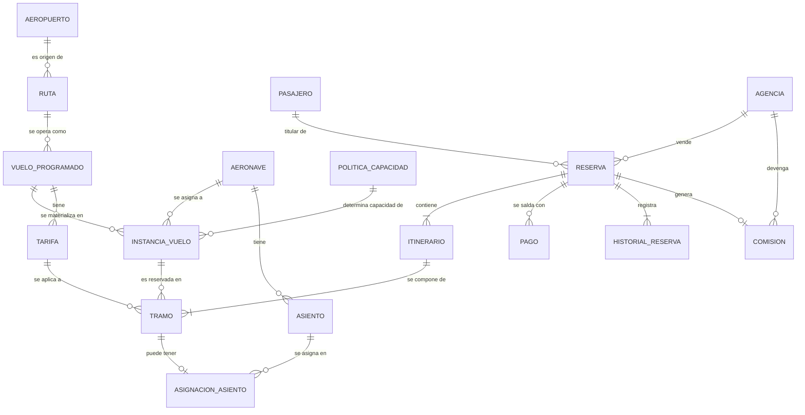
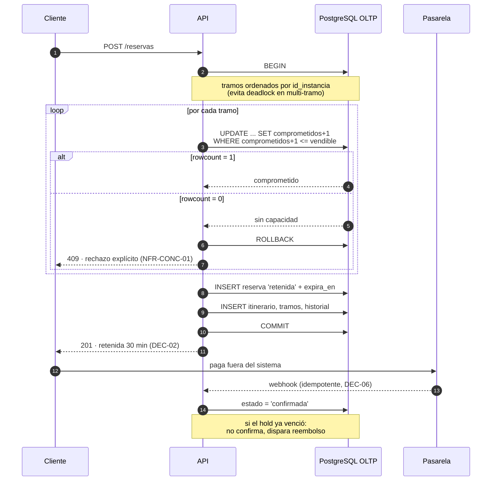
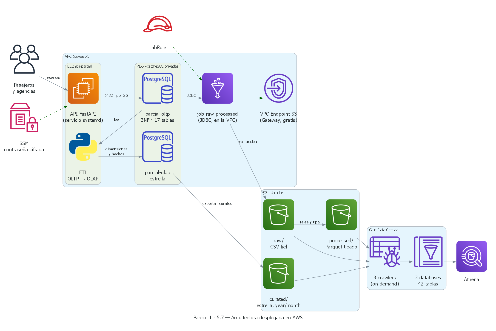
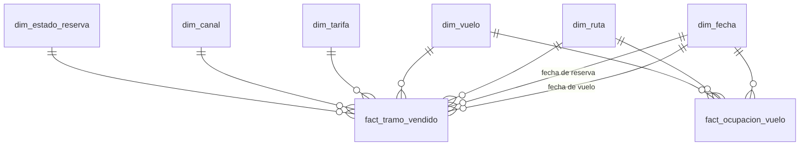

# Parcial 1 — Sistema de reservas de una aerolínea

**Big Data e Ingeniería de Datos (PCIA 5010)** · Universidad Sergio Arboleda

**Estudiante:** (nombre del estudiante) · **Modalidad:** individual · **Fecha:** 10 de septiembre de 2026

**Repositorio:** <https://github.com/Pipelol0723/bigdata-ing-datos> — carpeta `entregas/parcial-1-aerolinea/`

> Archivo generado por `entrega/construir_documento.py` a partir de `documento/`. Para
> corregir algo, editar la sección original y volver a correr el script.

# Cómo leer este documento

Reúne las secciones que pide la entrega final (§6 del enunciado), en su orden. Cada una responde
las preguntas guía y cierra con una tabla **"Defensa: qué se rompe si esto cambia"**: la
respuesta preparada para un cambio no previsto, que es el formato de la sustentación.

## Resumen

El problema central del sistema es **no vender dos veces el mismo asiento** cuando muchos compran
a la vez. Se resuelve con **bloqueo optimista** —la verificación de capacidad viaja dentro del
mismo `UPDATE`— y un `CHECK` en la tabla como segunda capa. La analítica corre en una **base
separada**, en esquema estrella, alimentada por ETL, y el histórico va a un **data lake en S3**
catalogado en Glue y consultado con Athena. Todo se desplegó en AWS, con las bases privadas
dentro de una VPC.

| Resultado | Cifra | Sección |
|---|---|---|
| Alcance del diseño | 9 supuestos · 19 `FR` · 10 `NFR` · 7 riesgos · 12 decisiones · 14 entidades (17 tablas) | 0 – 5.5 |
| Concurrencia: 30 pedidos simultáneos sobre 1 asiento | con el mecanismo, **1 de 30** · sin él, reservas de más con el contador en 1 (4 en local, 2 en AWS) | 5.6 |
| ETL OLTP → OLAP, en AWS | 141 dimensiones + 9.122 hechos en 2,4 s | 5.7 |
| Glue Data Catalog | 42 tablas en 3 databases | 5.7 |
| Athena, la misma consulta | 586.285 bytes en CSV contra 2.335 en Parquet (**≈ 250×**) | 5.7 |
| Costo | proyección ≈ $33/mes · gasto real del parcial ≈ $2,70 | 5.7 |

## Convenciones de identificadores

Toda decisión debe poder rastrearse hasta el requisito que la origina: todo lleva ID y toda
decisión cita los IDs que la sustentan.

| Prefijo | Significado | Ejemplo |
|---|---|---|
| `SUP-nn` | Supuesto declarado | `SUP-03` |
| `FR-nn` | Requisito funcional | `FR-07` |
| `NFR-<CAT>-nn` | Requisito no funcional | `NFR-CONC-01` |
| `DEC-nn` | Decisión de arquitectura | `DEC-04` |
| `RSK-nn` | Riesgo de negocio identificado | `RSK-02` |

Categorías de NFR: `PERF` (performance), `CONC` (consistencia y concurrencia), `DISP`
(disponibilidad), `SEG` (seguridad), `ESC` (escalabilidad), `AUD` (auditabilidad).

**Regla:** ninguna decisión de arquitectura entra al documento sin citar al menos un `FR-` o
`NFR-`. Si no se puede citar ninguno, o falta el requisito o sobra la decisión.

## Código fuente y evidencia

El código, los esquemas, los scripts de infraestructura y la evidencia cruda están en el
repositorio <https://github.com/Pipelol0723/bigdata-ing-datos>, carpeta `entregas/parcial-1-aerolinea/`. Las rutas que cita el documento
son relativas a esa carpeta.

| Carpeta | Contenido |
|---|---|
| `api/` | API FastAPI (5.6) y la prueba de concurrencia |
| `db/oltp/` · `db/olap/` | esquemas y datos de demostración |
| `etl/` | ETL OLTP → OLAP, exportación a `curated/` y job de Glue (5.7) |
| `infra/` | scripts de creación, instalación y baja de recursos en AWS |
| `evidencia/` | salidas crudas de las pruebas; las sesiones de AWS están en el Anexo B |
| `GUIA-EJECUCION-AWS.md` | paso a paso para levantar todo en AWS, probado de punta a punta |


# 0. Contexto y supuestos


## Por qué esta sección existe

El enunciado deja detalles sin especificar a propósito (cantidad de rutas, si hay programa
de viajero frecuente, si se permiten cambios de itinerario, qué pasa con el equipaje) y
advierte:

> *"un supuesto no declarado es una decisión de arquitectura escondida"*

Todo lo que no esté acá y aun así condicione el diseño, es una decisión invisible que no se
puede defender.

## Supuestos declarados

| ID | Supuesto | Por qué se asume esto | Qué secciones condiciona |
|---|---|---|---|
| `SUP-01` | **Escala:** 20 rutas, 60 vuelos diarios, 180 asientos promedio por aeronave (~10.800 asientos/día) | El enunciado dice "aerolínea regional" y no da números. Sin un orden de magnitud declarado, ningún NFR es verificable — y la rúbrica exige métricas concretas | 5.2 (todos los NFR), 5.4 (dimensionamiento), 5.7 (proyección de costos) |
| `SUP-02` | **Carga base:** 50 reservas/minuto en hora pico ordinaria; relación búsqueda:reserva de 50:1 (~2.500 búsquedas/min) | Ratio *look-to-book* habitual en venta aérea directa. Fija la carga de lectura, que domina el dimensionamiento | `NFR-PERF-01`, 5.4, 5.5 |
| `SUP-03` | **Temporada alta = ×5 la carga base** (250 reservas/min, 12.500 búsquedas/min) | Traduce a número el *"traffic spikes during peak season"* del enunciado, que no da cifras | `NFR-ESC-01`, `NFR-DISP-01`, 5.7 (escenario de crecimiento) |
| `SUP-04` | **El pago se delega íntegramente a una pasarela externa.** El sistema nunca almacena ni transporta datos de tarjeta; guarda sólo el identificador de transacción y su estado | Reduce drásticamente el alcance de cumplimiento PCI-DSS. Es la práctica estándar y es defendible como decisión, no como omisión | `NFR-SEG-01`, 5.4 (flujo de pago), 5.6 |
| `SUP-05` | **Sin programa de viajero frecuente** en el alcance de este parcial | El enunciado lo lista explícitamente como no especificado. Se excluye para acotar, no por olvido | 5.1, 5.3 |
| `SUP-06` | **Se permite cancelación. El cambio de fecha se modela como cancelación + nueva emisión**, con una penalidad parametrizable | Evita una entidad "modificación" con reglas propias sin perder el caso de uso. La penalidad como parámetro, no como constante, para que un cambio de política comercial no toque el modelo | 5.1, 5.3, 5.4 |
| `SUP-07` | **El equipaje queda fuera del alcance** | Listado como no especificado en el enunciado. No afecta al núcleo de inventario y concurrencia, que es lo que la rúbrica evalúa | 5.1, 5.3 |
| `SUP-08` | **Una sola moneda (COP) y dos idiomas (es/en)** en el alcance, pero el modelo de tarifas guarda la moneda como atributo | Multi-moneda real exigiría tasas de cambio con vigencia temporal. Guardar la moneda desde el inicio deja la puerta abierta sin pagar el costo ahora | 5.3, 5.5 |
| `SUP-09` | **La restricción específica de equipo (§3) se recibe el día de la defensa**, no por escrito antes de entregar | Confirmado con el profesor el 06/09. Se declara acá para que la ausencia de §3 en el documento sea una decisión trazable y no parezca un olvido | 5.1 (rúbrica), 7 |

## Decisiones estructurales tomadas (06/09)

Cuatro decisiones se tomaron antes de escribir los requisitos, porque condicionan todo lo demás. Se documentan en detalle en sus secciones; acá quedan enunciadas para dar contexto de lectura:

| Decisión | Qué se eligió | Dónde se justifica |
|---|---|---|
| Itinerario multi-tramo | **Itinerario como entidad propia** entre Reserva y Vuelo | 5.3 (`DEC-01`) |
| Momento del pago | **Hold temporal del asiento** con vencimiento, y confirmación al pagar | 5.1, 5.4 (`DEC-02`) |
| Control de sobreventa | **Bloqueo optimista con reintentos** sobre la instancia de vuelo | 5.4 (`DEC-03`) |
| Canal de agencias | **API B2B separada sobre el mismo backend** | 5.4 (`DEC-04`) |

## Preguntas abiertas del enunciado — resueltas acá

- ✅ ¿Cuántas rutas y vuelos diarios? → `SUP-01`
- ✅ ¿Programa de viajero frecuente? → `SUP-05`: fuera de alcance
- ✅ ¿Cambios de itinerario o sólo cancelación? → `SUP-06`: cancelación + reemisión
- ✅ ¿Gestión de equipaje? → `SUP-07`: fuera de alcance
- ✅ ¿Monedas e idiomas? → `SUP-08`
- ✅ ¿Qué son los "picos de temporada alta" en números? → `SUP-03`: ×5

## Defensa: qué se rompe si esto cambia (§7)

El día de la sustentación el profesor plantea un cambio, mejora o problema no cubierto en el
documento, y hay que responder **en el momento** qué parte del diseño se ve afectada. Esta
tabla es la respuesta preparada para esta sección.

| Si cambia… | Qué decisiones o entidades se tocan | Costo del cambio | Alternativa ya considerada |
|---|---|---|---|
| **Se habilita overbooking del N %** | Ninguna entidad. `capacidad_vendible = f(capacidad_física, política)` ya está parametrizado; el bloqueo optimista compara contra ese valor, no contra el físico | **Bajo** — un parámetro de política comercial | Invariante rígido `vendidos ≤ asientos`: se descartó justamente por esto |
| **Aparece programa de viajero frecuente** | Nueva entidad `Pasajero_Programa` + `Tarifa` gana una dimensión. No toca inventario ni concurrencia | Medio, aislado | Excluido en `SUP-05` para acotar |
| **Volumen ×100** | El cuello de botella es la lectura de disponibilidad, no la escritura: se resuelve con caché y réplicas de lectura. El bloqueo optimista degrada sólo si sube la *contención por vuelo*, que no escala con el volumen total | Medio | Bloqueo pesimista: se descartó por serializar el mismo vuelo |
| **Cae la pasarela de pagos** | El hold temporal (`SUP-04` + `DEC-02`) ya desacopla reserva de pago: la reserva sobrevive retenida y vence sola. Sin hold, la caída de la pasarela tiraría la reserva completa | **Bajo** — es un beneficio ya comprado con `DEC-02` | Pago atómico: más simple, pero acopla disponibilidad del sistema a la del proveedor |
| **Derecho al olvido sobre un pasajero** | `SUP-04` ya evita el problema más grave (no hay datos de tarjeta). Queda anonimizar datos personales conservando los hechos analíticos, que es justamente lo que permite la separación OLTP/OLAP de la 5.7 | Medio | Borrado físico en cascada: rompería la trazabilidad contable |
| **Codeshare con otra aerolínea** | El `Itinerario` como entidad propia (`DEC-01`) ya admite tramos operados por distinto transportista: se agrega el atributo, no se rehace el modelo | **Bajo** — es la ventaja que se compró con `DEC-01` | Reserva → muchos vuelos: no tendría dónde alojar el operador por tramo |


# 5.1 Requisitos funcionales (FR)


## Preguntas guía — respondidas

- ✅ **¿Quiénes son los actores? ¿Mismo sistema o interfaces distintas?**
      Cuatro actores. **Un solo backend, dos APIs.** El pasajero y el personal de aeropuerto
      usan la API pública; las agencias asociadas, una **API B2B separada** (`DEC-04`). La
      lógica de negocio no se duplica: cambia el contrato, no las reglas.
- ✅ **¿Cómo se maneja una reserva con múltiples tramos?**
      Una sola reserva, con el **itinerario como entidad propia** entre Reserva y Vuelo
      (`DEC-01`). Un itinerario agrupa tramos ordenados; la reserva es una sola transacción
      comercial. Ver 5.3.
- ✅ **¿Se permite reservar sin pagar de inmediato?**
      Sí. La reserva nace **retenida** con vencimiento y pasa a **confirmada** al acreditarse
      el pago (`DEC-02`). Si vence sin pago, el inventario se libera solo.
- ✅ **¿Qué pasa si el pasajero quiere cancelar o cambiar la fecha?**
      Cancelación directa (`FR-09`). El **cambio de fecha se modela como cancelación +
      nueva emisión** con penalidad parametrizable (`SUP-06`, `FR-10`), en vez de una
      entidad "modificación" con reglas propias.
- ✅ **¿Las agencias tienen flujo distinto?**
      Sí: API propia, autenticación por credenciales de agencia, tarifa negociada y comisión
      liquidable (`FR-13`, `FR-14`). El núcleo de búsqueda e inventario es el mismo.

## Actores del sistema

| Actor | Descripción | Interfaz que usa |
|---|---|---|
| **Pasajero** | Cliente final. Busca, reserva, paga, consulta y cancela sus propias reservas | Web pública (SPA) sobre la API pública |
| **Agente de agencia asociada** | Opera en nombre de un pasajero. Tarifas negociadas y comisión. Necesita retener asientos mientras confirma con su cliente | **API B2B** + portal propio (`DEC-04`) |
| **Personal de aeropuerto** | Consulta reservas y gestiona el embarque. **No vende** | API pública, con rol y permisos propios |
| **Administrador comercial** | Define rutas, vuelos programados, tarifas y **políticas de capacidad vendible** | Backoffice sobre la API pública |

> El personal de aeropuerto no vende porque el alcance de este parcial no incluye
> mostrador de ventas. Es un supuesto de acotación, no una limitación del diseño.

## Tabla de requisitos funcionales

Prioridad: `Alta` (sin esto el sistema no vende pasajes) / `Media` / `Baja`.

### Búsqueda y disponibilidad

| ID | Descripción | Actor | Prioridad | Sustento |
|---|---|---|---|---|
| `FR-01` | Buscar vuelos disponibles por origen, destino y fecha, devolviendo tarifa y asientos disponibles | Pasajero, Agente | Alta | Escenario §2 |
| `FR-02` | Devolver itinerarios con **escalas** cuando no hay vuelo directo, respetando un tiempo mínimo de conexión configurable | Pasajero, Agente | Alta | Escenario §2, `DEC-01` |
| `FR-03` | Mostrar la tarifa aplicable según **antelación de compra y clase** (económica / business) | Pasajero, Agente | Alta | Escenario §2 |

### Reserva y pago

| ID | Descripción | Actor | Prioridad | Sustento |
|---|---|---|---|---|
| `FR-04` | Crear una reserva sobre un itinerario completo, en estado **retenida**, descontando inventario de todos sus tramos | Pasajero, Agente | Alta | `DEC-02`, `NFR-CONC-01` |
| `FR-05` | La retención **vence automáticamente** tras un plazo configurable y **devuelve el inventario** | Sistema | Alta | `DEC-02` |
| `FR-06` | Confirmar la reserva al acreditarse el pago, pasándola a estado **confirmada** | Pasajero, Agente | Alta | `DEC-02`, `SUP-04` |
| `FR-07` | **Nunca confirmar más asientos que la capacidad vendible** de una instancia de vuelo, aun con solicitudes simultáneas | Sistema | **Alta** | `NFR-CONC-01`, `DEC-03` |
| `FR-08` | Delegar el cobro a una pasarela externa y registrar únicamente identificador y estado de la transacción | Sistema | Alta | `SUP-04`, `NFR-SEG-01` |

> `FR-07` es el requisito central del trabajo: es el que la rúbrica señala en tres criterios
> distintos (NFR, modelo ER y arquitectura). Todo lo demás se puede discutir; esto no.

### Posventa

| ID | Descripción | Actor | Prioridad | Sustento |
|---|---|---|---|---|
| `FR-09` | Cancelar una reserva confirmada, liberando el inventario y disparando el reembolso según política | Pasajero, Agente | Alta | `SUP-06` |
| `FR-10` | Cambiar la fecha, implementado como cancelación + nueva emisión con **penalidad parametrizable** | Pasajero, Agente | Media | `SUP-06` |
| `FR-11` | Consultar una reserva por su código, con el detalle de todos sus tramos | Pasajero, Agente, Aeropuerto | Alta | Escenario §2 |

### Canal de agencias

| ID | Descripción | Actor | Prioridad | Sustento |
|---|---|---|---|---|
| `FR-12` | Autenticar agencias con credenciales propias, distintas de las de un pasajero | Agente | Alta | `DEC-04`, `NFR-SEG-02` |
| `FR-13` | Aplicar **tarifa negociada** por agencia sobre la tarifa pública | Agente | Media | Escenario §2, `DEC-04` |
| `FR-14` | Registrar la **comisión** devengada por cada venta de agencia, para su liquidación posterior | Sistema | Media | Escenario §2 |
| `FR-15` | Permitir a la agencia un **plazo de retención mayor** que el del pasajero final | Agente | Media | `DEC-02`, `DEC-04` |

### Administración y analítica

| ID | Descripción | Actor | Prioridad | Sustento |
|---|---|---|---|---|
| `FR-16` | Administrar rutas, vuelos programados y sus instancias por fecha | Administrador | Alta | `DEC-01`, 5.3 |
| `FR-17` | Definir la **política de capacidad vendible** por vuelo, de forma independiente de la capacidad física de la aeronave | Administrador | Alta | Ver nota ⬇ |
| `FR-18` | Registrar todo cambio de estado de una reserva con marca de tiempo y actor responsable | Sistema | Media | `NFR-AUD-01` |
| `FR-19` | Exponer los datos históricos para analizar **ocupación por ruta, ingresos por tarifa y patrones de cancelación** | Administrador | Alta | Escenario §2, 5.7 |

> **`FR-17` es la decisión más importante de esta sección, y no es obvia.**
> El enunciado dice *"el sistema no debe vender más asientos de los que tiene el avión"*.
> Modelarlo literalmente daría el invariante `vendidos ≤ asientos_físicos`. En cambio se
> modela `capacidad_vendible = f(capacidad_física, política_comercial)`, y el invariante
> pasa a ser `vendidos ≤ capacidad_vendible`.
>
> Cuesta lo mismo implementarlo, pero convierte *"ahora permitimos overbooking del 5 %"* de
> un rediseño a un cambio de configuración. Es la aplicación concreta del criterio con el
> que se evalúa la defensa oral.

## Trazabilidad hacia adelante

| Requisito | Se materializa en |
|---|---|
| `FR-02` (escalas) | `DEC-01` — Itinerario como entidad (5.3) |
| `FR-04`, `FR-05`, `FR-15` (retención) | `DEC-02` — hold temporal (5.4) |
| `FR-07` (no sobrevender) | `DEC-03` — bloqueo optimista (5.4), prueba de concurrencia (5.6) |
| `FR-12`–`FR-15` (agencias) | `DEC-04` — API B2B separada (5.4) |
| `FR-19` (analítica) | ETL a la base OLAP (5.7) |

## Sobre la restricción específica de equipo (§3)

Según `SUP-09`, confirmado con el profesor el 06/09, **la restricción de este equipo se
recibe el día de la defensa**, no por escrito antes de entregar. Por eso no aparece
integrada en esta tabla.

La preparación para absorberla está en `FR-17` (políticas parametrizables) y en la tabla de
defensa de cada sección.

## Defensa: qué se rompe si esto cambia (§7)

| Si cambia… | Qué se toca | Costo | Alternativa ya considerada |
|---|---|---|---|
| **Overbooking del N %** | Sólo el valor de la política de `FR-17`. Ningún requisito ni entidad | **Bajo** | Invariante rígido contra capacidad física: descartado por esto mismo |
| **El personal de aeropuerto debe poder vender** | Nuevo actor con permisos de escritura sobre `FR-04`/`FR-06`. No toca inventario ni concurrencia | Bajo | Ya está el modelo de roles sobre la API pública |
| **Las agencias pueden emitir sin pagar (crédito)** | `FR-06` gana una vía de confirmación por línea de crédito. `FR-14` (comisión) ya existe | Medio | El hold diferenciado de `FR-15` es el primer escalón hacia esto |
| **Se exige devolver disponibilidad en tiempo real al frontend** | Es `NFR-PERF` y 5.5, no un FR nuevo. `FR-01` ya devuelve asientos disponibles | Bajo | Ver 5.5 (notificación de asiento tomado) |
| **Aparece equipaje como producto vendible** | Nueva entidad de servicios auxiliares colgando de la reserva. `SUP-07` lo excluyó explícitamente, no por olvido | Medio, aislado | Declarado fuera de alcance en `SUP-07` |


# 5.2 Requisitos no funcionales (NFR)


## Criterio de redacción

El enunciado avisa: **no alcanza con escribir "debe ser rápido" o "debe ser seguro"**.
Un NFR sin número no se puede verificar, y sin verificar no se puede evaluar.

**Regla propia:** todo NFR de esta sección tiene (1) un número, (2) cómo se mide, y
(3) el riesgo de negocio `RSK-` que lo justifica.

## Riesgos de negocio identificados

| ID | Riesgo | Consecuencia si se materializa |
|---|---|---|
| `RSK-01` | **Sobreventa por concurrencia:** dos compras simultáneas del último asiento se confirman ambas | Reacomodación o compensación al pasajero, costo directo por evento y daño reputacional. Es el riesgo que el enunciado nombra explícitamente |
| `RSK-02` | **Abandono por lentitud en la búsqueda:** el usuario se va antes de ver resultados | Pérdida de venta directa. En venta aérea la búsqueda es el embudo: se buscan ~50 veces por cada compra (`SUP-02`) |
| `RSK-03` | **Caída en temporada alta:** el sistema no responde en el pico de demanda | Es cuando se concentra el ingreso. Una hora caída en pico cuesta lo que varias en temporada baja |
| `RSK-04` | **Fuga de datos personales o de pago** | Sanción regulatoria (Ley 1581 de 2012, habeas data) y pérdida de la licencia para operar con tarjetas |
| `RSK-05` | **Inventario retenido y nunca liberado:** holds que no vencen bloquean asientos vendibles | Se deja de vender inventario que estaba disponible. Es el costo oculto de haber elegido `DEC-02` |
| `RSK-06` | **Disputa sobre una reserva sin historial reconstruible** | Sin trazabilidad no se puede resolver un reclamo ni auditar una liquidación de comisión a una agencia (`FR-14`) |
| `RSK-07` | **Crecimiento que degrada la búsqueda:** sumar rutas multiplica las combinaciones con escala | La búsqueda de itinerarios crece más rápido que el número de rutas, no proporcionalmente |

## Tabla de requisitos no funcionales

| ID | Categoría | Requisito (con métrica) | Cómo se verifica | Riesgo que mitiga |
|---|---|---|---|---|
| `NFR-PERF-01` | Performance | Búsqueda de **vuelo directo**: p95 ≤ **800 ms**, p99 ≤ 1,5 s, con la carga de `SUP-02` (2.500 búsquedas/min) | Prueba de carga con k6/Locust sobre `FR-01`, midiendo percentiles no promedios | `RSK-02` |
| `NFR-PERF-02` | Performance | Búsqueda **con escalas**: p95 ≤ **2 s**. Se admite el triple porque exige combinar tramos y validar tiempos mínimos de conexión | Misma prueba sobre `FR-02`, con pares origen-destino sin vuelo directo | `RSK-02` |
| `NFR-CONC-01` | **Concurrencia** | **Cero sobreventas.** Con N solicitudes simultáneas sobre los últimos M asientos (N > M), se confirman **exactamente M** y las N−M restantes reciben un rechazo explícito. Nunca M+1 | **Prueba obligatoria de 5.6**: script con 50 solicitudes concurrentes sobre 1 asiento; se corre **sin** el mecanismo y **con** él, y se comparan. Evidencia en `evidencia/concurrencia/` | `RSK-01` |
| `NFR-CONC-02` | Concurrencia | Toda retención vence y **libera inventario** a más tardar **60 s** después de su plazo (30 min pasajero / 24 h agencia) | Crear un hold, esperar el vencimiento, verificar que el asiento vuelve a estar disponible | `RSK-05` |
| `NFR-DISP-01` | Disponibilidad | **99,9 %** mensual (≈ 43 min de caída al mes) en el flujo de búsqueda y reserva. **No** 99,99 % | Monitoreo de disponibilidad del endpoint. Ver justificación ⬇ | `RSK-03` |
| `NFR-SEG-01` | Seguridad | **Cero datos de tarjeta** en la base y en los logs. Sólo se persiste el identificador de transacción de la pasarela y su estado | Revisión de esquema + inspección de logs buscando patrones de PAN | `RSK-04` |
| `NFR-SEG-02` | Seguridad | Datos personales cifrados **en reposo** (KMS) y **en tránsito** (TLS 1.2+). Credenciales de agencia separadas de las de pasajero, con rotación | Verificar cifrado en RDS y política de TLS. Revisar el modelo de autenticación de `FR-12` | `RSK-04` |
| `NFR-ESC-01` | Escalabilidad | Absorber el **×5 de temporada alta** (`SUP-03`) sin degradar `NFR-PERF-01`, escalando sólo la capa de lectura | Prueba de carga a 12.500 búsquedas/min con réplicas de lectura activas | `RSK-03`, `RSK-07` |
| `NFR-ESC-02` | Escalabilidad | Pasar de 20 a 40 rutas **sin cambios de esquema**, sólo con datos nuevos | Cargar el doble de rutas y repetir la prueba de `NFR-PERF-02` | `RSK-07` |
| `NFR-AUD-01` | Auditabilidad | Historial **completo e inmutable** de cambios de estado de una reserva: qué cambió, cuándo, qué actor. Retención **5 años** | Consultar el historial de una reserva con cancelación y reemisión, y reconstruir la secuencia entera | `RSK-06` |

## Preguntas guía — respondidas

### Performance — ¿cambia con escalas?

**Sí, y el requisito lo refleja explícitamente.** Un vuelo directo es una consulta filtrada;
un itinerario con escalas exige combinar tramos y validar tiempos mínimos de conexión, y el
espacio de combinaciones crece más que linealmente con las rutas (`RSK-07`).

Escribir un solo número para ambos casos sería o inalcanzable para uno o irrelevante para el
otro. Por eso son dos: `NFR-PERF-01` y `NFR-PERF-02`.

### Concurrencia — ¿qué debe garantizar el sistema?

El requisito bisagra de todo el trabajo. La garantía es **exactitud, no orden**: no importa
cuál de los dos pasajeros gane, importa que gane **exactamente uno** y que el otro reciba un
rechazo claro y no un error genérico.

Esa formulación es deliberada: define el resultado observable en vez del mecanismo, así
`NFR-CONC-01` sigue siendo válido aunque en 5.4 se cambie de bloqueo optimista a otra cosa.
El requisito no debe encadenar la implementación.

### Disponibilidad — ¿99,9 % o 99,99 %?

**99,9 %, y la diferencia se justifica en costo:**

| Nivel | Caída mensual | Qué exige |
|---|---|---|
| 99 % | ~7 h | Instancia única |
| **99,9 %** ✅ | **~43 min** | Multi-AZ con failover automático |
| 99,99 % | ~4 min | Multi-región activo-activo, replicación entre regiones, equipo de guardia |

Saltar de 99,9 a 99,99 % multiplica el costo de infraestructura y agrega una clase entera de
problemas (consistencia entre regiones) para ahorrar unos 39 minutos al mes. Para una
aerolínea **regional** con la escala de `SUP-01`, no se paga solo.

⚠️ **Y hay un límite honesto que conviene declarar**: el Learner Lab tiene 50 USD de
presupuesto, así que **Multi-AZ no se implementa en el entregable**. `NFR-DISP-01` es el
requisito de diseño para producción; la implementación de 5.6/5.7 corre en Single-AZ, y esa
desviación se declara en 5.7 en vez de disimularse.

### Seguridad — ¿qué normativa aplica?

**Ley 1581 de 2012** (protección de datos personales, Colombia) por los datos de pasajeros, y
**PCI-DSS** por los de pago.

La decisión de `SUP-04` —delegar el cobro íntegramente a una pasarela— es lo que mantiene el
alcance PCI en el nivel más bajo posible: si los datos de tarjeta nunca tocan el sistema, la
mayor parte de los controles no aplican. **Es una decisión de arquitectura tomada por un
motivo regulatorio**, no una simplificación.

### Escalabilidad — ¿cuál es el primer cuello de botella?

**La lectura de disponibilidad, no la escritura.** Con la relación 50:1 de `SUP-02`, por cada
reserva hay cincuenta búsquedas.

Eso tiene una consecuencia de diseño concreta: el crecimiento se absorbe con **caché y
réplicas de lectura**, no escalando la base transaccional. Y explica por qué `DEC-03`
(bloqueo optimista) no se vuelve el problema al crecer — la contención depende de cuántos
compiten *por el mismo vuelo*, no del volumen total del sistema.

El segundo cuello, más lejano, es la búsqueda con escalas (`RSK-07`, `NFR-ESC-02`).

### Auditabilidad — ¿qué tan importante es el historial?

Alta, por dos motivos distintos: **reclamos de pasajeros** y **liquidación de comisiones a
agencias** (`FR-14`), que es dinero entre dos empresas.

Se resuelve con historial de estados **append-only**: no se actualiza el estado de una
reserva, se agrega un registro nuevo. Costo bajo, y encaja con la separación OLTP/OLAP de
5.7 — ese historial es la fuente natural de los *patrones de cancelación* que pide `FR-19`.

## Defensa: qué se rompe si esto cambia (§7)

| Si cambia… | Qué se toca | Costo | Alternativa ya considerada |
|---|---|---|---|
| **Ahora se exige 99,99 %** | No cambia ningún requisito funcional ni el modelo. Cambia la topología: multi-región activo-activo, y aparece consistencia entre regiones como problema nuevo | **Alto**, y es de infraestructura | Ya está la tabla de arriba con el costo de cada nivel |
| **Se permite overbooking** | `NFR-CONC-01` **no cambia**: dice "no más que la capacidad vendible", no "que la física". Es exactamente para esto que se formuló así (`FR-17`) | **Nulo** | Formular el NFR contra capacidad física: descartado |
| **El p95 de búsqueda baja a 300 ms** | No toca el modelo. Obliga a caché de disponibilidad, y ahí aparece el trade-off frescura vs latencia — que colisiona con `NFR-CONC-02` | Medio | Ver el análisis de cuello de botella de arriba |
| **La retención pasa de 30 min a 2 h** | Sólo el parámetro de `NFR-CONC-02`. Pero sube `RSK-05`: más inventario retenido sin vender | Bajo técnicamente, **decisión comercial** | El hold diferenciado por canal (`FR-15`) ya reconoce que el plazo es política, no constante |
| **Aparece una normativa de retención de datos más corta** | Choca de frente `NFR-AUD-01` (5 años) con el derecho al olvido. Se resuelve anonimizando en OLTP y conservando los hechos agregados en OLAP | Medio | La separación OLTP/OLAP de 5.7 ya deja el camino abierto |
| **Dos pasajeros compiten pero desde canales distintos** (web y agencia) | Nada. `NFR-CONC-01` está definido sobre el inventario, no sobre el canal. La API B2B (`DEC-04`) comparte el mismo núcleo | **Nulo** | Inventario por canal: se descartó, fragmenta la disponibilidad |


# 5.3 Modelo entidad-relación

> **Notación:** Crow's Foot (consistente en todo el diagrama)

## Los tres nudos, desatados

### 1. Multi-tramo y escalas → `DEC-01`

**Decisión: `Itinerario` es una entidad propia entre `Reserva` y `Tramo`.**

```
Reserva ──1:N──▶ Itinerario ──1:N──▶ Tramo ──N:1──▶ InstanciaVuelo
```

Tres niveles, y cada uno existe por un motivo distinto:

- **`Reserva`** es la unidad **comercial**: un pago, un código de reserva, un titular.
- **`Itinerario`** es la unidad **de viaje**: ida y vuelta son dos itinerarios de la misma reserva.
- **`Tramo`** es la unidad **operativa**: un vuelo concreto, con su clase y su tarifa aplicada.

**Alternativa descartada:** `Reserva ──1:N──▶ Vuelo` directo. Es más simple, pero no tiene
dónde alojar el **orden** de los tramos ni la distinción ida/vuelta, y obliga a inferir la
conexión comparando horarios. Tampoco admite que un tramo lo opere otra aerolínea
(*codeshare*), porque el operador sería un atributo de una relación sin entidad.

> Es el modelo que usa la industria real: PNR → Ticket → Cupón, uno por tramo.

### 2. Vuelos recurrentes → `VueloProgramado` vs `InstanciaVuelo`

**Decisión: dos entidades separadas.**

| Entidad | Qué representa | Ejemplo |
|---|---|---|
| `VueloProgramado` | La **regla**: un vuelo que se repite | *AV-8020, BOG→MDE, sale 07:30, lunes a viernes, vigente ene–dic* |
| `InstanciaVuelo` | El **hecho**: ese vuelo en una fecha concreta | *AV-8020 del 12/09/2026, aeronave HK-4812, 24 asientos vendidos* |

**Por qué es forzoso separarlas.** Todo lo que cambia por fecha —la aeronave asignada, los
asientos vendidos, el estado (programado / en vuelo / cancelado)— **no puede vivir en la
regla**. Si se guardara todo en una sola entidad `Vuelo`, o se repite la definición de la ruta
y el horario 365 veces al año, o no hay dónde poner el inventario del martes.

**Y tiene una consecuencia directa sobre la concurrencia:** el bloqueo de `DEC-03` se toma
sobre la **instancia**, no sobre el programado. Dos personas comprando el vuelo del martes no
compiten con las que compran el del miércoles.

### 3. Inventario de asientos → vive en `InstanciaVuelo`

**Decisión: el inventario es un contador versionado en `InstanciaVuelo`, no una fila por asiento.**

```
InstanciaVuelo
  ├── capacidad_vendible_eco     ← f(capacidad_física, política)   FR-17
  ├── capacidad_vendible_bus
  ├── asientos_comprometidos_eco ← confirmados + retenidos vigentes
  ├── asientos_comprometidos_bus
  └── version                    ← columna del bloqueo optimista   DEC-03
```

El invariante que el sistema garantiza (`FR-07`, `NFR-CONC-01`) es:

```
asientos_comprometidos ≤ capacidad_vendible
```

**Nótese contra qué se compara: contra la capacidad *vendible*, no contra la física.** Es la
materialización de `FR-17`, y es lo que permite que *"ahora hay overbooking del 5 %"* sea un
cambio de parámetro y no un rediseño.

**Alternativa descartada:** una fila por asiento con estado (`libre`/`retenido`/`vendido`), y
la venta como un `UPDATE` sobre la primera fila libre. Es intuitivo y da asignación de asiento
gratis, pero:

- La contención pasa a ser **por asiento**, no por vuelo: dos compradores que quieren
  *cualquier* asiento pelean por la misma fila concreta sin necesidad.
- Obliga a materializar 180 filas por cada instancia de vuelo, ~10.800 por día (`SUP-01`),
  para representar algo que un contador resuelve con dos enteros.
- Acopla **vender** con **asignar asiento**, que son dos momentos distintos del negocio.

### 4. Asignación de asiento → separada de la compra

**Decisión: se vende *capacidad*, se asigna *asiento* después (check-in), en `AsignacionAsiento`.**

> ⚠️ **Ésta es la decisión de esta sección que conviene que confirmes** — las otras tres
> estaban prácticamente forzadas por el enunciado y por `DEC-01`/`DEC-03`; ésta es una
> elección real con alternativa legítima.

Motivos:

1. **Es lo que hace el negocio real.** Se compra el derecho a volar; el asiento se elige en el
   check-in, o se paga aparte.
2. **Simplifica la concurrencia.** Comprar compite por un contador; elegir asiento compite por
   una fila específica. Separarlos evita que la operación crítica cargue con el conflicto de la
   accesoria.
3. **Deja la puerta abierta al asiento como producto vendible** sin tocar el núcleo.

**Alternativa:** asignar el asiento en la compra. Más simple para el usuario, pero mete la
selección de asiento dentro de la transacción crítica de `FR-07`.

### 5. Nivel de normalización → 3NF en OLTP, desnormalizado en OLAP

El enunciado pregunta qué nivel se justifica *"dado que este modelo alimenta tanto el sistema
transaccional como el pipeline de Big Data"*. **La respuesta es que no hay un solo nivel, y
ésa es precisamente la razón de ser de la sección 5.7.**

| | OLTP (transaccional) | OLAP (analítico) |
|---|---|---|
| Normalización | **3NF** | **Desnormalizado** (esquema estrella) |
| Optimizado para | Escrituras concurrentes, integridad | Lecturas agregadas sobre históricos |
| Por qué | Cada dato en un solo lugar → sin anomalías de actualización, y el bloqueo de `DEC-03` toca una fila | Los joins de `FR-19` (ocupación por ruta, ingresos por tarifa) sobre 3NF cruzarían 6 tablas por consulta |

Forzar un solo modelo para ambos usos penaliza alguno de los dos: un OLTP desnormalizado
sufre anomalías y amplía la contención; un OLAP en 3NF hace lento cada reporte. **La copia vía
ETL a una segunda base (5.7) no es un capricho del enunciado: es la consecuencia de esta
decisión de modelado.**

---

## Diagrama entidad-relación



> Cardinalidades en Crow's Foot: `||` uno y sólo uno · `|{` uno o muchos · `o{` cero o muchos · `o|` cero o uno.

---

## Diccionario de datos

### `AEROPUERTO`

| Atributo | Tipo | Nulo | Descripción |
|---|---|---|---|
| `codigo_iata` **PK** | CHAR(3) | No | Código IATA (BOG, MDE) |
| `nombre` | VARCHAR(120) | No | Nombre del aeropuerto |
| `ciudad`, `pais` | VARCHAR(80) | No | Ubicación |
| `zona_horaria` | VARCHAR(40) | No | IANA (`America/Bogota`). **Necesario**: sin esto no se calcula duración real de conexión |

### `RUTA`

| Atributo | Tipo | Nulo | Descripción |
|---|---|---|---|
| `id_ruta` **PK** | BIGINT | No | |
| `origen` **FK** → AEROPUERTO | CHAR(3) | No | |
| `destino` **FK** → AEROPUERTO | CHAR(3) | No | |
| `duracion_estimada_min` | INT | No | Base para validar tiempos mínimos de conexión (`FR-02`) |

*Restricción: `origen <> destino`; único por (origen, destino).*

### `AERONAVE`

| Atributo | Tipo | Nulo | Descripción |
|---|---|---|---|
| `matricula` **PK** | VARCHAR(10) | No | |
| `modelo` | VARCHAR(60) | No | |
| `capacidad_fisica_eco` | INT | No | **Capacidad física.** No es la vendible |
| `capacidad_fisica_bus` | INT | No | |

### `VUELO_PROGRAMADO` — la *regla*

| Atributo | Tipo | Nulo | Descripción |
|---|---|---|---|
| `id_vuelo_prog` **PK** | BIGINT | No | |
| `numero_vuelo` | VARCHAR(8) | No | Designador comercial (AV-8020) |
| `id_ruta` **FK** | BIGINT | No | |
| `hora_salida_local`, `hora_llegada_local` | TIME | No | Hora, sin fecha: es la regla |
| `dias_operacion` | VARCHAR(7) | No | Máscara `LMXJVSD` |
| `vigencia_desde`, `vigencia_hasta` | DATE | No | Temporada comercial |

### `INSTANCIA_VUELO` — el *hecho*, y el corazón de la concurrencia

| Atributo | Tipo | Nulo | Descripción |
|---|---|---|---|
| `id_instancia` **PK** | BIGINT | No | |
| `id_vuelo_prog` **FK** | BIGINT | No | |
| `fecha_operacion` | DATE | No | |
| `matricula` **FK** → AERONAVE | VARCHAR(10) | Sí | Puede asignarse después |
| `capacidad_vendible_eco` | INT | No | **`= f(capacidad_física, política)`** — `FR-17` |
| `capacidad_vendible_bus` | INT | No | |
| `asientos_comprometidos_eco` | INT | No | Confirmados **+ retenidos vigentes** |
| `asientos_comprometidos_bus` | INT | No | |
| `version` | BIGINT | No | **Columna del bloqueo optimista** — `DEC-03` |
| `estado` | ENUM | No | `programado` / `en_vuelo` / `aterrizado` / `cancelado` |

*Restricción de negocio (`FR-07`): `asientos_comprometidos_* ≤ capacidad_vendible_*`. Único por (id_vuelo_prog, fecha_operacion).*

### `POLITICA_CAPACIDAD` — lo que hace parametrizable el overbooking

| Atributo | Tipo | Nulo | Descripción |
|---|---|---|---|
| `id_politica` **PK** | BIGINT | No | |
| `ambito` | ENUM | No | `global` / `ruta` / `vuelo_programado` |
| `id_referencia` | BIGINT | Sí | A qué aplica, según ámbito |
| `factor_sobreventa` | DECIMAL(4,3) | No | **1.000 = sin overbooking.** 1.050 = 5 % |
| `vigencia_desde`, `vigencia_hasta` | DATE | No | |

> Esta entidad es la respuesta preparada a *"ahora se permite overbooking"*. Sin ella, esa
> variación exigiría tocar el modelo; con ella, es una fila nueva.

### `TARIFA`

| Atributo | Tipo | Nulo | Descripción |
|---|---|---|---|
| `id_tarifa` **PK** | BIGINT | No | |
| `id_vuelo_prog` **FK** | BIGINT | No | |
| `clase` | ENUM | No | `economica` / `business` |
| `antelacion_min_dias`, `antelacion_max_dias` | INT | No | Ventana de compra (`FR-03`) |
| `precio_base` | DECIMAL(12,2) | No | |
| `moneda` | CHAR(3) | No | `SUP-08`: se guarda aunque hoy sea siempre COP |
| `penalidad_cambio` | DECIMAL(12,2) | No | `SUP-06`, `FR-10`. Parámetro, no constante |

### `PASAJERO`

| Atributo | Tipo | Nulo | Descripción |
|---|---|---|---|
| `id_pasajero` **PK** | BIGINT | No | |
| `tipo_documento`, `numero_documento` | VARCHAR | No | Único combinado |
| `nombre`, `apellido` | VARCHAR(80) | No | **Cifrado en reposo** — `NFR-SEG-02` |
| `email`, `telefono` | VARCHAR(120) | No | Cifrado en reposo |
| `anonimizado_en` | TIMESTAMP | Sí | Soporta derecho al olvido sin borrar hechos contables |

### `AGENCIA`

| Atributo | Tipo | Nulo | Descripción |
|---|---|---|---|
| `id_agencia` **PK** | BIGINT | No | |
| `nombre`, `nit` | VARCHAR | No | |
| `porcentaje_comision` | DECIMAL(5,2) | No | `FR-14` |
| `descuento_negociado` | DECIMAL(5,2) | No | `FR-13` |
| `minutos_retencion` | INT | No | **`FR-15`**: plazo mayor que el del pasajero |

### `RESERVA`

| Atributo | Tipo | Nulo | Descripción |
|---|---|---|---|
| `id_reserva` **PK** | BIGINT | No | |
| `codigo_reserva` | CHAR(6) | No | PNR, único. Lo que usa el pasajero (`FR-11`) |
| `id_pasajero` **FK** | BIGINT | No | |
| `id_agencia` **FK** | BIGINT | Sí | Nulo = venta directa. **Distingue el canal** |
| `estado` | ENUM | No | `retenida` / `confirmada` / `cancelada` / `expirada` |
| `creada_en` | TIMESTAMP | No | |
| `expira_en` | TIMESTAMP | Sí | **Sólo si `retenida`** — `DEC-02`, `NFR-CONC-02` |
| `monto_total`, `moneda` | DECIMAL/CHAR | No | |

### `ITINERARIO`

| Atributo | Tipo | Nulo | Descripción |
|---|---|---|---|
| `id_itinerario` **PK** | BIGINT | No | |
| `id_reserva` **FK** | BIGINT | No | |
| `sentido` | ENUM | No | `ida` / `vuelta` |
| `orden` | SMALLINT | No | Para itinerarios múltiples |

### `TRAMO` — la unidad operativa

| Atributo | Tipo | Nulo | Descripción |
|---|---|---|---|
| `id_tramo` **PK** | BIGINT | No | |
| `id_itinerario` **FK** | BIGINT | No | |
| `id_instancia` **FK** → INSTANCIA_VUELO | BIGINT | No | |
| `orden` | SMALLINT | No | **Secuencia dentro del itinerario**: resuelve las escalas |
| `clase` | ENUM | No | |
| `id_tarifa` **FK** | BIGINT | No | Tarifa aplicada |
| `precio_aplicado` | DECIMAL(12,2) | No | **Congelado al reservar**: la tarifa puede cambiar después |
| `operado_por` | VARCHAR(60) | Sí | Transportista. Nulo = propio. **Prepara codeshare** |

### `PAGO`

| Atributo | Tipo | Nulo | Descripción |
|---|---|---|---|
| `id_pago` **PK** | BIGINT | No | |
| `id_reserva` **FK** | BIGINT | No | |
| `id_transaccion_pasarela` | VARCHAR(80) | No | **Referencia externa** |
| `estado` | ENUM | No | `pendiente` / `aprobado` / `rechazado` / `reembolsado` |
| `monto`, `moneda` | DECIMAL/CHAR | No | |

> ⚠️ **No hay ninguna columna de datos de tarjeta, y es deliberado** (`SUP-04`,
> `NFR-SEG-01`). Su ausencia es una decisión de arquitectura con motivo regulatorio.

### `HISTORIAL_RESERVA` — append-only

| Atributo | Tipo | Nulo | Descripción |
|---|---|---|---|
| `id_historial` **PK** | BIGINT | No | |
| `id_reserva` **FK** | BIGINT | No | |
| `estado_anterior`, `estado_nuevo` | ENUM | Sí/No | |
| `actor_tipo`, `actor_id` | VARCHAR | No | Quién lo hizo (`NFR-AUD-01`) |
| `motivo` | VARCHAR(200) | Sí | |
| `ocurrido_en` | TIMESTAMP | No | |

*Sin `UPDATE` ni `DELETE`: sólo inserción. Es la fuente de los patrones de cancelación de `FR-19`.*

### `ASIENTO` y `ASIGNACION_ASIENTO`

| `ASIENTO` | Tipo | Descripción |
|---|---|---|
| `id_asiento` **PK** | BIGINT | |
| `matricula` **FK** | VARCHAR(10) | Pertenece a la aeronave, no al vuelo |
| `fila`, `columna`, `clase` | | `12A`, económica |

| `ASIGNACION_ASIENTO` | Tipo | Descripción |
|---|---|---|
| `id_asignacion` **PK** | BIGINT | |
| `id_tramo` **FK** | BIGINT | Único |
| `id_asiento` **FK** | BIGINT | |
| `asignado_en` | TIMESTAMP | Momento del check-in |

*Único por (id_asiento, instancia de vuelo del tramo): un asiento, un pasajero, por vuelo.*

### `COMISION`

| Atributo | Tipo | Descripción |
|---|---|---|
| `id_comision` **PK** | BIGINT | |
| `id_reserva` **FK**, `id_agencia` **FK** | BIGINT | `FR-14` |
| `monto` | DECIMAL(12,2) | Congelado al confirmar |
| `estado_liquidacion` | ENUM | `devengada` / `liquidada` |

---

## Trazabilidad: qué requisito origina cada decisión

| Decisión de modelado | Requisito que la origina |
|---|---|
| `Itinerario` como entidad (`DEC-01`) | `FR-02` (escalas) |
| `VueloProgramado` / `InstanciaVuelo` | `FR-16` (vuelos que se repiten), `NFR-CONC-01` |
| Contador + `version` en `InstanciaVuelo` | `FR-07`, `NFR-CONC-01`, `DEC-03` |
| `capacidad_vendible` ≠ `capacidad_fisica` | **`FR-17`** |
| `expira_en` en `Reserva` | `FR-05`, `NFR-CONC-02`, `DEC-02` |
| `id_agencia` nulable + `minutos_retencion` | `FR-13`, `FR-15`, `DEC-04` |
| `Pago` sin datos de tarjeta | `SUP-04`, `NFR-SEG-01` |
| `HistorialReserva` append-only | `NFR-AUD-01`, `FR-18` |
| `anonimizado_en` en `Pasajero` | `NFR-SEG-02`, derecho al olvido |
| 3NF en OLTP / estrella en OLAP | `FR-19`, y motiva toda la sección 5.7 |

## Defensa: qué se rompe si esto cambia (§7)

| Si cambia… | Qué se toca | Costo | Alternativa ya considerada |
|---|---|---|---|
| **Overbooking del 5 %** | Una fila en `POLITICA_CAPACIDAD`. **Ninguna tabla cambia**, ningún invariante se reescribe | **Nulo** | Invariante contra `capacidad_fisica`: descartado precisamente por esto |
| **Codeshare con otra aerolínea** | El atributo `operado_por` en `TRAMO` **ya existe**. Se agrega la aerolínea al catálogo | **Bajo** | `Reserva → Vuelo` directo: no tendría dónde poner el operador por tramo |
| **El asiento pasa a venderse en la compra** | `ASIGNACION_ASIENTO` se crea junto al `TRAMO` en vez de en el check-in. **El modelo no cambia**, cambia el momento de la inserción | Bajo | Es la alternativa evaluada en el nudo 4 |
| **Viajero frecuente** | Entidades nuevas colgando de `PASAJERO` y una dimensión más en `TARIFA`. **No toca inventario ni concurrencia** | Medio, aislado | Excluido en `SUP-05` |
| **Volumen ×100** | Nada estructural. `INSTANCIA_VUELO` se particiona por `fecha_operacion`; el histórico se archiva. La contención **no** crece: sigue siendo por vuelo | Medio, operativo | Fila por asiento: habría multiplicado el problema por 180 |
| **Derecho al olvido de un pasajero** | `anonimizado_en` **ya está**: se borran los datos personales y se conservan los hechos. Las reservas siguen contando para ocupación e ingresos | **Bajo** | Borrado en cascada: rompería la contabilidad y la liquidación de comisiones |
| **Un tramo se cancela pero el resto vuela** | `TRAMO` tiene identidad propia, así que puede cancelarse solo. Con `Reserva → Vuelo` directo habría que cancelar todo | **Bajo** | Es la segunda ventaja comprada con `DEC-01` |


# 5.4 Arquitectura backend


**Por qué se redactó en dos tiempos:** las decisiones se cerraron antes de programar, porque
eran el input de 5.6; los ajustes que aparecieron al implementar se declaran al final de esta
sección. Escribir la sección entera antes de tocar código obliga a reescribirla o a ocultar
los ajustes.

## Tabla de decisiones

| ID | Decisión | Alternativa descartada | Requisito que la sustenta | Justificación |
|---|---|---|---|---|
| `DEC-01` | **Itinerario como entidad** entre Reserva y Tramo | `Reserva → Vuelo` directo | `FR-02` | Sin entidad intermedia no hay dónde alojar el orden de los tramos ni el operador por tramo. Detalle en 5.3 |
| `DEC-02` | **Hold temporal**: la reserva nace `retenida` con vencimiento y pasa a `confirmada` al acreditarse el pago | Pago atómico con la reserva | `FR-04`, `FR-05`, `FR-15`, `RSK-05` | Desacopla la disponibilidad del sistema de la de la pasarela. Habilita el plazo diferenciado que necesitan las agencias |
| `DEC-03` | **Bloqueo optimista con reintentos** sobre `InstanciaVuelo` | Bloqueo pesimista · cola por vuelo | **`NFR-CONC-01`**, `FR-07` | No serializa las ventas del mismo vuelo, que es justo lo que duele en el pico de `SUP-03` |
| `DEC-04` | **API B2B separada** sobre el mismo núcleo | Misma API con rol distinto | `FR-12`–`FR-15`, `NFR-SEG-02` | Contratos, autenticación y límites distintos, sin duplicar reglas de negocio |
| `DEC-05` | **Monolito modular**: un solo desplegable con módulos de frontera explícita | Microservicios por dominio | **`NFR-CONC-01`**, `SUP-01` | Ver el análisis ⬇: partir en servicios convertiría el invariante de inventario en una transacción distribuida |
| `DEC-06` | **Pago delegado íntegramente**, confirmado por *webhook* idempotente | Manejar parte del flujo de cobro | `SUP-04`, `NFR-SEG-01` | Mantiene el alcance PCI en el mínimo. La idempotencia es obligatoria: los webhooks se reintentan |
| `DEC-07` | **Expiración de holds en dos capas**: barrido programado + filtrado perezoso en lectura | Sólo un job periódico | `NFR-CONC-02`, `RSK-05` | El barrido garantiza la liberación; el filtrado evita que un hold vencido cuente aunque el barrido no haya pasado |
| `DEC-08` | **Analítica sobre base separada**, nunca sobre la transaccional | Reportes contra el OLTP | `NFR-PERF-01`, `NFR-CONC-01`, `FR-19` | Un reporte de ocupación compitiendo con las reservas degrada las dos cosas. Es el puente a 5.7 |

---

## Preguntas guía — respondidas

### ¿Monolito o servicios separados? → `DEC-05`

**Monolito modular.** Y el argumento decisivo no es la simplicidad: **es el propio requisito
de concurrencia.**

Una reserva multi-tramo tiene que comprometer inventario en **N `InstanciaVuelo` a la vez, de
forma todo-o-nada**. Si un pasajero reserva BOG→MDE→MIA y hay lugar en el primer tramo pero no
en el segundo, no puede quedar medio confirmado.

| | Monolito | Servicios separados |
|---|---|---|
| Comprometer N tramos | **Una transacción local.** `COMMIT` o `ROLLBACK` | Transacción distribuida: *saga* con compensaciones |
| Garantía sobre `NFR-CONC-01` | **Atomicidad real** del motor | Consistencia **eventual**: existe una ventana donde el tramo 1 está tomado y el 2 falló |
| Costo de operar | Un desplegable | N servicios, N pipelines, observabilidad distribuida |

`NFR-CONC-01` exige *"exactamente M, nunca M+1"*. **La consistencia eventual no puede
garantizar eso**: puede converger a un estado correcto, pero admite una ventana intermedia
donde el invariante no se cumple. Partir el sistema en servicios obligaría a debilitar el
requisito más importante del trabajo para ganar una escalabilidad que `SUP-01` no pide.

Y la escala lo confirma: 250 reservas/minuto en pico (`SUP-03`) son ~4 por segundo. Una sola
instancia de aplicación las atiende sin transpirar. **El cuello de botella real es la lectura**
(`NFR-ESC-01`), y eso se resuelve con caché y réplicas, no partiendo el dominio.

**Módulos con frontera explícita** (`busqueda`, `reservas`, `inventario`, `pagos`, `agencias`,
`administracion`): comunicación sólo por interfaces públicas del módulo, sin acceso cruzado a
tablas. Si mañana el volumen lo justifica, `busqueda` es lo primero que se extrae — es de sólo
lectura y no participa del invariante.

### ¿Cómo se garantiza que no se sobrevenda? → `DEC-03`

**Bloqueo optimista con reintentos.** El mecanismo concreto:

```sql
UPDATE instancia_vuelo
   SET asientos_comprometidos_eco = asientos_comprometidos_eco + :n,
       version                    = version + 1
 WHERE id_instancia = :id
   AND version      = :version_leida
   AND asientos_comprometidos_eco + :n <= capacidad_vendible_eco;
```

**Dónde vive exactamente la garantía.** La condición
`asientos_comprometidos + n <= capacidad_vendible` está **dentro del `UPDATE`**, así que el
motor la evalúa con la fila bloqueada durante la escritura. Dos transacciones simultáneas se
serializan en ese punto: la segunda ve el valor ya actualizado por la primera. Nunca hay
lectura sucia ni condición de carrera.

- **1 fila afectada** → comprometido.
- **0 filas** → o bien cambió la `version` (alguien más tocó la instancia: **reintentar**,
  hasta 3 veces con espera exponencial), o bien ya no hay capacidad (**rechazar** con
  `409 Conflict` y un mensaje explícito, que es lo que `NFR-CONC-01` exige).

Distinguir ambos casos requiere una relectura tras el fallo. Es el costo del enfoque
optimista, y se paga sólo en el camino infeliz.

**El detalle que casi nadie ve: el orden de bloqueo.** Con reservas multi-tramo, dos
transacciones que toquen las mismas instancias en orden distinto se abrazan en un *deadlock*.
Se evita **actualizando siempre en orden ascendente de `id_instancia`**. Es una línea de
código y elimina una clase entera de fallos intermitentes.

**Por qué no las alternativas:**

| Alternativa | Por qué se descartó |
|---|---|
| **Bloqueo pesimista** (`SELECT FOR UPDATE`) | Correcto y más fácil de explicar, pero **serializa todas las ventas del mismo vuelo**. En el pico de `SUP-03` —que es cuando muchos compran el mismo vuelo— es exactamente el peor momento para hacer cola |
| **Cola que serializa por vuelo** | Escala y desacopla, pero vuelve **asíncrona** la respuesta ("tu reserva está en proceso"), suma un componente a operar, y no aporta nada a la escala de `SUP-01` |

La contención del enfoque optimista depende de **cuántos compiten por el mismo vuelo**, no del
volumen total. Con 60 vuelos diarios y 250 reservas/min repartidas entre ellos, los reintentos
son raros. Si en el futuro un vuelo concreto se volviera muy disputado, la cola es la salida
natural — y por eso queda documentada, no descartada para siempre.

### ¿Cómo se integra el pago? → `DEC-06`

**Delegado por completo** (`SUP-04`). El sistema nunca ve datos de tarjeta.

```
1. POST /reservas              → reserva `retenida`, inventario comprometido, expira_en = ahora + 30 min
2. Se crea la intención de pago en la pasarela → el cliente paga fuera del sistema
3. Webhook de la pasarela      → transición a `confirmada`
4. Si no llega en el plazo     → DEC-07 expira la reserva y libera inventario
```

Dos exigencias que esto impone:

**Idempotencia (obligatoria).** Las pasarelas reintentan los webhooks. El mismo
`id_transaccion_pasarela` debe procesarse una sola vez: se guarda con restricción de unicidad
y el reintento es un no-op que responde `200`. Sin esto, un reintento confirmaría dos veces.

**El caso feo: el pago llega después de que expiró el hold.** Es real y hay que responderlo.
El manejador del webhook **revalida la capacidad** antes de confirmar:

- Si todavía hay lugar → se confirma igual (el cliente pagó, y el inventario estaba).
- Si ya no hay → **no se confirma**: se dispara el reembolso automático y se notifica.

Es preferible reembolsar a un pasajero que incumplir `FR-07`. La alternativa —confirmar
igual— sería vender un asiento que no existe, que es precisamente lo que todo el diseño evita.

### ¿Cómo se exponen los servicios a las agencias? → `DEC-04`

**Una API B2B separada sobre el mismo núcleo de dominio.**

| | API pública | API B2B |
|---|---|---|
| Autenticación | Sesión / JWT de usuario | **Credenciales de cliente por agencia**, rotables (`FR-12`) |
| Precios | Tarifa pública | Tarifa con **descuento negociado** (`FR-13`) |
| Retención | 30 min | **Configurable por agencia** (`FR-15`) |
| Límite de uso | Por sesión | Por agencia, contractual |
| Comisión | — | Se devenga por venta (`FR-14`) |

Lo que **no** se duplica: búsqueda, inventario, reglas de tarifa, invariante de sobreventa.
Ambas APIs llaman a los mismos módulos. La agencia no es un rol dentro de la API pública
porque su **contrato** es distinto —versionado, límites y ciclo de vida propios—, no sólo
sus permisos.

Consecuencia para `NFR-CONC-01`: como el inventario es único y compartido, **un pasajero web y
una agencia compiten por el mismo asiento sin ninguna coordinación adicional**. Un inventario
segmentado por canal —la alternativa— fragmentaría la disponibilidad y dejaría asientos sin
vender en un canal mientras se agotan en otro.

### ¿Cómo se relaciona con el pipeline de Big Data? → `DEC-08`

**La analítica nunca consulta la base transaccional.** Ésa es la decisión, y tiene un motivo
de concurrencia, no de comodidad:

Una consulta de *"ocupación por ruta del último trimestre"* (`FR-19`) recorre millones de
filas históricas. Corriéndola contra el OLTP:

- Compite por I/O y memoria con las reservas en curso → rompe `NFR-PERF-01`.
- Mantiene abiertas lecturas largas sobre `InstanciaVuelo` → aumenta la contención que
  `DEC-03` busca minimizar.

```
        ESCRITURA                                    LECTURA ANALÍTICA
   ┌──────────────────┐                          ┌────────────────────┐
   │  OLTP PostgreSQL │  ──────── ETL ────────►  │  OLAP PostgreSQL   │
   │  3NF · DEC-03    │                          │  estrella · FR-19  │
   └──────────────────┘                          └────────────────────┘
            │                                              │
            └──── copias en S3, catalogadas en Glue ───────┘
```

Cómo quedó implementado cada tramo —dónde corre el ETL y cómo llegan las dos bases al Glue
Data Catalog— se detalla en 5.7.

Las fuentes naturales del ETL ya existen en el modelo de 5.3: `HISTORIAL_RESERVA`
(append-only) da los patrones de cancelación, y `TRAMO` + `INSTANCIA_VUELO` dan ocupación e
ingresos. **El diseño de 5.3 ya preparó el terreno para 5.7.**

---

## Flujo de una reserva — dónde actúa cada decisión



## Ajustes que aparecieron durante la implementación

Implementar 5.6 no contradijo ninguna decisión de esta sección, pero precisó dos. Un ajuste no es
un error: es información que el diseño previo no tenía.

| Qué cambió | Por qué | Documento actualizado |
|---|---|---|
| **El pool de conexiones pasa a ser parte del mecanismo de `DEC-03`**, no un detalle de infraestructura | La primera versión de la API compartía una sola conexión. La prueba de concurrencia habría pasado **por el motivo equivocado**: sin conexiones paralelas no hay carrera que ganar, y el bloqueo optimista nunca se habría puesto a prueba | 5.4 (esta tabla) · 5.6 |
| **La expiración de holds pasa a dos capas** (`DEC-07`): barrido programado + filtrado perezoso en la lectura | Con sólo el barrido periódico queda una ventana en la que un hold vencido sigue contando como ocupado, y la búsqueda muestra menos asientos de los que hay | 5.4 — `DEC-07` |

Un tercer ajuste de 5.6 —`id_canal = 0` para la venta directa en el OLAP— es una transformación
del ETL y no toca el backend: se documenta en 5.7.

---

## Defensa: qué se rompe si esto cambia (§7)

| Si cambia… | Qué se toca | Costo | Alternativa ya considerada |
|---|---|---|---|
| **Overbooking del 5 %** | Nada del backend. La condición del `UPDATE` compara contra `capacidad_vendible`, que se calcula desde `POLITICA_CAPACIDAD` | **Nulo** | Comparar contra capacidad física: descartado en `FR-17` |
| **Un vuelo concreto se vuelve muy disputado y los reintentos se disparan** | Se pasa **ese vuelo** a cola serializada. El resto sigue optimista. La frontera del módulo `inventario` permite convivir con dos estrategias | Medio, acotado | La cola quedó documentada como alternativa, no descartada |
| **Hay que escalar a 10× el tráfico** | Réplicas de lectura + caché de disponibilidad. El módulo `busqueda` es el primero en extraerse: es de sólo lectura y no toca el invariante | Medio | Microservicios desde el inicio: costo de saga sin necesidad (`DEC-05`) |
| **La pasarela de pagos cae** | El hold sobrevive y vence solo (`DEC-02`, `DEC-07`). Las reservas nuevas se siguen creando `retenidas`; sólo se posterga la confirmación | **Bajo** — es el beneficio comprado con `DEC-02` | Pago atómico: la caída de la pasarela tiraría toda venta nueva |
| **Se exige confirmación instantánea sin webhook** | Cobro síncrono en la petición. Acopla el tiempo de respuesta al de la pasarela y pone en riesgo `NFR-PERF-01` | Medio | Es el modelo que `DEC-06` descartó |
| **Las agencias piden un SLA distinto al de la web** | La API B2B ya está separada: se le puede dar cuota, prioridad e infraestructura propias sin tocar la pública | **Bajo** | Rol dentro de la misma API: no permitiría diferenciar el SLA |
| **La analítica debe ser en tiempo real, no por lotes** | Cambia la frecuencia del ETL, o se pasa a CDC. **No cambia** el backend: la frontera de `DEC-08` sigue valiendo | Medio, aislado en 5.7 | Consultar el OLTP directamente: descartado por `NFR-PERF-01` |


# 5.5 Arquitectura frontend

> **Alcance:** sólo diseño. El enunciado no pide implementar el frontend.

## Tabla de decisiones

| ID | Decisión | Alternativa descartada | Requisito que la sustenta | Justificación |
|---|---|---|---|---|
| `DEC-09` | **SPA para el embudo de reserva** (búsqueda → selección → checkout) | Renderizado del lado del servidor (SSR) | `NFR-PERF-01`, `NFR-PERF-02` | El embudo es un flujo con estado donde el usuario va y vuelve. Con SSR, cada cambio de filtro es una recarga completa: el presupuesto de latencia se gasta en re-renderizar lo que no cambió |
| `DEC-10` | **Server-Sent Events** para avisar cambios de disponibilidad del vuelo que se está mirando | *Polling* periódico · WebSocket | `NFR-CONC-01`, `NFR-ESC-01` | El tráfico es de una sola dirección (servidor → cliente). SSE reconecta solo y va sobre HTTP común; WebSocket es bidireccional y no aporta nada acá |
| `DEC-11` | **Portal separado para agencias**, sobre el mismo sistema de diseño | Un rol distinto en la misma interfaz | `FR-12`–`FR-15`, `DEC-04` | Coherente con la API B2B: el agente opera para terceros, en lote y viendo comisiones. Es otro producto, no otro permiso |
| `DEC-12` | **Montos y horarios se muestran tal como los da el backend**: nunca se convierten en el cliente | Convertir moneda y zona horaria en el navegador | `SUP-08`, `NFR-AUD-01` | Ver el análisis ⬇: convertir en el cliente introduce discrepancias de redondeo y errores de hora que en una aerolínea son graves |

---

## Preguntas guía — respondidas

### ¿SPA o renderizado del lado del servidor? → `DEC-09`

**SPA para el embudo de reserva.** El NFR que pesa es **`NFR-PERF-01`/`NFR-PERF-02`**, pero no
por el motivo que suele darse.

La reserva no es una página: es un **flujo con estado** de cuatro pasos donde el usuario
retrocede constantemente —cambia la fecha, compara escalas, vuelve al resultado anterior—. Con
SSR, cada una de esas interacciones es una recarga completa: el servidor vuelve a armar el
encabezado, el pie y el formulario que no cambiaron.

El presupuesto de `NFR-PERF-01` es **800 ms p95 para la búsqueda**. En una SPA ese
presupuesto se gasta casi entero en lo que importa: la llamada a la API y el repintado de la
lista de resultados. Con SSR hay que descontar de esos 800 ms el render del documento
completo y su descarga.

**Alternativa descartada: SSR.** Es más simple, mejor para SEO y da un primer pintado más
rápido. El primer pintado importa —pero **una sola vez**, mientras que la interacción con
resultados ocurre decenas de veces por sesión (`SUP-02`: 50 búsquedas por cada compra).

> **Matiz honesto:** en una aerolínea real convendría un híbrido — SSR para las páginas de
> destino y de ruta, que son las que traen tráfico orgánico, y SPA para el embudo. Queda fuera
> del alcance de este parcial, que cubre el sistema de reservas y no el sitio comercial.

### ¿Cómo se avisa que el asiento ya no está disponible? → `DEC-10`

Ésta es la pregunta que engancha con `NFR-CONC-01`, y **la respuesta empieza por reconocer un
límite: no se puede evitar que ocurra, sólo achicar la ventana y fallar bien.**

**Lo que de verdad protege al usuario no es la notificación: es el hold** (`DEC-02`). Apenas
el usuario confirma la selección, el inventario queda comprometido a su nombre por 30 minutos.
A partir de ahí nadie se lo puede quitar. La ventana de riesgo existe **sólo mientras mira,
antes de reservar** — y ése es el problema que resuelve `DEC-10`.

**Tres capas, de menor a mayor costo:**

| Capa | Qué hace | Cuándo actúa |
|---|---|---|
| **1. SSE** | El servidor empuja los asientos restantes del vuelo que el usuario tiene abierto. La UI actualiza el contador y, si llega a cero, deshabilita el botón | Mientras mira |
| **2. Hold** (`DEC-02`) | Al confirmar, el asiento queda comprometido con vencimiento. El usuario tiene 30 min para pagar sin competir con nadie | Al reservar |
| **3. Manejo del `409`** | Si aun así perdió la carrera, el rechazo de `DEC-03` se muestra como un mensaje específico —*"quedan 0 asientos en económica; hay 2 en business a $X"*— con alternativas cargadas | Al fallar |

La tercera capa es la que más se descuida y la que más se nota. `NFR-CONC-01` no pide sólo que
no se sobrevenda: pide que **las solicitudes perdedoras reciban un rechazo explícito**. Un
"error inesperado" genérico cumpliría la letra del requisito e incumpliría su intención.

**Por qué SSE y no las alternativas:**

| Alternativa | Por qué se descartó |
|---|---|
| ***Polling*** cada N segundos | A la escala de `SUP-02` (2.500 búsquedas/min), cada sesión abierta preguntando cada 5 s multiplica la carga de lectura — que es justamente el cuello de botella identificado en `NFR-ESC-01`. Se paga tráfico constante para un evento raro |
| **WebSocket** | Canal bidireccional persistente. Acá el cliente **no envía nada** por ese canal: sólo escucha. Es infraestructura de más para el mismo resultado |

SSE además reconecta solo cuando se corta la red, sin código adicional.

### ¿Hace falta una interfaz separada para agencias? → `DEC-11`

**Sí, un portal separado**, coherente con la API B2B de `DEC-04`.

No es una cuestión de permisos, sino de que **el trabajo es distinto**:

| | Pasajero | Agente de agencia |
|---|---|---|
| Para quién compra | Para sí mismo | **Para terceros**: carga datos de otro |
| Volumen | Una reserva | Muchas por turno; necesita operar en lote |
| Qué necesita ver | Su itinerario | **Comisión devengada** (`FR-14`), reservas retenidas por vencer |
| Retención | 30 min | Configurable, más larga (`FR-15`) |
| Aprendizaje | Cero: se usa una vez | Es su herramienta de trabajo diaria |

Meter ambos en una interfaz con roles daría un producto peor para los dos: el pasajero vería
opciones que no le sirven, y el agente pelearía con un flujo pensado para comprar un pasaje.

**Lo que sí se comparte:** el sistema de diseño y la librería de componentes. Selector de
fechas, tarjeta de vuelo, mapa de asientos son los mismos. Se comparte la implementación, no
el flujo.

### ¿Qué implica manejar múltiples monedas e idiomas? → `DEC-12`

`SUP-08` acota el alcance a una moneda (COP) y dos idiomas (es/en). Pero hay decisiones que
**cuestan poco ahora y muchísimo después**, y conviene tomarlas desde el inicio:

**Textos externalizados desde el día uno.** Sacar cadenas de la interfaz cuando ya hay 80
pantallas es un trabajo mecánico y enorme; hacerlo desde el principio no cuesta nada.

**La moneda viaja con el monto, y no se convierte en el cliente.** El backend devuelve
`{ monto: 450000, moneda: "COP" }` y el frontend **sólo formatea**. Convertir en el navegador
significaría tasas de cambio en el cliente, y dos usuarios podrían ver precios distintos para
el mismo vuelo según cuándo cargó su página. Para algo que termina en un cobro, es
inaceptable: el monto que se muestra tiene que ser exactamente el que se cobra
(`NFR-AUD-01`).

**Y el error clásico de las aerolíneas: la zona horaria.**

Un vuelo sale a las **07:30 hora de Bogotá** y llega a las **11:45 hora de Miami**. Si el
frontend renderizara esas horas en la zona del navegador, un usuario en México vería horas que
**no coinciden con su tarjeta de embarque**.

> **Regla:** las horas de vuelo se muestran siempre en la **hora local del aeropuerto
> correspondiente**, con el código IATA al lado. Nunca en la zona del navegador.

Por eso `AEROPUERTO` tiene el atributo `zona_horaria` en el modelo de 5.3: **no está de
adorno, sostiene este requisito de presentación**. La única hora que se muestra en la zona del
usuario es el **vencimiento del hold** (`expira_en`), porque ésa sí es un plazo que corre
para él, no un evento en un aeropuerto.

---

## Trazabilidad hacia atrás

| Decisión de frontend | Se apoya en |
|---|---|
| `DEC-09` (SPA) | `NFR-PERF-01`, `NFR-PERF-02`, `SUP-02` (relación 50:1) |
| `DEC-10` (SSE) | `NFR-CONC-01` (rechazo explícito), `NFR-ESC-01`, y descansa sobre `DEC-02` |
| `DEC-11` (portal separado) | `DEC-04`, `FR-12`–`FR-15` |
| `DEC-12` (no convertir en cliente) | `SUP-08`, `NFR-AUD-01`, `AEROPUERTO.zona_horaria` de 5.3 |

## Defensa: qué se rompe si esto cambia (§7)

| Si cambia… | Qué se toca | Costo | Alternativa ya considerada |
|---|---|---|---|
| **Se exige buen posicionamiento SEO** | Las páginas de destino pasan a SSR; el embudo sigue SPA. Es el híbrido ya analizado. **No toca el backend** | Medio, aislado en el frontend | Documentado como matiz en `DEC-09` |
| **Hay que operar en 3 monedas** | El frontend **no cambia**: ya recibe monto + moneda y sólo formatea (`DEC-12`). El trabajo está en el backend: tasas con vigencia temporal | **Bajo en el frontend** | Convertir en el cliente: descartado por consistencia de precio |
| **Se pide notificación instantánea de asiento tomado** | Ya está: es exactamente `DEC-10`. Si se quisiera menor latencia, se baja el intervalo de emisión del SSE | **Nulo** | Polling y WebSocket, ambos descartados con motivo |
| **Muchos usuarios simultáneos abren el mismo vuelo** | El SSE se convierte en el costo dominante. Se mitiga emitiendo por vuelo y no por sesión: una fuente, N suscriptores | Medio | *Polling*: habría escalado peor, es N peticiones independientes |
| **El agente de agencia necesita una app móvil** | El portal ya está separado (`DEC-11`) y consume la API B2B: se agrega un cliente más, sin tocar el resto | Bajo | Interfaz única con roles: habría obligado a rediseñar para dos públicos a la vez |
| **Hay que soportar idiomas de escritura derecha-izquierda** | Textos ya externalizados (`DEC-12`); falta el trabajo de estilos. Costoso, pero no estructural | Medio | Externalizar después: habría sido mucho peor |


# 5.6 Primera implementación del backend

> **Entorno de desarrollo:** PostgreSQL 16 en Docker · FastAPI en venv local

## Alcance mínimo exigido

- ✅ Base de datos funcional, con el motor y el nivel de normalización de 5.3 → **PostgreSQL 16, 3NF, 17 tablas**
- ✅ API FastAPI con:
    - ✅ Buscar vuelos disponibles → `GET /vuelos`
    - ✅ Crear una reserva → `POST /reservas`
    - ✅ Consultar una reserva existente → `GET /reservas/{codigo}`
- ✅ La creación refleja la decisión de concurrencia de 5.4 (`DEC-03`), **verificada bajo carga concurrente real**

Endpoints adicionales, no exigidos pero necesarios para cerrar el ciclo:
`POST /reservas/{codigo}/pago` (webhook idempotente, `DEC-06`) y
`POST /operacion/expirar-holds` (barrido de `DEC-07`).

---

## 🔬 La prueba de concurrencia

**Plan: mostrar primero el bug, después la cura.** Reproducir la falla vale más que sólo
demostrar que funciona — prueba que el mecanismo es necesario, no decorativo.

### Montaje

El escenario es el textual del enunciado: *"dos pasajeros intentan reservar el último asiento
al mismo tiempo"*, amplificado a **30 solicitudes simultáneas sobre 1 asiento**.

Tres detalles del montaje sin los cuales la prueba no probaría nada:

1. **Pool de conexiones, no una conexión compartida.** Con una sola conexión las peticiones se
   serializan en el cliente y la carrera nunca ocurre: el cuello de botella sería el driver,
   no el inventario.
2. **Barrera de sincronización.** Los 30 hilos se bloquean y salen *todos a la vez*. Sin eso
   las peticiones se escalonan y el conflicto no se manifiesta.
3. **Para la corrida A se retira temporalmente el `CHECK` de la tabla.** Si no, la restricción
   declarativa atajaría la sobreventa y no se vería la diferencia entre los dos mecanismos.
   Se restaura inmediatamente después.

### Resultados

| Corrida | Mecanismo | 201 | 409 | Comprometidos | Reservas vivas | Veredicto |
|---|---|---|---|---|---|---|
| **A** | Sin control (`MODO_INSEGURO=1`) | **4** | 26 | 1 | **4** | ❌ **SOBREVENTA** |
| **B** | Bloqueo optimista (`DEC-03`) | **1** | 29 | 1 | 1 | ✅ **CORRECTO** |

Evidencia cruda en `evidencia/concurrencia/resultado-sin-lock.json` y `resultado-con-lock.json`.

**Reprobada en AWS el 10/09**, con la API en la EC2 y la base en RDS: con el mecanismo, **1 de
30**; sin él, **2 reservas vivas con el contador en 1**. En local habían sido 4: la latencia de
red de RDS cambia el tamaño de la ventana de carrera, y colisionan menos pedidos. El defecto es el
mismo (`evidencia/aws/sesion-2026-09-10.md`).

### Lo que muestra la corrida A, y es más grave que "vender de más"

**Cuatro pasajeros con reserva viva sobre un vuelo de un asiento** — pero el contador dice
`asientos_comprometidos = 1`.

Los cuatro hilos leyeron `comprometidos = 0`, los cuatro concluyeron que había lugar, y los
cuatro escribieron `1`. Tres escrituras se perdieron. Es el *lost update* clásico.

Y lo peor no es el número: **es que el sistema no sabe que está mal**. El inventario informa
un asiento vendido mientras hay cuatro personas con derecho a volar. Ningún reporte, ninguna
alarma y ningún reintento lo detectarían: la base es internamente consistente y está
completamente equivocada.

### Por qué la corrida B da exactamente 1

```sql
UPDATE reservas.instancia_vuelo
   SET asientos_comprometidos_eco = asientos_comprometidos_eco + 1,
       version = version + 1
 WHERE id_instancia = %s
   AND asientos_comprometidos_eco + 1 <= capacidad_vendible_eco;
```

La comprobación de capacidad viaja **dentro** de la sentencia. El motor la evalúa con la fila
bloqueada durante la escritura, así que no existe ventana entre comprobar y escribir. La
segunda transacción ve el valor ya actualizado por la primera.

`rowcount == 1` → comprometido. `rowcount == 0` → **rechazo explícito con `409`**, que es lo
que `NFR-CONC-01` exige: las perdedoras reciben un mensaje accionable, no un error genérico.

---

## Preguntas guía — respondidas

### ¿El código refleja lo documentado en 5.4, o hubo ajustes?

**Tres ajustes**, ninguno de los cuales contradice el diseño; los tres lo precisan.

| Ajuste | Por qué apareció | Documento actualizado |
|---|---|---|
| **Pool de conexiones en vez de conexión única** | La primera versión compartía una conexión. Habría hecho pasar la prueba de concurrencia **por el motivo equivocado**: sin paralelismo real no hay carrera que ganar | 5.4 — se explicita que el pool es parte del mecanismo, no un detalle de infraestructura |
| **`id_canal = 0` para la venta directa** en el OLAP | `id_agencia` es `NULL` en el OLTP, correcto en 3NF. Pero un `NULL` en la clave foránea de un hecho obliga a `LEFT JOIN` en todos los reportes | 5.7 — es una transformación del ETL, no un cambio del OLTP |
| **Expiración de holds en dos capas** | Un barrido periódico deja una ventana donde un hold vencido sigue contando como ocupado. Se agregó filtrado perezoso en la búsqueda | 5.4 — quedó como `DEC-07` |

### ¿Cómo se probó `NFR-CONC-01` y qué evidencia lo respalda?

Script `api/prueba_concurrencia.py`, ejecutable y repetible:

```bash
python prueba_concurrencia.py --peticiones 30 --etiqueta con-lock
```

El script no confía en los códigos HTTP: **después de la carga vuelve a la base** y compara
tres números que deben coincidir — respuestas `201`, `asientos_comprometidos` y reservas
vivas. La corrida A falla exactamente en esa comparación (4 ≠ 1), que es cómo se detecta una
inconsistencia que los códigos HTTP por sí solos no revelarían.

### ¿Qué hubo que ajustar del modelo de 5.3?

**Nada estructural.** Las 17 tablas se crearon sin cambios. Dos precisiones menores aparecieron:

- **`CHECK` de sobreventa por clase, no global.** El generador de datos de prueba asignaba un
  10 % a business sin mirar que sólo hay 12 asientos de esa clase, y la restricción lo atajó.
  **El invariante encontró un bug real en el código que lo alimentaba** — que es justamente
  para lo que sirve tenerlo declarado en la tabla.
- **Colisión de PNR.** Seis caracteres dan 16,7 millones de combinaciones, pero con miles de
  reservas la paradoja del cumpleaños vuelve probable el choque. Se resolvió con reintento
  hasta encontrar uno libre, que es lo que hacen los sistemas de reservas reales.

---

## Guía de ejecución

**En AWS:** `GUIA-EJECUCION-AWS.md`, en la raíz de la entrega, probada de punta a punta el 10/09.
La API corre en una EC2 dentro de la VPC como servicio `systemd`, se accede por EC2 Instance
Connect sin abrir el 22 a internet, y la contraseña de la base se lee cifrada de SSM Parameter
Store. Lo que sigue es la guía **local**, con la que se desarrolló y se validó todo antes de
subirlo.

**Requisitos:** Docker y Python 3.11+.

```bash
# 1. Levantar las dos bases (OLTP en 15432, OLAP en 15433)
cd entregas/parcial-1-aerolinea
docker compose up -d

# 2. Cargar esquema, catálogo y actividad de demostración
docker exec -i parcial-oltp psql -U parcial -d aerolinea < db/oltp/01-esquema.sql
docker exec -i parcial-oltp psql -U parcial -d aerolinea < db/oltp/02-datos-demo.sql
docker exec -i parcial-oltp psql -U parcial -d aerolinea < db/oltp/03-actividad-demo.sql

# 3. Instalar dependencias y levantar la API
pip install -r api/requirements.txt
cd api && uvicorn main:app --port 8010
```

Documentación interactiva en `http://127.0.0.1:8010/docs`.

**Prueba de concurrencia (corrida B, con el mecanismo):**

```bash
python api/prueba_concurrencia.py --peticiones 30 --etiqueta con-lock
```

**Corrida A (sin el mecanismo)** — reproduce la sobreventa:

```bash
docker exec -i parcial-oltp psql -U parcial -d aerolinea \
  -c "ALTER TABLE reservas.instancia_vuelo DROP CONSTRAINT no_sobreventa_eco;"
MODO_INSEGURO=1 uvicorn main:app --port 8010     # en otra terminal
python api/prueba_concurrencia.py --peticiones 30 --etiqueta sin-lock
```

**Restaurar — el orden importa.** La corrida A deja la instancia con 4 comprometidos sobre 1
vendible, así que agregar el `CHECK` directamente **falla**: PostgreSQL valida las filas
existentes y encuentra la violación. Primero hay que dejar la instancia en un estado válido, y la
propia corrida B lo hace (`preparar_instancia` la resetea antes de disparar):

```bash
uvicorn main:app --port 8010                     # reiniciar la API SIN MODO_INSEGURO
python api/prueba_concurrencia.py --peticiones 30 --etiqueta con-lock   # resetea y deja 1 de 1
docker exec -i parcial-oltp psql -U parcial -d aerolinea \
  -c "ALTER TABLE reservas.instancia_vuelo ADD CONSTRAINT no_sobreventa_eco
      CHECK (asientos_comprometidos_eco <= capacidad_vendible_eco);"
```

> Corregido el 10/09: la versión anterior restauraba el `CHECK` inmediatamente después de la
> corrida A, lo que habría fallado. Detectado al releer el código para la guía de AWS.

---

## Nota sobre las dos capas de protección

El invariante está protegido **dos veces**, y es deliberado:

| Capa | Qué hace | Cuándo actúa |
|---|---|---|
| `UPDATE` condicional (`DEC-03`) | **Previene**: la venta de más nunca ocurre | En cada reserva |
| `CHECK` de la tabla | **Garantiza**: aunque el código tenga un bug, la fila no entra | Siempre |

Si en la defensa preguntan *"¿y si el código falla?"*, la respuesta está en la tabla. Y la
corrida A lo demuestra al revés: hubo que **retirar** el `CHECK` para poder reproducir la
falla. La red de seguridad funcionaba incluso con el mecanismo aplicativo roto.

## Defensa: qué se rompe si esto cambia (§7)

| Si cambia… | Qué se toca | Costo | Alternativa ya considerada |
|---|---|---|---|
| **Overbooking del 5 %** | Nada del código. El `UPDATE` compara contra `capacidad_vendible`, que sale de `POLITICA_CAPACIDAD` | **Nulo** | Comparar contra capacidad física (`FR-17`) |
| **Los reintentos se disparan en un vuelo muy disputado** | Ese vuelo pasa a cola serializada; el resto sigue optimista. La frontera del módulo `inventario` permite las dos estrategias a la vez | Medio, acotado | La cola quedó documentada en 5.4, no descartada |
| **Reserva multi-tramo con tramos en instancias distintas** | **Ya funciona**: el bucle recorre los tramos ordenados por `id_instancia` dentro de una sola transacción. Todo o nada | **Nulo** | Es la ventaja de `DEC-05` (monolito): una transacción local, no una saga |
| **La API debe soportar 10× el tráfico** | El pool sube de tamaño y se agregan réplicas de lectura para `GET /vuelos`. La escritura no es el cuello (`NFR-ESC-01`) | Medio | Ver análisis de cuello de botella en 5.2 |
| **Hay que cambiar de PostgreSQL a otro motor** | El `UPDATE` condicional es SQL estándar y funciona en cualquier motor con transacciones. Lo específico es `psycopg`, aislado en `repositorio.py` | Bajo | — |


# 5.7 Implementación en AWS: ETL, catálogo de datos y costos

> **Evidencia:** `evidencia/aws/sesion-2026-09-08.md` y `evidencia/aws/sesion-2026-09-10.md`

## Arquitectura desplegada



El diagrama muestra la arquitectura **tal como quedó desplegada y verificada**, no la vista de
diseño: cada caja es un recurso que existe y cada flecha, un proceso que se ejecutó y se midió.

| Flujo | Qué lo ejecuta | Por qué ahí |
|---|---|---|
| Reservas → **OLTP** | API FastAPI en la EC2 `api-parcial` | la API tiene que estar dentro de la VPC: las bases son privadas |
| **OLTP → OLAP** (dimensiones y hechos) | ETL en Python, en la misma EC2 | recarga completa de ~9.000 filas en ~2 s: un job de Glue tardaría más en arrancar que en terminar |
| **OLTP → `raw/` → `processed/`** | job de Glue `job-raw-processed`, por JDBC | llega a la base privada desde dentro de la VPC y escribe al lago con Spark: deja probado el camino de migración del ETL a Glue |
| **OLAP → `curated/`** | `exportar_curated.py`, en la EC2 | Parquet particionado por fecha de vuelo y mes (ADR #1) |
| Zonas → **Glue Data Catalog** | 3 crawlers *on demand* | una database por zona: la única frontera de permisos disponible sin Lake Formation |
| Catálogo → **Athena** | consultas SQL sobre S3 | cobra por byte escaneado: Parquet + particiones lo mantienen en centavos |

Las líneas punteadas no son flujo de datos: son permisos (`LabRole`), la contraseña leída de SSM
Parameter Store y la ruta hacia S3 por el **VPC Endpoint tipo Gateway** — gratis, frente a los
~$32/mes de un NAT Gateway.

## Resultado de la ejecución en AWS (08/09)

| Qué | Resultado medido |
|---|---|
| 2 × RDS PostgreSQL **18.3** | `parcial-oltp`, `parcial-olap` — los `.sql` escritos contra PG 16 corrieron **sin un solo cambio** |
| Carga de los 4 `.sql` | OK · el generador de actividad tardó **2,4 s** |
| Invariante de no-sobreventa sobre RDS | **0 violaciones** |
| ETL OLTP → OLAP contra las RDS | **141 dimensiones + 9.121 hechos en 1,64 s** |
| Data lake en S3 | `curated/`: 13 objetos, 147 KiB, Parquet particionado `year=/month=` |
| Catálogo de Glue | **42 tablas en 3 databases**; en `curated/`, particiones `year`/`month` detectadas solas |
| Athena | 8.893 filas del modelo estrella escaneando **4.614 bytes** · misma consulta: **586.285 bytes en CSV contra 2.335 en Parquet** |
| Costo real de la sesión | **~$0,64** (las dos pasadas) |

### Dónde corre cada ETL, y por qué no es el mismo lugar

| ETL | Dónde corre | Por qué ahí |
|---|---|---|
| **OLTP → OLAP** (`etl_oltp_a_olap.py`) | **EC2 de la API**, dentro de la VPC (el 08/09, desde CloudShell durante la ventana de bootstrap) | Es una recarga completa de 9.121 filas en 1,64 s. Un job de Glue agregaría arranque de workers y costo por DPU para un trabajo que tarda menos que el arranque |
| **OLTP → `raw/` → `processed/`** (`job_glue_raw_processed.py`) | **Job de Glue, dentro de la VPC** | Nació de una restricción: el 08/09 las RDS ya eran privadas, CloudShell corre **fuera** de la VPC y todavía no había ninguna EC2 adentro. Glue llegaba sin abrir nada hacia internet |

La segunda fila es la respuesta a *"¿cómo extraés de una base que no escucha en internet?"*, y
salió de toparse con el problema, no de anticiparlo: la primera pasada dejó `raw/` y `processed/`
vacías justamente porque la ventana de bootstrap ya estaba cerrada.

**Resultado del job** (Glue 4.0, G.1X × 2, **SUCCEEDED en 149 s**): las 17 tablas del OLTP en
`raw/` como CSV fiel y en `processed/` como Parquet tipado. **2.915.371 bytes en CSV contra
941.399 en Parquet: 3,1 veces menos.**

## Por qué se validó primero en local

Todo el pipeline —esquema OLTP, esquema estrella, ETL y las tres vistas de negocio— está
**funcionando y probado** contra dos PostgreSQL 16 en Docker que espejan la topología de
destino (`docker-compose.yml`).

No es una preferencia de comodidad: el Learner Lab tiene **50 USD de presupuesto total** y
dos instancias RDS encendidas cuestan ~$0.86/día. Depurar un ETL contra AWS habría costado
varios dólares en instancias corriendo mientras se corregían errores de SQL. Depurarlo local
cuesta **cero**, y a AWS se sube una sola vez, ya funcionando.

Es la aplicación directa del pilar de **Optimización de Costos** al propio proceso de
desarrollo, no sólo al producto.

---

## Qué se copia al OLAP, y por qué transformado

### La respuesta corta: transformado, en esquema estrella, con dos tablas de hechos

```
OLTP (3NF, 17 tablas)                    OLAP (estrella, 6 dim + 2 hechos)
──────────────────────                   ─────────────────────────────────
tramo ──┐                                fact_tramo_vendido   (grano: tramo)
itinerario ──┤                             → ingresos por tarifa
reserva ──┼── ETL ──▶                      → patrones de cancelación
instancia_vuelo ──┤
vuelo_programado ──┤                     fact_ocupacion_vuelo (grano: vuelo)
ruta ──┤                                   → ocupación por ruta
aeropuerto ──┘
                                         dim_fecha · dim_ruta · dim_vuelo
                                         dim_tarifa · dim_canal · dim_estado
```



Las dimensiones compartidas (`dim_fecha`, `dim_ruta`, `dim_vuelo`) hacen que el modelo sea una
**constelación**, no dos estrellas independientes: se puede cruzar ocupación con ingresos por la
misma ruta y la misma fecha.

### ¿Por qué no copiar tal cual?

Responder *"ocupación por ruta"* contra el OLTP cruza **cinco tablas**:
`tramo → instancia_vuelo → vuelo_programado → ruta → aeropuerto`. Cada reporte paga ese costo
otra vez. El ETL **resuelve esos joins una sola vez** y los materializa.

### ¿Por qué DOS tablas de hechos?

Porque las preguntas de `FR-19` tienen **granos distintos**, y ése es el error de modelado
dimensional más común:

- *Ingresos y cancelaciones* → grano **tramo vendido**
- *Ocupación por ruta* → grano **instancia de vuelo**

Un único hecho a grano de tramo **no puede** dar ocupación: no conoce los vuelos que
no vendieron nada, y ésos son justamente los que hacen bajar el promedio. Calcularla sólo
sobre los vuelos con ventas daría una ocupación sistemáticamente inflada.

Las dos tablas comparten dimensiones (`dim_fecha`, `dim_ruta`, `dim_vuelo`): es una
**constelación**, no dos estrellas sueltas.

### ¿Debe el esquema analítico ser idéntico al transaccional?

**No, y ésa es la razón de ser de esta sección.** Conecta directo con la discusión de
normalización de 5.3:

| | OLTP | OLAP |
|---|---|---|
| Normalización | **3NF** | **Desnormalizado** (estrella) |
| Optimizado para | Escrituras concurrentes, integridad | Lecturas agregadas sobre históricos |
| Por qué | Cada dato en un lugar → sin anomalías, y `DEC-03` bloquea una fila | Los joins de `FR-19` ya vienen resueltos |

Forzar un solo modelo penaliza a alguno de los dos. **La copia por ETL no es un requisito
arbitrario del enunciado: es la consecuencia lógica de haber elegido 3NF en 5.3.**

### Transformaciones concretas que aplica el ETL

| Transformación | Por qué |
|---|---|
| Aplana `ruta → aeropuerto` en `dim_ruta` con ciudades y `ruta_descripcion` | Elimina dos joins de cada reporte |
| `dim_fecha` con trimestre, día de semana y **temporada** | Permite *"ocupación en temporada alta"* sin recalcular |
| `ventana_compra` (anticipada/intermedia/última hora) derivada de `antelacion_min_dias` | Agrupa por concepto de negocio, no por número crudo |
| **`id_canal = 0`** para la venta directa | En el OLTP `id_agencia` es `NULL` (correcto en 3NF), pero un `NULL` en la FK de un hecho obliga a `LEFT JOIN` en todos los reportes |
| Banderas `es_vendida` / `es_cancelada` / `es_expirada` precalculadas | Los patrones de cancelación salen con `SUM()`, sin `CASE WHEN` repetido |
| `factor_ocupacion` precalculado | Evita divisiones por cero repartidas por todas las consultas |
| `dias_antelacion` = fecha de vuelo − fecha de reserva | Métrica de negocio que en el OLTP habría que calcular en cada consulta |

### Resultado verificado (local)

| Objeto | Filas |
|---|---|
| Dimensiones (6) | 141 |
| `fact_tramo_vendido` | 8.794 |
| `fact_ocupacion_vuelo` | 227 |
| **Tiempo de ejecución** | **3,22 s** |

Salida de las tres vistas de negocio en `evidencia/olap/vistas-de-negocio.txt`.

---

## Qué servicio implementa el ETL

**AWS Glue ETL (Spark), 2 workers G.1X.** Y la justificación honesta empieza reconociendo
que **hoy es la opción más cara de las tres disponibles**:

| Opción en el Learner Lab | Costo por corrida | Límite que impone |
|---|---|---|
| **Glue ETL (Spark)** ✅ | ~$0.044 | Ninguno relevante |
| Glue Python Shell | ~$0.005 | Un solo núcleo, sin paralelismo |
| Lambda | ~$0.000 | **Tope duro de 15 minutos** y memoria acotada |

A 8.794 filas, las tres funcionan y Lambda sería gratis. **Se elige Spark por el escenario
que la propia rúbrica manda proyectar:**

> Con volumen ×10 o ×100, Lambda choca contra su tope de 15 minutos y Python Shell contra su
> único núcleo. Spark **paraleliza**: el tiempo no crece linealmente con el volumen. Se elige
> la opción que **no obliga a rediseñar** cuando el negocio crece.

Declarar que hoy es más cara es lo que vuelve creíble la elección: no se está justificando
una preferencia, se está pagando una opción sobre el futuro.

**Descartado también: script en una EC2.** Sería lo más barato, pero reintroduce un servidor
que administrar, parchear y monitorear — exactamente lo que `DEC-05` y el pilar de Excelencia
Operativa buscan evitar.

> ⚠️ **Desviación declarada en la implementación.** El ETL OLTP → OLAP **no se migró a Glue**:
> se ejecutó el mismo script Python validado en local (`etl_oltp_a_olap.py`), desde la EC2 de
> la aplicación, dentro de la VPC — la alternativa que esta sección descarta para el diseño.
> Tres razones: el script corrió contra las RDS **sin cambiar una línea** (las conexiones llegan
> por variables de entorno); a ~9.000 filas en ~2 s el arranque de un job de Glue cuesta más
> que el proceso; y la objeción de arriba —un servidor más que administrar— no aplica, porque
> la EC2 ya existe para servir la API.
>
> **Glue sí se implementó y se midió** en el job `job-raw-processed`, que puebla `raw/` y
> `processed/` por JDBC dentro de la VPC. El camino de migración —conexión JDBC, Security Group,
> VPC Endpoint, `LabRole`, script en S3— ya está probado. **La decisión de diseño no cambia:**
> el ETL del OLAP pasa a Glue cuando la recarga completa deje de entrar en la ventana de proceso
> (`NFR-ESC-01`).

---

## Frecuencia de ejecución

**Diaria, no por evento.**

| Frecuencia | Costo mensual del ETL | ¿Lo justifica el negocio? |
|---|---|---|
| Por evento (CDC) | alto + complejidad | ❌ Ninguna pregunta de `FR-19` necesita tiempo real |
| **Diaria** ✅ | **~$1.30** | ✅ Son preguntas estratégicas: *ocupación por ruta*, *patrones de cancelación* |
| Horaria | ~$32 | ❌ 24× el costo para datos que se miran una vez por semana |

**El criterio es la frescura que el negocio consume, no la que es técnicamente posible.**
Nadie decide abrir una ruta nueva con datos de hace una hora en vez de un día.

⚠️ **Los crawlers van *on demand*, nunca programados.** El esquema no cambia todos los días,
sólo los datos. Un crawler diario catalogaría 30 veces el mismo esquema: ~$9/mes tirados.

**Estrategia de carga: recarga completa** (`TRUNCATE` + `INSERT`). A este volumen es lo
correcto — es idempotente, no arrastra estado y no puede quedar a medias. La carga incremental
por marca de agua sobre `historial_reserva.ocurrido_en` es la evolución prevista para cuando
la recarga deje de entrar en la ventana de proceso, no un pendiente.

---

## Conexión al Glue Data Catalog

```
 ┌─────────────────────────── VPC (us-east-1c) ───────────────────────────┐
 │                                                                        │
 │  Glue Job (JDBC) ──► [SG auto-referenciado] ──► RDS OLTP :5432         │
 │        │                                                               │
 │        └──► VPC Endpoint S3 (Gateway, gratis) ──┐                      │
 │  EC2 api-parcial ── exporta el OLAP a curated/ ─┤                      │
 │                                                 │                      │
 └─────────────────────────────────────────────────┼──────────────────────┘
                                                   ▼
                                 S3:  raw/  ·  processed/  ·  curated/
                                                   │
                                        3 crawlers (on demand)
                                                   ▼
                                           Glue Data Catalog
                      aerolinea_raw  ·  aerolinea_processed  ·  aerolinea_catalog
```

| Pieza | Configuración |
|---|---|
| Conexión JDBC ×2 | `conn-parcial-oltp` y `conn-parcial-olap` · `jdbc:postgresql://<endpoint>:5432/<base>` — **dos puntos y puerto explícito** |
| Rol IAM | **`LabRole`** (el lab no permite crear roles) |
| Red | VPC por defecto, subred en `us-east-1c`, **SG con regla auto-referenciada** |
| Salida a S3 | **VPC Endpoint tipo Gateway** — gratis |
| Crawlers ×3 | Uno por zona del lago, *on demand*: `crawler-raw`, `crawler-processed`, `crawler-datalake-aerolinea` |

**Cómo quedaron registradas las dos bases.** Cada base está en el catálogo **a través de su copia
en el data lake**: las 17 tablas del OLTP en `aerolinea_raw` (CSV fiel) y `aerolinea_processed`
(Parquet tipado); el modelo estrella del OLAP en `aerolinea_catalog` (8 tablas, con las
particiones `year`/`month` detectadas por el crawler).

> ⚠️ **Desviación declarada.** El enunciado pide que *ambas bases* queden registradas en el
> catálogo. Las conexiones JDBC a las dos RDS se crearon —y la del OLTP quedó probada, porque
> es la que usa el job de Glue—, pero **no se corrió un crawler JDBC directo sobre las bases**:
> las tablas están catalogadas a partir de sus copias en S3.
>
> **Por qué igual se sostiene:** una tabla catalogada por JDBC es sólo metadato, y Athena no
> puede consultarla sin un conector federado. Una tabla catalogada sobre S3 es **visible y
> consultable** —que es lo que pide el enunciado— desde Glue y desde Athena. **Qué faltaría para
> cumplirlo al pie de la letra:** dos crawlers sobre `conn-parcial-oltp` y `conn-parcial-olap`
> con `Include path = aerolinea/reservas/%` y `aerolinea_dw/dw/%`; unos 5 minutos y ~$0,25 con
> las bases encendidas.

### Las cinco trampas, ya pagadas en prácticas anteriores

Documentadas en el `CLAUDE.md` del curso. Aplican igual a PostgreSQL:

1. La URL JDBC va con **dos puntos** (`jdbc:postgresql://`), no punto, y **con el puerto**.
2. El SG de Glue necesita **regla auto-referenciada** (todo el tráfico con origen el propio
   grupo). Sin eso la conexión falla sin explicar por qué.
3. **Sin VPC Endpoint de S3 el crawler da timeout**: los workers corren dentro de la VPC sin
   IP pública. El endpoint Gateway es **gratis**; el NAT Gateway resuelve lo mismo a
   **$0.045/h** — más de un dólar por día. No usarlo.
4. `Service is unable to assume provided role` = se eligió un rol que no es `LabRole`.
5. El crawler **cobra por ejecución**: dejarlo *on demand*.

---

## Tabla de justificación de servicios

| Servicio AWS | Alternativa considerada | Requisito que lo sustenta | Pilar(es) Well-Architected |
|---|---|---|---|
| **RDS PostgreSQL** `db.t3.micro` (OLTP) | PostgreSQL autoadministrado en EC2 | `NFR-DISP-01` (99,9 %), `NFR-SEG-02` (cifrado en reposo) | **Fiabilidad** (backups y failover gestionados), **Seguridad** (parcheo y cifrado sin intervención) |
| **RDS PostgreSQL** `db.t3.micro` (OLAP) | Redshift · Athena sobre S3 | `FR-19`, `NFR-PERF-01` (la analítica no debe tocar el OLTP) | **Optimización de Costos** — Redshift `ra3.large` cuesta ~$780/mes contra ~$15: absurdo a esta escala. **Eficiencia del Rendimiento** — aísla la carga analítica |
| **AWS Glue ETL** (Spark, 2×G.1X) — `job-raw-processed` | Glue Python Shell · Lambda · script en EC2 | `FR-19`, `NFR-ESC-01` (absorber ×5 en temporada alta) | **Eficiencia del Rendimiento** (paraleliza, no choca contra topes), **Excelencia Operativa** (serverless, sin servidor que mantener). Hoy extrae del OLTP al lago; es el destino del ETL del OLAP cuando el volumen lo pida |
| **EC2** `t3.micro` (API + ETL OLTP → OLAP) | Lambda + API Gateway · Elastic Beanstalk | La API de 5.6, `DEC-05` (monolito modular) | **Excelencia Operativa** — el mismo código de 5.6 corre sin cambios como servicio `systemd`; **Seguridad** — puerto 22 sólo desde el rango de EC2 Instance Connect, API en `127.0.0.1` |
| **SSM Parameter Store** (`SecureString`) | Contraseña en un archivo del repo o en el *user data* | `NFR-SEG-02` | **Seguridad** — la contraseña viaja cifrada con KMS y nunca se escribe en el repositorio |
| **S3** (data lake `raw/` · `processed/` · `curated/`) | Guardar sólo el OLAP | `FR-19`, `NFR-AUD-01` (retención de 5 años: la zona cruda pasa a Glacier por lifecycle) | **Fiabilidad** (versionado), **Optimización de Costos** (lifecycle por zona) |
| **Glue Data Catalog** | Documentar el esquema a mano | Exigido explícitamente por el enunciado; habilita `FR-19` | **Excelencia Operativa** (metadatos vivos, no un documento que se desactualiza), **Sostenibilidad** (un catálogo compartido evita copias redundantes) |
| **Glue Crawler** ×3 (uno por zona) | Definir las tablas a mano en el catálogo | Mantiene el catálogo sincronizado con `DEC-08` | **Excelencia Operativa** — detectó solo las particiones `year`/`month` |
| **Athena** | Consultar el OLAP con `psql` | `FR-19` (analítica sin tocar el OLTP) | **Optimización de Costos** — se paga por byte leído: 2.335 bytes en Parquet contra 586.285 en CSV |
| **Conexión JDBC de Glue** (en VPC) | Hacer las bases públicamente accesibles | `NFR-SEG-01`, `NFR-SEG-02` | **Seguridad** — las bases nunca escuchan en una interfaz pública |
| **VPC Endpoint S3** (Gateway) | NAT Gateway | `NFR-SEG-02`; restricción de presupuesto | **Seguridad** (el tráfico no sale a internet), **Optimización de Costos** (gratis vs $0.045/h) |
| **Security Group auto-referenciado** | Abrir el 5432 a `0.0.0.0/0` | `NFR-SEG-02` | **Seguridad** — es la lección ya pagada en la práctica de Sakila |
| **LabRole** (IAM) | Rol dedicado con permisos mínimos | Restricción del Learner Lab | **Seguridad** — se declara la desviación: en producción correspondería un rol con privilegio mínimo por servicio |

---

## Proyección de costos

> Precios de **us-east-1**, On-Demand, a septiembre de 2026. Verificados contra la
> [AWS Pricing Calculator](https://calculator.aws). Mes = 730 horas.
>
> **Alcance:** la plataforma de datos —bases, ETL y catálogo—, que es lo que evalúa 5.7. La EC2
> de la API (`t3.micro` + 8 GB gp3 ≈ **$8,23/mes**) es el cómputo del backend de 5.6 y queda
> fuera; el ETL OLTP → OLAP corre en ella **sin costo marginal**. S3 y Athena, a este volumen
> (~4 MB, consultas de KB), no llegan a un centavo por mes.

| Concepto | Supuesto | Costo mensual |
|---|---|---|
| RDS OLTP | `db.t3.micro` PostgreSQL, 1 AZ, 20 GB gp2 · $0.018/h + $0.115/GB-mes | **$15.44** |
| RDS OLAP | idéntica | **$15.44** |
| Glue ETL | 2 DPU (G.1X) × ~3 min × 30 corridas/mes · $0.44/DPU-hora — *medido: 149 s por corrida* | **$1.32** |
| Crawlers | 3 crawlers × ~4 corridas/mes (on demand) · mínimo facturable 10 min | **$0.88** |
| Glue Data Catalog | 42 tablas · el primer millón de objetos y de peticiones no se cobra | **$0.00** |
| VPC Endpoint S3 | tipo Gateway | **$0.00** |
| | **TOTAL** | **≈ $33.08 / mes** |

**Las dos instancias RDS son el 93 % del costo.** Cualquier optimización que no las toque es
irrelevante — dato que conviene tener a mano en la defensa.

### Costo real de este parcial

La proyección mensual es lo que pide el enunciado, pero **no es lo que se gastó**: los recursos
se crearon para ejecutar, medir y defender, y se dan de baja después de la defensa.

| Concepto | Estimado |
|---|---|
| Sesión del 08/09 — RDS, carga, ETL, crawlers, job de Glue, Athena | ~$0,64 |
| RDS encendidas del 08/09 al 10/09 para la demo en vivo (decisión del alumno) | ~$1,70 |
| Sesión del 10/09 — EC2 de la API, prueba de la guía de punta a punta | ~$0,35 |
| **Total** | **≈ $2,70** |

> El panel del lab (AWS Budgets) se actualiza con 8–12 h de atraso: son estimaciones a partir
> de los precios de la tabla, no una lectura de la factura.

### Escenario de crecimiento ×10

Hay dos formas de multiplicar por diez, y **no cuestan lo mismo**:

#### A) Volumen de datos ×10 (87.940 tramos)

| Concepto | Actual | ×10 | ¿Escala lineal? |
|---|---|---|---|
| RDS OLTP | $15.44 | **$28.28** (`db.t3.small`) | ❌ Sube un escalón de clase, no ×10 |
| RDS OLAP | $15.44 | **$28.28** | ❌ Íd. |
| Storage | (incluido) | incluido | ❌ 20 GB es el **mínimo** de RDS: no cambia hasta superarlo |
| Glue ETL | $1.32 | **$3.50** | ❌ Spark paraleliza: ~2,7× el tiempo, no 10× |
| Crawlers | $0.88 | $0.88 | ❌ El esquema no cambia con el volumen |
| Catálogo | $0 | $0 | ❌ Plano |
| **Total** | **$33.08** | **≈ $60.94** | **×1,84 — no ×10** |

#### B) Frecuencia ×10 (ETL cada 2,4 h en vez de diario)

| Concepto | Actual | ×10 | |
|---|---|---|---|
| Glue ETL | $1.32 | **$13.20** | ✅ Sí escala lineal: son 10× más corridas |
| Todo lo demás | $31.76 | $31.76 | Sin cambios |
| **Total** | **$33.08** | **≈ $44.96** | ×1,36 |

### Lectura para los pilares de Optimización de Costos y Sostenibilidad

**El costo está dominado por capacidad reservada (las RDS, encendidas 24×7), no por trabajo
realizado.** Tres consecuencias:

1. **Diez veces más datos cuestan menos del doble.** El cómputo del ETL, que es lo que
   escala con el volumen, es sólo el 4 % del total. Es un sistema con buena eficiencia
   marginal: crecer sale barato.
2. **Multiplicar la frecuencia sale más caro que multiplicar el volumen** ($13.20 contra
   $3.50 de incremento). Confirma la decisión de frecuencia diaria: la frescura innecesaria
   es el gasto evitable, no el tamaño de los datos.
3. **La palanca real de ahorro es apagar lo que no se usa.** En **Sostenibilidad**, la
   pregunta correcta no es "cómo proceso más barato" sino "por qué hay dos bases encendidas
   de noche cuando el ETL corre a las 03:00 y nadie consulta hasta las 08:00". Apagar la OLAP
   fuera de horario laboral recorta ~40 % de su costo sin afectar a ningún usuario.

⚠️ **Desviación declarada:** `NFR-DISP-01` pide 99,9 %, que exige Multi-AZ (~2× el costo de
cómputo). Con 50 USD de presupuesto **no se implementa**: el entregable corre en Single-AZ.
El requisito es de diseño para producción; la implementación lo declara en vez de disimularlo.

---

## Procedimiento ejecutado en AWS

| # | Paso | Resultado verificado |
|---|---|---|
| 1 | Crear 2 RDS PostgreSQL `db.t3.micro`, sin *enhanced monitoring* | `parcial-oltp` y `parcial-olap`, PostgreSQL 18.3, `available` |
| 2 | Cargar `01-esquema.sql`, `02-datos-demo.sql`, `03-actividad-demo.sql` en la OLTP y `01-esquema-estrella.sql` en la OLAP, por una ventana de **una sola IP**, revocada en la misma sesión | 17 tablas · 0 violaciones del invariante · bases privadas |
| 3 | SG de Glue con **regla auto-referenciada**; 5432 en las bases sólo desde ese grupo | Una única regla, sin CIDR (trampa 2) |
| 4 | Reutilizar el **VPC Endpoint de S3** (Gateway) | `vpce-09b60424dc9c1f1cf` (trampa 3) |
| 5 | Crear 2 conexiones JDBC con `LabRole` | `conn-parcial-oltp`, `conn-parcial-olap` (trampas 1 y 4) |
| 6 | ETL OLTP → OLAP con el script de 5.6, sin cambios | 141 dimensiones + 9.121 hechos en 1,64 s |
| 7 | Exportar el OLAP a `curated/` (Parquet, `year`/`month`) | 13 objetos, 2 particiones |
| 8 | Job de Glue `job-raw-processed` por `conn-parcial-oltp` | SUCCEEDED en 149 s · 17 tablas en `raw/` y `processed/` |
| 9 | 3 crawlers sobre las tres zonas | 42 tablas en 3 databases, particiones detectadas |
| 10 | Athena sobre las tres databases | 586.285 bytes en CSV contra 2.335 en Parquet |
| 11 | EC2 de la API con la guía de ejecución, **todo desde AWS** | Reserva, pago idempotente y concurrencia 1 de 30 |

Evidencia completa en `evidencia/aws/sesion-2026-09-08.md` y `evidencia/aws/sesion-2026-09-10.md`.

El código del ETL no cambia entre local y AWS: las conexiones vienen de `DSN_OLTP` y
`DSN_OLAP` como variables de entorno.

## Baja de recursos

⚠️ Las dos RDS suman ~$4.60/mes de storage **aunque estén detenidas**, y AWS las reinicia
solas a los 7 días. Después de la defensa **se borran**, no se detienen: el esquema, los datos
semilla y los scripts quedan en el repo y recrear todo son 5 minutos.

## Defensa: qué se rompe si esto cambia (§7)

| Si cambia… | Qué se toca | Costo | Alternativa ya considerada |
|---|---|---|---|
| **La analítica debe ser en tiempo real** | Cambia la frecuencia del ETL, o se pasa a CDC. **No cambia el backend ni el modelo**: la frontera de `DEC-08` sigue valiendo. El costo del ETL ×10, no el total | Medio, aislado | La tabla de frecuencias ya tiene el número |
| **Volumen ×100** | Las RDS suben de clase; el ETL del OLAP pasa de la EC2 a un job de Glue (Spark), que absorbe sin rediseño — **por eso Spark es el destino de diseño** y no Lambda. El camino (JDBC, SG, endpoint, `LabRole`) ya está probado con `job-raw-processed` | Medio | Lambda: habría chocado contra los 15 min |
| **Piden agregar una métrica nueva** (ej. ingreso por aeronave) | `dim_vuelo` ya tiene la ruta; se agrega `dim_aeronave` y una FK al hecho. El grano no cambia | Bajo | El grano a nivel tramo se eligió sin pre-agregar justamente para esto |
| **Hay que reducir el costo a la mitad** | Apagar la OLAP fuera de horario laboral y bajar la frecuencia del ETL. Las RDS son el 93 % del costo: cualquier otra optimización es ruido | Bajo | Está en la lectura de Sostenibilidad |
| **El profesor pide Athena en vez de la RDS OLAP** | El ETL escribiría Parquet a S3 en vez de a PostgreSQL. El esquema estrella **no cambia**; cambia el destino | Medio | Descartado acá porque el enunciado exige PostgreSQL para el OLAP |
| **Se exige Multi-AZ** | Duplica el costo de cómputo de las RDS ($30.88 → ~$61.76/mes). No toca ni el modelo ni el ETL | Alto, sólo dinero | Declarado como desviación consciente |


# Anexo A — Registro de prompts (§4)


## Por qué este anexo existe

El enunciado permite el uso de asistentes de IA con una condición explícita:

> *"el documento final debe incluir, como anexo, un breve registro de los principales
> prompts utilizados durante el ejercicio y cómo fueron refinados o corregidos por el equipo"*

Lo que se evalúa no es el prompt perfecto, sino **la iteración**: qué se pidió, qué devolvió
la herramienta, y qué hubo que corregirle. Por eso este archivo se escribe en el momento, no
se reconstruye al final.

**Asistente utilizado:** Claude (Claude Code, modelo Opus).

---

## Registro

### 2026-09-01 — Análisis del enunciado y planificación

| # | Objetivo | Prompt (resumen) | Qué devolvió | Corrección / refinamiento aplicado |
|---|---|---|---|---|
| 1 | Entender qué pesa en la nota | Se adjuntó el enunciado con la instrucción explícita: *"léela, dime lo importante y **planea sin hacer nada**, pregúntame todo lo que necesites"* | Análisis de la rúbrica, plan por fases y 4 preguntas de decisión | **La restricción "sin hacer nada" fue deliberada.** Sin ella el asistente arranca produciendo documento antes de entender el enunciado. Forzarlo a planificar y preguntar primero fue lo que hizo aparecer el análisis de pesos de la rúbrica. |
| 2 | Corregir jerga sin definir | *"¿qué es FR+NFR? explícame todo sin entrar en mucho detalle a menos que te lo pida"* | Explicación general del proyecto y de OLTP vs OLAP | El asistente había usado siglas sin traducir. Se le corrigió el registro: explicación de alto nivel primero, profundidad sólo bajo pedido. |
| 3 | Decisión de infraestructura | Ante la opción de reutilizar la RDS MySQL y las conexiones Glue de prácticas anteriores, se decidió **crear todo nuevo** | El asistente había recomendado reutilizar para ahorrar presupuesto | **Decisión propia, en contra de la sugerencia del asistente.** Reutilizar obligaba a explicar en la defensa por qué un componente venía prestado de otra práctica. La coherencia del trabajo pesa más que ~$2 de ahorro. |
| 4 | Manejar la restricción faltante (§3) | Se le planteó que la restricción específica todavía no fue asignada | Propuso modelar las reglas de negocio sensibles como **políticas parametrizables** en vez de invariantes rígidos | Se adoptó. El ejemplo concreto: `capacidad_vendible = f(capacidad_física, política_comercial)`, para que una restricción del tipo "se permite overbooking" entre como configuración y no como rediseño. |

### 2026-09-06 — Redacción del documento e implementación

| # | Objetivo | Prompt (resumen) | Qué devolvió | Corrección / refinamiento aplicado |
|---|---|---|---|---|
| 5 | Situar el parcial en el curso | *"revisa todas las actividades del campus desde la semana 1, planea cómo hacerlas y documenta"* | Relevamiento completo del campus: 13 entregas vencidas, sólo 1 enviada | **Reordenó la prioridad.** El plan inicial trataba el parcial como una tarea más; al ver que vencía en 4 días y pesaba más que todo el backlog junto, se reescribió el plan poniéndolo como prioridad 0. |
| 6 | Evitar que la IA decida por mí | *"planea y dime cómo piensas implementar el 5.7 **antes de hacer cualquier cosa**"* | Plan por fases, 5 decisiones con alternativas y proyección de costos | **La restricción explícita fue clave otra vez.** Sin ella habría empezado a crear recursos en AWS. El plan mostró que convenía validar todo en local primero: depurar el ETL contra AWS habría costado varios dólares en instancias encendidas. |
| 7 | Decisiones estructurales del diseño | El asistente presentó 4 bifurcaciones (itinerario multi-tramo, momento del pago, control de sobreventa, canal de agencias) con trade-offs y recomendación | Cuatro pares decisión/alternativa | **Las decisiones las tomé yo, con la alternativa a la vista.** Es lo que después permite defender cada una: la columna "alternativa descartada" del documento no es decorativa, es el registro de esa elección. |
| 8 | Concurrencia — corrección de fondo | Al revisar el código de la API antes de probarlo, apareció que usaba **una sola conexión compartida** | El asistente lo detectó y lo corrigió por pool antes de ejecutar | **Es el error más peligroso del trabajo**: la prueba de concurrencia habría pasado igual, pero por el motivo equivocado — sin paralelismo real no hay carrera que ganar. Un test que pasa por la razón incorrecta es peor que uno que falla. |
| 9 | Demostrar la falla, no sólo la cura | *"que la evidencia muestre el antes y el después"* | Modo `MODO_INSEGURO` que reproduce el patrón ingenuo leer→decidir→escribir | Al ejecutarlo, **el `CHECK` de la tabla impedía ver la sobreventa**. Hubo que retirarlo temporalmente para reproducir la falla — lo que terminó demostrando algo mejor: la restricción declarativa protegía incluso con el mecanismo aplicativo roto. |
| 10 | Datos de prueba | Generador SQL de actividad transaccional | Falló dos veces | **Las dos fallas fueron informativas y quedaron documentadas:** (a) colisión de PNR por la paradoja del cumpleaños con 6 caracteres → se resolvió con reintento, que es lo que hacen los sistemas reales; (b) sobreventa en business porque el generador repartía 10 % a esa clase sin mirar que sólo hay 12 asientos. **El invariante encontró un bug en el código que lo alimentaba.** |

### 2026-09-08 — Despliegue en AWS

| # | Objetivo | Prompt (resumen) | Qué devolvió | Corrección / refinamiento aplicado |
|---|---|---|---|---|
| 11 | Ejecutar la sesión de AWS | *"usá Claude in Chrome o tomá control de mi PC y realizá la sesión de AWS, iterá las veces que sea necesario y preguntame lo que necesites"* | Propuso dos vías de acceso: CLI local con credenciales pegadas (rápido) o CloudShell manejado desde el navegador | **Elegí CloudShell**, aunque es más lento: las credenciales del lab nunca tocan mi disco. Es la regla que yo mismo había escrito en el `CLAUDE.md` y el asistente la respetó al plantear la opción. |
| 12 | Cargar datos en bases privadas | El asistente detectó **antes de crear nada** que CloudShell corre fuera de la VPC y no podría alcanzar unas RDS privadas | Planteó tres salidas: CloudShell en modo VPC, ventana temporal por IP, o bootstrap por un job de Glue | **Elegí la ventana temporal**, limitada a **una sola IP** y cerrada en la misma sesión. La decisión y su contradicción aparente con el `NFR-SEG-02` quedan documentadas: el régimen es privado, el bootstrap necesitó una ventana. **Que el problema apareciera en el diseño y no a mitad de la carga fue consecuencia de pedir el plan antes de ejecutar** — el mismo patrón que ya había funcionado dos veces. |
| 13 | Verificar el análisis de costos de S3 | Aplicar la política de ciclo de vida revisada | AWS respondió `TransitionDefaultMinimumObjectSize: all_storage_classes_128K` | **El servicio confirmó el análisis.** Yo había argumentado que el mínimo facturable de 128 KB hace que Standard-IA salga más caro para archivos chicos; resulta que AWS directamente **no transiciona** objetos por debajo de ese umbral. Se reemplazó el argumento teórico por la evidencia del propio servicio, y se verificó midiendo: el objeto más grande del data lake pesa 81,4 KiB. |
| 14 | Consistencia de las cifras | Al comparar la corrida de AWS con la local aparecieron **9.121 hechos** contra los **8.821** documentados | El asistente lo señaló en vez de actualizar el número en silencio | **Se documentó la diferencia y su causa:** el generador de actividad demo es aleatorio, así que cada corrida produce un volumen distinto; las dimensiones (141) coinciden porque son deterministas. Cambiar la cifra sin explicar por qué habría dejado dos números incompatibles entre documentos. |
| 15 | Revisar lo desplegado | *"ahora hacé los trabajos del Moodle, hacelos en AWS"* | El asistente empezó señalando un hueco **en su propio trabajo del día anterior**: el data lake tenía tres zonas y sólo `curated/` con datos, mientras el diagrama del Checkpoint 1 afirmaba un flujo completo | **Se corrigió antes de agregar nada nuevo.** La evidencia contradecía al documento, y eso en una defensa eliminatoria se paga caro. Es el tipo de error que sólo aparece releyendo lo entregado contra lo afirmado. |
| 16 | Extraer de una base privada | Al plantear cómo poblar `raw/`, apareció que las RDS ya eran privadas y CloudShell corre fuera de la VPC | Dos opciones: reabrir la ventana por IP, o un job de Glue dentro de la VPC | **Elegí el job de Glue**, revirtiendo mi propio "no hace falta" del día anterior. El contexto había cambiado: ya no era un lujo sino la única vía que no reabría la ventana — y de paso les dio un consumidor a las dos conexiones JDBC, que hasta entonces existían sin que nada las usara. |
| 17 | Que las zonas signifiquen algo | Al escribir el job, decidir si `processed/` se construye desde la base o desde `raw/` | El asistente propuso releer `raw/` desde S3 | **Se adoptó, y es la decisión que vuelve real la zona cruda:** si `processed/` se regenerara volviendo a la fuente, `raw/` sería decorativa y el argumento de reversibilidad se caería en la primera pregunta. El tipado —devolverle al CSV el esquema de PostgreSQL— quedó como la transformación concreta que justifica la zona. |

### 2026-09-10 — Guía de ejecución en AWS

| # | Objetivo | Prompt (resumen) | Qué devolvió | Corrección / refinamiento aplicado |
|---|---|---|---|---|
| 18 | Documentar cómo correr todo | *"creá un documento con el paso a paso para correr la app en AWS, qué hiciste y por qué, y cómo abrir cada cosa por separado"* | El asistente empezó por releer el código antes de escribir, y encontró **dos defectos** | **(a)** `prueba_concurrencia.py` tenía la conexión fija al Docker local mientras la API la leía del entorno: apuntada a RDS, la prueba habría preparado y verificado la instancia en **otra base**. **(b)** La restauración de la corrida sin lock estaba en el orden equivocado: re-agregar el `CHECK` con filas que lo violan falla. Ambos corregidos. Ninguno se había manifestado porque todo corría en local — **aparecieron al intentar escribir los pasos para AWS**. |
| 19 | Que todo corra en AWS | *"todo debe correrse en AWS, nada en mi local"* | La API nunca se había desplegado en AWS: sólo había corrido en local | Se diseñó una **EC2 dentro de la VPC** para la API, el ETL y `psql`, porque las RDS son privadas y CloudShell corre afuera. La contraseña pasa por **SSM Parameter Store** en vez del user-data, y el acceso es por **EC2 Instance Connect** sin abrir el 22 a internet. **Esta parte quedó marcada como no ejecutada todavía** en la guía, en vez de presentarla como verificada. |
| 20 | Probar la guía de punta a punta | *"probá todo en AWS"* | La guía completa ejecutada en AWS: EC2 por EC2 Instance Connect, la API, el ciclo de reserva y pago, la prueba de concurrencia en los dos modos, el ETL, el job de Glue y Athena | **La prueba encontró dos bugs más que en local nunca se habían visto.** (a) La prueba de concurrencia intentaba borrar reservas **pagadas** y chocaba con la FK de `pago`. La FK estaba bien: el esquema protege a propósito los registros financieros. Se corrigió la prueba, que ahora usa una instancia de vuelo propia. (b) El job de Glue duplicaba `processed/` en la segunda corrida. Los dos bugs dependían de condiciones que el entorno local no reproducía: datos aleatorios distintos y una sola extracción. |
| 21 | Un error del asistente durante la prueba | Desplegar la corrección del job de Glue | El asistente subió el archivo corregido a CloudShell y lo desplegó | **La subida había fallado en silencio** —CloudShell no sobrescribe archivos— y la verificación del asistente buscó un texto que aparecía **en las dos versiones**. Se desplegó el script con el bug. Esa corrida terminó sirviendo: midió el bug (**17.787 filas para 8.894 reservas**). La corrección real se verificó mirando la línea que cambió, no una que se repetía. **Una verificación que no puede fallar no verifica nada.** |
| 22 | La demo sin lock en AWS | Correr la corrida A contra RDS | 2 reservas confirmadas sobre 1 asiento, **con el contador diciendo 1** | En local habían sido 4. Con la latencia de red de RDS, la ventana de carrera cambia y colisionan menos pedidos. **El resultado que importa es el mismo, y es más claro:** es una actualización perdida, y el sistema no sabe que vendió de más. |

### 2026-09-10 — Documento final consolidado

| # | Objetivo | Prompt (resumen) | Qué devolvió | Corrección / refinamiento aplicado |
|---|---|---|---|---|
| 23 | Armar el documento de entrega | *"¿existe algún documento respuesta al parcial? En caso de que no, créalo"* | Antes de consolidar, el asistente releyó cada sección contra el enunciado y contra lo desplegado, y encontró **cuatro inconsistencias**: la 5.7 afirmaba crawlers JDBC sobre las dos bases que nunca se corrieron; nombraba una subred de otra zona; no tenía el diagrama de arquitectura que exige su entregable; y la 5.6 remitía a una tabla de ajustes de la 5.4 que estaba vacía | Me planteó dos salidas para el catálogo: correr los dos crawlers JDBC (~$0,25, RDS encendidas) o **reescribir la 5.7 para que diga exactamente lo que se hizo**. **Elegí reescribirla**: las dos bases quedan catalogadas a través de sus copias en S3, y la diferencia con el enunciado se declara como desviación, con lo que costaría cerrarla. Una afirmación falsa en la sección que más pesa es peor que una desviación declarada. |

---

## Observaciones sobre el uso de la herramienta

### Dónde ayudó de verdad

- **Redactar con trazabilidad.** Mantener coherentes ~50 identificadores (`FR-`, `NFR-`,
  `DEC-`, `SUP-`, `RSK-`) referenciados entre siete documentos es trabajo mecánico y propenso
  al error humano. Acá la herramienta es claramente mejor que yo.
- **Verificar en vez de afirmar.** Cada afirmación técnica del documento se ejecutó antes de
  escribirla: el invariante se probó con SQL, la concurrencia con 30 peticiones simultáneas,
  el ETL con 8.794 filas reales. Las únicas cifras estimadas son las de costo, y se declaran
  como tales.
- **Anticipar el costo antes de gastarlo.** El plan de trabajar en local y subir a AWS una
  sola vez salió de pedir el plan antes de la ejecución.

### Dónde se equivocó

- **La conexión única** (entrada 8). Habría invalidado la prueba más importante del trabajo.
- **Tiende a producir antes de entender.** Las dos veces que el resultado fue mejor, fue
  porque el prompt incluía una prohibición explícita: *"sin hacer nada"*, *"antes de hacer
  cualquier cosa"*. Sin esa restricción arranca a escribir código o crear recursos.
- **Recomendó reutilizar infraestructura** de prácticas anteriores para ahorrar presupuesto,
  sin considerar el costo de tener que explicarlo en la defensa (entrada 3).

### Qué mantuve bajo control propio

Las **decisiones de diseño**, sin excepción. La herramienta presentó alternativas con sus
trade-offs; la elección fue mía en los cuatro casos estructurales, y en uno fue **en contra**
de su recomendación.

Es una distinción que importa por cómo se evalúa este trabajo: la defensa oral es
eliminatoria por sección. Una decisión que no tomé yo es una sección que no puedo sostener.


# Anexo B — Evidencia de la ejecución en AWS

Salidas de las dos sesiones de AWS, tal como se registraron. La del **08/09** crea las bases,
corre el ETL y arma el data lake y el catálogo; la del **10/09** ejecuta de punta a punta la guía
de AWS, con la API en una EC2, y documenta los tres bugs que sólo aparecieron allí.


## Evidencia — Sesión de AWS del 2026-09-08

**Cuenta:** `936980625651` · **Región:** us-east-1 · **Ejecutado desde:** AWS CloudShell
**Cubre:** §5.7 del Parcial 1 · Sesión 6 · Sesión 7 · Checkpoint 1

---

### 1. Auditoría inicial

```
CUENTA: 936980625651
--- EC2 ---     (vacío)
--- RDS ---     (vacío)
--- S3 ---      (vacío)
--- GLUE ---
sakila_catalog
crawler-sakila-rds
Jdbc connection
```

Cuenta limpia salvo los tres objetos huérfanos de la práctica de Sakila, que apuntan a una RDS
borrada el 01/09.

### 2. Recursos creados

| Recurso | Identificador |
|---|---|
| VPC (por defecto, preexistente) | `vpc-099e92d8e5feb8b90` |
| SG de Glue, **con regla auto-referenciada** | `sg-0b3237efc5e6f8c1e` (`glue-parcial`) |
| SG de las bases | `sg-0a85ff98fa816dff8` (`rds-parcial`) |
| VPC Endpoint de S3 (Gateway, **gratis**) | `vpce-09b60424dc9c1f1cf` — **ya existía, reutilizado** |
| RDS OLTP | `parcial-oltp` · db.t3.micro · PostgreSQL **18.3** |
| RDS OLAP | `parcial-olap` · db.t3.micro · PostgreSQL **18.3** |
| Bucket del data lake | `datalake-aerolinea-936980625651` |
| Conexión JDBC OLTP | `conn-parcial-oltp` |
| Conexión JDBC OLAP | `conn-parcial-olap` |
| Database del catálogo | `aerolinea_catalog` |
| Crawler | `crawler-datalake-aerolinea` |
| Subnet / AZ de las conexiones | `subnet-02b0a04f3441bd89a` / `us-east-1c` |

La contraseña maestra se generó **dentro de CloudShell** con `openssl rand`, nunca se imprimió
en pantalla y no existe en el repositorio.

### 3. Carga de los esquemas

```
=== db/oltp/01-esquema.sql ===        OK
=== db/oltp/02-datos-demo.sql ===     OK
=== 03-actividad-demo.sql ===         OK   (real 0m2.399s)
=== esquema estrella en OLAP ===      OK
```

**17 tablas** en el esquema `reservas`:

```
aeronave  aeropuerto  agencia  asiento  asignacion_asiento  comision
historial_reserva  instancia_vuelo  itinerario  pago  pasajero
politica_capacidad  reserva  ruta  tarifa  tramo  vuelo_programado
```

#### Invariante de no-sobreventa, sobre RDS

```sql
select count(*) from reservas.instancia_vuelo
where asientos_comprometidos_eco > capacidad_vendible_eco
   or asientos_comprometidos_bus > capacidad_vendible_bus;
```

```
violaciones=0
```

> Los `.sql` se escribieron y probaron contra **PostgreSQL 16 en Docker** y corrieron sin un
> solo cambio contra **PostgreSQL 18.3 en RDS**. No es suerte: el esquema no usa nada
> específico de versión.

### 4. ETL — OLTP → OLAP, ejecutado contra las RDS

```
====================================================
 ETL  OLTP -> OLAP   (seccion 5.7)
====================================================
  dim_fecha ............. 75
  dim_ruta .............. 14
  dim_vuelo ............. 9
  dim_tarifa ............ 36
  dim_canal ............. 3
  dim_estado_reserva .... 4
  fact_tramo_vendido .... 8893
  fact_ocupacion_vuelo .. 228
----------------------------------------------------
  OK  141 filas de dimensiones, 9121 de hechos en 1.64s
```

⚠️ En local esta corrida dio **8.821** hechos y en AWS **9.121**. No es un error: el generador
de actividad demo es aleatorio, así que cada ejecución produce un volumen distinto. Las
dimensiones (141) sí coinciden, porque son deterministas.

**El mismo script, sin cambios**, apuntó a las RDS mediante las variables `DSN_OLTP` y
`DSN_OLAP`. Es la ventaja concreta de no hardcodear la conexión.

### 5. Las tres preguntas de negocio (`FR-19`), contra RDS

#### `v_ocupacion_por_ruta`

| ruta | origen | destino | vuelos | ofrecidos | vendidos | ocupación % | ingreso |
|---|---|---|---|---|---|---|---|
| BOG-CTG | Bogotá | Cartagena | 30 | 4860 | 1745 | **35,91** | 970.334.000 |
| CTG-BOG | Cartagena | Bogotá | 30 | 4860 | 1735 | 35,70 | 963.731.000 |
| MDE-BOG | Medellín | Bogotá | 22 | 3564 | 1229 | 34,48 | 564.717.000 |
| BOG-MDE | Bogotá | Medellín | 22 | 3415 | 1126 | 31,59 | 537.578.000 |
| BOG-CLO | Bogotá | Cali | 30 | 4860 | 1059 | 21,79 | 521.804.000 |

#### `v_ingresos_por_tarifa`

| clase | ventana de compra | tramos | ingreso | ticket promedio | antelación media |
|---|---|---|---|---|---|
| económica | última hora | 2822 | 1.481.220.000 | 680.231 | 22,9 |
| económica | intermedia | 2768 | 913.272.000 | 420.923 | 23,0 |
| económica | anticipada | 2821 | 633.694.000 | 291.010 | 22,9 |
| **business** | última hora | 482 | 529.978.000 | **1.433.431** | 22,4 |

> El ticket de business a última hora es **4,9 veces** el de económica anticipada. La estructura
> tarifaria está capturando disposición a pagar, que es justo lo que la vista tenía que mostrar.

### 6. Data lake en S3

Bucket `datalake-aerolinea-936980625651`:

- acceso público bloqueado **4/4**
- **versionado activado**
- zonas `raw/` `processed/` `curated/`
- política de ciclo de vida aplicada (3 reglas)

#### Respuesta de AWS al aplicar el lifecycle

```json
{ "TransitionDefaultMinimumObjectSize": "all_storage_classes_128K" }
```

**AWS no transiciona objetos de menos de 128 KB, por defecto y para todas las clases.** Es la
confirmación del análisis de costos de la Sesión 6.

#### Objetos escritos — Parquet particionado según el ADR #1

```
  3.0 KiB  curated/dim_canal/dim_canal.parquet
  3.2 KiB  curated/dim_estado_reserva/dim_estado_reserva.parquet
  7.6 KiB  curated/dim_fecha/dim_fecha.parquet
  6.6 KiB  curated/dim_ruta/dim_ruta.parquet
  5.0 KiB  curated/dim_tarifa/dim_tarifa.parquet
  3.7 KiB  curated/dim_vuelo/dim_vuelo.parquet
  8.1 KiB  curated/fact_ocupacion_vuelo/year=2026/month=09/parte-0000.parquet
  6.2 KiB  curated/fact_ocupacion_vuelo/year=2026/month=10/parte-0000.parquet
 81.4 KiB  curated/fact_tramo_vendido/year=2026/month=09/parte-0000.parquet
 22.0 KiB  curated/fact_tramo_vendido/year=2026/month=10/parte-0000.parquet

Total Objects: 13     Total Size: 150305 bytes  (~147 KiB)
```

**Dos confirmaciones del ADR #1, medidas:**

1. Los 8.893 hechos cayeron en **2 particiones**, no en 60. Con granularidad diaria, los 81,4 KiB
   de septiembre se habrían partido en ~30 archivos de ~2,7 KiB — el *small files problem* que el
   ADR predijo con el cálculo de 294 filas/día.
2. **Ningún objeto llega a 128 KB.** El más grande es de 81,4 KiB. O sea que, con la
   configuración por defecto de AWS, la regla de transición de `processed/` no va a mover nada
   hasta que el volumen crezca — que es exactamente lo que el ADR dice que debe pasar.

### 7. Catálogo y crawler

```
crawler-datalake-aerolinea   RUNNING → STOPPING   rol: LabRole
```

Ocho tablas catalogadas en `aerolinea_catalog`:

```
dim_canal            s3://datalake-aerolinea-936980625651/curated/dim_canal/
dim_estado_reserva   .../curated/dim_estado_reserva/
dim_fecha            .../curated/dim_fecha/
dim_ruta             .../curated/dim_ruta/
dim_tarifa           .../curated/dim_tarifa/
dim_vuelo            .../curated/dim_vuelo/
fact_ocupacion_vuelo .../curated/fact_ocupacion_vuelo/
fact_tramo_vendido   .../curated/fact_tramo_vendido/
```

Claves de partición detectadas automáticamente:

```
--- claves de particion ---     --- particiones registradas ---
year    string                  2026  10
month   string                  2026  09
```

El crawler dedujo el particionado de la convención Hive `year=/month=` sin que nadie se lo
declarara. Es la razón para escribir las rutas así.

### 8. Athena — y la medición que cierra el argumento

| Consulta | Bytes escaneados | Resultado |
|---|---|---|
| **A.** `SELECT count(*), sum(ingreso) FROM fact_tramo_vendido` | **4.614** | 8.893 tramos · 4.596.584.000 |
| **B.** idem `WHERE year='2026' AND month='09'` | **3.927** | 7.472 tramos · 3.827.394.000 |

Dos cosas que sólo se ven midiendo:

- **Consultar 8.893 filas escaneó 4,6 KB.** Los archivos pesan 103 KB, pero Parquet es columnar
  y la query sólo pidió `ingreso`: leyó esa columna y sacó el conteo de los metadatos. Ese es el
  ahorro que justifica no usar CSV.
- **El filtro de partición bajó el escaneo un 15 %**, la misma proporción que las filas
  (7.472 / 8.893 = 84 %). La poda funciona y es medible.

A $5 por TB, la consulta A costó **$0,000000023**.

### 9. Ventana de seguridad — abierta y cerrada

Las RDS se crearon accesibles para poder cargar los `.sql` desde CloudShell, con la regla del
Security Group limitada a **una sola IP**.

```
ventana abierta:  5432 desde 32.192.65.194/32
...
regla publica REVOCADA (32.192.65.194/32)
parcial-oltp   → --no-publicly-accessible
parcial-olap   → --no-publicly-accessible
```

Reglas que quedan en el SG de las bases:

```
tcp   5432   sg-0b3237efc5e6f8c1e   None
```

**Una sola regla, sin ningún CIDR: la base acepta a Glue por pertenencia al grupo, no por IP.**
Es el régimen que declara el `NFR-SEG-02`.

> **Para la defensa.** Si preguntan por la contradicción: el régimen de operación es privado; el
> *bootstrap* de una base privada es un problema real y se resolvió con una ventana de una IP,
> cerrada en la misma sesión. La alternativa —cargar por un job de Glue dentro de la VPC— evita
> la ventana y cuesta más tiempo de armado; se descartó por calendario, no por desconocimiento.

### 10. Costo de la sesión

| Concepto | Estimado |
|---|---|
| 2 × RDS db.t3.micro, ~2 h | ~$0,07 |
| Almacenamiento RDS 2 × 20 GB gp2, prorrateado | ~$0,03 |
| Crawler (1 corrida) | ~$0,12 |
| Athena (2 consultas, 8,5 KB) | ~$0,00 |
| S3 (147 KiB) | ~$0,00 |
| **Total** | **~$0,25** |

El bucket **no se borra**: cuesta centavos y lo necesitan el Checkpoint 2 y el resto del curso.
Las RDS sí, porque cobran almacenamiento aunque estén detenidas y AWS las reinicia solas a los
7 días.

---

## Parte 2 — Las zonas `raw/` y `processed/`, pobladas por un job de Glue

### 11. Por qué hizo falta una segunda pasada

Al revisar lo hecho apareció un hueco en la evidencia: **el data lake tenía tres zonas pero sólo
`curated/` tenía datos.** El diagrama del Checkpoint 1 afirma un flujo
`RDS → raw/ → processed/ → curated/`, y la evidencia no lo respaldaba. Ante la pregunta
*"¿dónde está tu zona cruda?"* la respuesta honesta habría sido "vacía".

Además, las dos conexiones JDBC creadas no tenían **ningún consumidor**: existían para demostrar
que se podían crear, no porque algo las usara.

### 12. La restricción que definió la solución

Las RDS quedaron **privadas** al cerrar la ventana de bootstrap, y CloudShell corre **fuera de la
VPC**. O sea que para extraer del OLTP había dos caminos:

| Opción | Costo | Problema |
|---|---|---|
| Reabrir la ventana por IP | $0 | Vuelve a abrir lo que ya se documentó como cerrado |
| **Job de Glue dentro de la VPC** | ~$0,15 | Ninguno: es donde el problema no existe |

**Se eligió el job de Glue.** Glue corre dentro de la VPC con el Security Group de la conexión,
así que alcanza una base privada sin abrir nada hacia internet. La restricción de seguridad no se
sorteó: se resolvió con la herramienta que estaba diseñada para eso.

### 13. Dos decisiones del job que no son cosméticas

**`processed/` se construye leyendo `raw/` desde S3, no consultando la base otra vez.**
Es lo que vuelve real la promesa de la zona cruda: si el ETL sólo pudiera regenerarse volviendo a
la fuente, `raw/` sería decorativa y el argumento de reversibilidad se caería en la primera
pregunta.

**El tipado es la transformación concreta entre las dos zonas.** Al releer el CSV todo vuelve como
texto; el job le devuelve el esquema que traía de PostgreSQL, capturado del `DynamicFrame` de
origen. Eso responde por sí solo *"¿qué aporta `processed/` sobre `raw/`?"*.

### 14. Ejecución

| | |
|---|---|
| Job | `job-raw-processed` · Glue **4.0** · G.1X × 2 workers |
| Conexión | `conn-parcial-oltp` (JDBC, dentro de la VPC) |
| Rol | `LabRole` |
| Run | `jr_6c52e8d1b691edc096bdccf48f50e02189a15d1bf74c2e3018ce79a074101662` |
| Resultado | **SUCCEEDED · 149 segundos** |

#### Lo que dejó, por zona

| Zona | Formato | Archivos | Bytes |
|---|---|---|---|
| `raw/oltp/` | CSV con encabezado, particionado por `fecha_extraccion=` | **17** | **2.915.371** |
| `processed/oltp/` | Parquet + Snappy, tipado | **17** | **941.399** |
| `curated/` | Parquet, modelo estrella | 10 | 150.305 |

**Las mismas 17 tablas ocupan 3,1 veces menos en Parquet que en CSV.** No es una cifra de manual:
son los datos del proyecto, medidos.

### 15. El catálogo, ahora en tres databases

| Database | Zona | Tablas |
|---|---|---|
| `aerolinea_raw` | `raw/oltp/` | **17** |
| `aerolinea_processed` | `processed/oltp/` | **17** |
| `aerolinea_catalog` | `curated/` | 8 |

Crawlers `crawler-raw` y `crawler-processed`, ambos con `LabRole`, ambos **On demand**.

> **Esto demuestra en vivo el argumento de gobernanza de la Sesión 7.** Sin Lake Formation, la
> separación por database es la **única** frontera de permisos disponible: se puede dar acceso a
> `aerolinea_catalog` y negarlo sobre `aerolinea_raw` con políticas IAM por recurso. Antes era una
> afirmación de diseño; ahora hay tres databases sobre las que aplicarla.

### 16. CSV vs Parquet, medido con Athena

La misma consulta, la misma respuesta, contra las dos zonas:

#### Consulta A — `SELECT count(*) FROM reserva`

| Zona | Bytes escaneados | Resultado |
|---|---|---|
| `aerolinea_raw` (CSV) | **586.285** | 8.893 |
| `aerolinea_processed` (Parquet) | **0** | 8.893 |

**Cero bytes.** Parquet guarda el conteo de filas en el pie de página del archivo: Athena responde
sin leer un solo byte de datos.

#### Consulta B — `SELECT estado, count(*) FROM reserva GROUP BY estado`

| Zona | Bytes escaneados | Resultado |
|---|---|---|
| `aerolinea_raw` (CSV) | **586.285** | confirmada: 6.894 |
| `aerolinea_processed` (Parquet) | **2.335** | confirmada: 6.894 |

**251 veces menos** para la misma respuesta. Ésta es la medición que importa, porque no depende
del caso especial de los metadatos: la consulta lee una columna de verdad. CSV está obligado a
recorrer el archivo entero; Parquet lee sólo `estado`.

> Nótese que el CSV escanea **exactamente los mismos 586.285 bytes en las dos consultas**. Da lo
> mismo qué le preguntes: siempre lee todo. Eso es lo que se paga a $5 por TB.

### 17. Costo de la parte 2

| Concepto | Estimado |
|---|---|
| Job de Glue (2 DPU × 149 s + arranque mínimo) | ~$0,15 |
| 2 crawlers (1 corrida cada uno) | ~$0,24 |
| Athena (4 consultas, ~1,2 MB) | ~$0,00 |
| S3 (+3,7 MB) | ~$0,00 |
| **Total parte 2** | **~$0,39** |

**Total de las dos partes: ~$0,64.**


## Evidencia — Sesión de AWS del 2026-09-10: la aplicación completa en AWS

**Cuenta:** `936980625651` · **Región:** us-east-1
**Objetivo:** ejecutar de punta a punta la `GUIA-EJECUCION-AWS.md`,
con **todo corriendo en AWS y nada en la máquina local**.

**Resultado:** la guía se ejecutó completa. Aparecieron **tres bugs que en local nunca se habían
manifestado**; los tres se corrigieron y se volvieron a probar en AWS.

---

### 1. EC2 de la aplicación — `infra/03-crear-ec2-api.sh` (desde CloudShell)

```
[+] SG api-parcial: sg-011464a7b7ecbddbd
[+] 22 desde EC2 Instance Connect (pl-0e4bcff02b13bef1e)
[+] 5432 en las bases desde api-parcial
[+] parámetros /parcial/* en SSM (contraseña como SecureString)
[+] instancia lanzada: i-0154fecb40194d171 — esperando que arranque...
[+] código subido a s3://datalake-aerolinea-936980625651/app/
LISTO  —  instancia i-0154fecb40194d171
```

| | |
|---|---|
| Instancia | `i-0154fecb40194d171` · t3.micro · Amazon Linux 2023 · `LabInstanceProfile` |
| IP pública / privada | `3.231.145.92` / `172.31.10.56` |
| Chequeos de estado | `running · ok · ok` a los ~50 s |

**Acceso por EC2 Instance Connect desde el navegador** — sin clave local y **sin el 22 abierto a
internet**: el SG lo permite sólo desde el prefix list administrado por AWS.

### 2. Instalación — `infra/04-instalar-en-ec2.sh` (dentro de la EC2)

```
Python 3.11.16
psql (PostgreSQL) 16.15
=== 3/5  entorno de Python ===        dependencias OK
=== 4/5  conexiones (desde SSM, nunca en el código) ===
-rw-------. 1 ec2-user ec2-user 290 Sep 10 06:48 /home/ec2-user/aerolinea.env
OLTP OK - 17 tablas
OLAP OK - 12 tablas
=== 5/5  servicio de la API ===
{"estado":"ok","modo_inventario":"seguro","max_reintentos":3}
```

La EC2 alcanzó **las dos RDS privadas** por pertenencia al grupo de seguridad, y leyó la
contraseña cifrada de SSM con el rol de la instancia. `aerolinea.env` quedó con permisos `600`.

### 3. La API, endpoint por endpoint

#### `GET /vuelos` — BOG → MDE

```
2026-09-11  1        2026-09-14  1
2026-09-12  0        2026-09-15  1
2026-09-13  0        2026-09-16  1
```

Los días con 0 no son un error: la ruta no opera todos los días (`dias_operacion` del vuelo
programado).

#### Ciclo completo de una reserva

| Paso | Respuesta |
|---|---|
| `POST /reservas` | **`201`** · `{"codigo_reserva":"1JJ4XA","estado":"retenida","monto_total":262000.0,"moneda":"COP","intentos":1}` |
| `GET /reservas/1JJ4XA` | la reserva, con `expira_en` a 30 minutos |
| `POST /reservas/1JJ4XA/pago` | **`200`** · `{"estado":"confirmada"}` |
| **el mismo pago, repetido** | **`200`** · `{"estado":"confirmada","idempotente":true}` |

> **El webhook duplicado no cobra dos veces.** El segundo pago con la misma transacción devuelve
> la reserva confirmada y marca `idempotente: true`. Es el comportamiento que exige un proveedor
> de pagos que reintenta.

### 4. Prueba de concurrencia — el corazón del trabajo

#### Corrida B — con bloqueo optimista

```
Instancia 229: 1 asiento(s) vendible(s), 0 comprometidos
Lanzando 30 peticiones SIMULTÁNEAS...
      201 :   1   reserva creada
      409 :  29   rechazo explícito (sin cupo)
  capacidad vendible ...... 1
  asientos comprometidos .. 1
  reservas vivas .......... 1
  version ................. 1
[OK] CORRECTO: exactamente 1 de 30 solicitudes prosperaron
Instancia de prueba 229 y sus reservas eliminadas.
```

#### Corrida A — sin el mecanismo (`MODO_INSEGURO=1` y sin el `CHECK`)

```
salud: {"estado":"ok","modo_inventario":"inseguro","max_reintentos":3}
      201 :   2   reserva creada
      409 :  28
  capacidad vendible ...... 1
  asientos comprometidos .. 1
  reservas vivas .......... 2
  version ................. 2
[!] INCONSISTENTE: 2 respuestas 201 pero 1 comprometidos
```

**Esto es una actualización perdida, y es peor que una sobreventa visible.** Dos pasajeros tienen
confirmado el mismo asiento (`reservas vivas = 2` sobre `vendible = 1`), pero el contador dice
**1**. `version = 2` prueba que hubo dos escrituras: la segunda pisó a la primera. **El sistema no
sabe que vendió de más** — ninguna consulta sobre el contador lo detectaría.

> El veredicto de la prueba dice *INCONSISTENTE* y no *SOBREVENTA* porque compara el contador
> contra la capacidad (1 ≤ 1). La sobreventa real está en `reservas vivas`. Justamente por eso el
> contador no alcanza: miente de forma coherente.

En local, la misma corrida había dado 4 reservas sobre 1 asiento. Con RDS de por medio la latencia
de red cambia el tamaño de la ventana de carrera, y colisionaron menos pedidos. El resultado
cualitativo es el mismo.

#### Restauración, en el orden de la guía

```
salud: {"estado":"ok","modo_inventario":"seguro","max_reintentos":3}
      201 :   1  ·  409 :  29
[OK] CORRECTO: exactamente 1 de 30 solicitudes prosperaron
ALTER TABLE
--- CHECK restaurado, verificacion: ---
no_sobreventa_bus
no_sobreventa_eco
```

El sistema quedó exactamente como estaba.

Resultados crudos en `s3://datalake-aerolinea-936980625651/evidencia/concurrencia/`:

| Archivo | Modo | Respuestas | Estado final | Veredicto |
|---|---|---|---|---|
| `resultado-con-lock-aws.json` | seguro | `201: 1 · 409: 29` | vendible 1 · comprometidos 1 · vivas 1 · version 1 | **CORRECTO** |
| `resultado-sin-lock-aws.json` | inseguro | `201: 2 · 409: 28` | vendible 1 · comprometidos 1 · **vivas 2** · version 2 | INCONSISTENTE |

### 5. ETL OLTP → OLAP, desde la EC2

```
fact_tramo_vendido ... 8894
fact_ocupacion_vuelo . 228
OK  141 filas de dimensiones, 9122 de hechos en 2.43s
invariante (debe dar 0) ........................... 0
instancias de prueba que quedaron (debe dar 0) .... 0
```

**Rastro de punta a punta:** `fact_tramo_vendido` pasó de **8.893 a 8.894** — exactamente la
reserva `1JJ4XA`, creada y pagada por la API minutos antes. Recorrió API → OLTP → ETL → OLAP. Las
corridas de concurrencia no dejaron rastro.

`dw.etl_ejecucion` registra las dos corridas:

```
 2 | 2026-09-10 07:00:36 | … | 9122 | 141 | ok
 1 | 2026-09-08 18:26:04 | … | 9121 | 141 | ok
```

### 6. Exportación a `curated/`, desde la EC2

```
fact_tramo_vendido         8894 filas  en 2 particiones year/month
fact_ocupacion_vuelo        228 filas  en 2 particiones year/month
curated/ actualizado en S3
```

Subido con el rol de la instancia, pasando por el VPC Endpoint de S3.

### 7. Job de Glue — y el bug de la segunda corrida

| Corrida | Script | Duración | `processed.reserva` |
|---|---|---|---|
| 10/09, 1ª | **con el bug** | 171 s | **17.787 filas · 8.894 distintas** ❌ |
| 10/09, 2ª | **corregido** | 169 s | **8.894 filas · 8.894 distintas** ✅ |

Ver el bug #3 más abajo.

### 8. Athena sobre los datos de hoy

| Consulta | Bytes escaneados | Resultado |
|---|---|---|
| `SELECT estado, count(*) FROM reserva …` en `aerolinea_raw` (CSV) | **586.285** | confirmada 6.894 |
| la misma, en `aerolinea_processed` (Parquet) | **2.339** | confirmada **6.895** |
| `fact_tramo_vendido WHERE year='2026' AND month='09'` | 3.931 | 7.473 tramos |

**250 veces menos, misma pregunta.** Y la diferencia 6.894 / 6.895 no es un error: `raw/` guarda
una partición por extracción y el catálogo sigue mostrando la del 08/09; `processed/` refleja la
de hoy, que ya incluye `1JJ4XA` confirmada. **Es la semántica de las zonas, medida.**

---

### 9. Los tres bugs que sólo aparecieron en AWS

| # | Bug | Por qué no se vio en local | Corrección |
|---|---|---|---|
| **1** | `prueba_concurrencia.py` tenía la conexión **fija al Docker local**; la API la leía del entorno | en local ambas apuntaban al mismo lado | lee `DSN_OLTP`, igual que la API |
| **2** | La prueba **borraba reservas de una instancia de la demo** para partir de cero, y en RDS esa instancia tenía reservas **pagadas**: `ForeignKeyViolation` sobre `pago_id_reserva_fkey` | el generador es aleatorio: en local justo no había pagos en esa instancia | la prueba usa una **instancia dedicada** (fecha 2099-12-31) en la que sólo reserva ella, que nunca paga, y **la borra al terminar** |
| **3** | El job de Glue construía `processed/` leyendo **toda** la carpeta de `raw/`; con dos extracciones, **duplicaba todas las filas** | el 08/09 había una sola extracción | lee sólo la extracción recién escrita |

#### Lo que el bug #2 dice del diseño

**La FK que rompió la prueba está bien.** El esquema borra en cascada todo lo operativo
—itinerario, tramo, asignación de asiento, historial— y **deliberadamente no** lo financiero:
`pago` y `comision` no tienen `ON DELETE CASCADE`. Un pago es un registro de auditoría: no puede
desaparecer porque alguien borró una reserva. El error estaba en la prueba, que intentaba limpiar
datos que el diseño protege.

#### Un error del asistente durante la sesión (prompt log, entrada 21)

Al desplegar la corrección del bug #3, **la subida del archivo falló** (CloudShell no sobrescribe:
*"ya existe en el entorno y no se sobrescribirá"*) y la verificación no lo detectó: buscó
`csv(ruta_raw)`, que también aparece en la línea de *escritura* del script viejo. **Se desplegó el
script con el bug.** Esa corrida es la que midió las 17.787 filas. Se borró el archivo viejo, se
volvió a subir, y esta vez se verificó la línea de **lectura** antes de desplegar.

---

### 10. Estado al cerrar la prueba

| | |
|---|---|
| API | `seguro`, corriendo como servicio en la EC2 |
| `CHECK` de sobreventa | `no_sobreventa_eco` y `no_sobreventa_bus`, presentes |
| Invariante | 0 violaciones |
| Instancias de prueba residuales | 0 |
| RDS | privadas (`PubliclyAccessible = False`) |

### 11. Costo de la sesión

| Concepto | Estimado |
|---|---|
| EC2 t3.micro (~1 h) | ~$0,01 |
| 2 corridas del job de Glue | ~$0,30 |
| RDS (ya estaban encendidas) | ~$0,04 |
| Athena, S3, SSM | ~$0,00 |
| **Total** | **~$0,35** |
