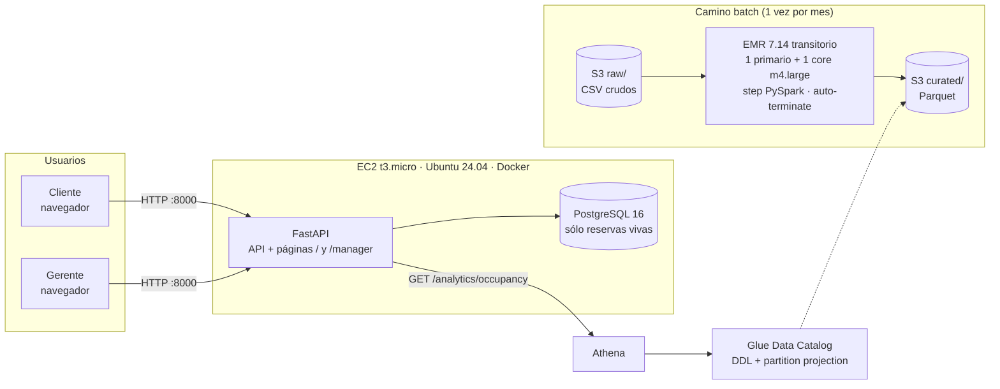

# 5. Decisiones y su justificación

> Borrador (18/10/2026). Cada decisión cita el requisito que la motiva (R1–R12 del enunciado) y los
> pilares del AWS Well-Architected Framework que pesan: **OE** Operational Excellence · **SEC**
> Security · **REL** Reliability · **PERF** Performance Efficiency · **COST** Cost Optimization ·
> **SUS** Sustainability. Los números entre corchetes son mediciones del harness sobre el sistema
> desplegado, no estimaciones.

## 5.0 Arquitectura

**Servicios facturables del proyecto: 5** (EC2, S3, EMR, Glue, Athena), de 8 permitidos por R11. El
harness cuenta 6 porque la cuenta del Learner Lab trae funciones de **Lambda** propias, que este
proyecto no usa.

**Resultado del harness sobre lo desplegado [18/10]: 70,0 / 70,0** (R1–R12 en verde, una sola corrida;
`evidencia/harness-2026-10-18/report.md`).

## 5.1 Modelo de hosting

**Decisión.** Backend, frontend y base transaccional en **una sola EC2 `t3.micro`**, con Docker
Compose: un contenedor de FastAPI (que sirve también las dos páginas HTML) y uno de PostgreSQL 16.
La base no publica ningún puerto; sólo la ve la API por la red interna de Docker. Hacia afuera sale
únicamente el 8000.

**Por qué esto y no algo más gestionado.** La alternativa obvia era **RDS** para la base. R1 y R2 se
cumplen igual con PostgreSQL en la misma máquina —es el mismo motor y la misma garantía
transaccional—, y RDS agregaba ~US$14,70/mes (instancia + 20 GB) y un servicio facturable más. Con
un presupuesto de US$50 y R12 premiando la arquitectura más barata, el costo manda (**COST**). Lo
que se resigna es **REL**: sin backups gestionados ni Multi-AZ, perder la instancia es perder las
reservas. Se compensa con un `pg_dump` periódico a S3; para una aerolínea real, ésa sería la primera
línea a cambiar (pasar a RDS).

**Por qué no algo menos gestionado (SQLite).** Con 50 reservas simultáneas por el último asiento
(R2), SQLite serializa todas las escrituras y devuelve *database is locked* si se agota la espera: un
5xx, que R2 prohíbe. PostgreSQL resuelve la concurrencia con bloqueo por fila.

**El tamaño se midió, no se supuso (D2).** Se arrancó por la `t3.micro`, la más chica que permite R11,
para subir a `t3.small` sólo si R1 fallaba. Medido contra la EC2 [18/10]: **p95 = 80 ms** con 20
clientes concurrentes desde CloudShell (183 ms desde fuera de AWS; tope 1 s) y **R2 exacto en las 5 rondas** (1 de 50 en el último asiento, 3 de
50 con K = 3). No hizo falta subir (**PERF**, **COST**, **SUS**: no sobredimensionar).

**Cómo se evita la sobreventa (R2).** El asiento se descuenta y la reserva se inserta en **una sola
transacción**, con un `UPDATE flights SET seats_available = seats_available - 1 WHERE flight_id = %s
AND seats_available > 0`. PostgreSQL bloquea la fila del vuelo; el primero descuenta y los demás ven
cero asientos y no actualizan nada → `409`. Un `CHECK (seats_available >= 0)` es la segunda red. El
pool de conexiones **espera** en vez de fallar: con 50 pedidos simultáneos, un pool agotado que
respondiera error sería un 500.

## 5.2 Por qué EMR, y cuál

**Qué hace el job que Athena sola no puede.** Las reglas C1–C4 se pueden escribir en SQL, pero **C5
pide quedarse con la *primera* aparición de cada `reservation_id`**. Un CSV en S3 no tiene orden de
filas para Athena: no hay forma de saber cuál vino primero. En Spark, cada fila se numera al leer
el archivo (`monotonically_increasing_id`, que crece con la posición) y se conserva la de menor número.
Además el job hace el *join* con los vuelos (la ruta y el mes salen de `flights.csv`), escribe el
Parquet particionado y calcula las métricas, todo en una pasada.

**Alternativas consideradas.**
- **Athena CTAS:** más barata por corrida, pero no resuelve C5 de forma determinista y deja la
  transformación repartida en varias consultas.
- **Glue job (Spark):** el mismo código PySpark sin administrar clúster. Se descartó porque el curso
  exige EMR en este proyecto.
- **EMR Serverless:** sin clúster que administrar, pero necesita un rol de ejecución que confíe en
  `emr-serverless`, y en el Learner Lab no se pueden crear roles (sólo existe `LabRole`). No se probó.

**Cuál y con qué.** EMR 7.14 (Spark 3.5.6) en **clúster transitorio**: se crea con el step y la
opción `--auto-terminate`, corre el job y **se termina solo**; si el step falla, también
(`ActionOnFailure=TERMINATE_CLUSTER`). Así R10 se cumple por diseño, no por acordarse de apagarlo
(**OE**, **COST**). Instancias **m4.large**, el único tipo que permite R11 (el lab rechaza `m5.large`).

**Uno o dos nodos: lo que enseñó la primera corrida.** El diseño original era un solo nodo (4 horas
normalizadas por corrida). En AWS el step quedó trabado: *"waiting for resources to be assigned for
AM"* — en EMR 7, YARN no ubica el *application master* de Spark en el nodo primario. Se pasó a **1
primario + 1 core**: 8 horas normalizadas por corrida, con un tope de 150 en 45 días (R10).

## 5.3 Organización de los datos

**Parquet** porque es columnar: una consulta que suma `price_cents` de un mes lee sólo esa columna,
comprimida, y no las seis. **Particionado por mes** (`month=YYYY-MM`, el mes del vuelo) porque es el
filtro natural del panel y de las consultas de R6: Athena descarta las otras 23 carpetas sin leerlas.

Sin eso, R6 fallaría: con CSV o sin particiones, cada consulta de un mes escanea el historial entero.
Con el layout elegido, el promedio por partición es de ~1,1 MB y el tope de R6 para una consulta de
un mes, ~2,2 MB. El job escribe **un archivo por mes** (`repartition("month")`): pocos archivos
medianos en vez de cientos chicos, que es lo que Athena lee mejor (**PERF**, **COST**, **SUS**: se
escanea —y se paga— sólo lo necesario).

`route_month_metrics` va **sin particionar**: son 240 filas, y si `month` fuera partición, el catálogo
lo sacaría de la lista de columnas y dejaría de cumplir el contrato (R5).

**Registro en el catálogo.** Las tablas se crean con DDL de Athena y la de detalle usa *partition
projection*: Athena calcula las 24 particiones a partir del rango declarado, sin crawler (que cobra
por corrida) y sin volver a registrar particiones cada vez que el job reescribe (**OE**, **COST**).

## 5.4 De dónde saca el panel sus números

El endpoint `/analytics/occupancy` consulta **Athena en cada pedido** sobre `route_month_metrics`
(R7 lo exige y verifica el historial de consultas). Consecuencias:

- **Latencia:** 1–3 s por consulta (arranque de Athena), dentro del tope de 10 s de R7. Para un
  panel de gerencia es aceptable; para una página de clientes no lo sería.
- **Costo por consulta:** Athena cobra un mínimo de 10 MB por consulta; sobre una tabla de 240 filas,
  cada consulta cuesta ~US$0,00005.
- **Frescura:** los números son los de la última corrida del job (mensual). La tabla agregada no
  cambia entre corridas.

**¿Caché?** Hoy no se justifica: 10.000 consultas al mes cuestan ~US$0,50. Con ×10 consultas, o si
la latencia de 1–3 s molestara, una caché en memoria por (ruta, mes) con vencimiento al correr el job
sería correcta y R7 la permite si la primera consulta va a Athena.

**Seguridad.** `route` y `month` se validan con expresiones regulares (`^[A-Z]{3}-[A-Z]{3}$`,
`^\d{4}-(0[1-9]|1[0-2])$`) y viajan como **parámetros de Athena**, nunca concatenados en el SQL:
doble defensa contra inyección (**SEC**).

## 5.5 Separación de cargas

El historial de 2 millones de reservas **nunca entra a la base transaccional**: vive en S3 y sólo lo
leen EMR y Athena. PostgreSQL atiende reservas y búsquedas, nada más. Un análisis pesado no puede
frenar una reserva porque no comparten ni disco, ni CPU, ni conexiones (R1, R2; **PERF**, **REL**).
La única carga analítica que pasa por la EC2 es el endpoint del panel, que delega el cálculo en
Athena y sólo espera la respuesta.

## 5.6 Servicios, alternativa y pilar

| Servicio | Para qué | Alternativa considerada | Requisito | Pilares |
|---|---|---|---|---|
| **EC2** `t3.micro` | API, frontend y PostgreSQL en Docker | RDS + EC2; Lambda + API Gateway | R1, R2, R3, R8, R9, R11 | COST, PERF, SUS |
| **S3** | Crudos, Parquet curado, resultados de Athena | EBS / HDFS del clúster | R4, R6 | COST, REL, SUS |
| **EMR** 7.14, transitorio | Job PySpark C1–C5 + métricas | Glue job; Athena CTAS; EMR Serverless | R4, R10 | OE, COST |
| **Glue Data Catalog** | Esquema de las dos tablas | Crawler de Glue | R5 | OE, COST |
| **Athena** | Consultas del panel y verificación | Redshift (cobra encendido 24/7) | R6, R7, R9 | COST, PERF |

## 5.7 Proyección de costos

Ver `cost_projection.yaml`. Supuestos: ~200 usuarios/día, ~2.000 búsquedas y ~300 reservas diarias,
10.000 consultas/mes al panel, 2 M reservas de historial (85 MB de CSV, ~27 MB de Parquet) y una
corrida mensual del job. Sistema 24/7, single-AZ.

| Servicio | US$/mes |
|---|---|
| EC2 `t3.micro` 24/7 | 7,59 |
| EBS gp3 8 GB | 0,64 |
| IPv4 pública | 3,65 |
| S3 | 0,01 |
| Athena | 0,50 |
| EMR (1 corrida, 2 × m4.large, < 1 h) | 0,26 |
| Glue Data Catalog | 0,00 |
| **Total** | **≈ 12,65** |

**Con ×10.** *Datos ×10* (20 M reservas): el job tarda más y quizá pida un core más (~US$0,26 → ~0,52
por corrida); el panel **no cambia de costo**, porque lee la tabla agregada (2.400 filas en vez de
240) y sigue en el mínimo de 10 MB por consulta; S3 sube a centavos. *Consultas ×10* (100.000/mes):
Athena pasa a ~US$5/mes, y ahí sí conviene la caché del punto 5.4, que lo devuelve a centavos. El
costo dominante sigue siendo la EC2 24/7, el único recurso que cobra por existir: es lo primero a
optimizar (**COST**) y lo que más energía consume sin uso (**SUS**).
