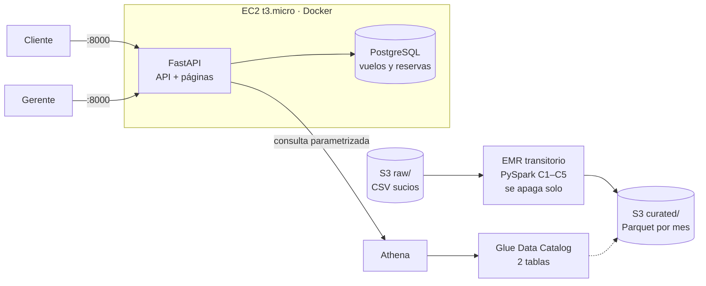

# 1. Qué se construyó

Un sistema de reservas para una aerolínea con un **panel analítico para la gerencia**, desplegado en
AWS y evaluado por el harness automático del profesor. Tiene tres caminos:

| Camino | Qué hace | Con qué |
|---|---|---|
| **Transaccional** | El cliente busca vuelos y reserva. Nunca se vende un asiento dos veces | FastAPI + PostgreSQL en una EC2 |
| **Batch** | Limpia dos años de reservas sucias (≈ 2,1 M) y las guarda ordenadas por mes | PySpark en EMR → Parquet en S3 |
| **Analítico** | El gerente consulta la ocupación de una ruta en un mes | Glue Data Catalog + Athena |

**Regla del enunciado:** lo más barato que cumpla es lo mejor. Cada pieza es la versión mínima que
pasa su requisito, y todas se midieron en AWS.

**Resultado:** harness **70,0 / 70,0** en una sola corrida (18/10/2026, 23 tests en 34 s).

# 2. Arquitectura

| Servicio | Para qué | Alternativa descartada y por qué |
|---|---|---|
| **EC2** `t3.micro` | API, páginas web y PostgreSQL, en Docker | **RDS**: +US$14,70/mes por la misma garantía transaccional |
| **S3** | CSV crudos, Parquet curado, resultados de Athena | Disco del clúster: muere con el clúster |
| **EMR** (transitorio) | Job de limpieza C1–C5 y métricas | **Glue job**: el curso exige EMR. **Athena CTAS**: no resuelve C5 |
| **Glue Data Catalog** | Esquema de las 2 tablas, creado con DDL | **Crawler**: cobra por corrida y no garantiza el orden de columnas |
| **Athena** | Consultas del panel, pago por consulta | **Redshift**: cobra prendido 24/7 |

Son **5 servicios facturables** (el máximo permitido es 8). IAM no cobra: la EC2 usa el rol del lab
(`LabInstanceProfile`) para llamar a Athena **sin claves guardadas en ningún archivo**.

# 3. Cómo se cumple cada requisito

| Req | Qué pide | Cómo se cumple | Medición |
|---|---|---|---|
| R1 | Búsqueda en ≤ 1 s (p95) | Índice `(route, flight_date)` y pool de conexiones | p95 = **0,080 s** |
| R2 | Sin sobreventa | `UPDATE … WHERE seats_available > 0` y la reserva en **una transacción** | **1 de 50** por el último asiento |
| R3 | Consultar una reserva | Id como texto: uno inválido da 404 | 200 y 404 correctos |
| R4 | Job de EMR → Parquet | Step de PySpark en un clúster que se apaga solo | **2.017.079** filas = oráculo |
| R5 | Tablas en Glue | DDL con *partition projection* | Columnas y orden del contrato |
| R6 | Athena correcto y barato | Parquet + una carpeta por mes | Un mes escanea **280 KB** (tope 1,8 MB) |
| R7 | Endpoint lee de Athena | Consulta a Athena en cada pedido | 5 casos correctos en ~1 s |
| R8 | Flujo del cliente en navegador | HTML + JS servido por FastAPI | Reserva creada desde Chromium |
| R9 | Panel = endpoint | El panel llama al mismo endpoint | 0,8359 = 0,8359 = 0,8359 |
| R10 | EMR acotado | `--auto-terminate` | 0 clústeres vivos |
| R11 | Simple y barato | `t3.micro`, `m4.large`, sin NAT ni balanceador | 5 servicios propios |
| R12 | Proyección de costos | `cost_projection.yaml` | Dentro del tope y la tolerancia |

# 4. Las reglas de limpieza (job de EMR)

| Regla | Qué hace | Ejemplo |
|---|---|---|
| C1 | Ruta sin espacios y en mayúsculas | ` bog - mde ` → `BOG-MDE` |
| C2 | Estado sin espacios y en mayúsculas | ` confirmed ` → `CONFIRMED` |
| C3 | Sólo `CONFIRMED` o `CANCELLED` | `PENDING` se descarta |
| C4 | Precio presente y mayor que 0 | `-500` o vacío se descarta |
| C5 | Un `reservation_id` repetido: se queda el **primero** | 2.ª aparición se descarta |

**Por qué Spark y no SQL:** C5 exige saber qué fila vino *primero*, y un CSV en S3 no tiene orden para
Athena. Spark numera cada fila al leerla y se queda con la de menor número.

Después de limpiar, el job cruza las reservas con los vuelos (para sacar la ruta y el mes), escribe
**un Parquet por mes** (24 carpetas `month=2023-01 … 2024-12`) y calcula la tabla de métricas
(240 filas: 10 rutas × 24 meses).

# 5. Decisiones clave

| Decisión | Alternativa descartada | Por qué |
|---|---|---|
| **Una EC2 con Docker** (API + base) | RDS + EC2; Lambda + API Gateway | Mismo motor y misma garantía, mucho más barato |
| **`t3.micro`, medida, no supuesta** | Empezar más grande | R1 dio p95 de 80 ms: no hizo falta subir |
| **EMR transitorio, 1 primario + 1 core** | Clúster fijo; 1 solo nodo | Fijo cobra todo el día. Con 1 nodo el job se trabó |
| **Tablas por DDL + *partition projection*** | Crawler; `MSCK REPAIR` | Gratis, exacto y sin volver a registrar particiones |
| **Páginas servidas por el mismo FastAPI** | SPA aparte (React/Vite) en otro puerto | Mismo origen: sin CORS, sin build, sin otro proceso |
| **Athena en cada consulta, sin caché** | Caché en memoria | R7 lo exige; 10.000 consultas/mes cuestan US$0,50 |
| **`bookings` = sólo confirmadas** | Confirmadas + canceladas (el oráculo) | Es lo que dice el contrato; la otra es un parámetro del job |

**Separación de cargas:** los 2 millones de reservas históricas **nunca entran a PostgreSQL**. Viven en
S3 y sólo las leen EMR y Athena. Un análisis pesado no puede frenar una reserva.

# 6. Costos

| | US$/mes |
|---|---|
| EC2 `t3.micro` 24/7 | 7,59 |
| Athena (10.000 consultas) | 0,50 |
| EMR (1 corrida mensual) | 0,26 |
| S3 | 0,01 |
| **Declarado en `cost_projection.yaml`** | **8,36** |
| Disco EBS 8 GB + IPv4 pública (el harness no los estima) | 4,29 |
| **Costo real** | **≈ 12,65** |

- Se declara lo que el harness sabe medir; con US$12,65, R12 fallaría desde el 24/11. Los US$4,29
  restantes están explicados en el documento y consultados con el profesor.
- **Lo gastado de verdad en todo el parcial: menos de US$1.** Se desarrolló en la laptop contra el
  oráculo y AWS se usó sólo para verificar.
- **Con ×10 datos**, el panel cuesta lo mismo (lee la tabla agregada). **Con ×10 consultas**, Athena
  sube a ~US$5/mes y ahí conviene la caché.

# 7. Lo que falló y lo que se evitó

Ningún requisito quedó fallando, pero cuatro habrían fallado sin estos cambios:

| Qué | Causa | Solución |
|---|---|---|
| **Falló:** el job de EMR quedó trabado | Con un solo nodo, YARN no ubica el proceso principal de Spark | 1 primario + 1 core: terminó en ~2 min |
| **Falló:** búsqueda local con p95 de 2 s | `localhost` probaba IPv6 primero y esperaba ~2 s | Usar la IP; bajó a 18 ms |
| **Se evitó:** id inválido → 422 en vez de 404 | Con un id numérico, FastAPI rechaza el formato antes de buscar | Declararlo como texto desde el diseño |
| **Se evitó:** columnas fuera de orden | Particionar la tabla de métricas saca `month` de las columnas | Dejarla sin particionar (240 filas) |

# 8. Si el profesor pide un cambio en vivo

**Regla para responder:** primero en qué camino vive el cambio (transaccional, batch o analítico),
después qué tabla cambia y recién ahí qué tests lo notan. Cada regla es una función separada, así que
cada cambio toca **un solo lugar**.

| Cambio | Qué se toca | Costo |
|---|---|---|
| Otra regla de limpieza | Una función del job (`c3_…`, `c5_…`) y volver a correrlo | ~10 min, ~US$0,26 |
| Las canceladas también ocupan asiento | Una línea de `tabla_metricas` | 1 corrida de EMR |
| Otra agregación (por semana, por clase) | Job, DDL de la tabla, consulta del endpoint y panel | 1 corrida + 3 archivos |
| Más meses (2025) | Ampliar el rango de *partition projection* | DDL + 1 corrida |
| Datos ×10 | Quizá un nodo core más | Corrida ~2× más larga |
| Pasar a RDS | Sólo la cadena de conexión; migrar con `pg_dump` | +US$14,70/mes |
| Que el panel muestre las reservas de hoy | Exportar PostgreSQL a `raw/` cada noche y correr el job | 1 corrida diaria |
| Que el panel no espere a Athena | Caché por (ruta, mes) que vence al correr el job | Código del endpoint |

# 9. Preguntas probables

**¿Cómo evitás la sobreventa?** El descuento del asiento es un `UPDATE` condicionado a que quede
alguno, en la misma transacción que la reserva. PostgreSQL bloquea la fila del vuelo: los pedidos se
ordenan solos y, cuando llega a 0, el `UPDATE` no toca nada → 409. Un `CHECK` en la tabla es la
segunda red.

**¿Por qué EMR transitorio?** El job dura minutos; un clúster prendido cobra por hora sin hacer nada.
Con `--auto-terminate` se paga sólo lo que dura, y R10 se cumple por diseño, no por acordarse de
apagarlo.

**¿Por qué Parquet particionado por mes?** Parquet es columnar: se lee sólo la columna que se usa.
Con la partición, Athena salta las otras 23 carpetas. Se escanea —y se paga— sólo lo necesario.

**¿Qué es *partition projection*?** Athena calcula las 24 particiones a partir del rango declarado
(`2023-01` a `2024-12`), sin crawler y sin registrarlas cada vez que corre el job.

**¿Y la inyección SQL en Athena?** Doble defensa: la ruta y el mes se validan con expresiones
regulares (si no coinciden, 422) y viajan como **parámetros** de Athena, nunca pegados al SQL.

**¿Por qué no aparecen en el panel las reservas de hoy?** Porque el panel lee el histórico que limpió
EMR, no PostgreSQL. Es la separación de cargas a propósito; para incluirlas haría falta un export
nocturno a S3 (sección 8).

**¿Qué pasa si se cae la EC2?** Se pierden las reservas vivas: es lo que se resigna por no usar RDS
(sin backups gestionados). Se cubriría con un `pg_dump` periódico a S3, que hoy no está automatizado;
en una aerolínea real, pasar a RDS sería lo primero a cambiar.

# 10. Demo en vivo

La EC2 cambia de IP cada vez que se abre el lab. El 22/10: **`54.147.173.30`**.

| Página | URL |
|---|---|
| Cliente | `http://<IP>:8000/` |
| Panel de gerencia | `http://<IP>:8000/manager` |
| API documentada | `http://<IP>:8000/docs` |

1. **Reservar:** PEI → CLO, 15/12/2026 → Reservar → nombre → número de reserva.
2. **Sobreventa:** 30 pedidos simultáneos por un vuelo de 1 asiento → **1 aceptado, 29 rechazados**
   (el comando está en `RESUMEN-PRESENTACION.md`).
3. **Panel:** PEI-CLO, 2023-03 → **83,59 %** (el mismo caso que verificó el harness).
4. **EMR:** el clúster `parcial2-curar` en *Terminado*, "todos los pasos completados", 11 min.
5. **S3:** las 24 carpetas `month=` en `curated/reservations_curated/`.
6. **Athena:** una consulta de un mes y el dato de *bytes escaneados*.
7. **Harness en vivo (CloudShell):** `bash ~/p2h/05-correr-harness.sh` → **70,0 / 70,0** en ~40 s
   (corrida del 22/10, ya con la proyección entregada).
