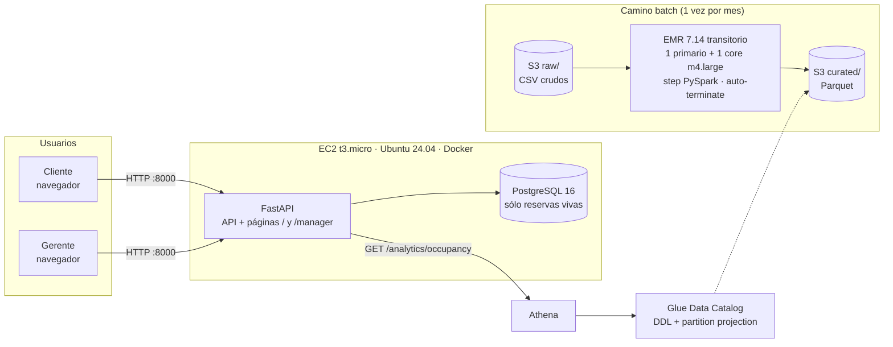

# Parcial 2 — Panel analítico de la aerolínea

**Big Data e Ingeniería de Datos (PCIA 5010)** · Universidad Sergio Arboleda

**Estudiante:** Andres Felipe Cespedes Rondon · **Modalidad:** individual · **Semilla:** 12345 · **Fecha:** 22 de octubre de 2026

**Repositorio:** <https://github.com/Pipelol0723/bigdata-ing-datos> — carpeta `entregas/parcial-2-panel-analitico/`

> Archivo generado por `entrega/construir_documento.py` a partir de `documento/`.

# Cómo leer este documento

Responde la entrega final del segundo parcial (§7 del enunciado): las **secciones 5 y 6**, con la
misma numeración del enunciado, y el registro de prompts como anexo obligatorio. Antes va una
introducción con la **matriz de trazabilidad** de R1 a R12, y al final dos anexos más: qué partes se
tocan ante un cambio en vivo (para la defensa) y el reporte del harness sin editar.

| Parte | Qué contiene |
|---|---|
| Introducción | El sistema, el resultado (70/70) y cada requisito con su pieza y su medición |
| 5 · Decisiones | Hosting, por qué EMR, organización de los datos, el panel, la separación de cargas, los servicios y los costos, cada uno con su requisito y su pilar de Well-Architected |
| 6 · Harness | Cómo se corrió, qué dio, lo que no se pudo verificar y lo que falló en el camino |
| Anexo A | Registro de prompts |
| Anexo B | Impacto de cambios: qué se toca si el profesor pide otra regla u otra agregación |
| Anexo C | `report.md` del harness, tal cual |

El código, los scripts y la evidencia están en <https://github.com/Pipelol0723/bigdata-ing-datos>, carpeta `entregas/parcial-2-panel-analitico/`.

# Introducción: el sistema y la trazabilidad

## Qué se construyó

El sistema de reservas del primer parcial, ahora completo y medido. Tiene tres caminos:

1. **Transaccional.** Los clientes buscan vuelos y reservan; la base no vende un asiento dos veces
   aunque 50 personas pidan el último a la vez. Una API FastAPI y PostgreSQL, en una EC2.
2. **Batch.** Dos años de historial (≈ 2,1 millones de reservas en CSV, sucias a propósito) se limpian
   con un job de **PySpark en EMR** que aplica las reglas C1–C5 y escribe Parquet particionado por
   mes en S3.
3. **Analítico.** Las dos tablas resultantes se registran en el **Glue Data Catalog** y se consultan
   con **Athena**; el panel de gerencia muestra la ocupación de una ruta en un mes leyendo de Athena.

El enunciado fija que lo más barato que cumpla es lo mejor. Por eso cada pieza es la versión mínima
que pasa su requisito, y cada una se midió en AWS contra el harness del profesor.

**Semilla asignada: 12345** (individual). Determina el dataset, el valor K de la prueba de
concurrencia (K = 3) y todas las respuestas esperadas.

## Resultado

| Aspecto | Valor |
|---|---|
| Harness del profesor contra lo desplegado (18/10/2026) | **70,0 / 70,0** · 23 tests en 34 s, una sola corrida |
| Datos | 2.087.701 reservas crudas → **2.017.079 curadas**, idénticas fila por fila a las del oráculo |
| Costo real del parcial en AWS | menos de US$1 (dos corridas de EMR, la EC2 y Athena) |
| Proyección mensual 24/7 | US$8,36 declarados (lo que mide el harness) + US$4,29 de EBS e IPv4 = **US$12,65 reales** |

## Matriz de trazabilidad

Cada requisito, la pieza que lo cumple, dónde está y la medición del harness que lo prueba
(`evidencia/harness-2026-10-18/report.md`).

| Req | Pts | Cómo se cumple | Dónde | Medición |
|---|---|---|---|---|
| R1 · búsqueda p95 ≤ 1 s | 4 | Índice `(route, flight_date)`; endpoint síncrono con pool de conexiones | `app/main.py`, `app/schema.sql` | p95 **0,080 s** con 20 clientes |
| R2 · sin sobreventa | 10 | `UPDATE … WHERE seats_available > 0` y la reserva en la misma transacción; `CHECK` como segunda red; pool que espera | `app/main.py` (`reservar`) | 1 de 50 y 3 de 50 (K = 3), 5 rondas cada uno, sin 5xx |
| R3 · consultar reserva | 3 | `reservation_id` como texto (un id inválido da 404, no 422) | `app/main.py` | 200 y 404 correctos |
| R4 · job EMR → Parquet | 8 | PySpark con C1–C5, corrido como **step** de un clúster transitorio | `spark/curar_reservas.py`, `infra/02-job-emr.sh` | 2.017.079 filas; **24/24** archivos escritos dentro del step |
| R5 · tablas en Glue | 6 | DDL de Athena; `reservations_curated` con partition projection; métricas sin particionar | `sql/tablas_athena.sql` | Columnas, orden y formato según contrato |
| R6 · Athena correcto y podado | 8 | Parquet + partición por mes; un archivo por mes | `spark/curar_reservas.py` | Top-10 = oráculo; un mes escanea **280.837 B** (tope 1.827.162) |
| R7 · endpoint desde Athena | 8 | Consulta parametrizada a Athena en cada pedido | `app/main.py` (`ocupacion`) | 5 rutas/mes correctas en ~0,93–1,06 s |
| R8 · flujo del cliente | 6 | HTML + JS servido por FastAPI con los `data-testid` del contrato | `app/static/index.html` | Reserva creada desde Chromium |
| R9 · panel = endpoint | 4 | El panel llama al endpoint y muestra 2 decimales | `app/static/manager.html` | 0,8359 = 0,8359 = 0,8359 |
| R10 · EMR acotado | 5 | `--auto-terminate`: el clúster muere al terminar el step | `infra/02-job-emr.sh` | 0 clústeres activos; 48 h normalizadas de 150 |
| R11 · simple y barato | 4 | `t3.micro`, `m4.large`, sin NAT ni balanceador, 5 servicios | `infra/04-ec2-app.sh` | 6 servicios contados (Lambda viene de la cuenta del lab) |
| R12 · proyección de costos | 4 | `cost_projection.yaml` coherente con lo desplegado | `cost_projection.yaml` | Dentro del tope y de la tolerancia (§5.7 y §6.3) |

## Dónde está cada cosa

El código, los scripts y la evidencia están en el repositorio, carpeta
`entregas/parcial-2-panel-analitico/`. Las rutas que cita el documento son relativas a esa carpeta.

| Carpeta | Contenido |
|---|---|
| `app/` | Backend FastAPI, esquema de PostgreSQL y las dos páginas del frontend |
| `spark/` | El job de PySpark (`curar_reservas.py`) |
| `sql/` | DDL de las dos tablas para Athena / Glue |
| `infra/` | Scripts de CloudShell: bucket, job de EMR, tablas, EC2 y auditoría de baja |
| `local/` | Pruebas en la laptop: el job contra el oráculo y el harness contra el backend local |
| `harness/` | El harness del profesor, **sin modificar**, más `config.yaml` |
| `evidencia/` | El `report.md` final del harness y cómo se obtuvo |
| `cost_projection.yaml` · `docker-compose.yml` | Proyección de costos y la composición que corre en la EC2 |

# 5. Decisiones y su justificación

> Cada decisión cita el requisito que la motiva (R1–R12 del enunciado) y los pilares del AWS
> Well-Architected Framework que pesan: **OE** Operational Excellence · **SEC** Security · **REL**
> Reliability · **PERF** Performance Efficiency · **COST** Cost Optimization · **SUS**
> Sustainability. Los números entre corchetes son mediciones del harness sobre el sistema
> desplegado, no estimaciones.

## 5.0 Arquitectura

**Servicios facturables del proyecto: 5** (EC2, S3, EMR, Glue, Athena), de 8 permitidos por R11. El
harness cuenta 6 porque la cuenta del Learner Lab trae funciones de **Lambda** propias, que este
proyecto no usa.

**Resultado del harness sobre lo desplegado [18/10]: 70,0 / 70,0** (R1–R12 en verde, una sola corrida;
`evidencia/harness-2026-10-18/report.md`).

## 5.1 Modelo de hosting

**Decisión.** Backend, frontend y base transaccional en **una sola EC2 `t3.micro`**, con Docker
Compose: un contenedor de FastAPI (que sirve también las dos páginas HTML) y uno de PostgreSQL 16.
La base no publica ningún puerto; sólo la ve la API por la red interna de Docker. Hacia afuera sale
únicamente el 8000.

**Por qué esto y no algo más gestionado.** La alternativa obvia era **RDS** para la base. R1 y R2 se
cumplen igual con PostgreSQL en la misma máquina —es el mismo motor y la misma garantía
transaccional—, y RDS agregaba ~US$14,70/mes (instancia + 20 GB) y un servicio facturable más. Con
un presupuesto de US$50 y R12 premiando la arquitectura más barata, el costo manda (**COST**). Lo
que se resigna es **REL**: sin backups gestionados ni Multi-AZ, perder la instancia es perder las
reservas. Se compensa con un `pg_dump` periódico a S3; para una aerolínea real, ésa sería la primera
línea a cambiar (pasar a RDS).

**Por qué no algo menos gestionado (SQLite).** Con 50 reservas simultáneas por el último asiento
(R2), SQLite serializa todas las escrituras y devuelve *database is locked* si se agota la espera: un
5xx, que R2 prohíbe. PostgreSQL resuelve la concurrencia con bloqueo por fila.

**El tamaño se midió, no se supuso (D2).** Se arrancó por la `t3.micro`, la más chica que permite R11,
para subir a `t3.small` sólo si R1 fallaba. Medido contra la EC2 [18/10]: **p95 = 80 ms** con 20
clientes concurrentes desde CloudShell (183 ms desde fuera de AWS; tope 1 s) y **R2 exacto en las 5 rondas** (1 de 50 en el último asiento, 3 de
50 con K = 3). No hizo falta subir (**PERF**, **COST**, **SUS**: no sobredimensionar).

**Cómo se evita la sobreventa (R2).** El asiento se descuenta y la reserva se inserta en **una sola
transacción**, con un `UPDATE flights SET seats_available = seats_available - 1 WHERE flight_id = %s
AND seats_available > 0`. PostgreSQL bloquea la fila del vuelo; el primero descuenta y los demás ven
cero asientos y no actualizan nada → `409`. Un `CHECK (seats_available >= 0)` es la segunda red. El
pool de conexiones **espera** en vez de fallar: con 50 pedidos simultáneos, un pool agotado que
respondiera error sería un 500.

## 5.2 Por qué EMR, y cuál

**Qué hace el job que Athena sola no puede.** Las reglas C1–C4 se pueden escribir en SQL, pero **C5
pide quedarse con la *primera* aparición de cada `reservation_id`**. Un CSV en S3 no tiene orden de
filas para Athena: no hay forma de saber cuál vino primero. En Spark, cada fila se numera al leer
el archivo (`monotonically_increasing_id`, que crece con la posición) y se conserva la de menor número.
Además el job hace el *join* con los vuelos (la ruta y el mes salen de `flights.csv`), escribe el
Parquet particionado y calcula las métricas, todo en una pasada.

**Alternativas consideradas.**

- **Athena CTAS:** más barata por corrida, pero no resuelve C5 de forma determinista y deja la
  transformación repartida en varias consultas.
- **Glue job (Spark):** el mismo código PySpark sin administrar clúster. Se descartó porque el curso
  exige EMR en este proyecto.
- **EMR Serverless:** sin clúster que administrar, pero necesita un rol de ejecución que confíe en
  `emr-serverless`, y en el Learner Lab no se pueden crear roles (sólo existe `LabRole`). No se probó.

**Cuál y con qué.** EMR 7.14 (Spark 3.5.6) en **clúster transitorio**: se crea con el step y la
opción `--auto-terminate`, corre el job y **se termina solo**; si el step falla, también
(`ActionOnFailure=TERMINATE_CLUSTER`). Así R10 se cumple por diseño, no por acordarse de apagarlo
(**OE**, **COST**). Instancias **m4.large**, el único tipo que permite R11 (el lab rechaza `m5.large`).

**Uno o dos nodos: lo que enseñó la primera corrida.** El diseño original era un solo nodo (4 horas
normalizadas por corrida). En AWS el step quedó trabado: *"waiting for resources to be assigned for
AM"* — en EMR 7, YARN no ubica el *application master* de Spark en el nodo primario. Se pasó a **1
primario + 1 core**: 8 horas normalizadas por corrida, con un tope de 150 en 45 días (R10).

## 5.3 Organización de los datos

**Parquet** porque es columnar: una consulta que suma `price_cents` de un mes lee sólo esa columna,
comprimida, y no las seis. **Particionado por mes** (`month=YYYY-MM`, el mes del vuelo) porque es el
filtro natural del panel y de las consultas de R6: Athena descarta las otras 23 carpetas sin leerlas.

Sin eso, R6 fallaría: con CSV o sin particiones, cada consulta de un mes escanea el historial entero.
Con el layout elegido [18/10], el promedio por partición es de 913.581 bytes y el tope de R6 para una
consulta de un mes, 1.827.162; la consulta del harness escaneó **280.837 bytes**: sólo las columnas
que usa, de una sola carpeta. El job escribe **un archivo por mes** (`repartition("month")`): pocos archivos
medianos en vez de cientos chicos, que es lo que Athena lee mejor (**PERF**, **COST**, **SUS**: se
escanea —y se paga— sólo lo necesario).

`route_month_metrics` va **sin particionar**: son 240 filas, y si `month` fuera partición, el catálogo
lo sacaría de la lista de columnas y dejaría de cumplir el contrato (R5).

**Registro en el catálogo.** Las tablas se crean con DDL de Athena y la de detalle usa *partition
projection*: Athena calcula las 24 particiones a partir del rango declarado, sin crawler (que cobra
por corrida) y sin volver a registrar particiones cada vez que el job reescribe (**OE**, **COST**).

## 5.4 De dónde saca el panel sus números

El endpoint `/analytics/occupancy` consulta **Athena en cada pedido** sobre `route_month_metrics`
(R7 lo exige y verifica el historial de consultas). Consecuencias:

- **Latencia:** 1–3 s por consulta (arranque de Athena), dentro del tope de 10 s de R7. Para un
  panel de gerencia es aceptable; para una página de clientes no lo sería.
- **Costo por consulta:** Athena cobra un mínimo de 10 MB por consulta; sobre una tabla de 240 filas,
  cada consulta cuesta ~US$0,00005.
- **Frescura:** los números son los de la última corrida del job (mensual). La tabla agregada no
  cambia entre corridas.

**¿Caché?** Hoy no se justifica: 10.000 consultas al mes cuestan ~US$0,50. Con ×10 consultas, o si
la latencia de 1–3 s molestara, una caché en memoria por (ruta, mes) con vencimiento al correr el job
sería correcta y R7 la permite si la primera consulta va a Athena.

**Seguridad.** `route` y `month` se validan con expresiones regulares (`^[A-Z]{3}-[A-Z]{3}$`,
`^\d{4}-(0[1-9]|1[0-2])$`) y viajan como **parámetros de Athena**, nunca concatenados en el SQL:
doble defensa contra inyección (**SEC**).

## 5.5 Separación de cargas

El historial de 2 millones de reservas **nunca entra a la base transaccional**: vive en S3 y sólo lo
leen EMR y Athena. PostgreSQL atiende reservas y búsquedas, nada más. Un análisis pesado no puede
frenar una reserva porque no comparten ni disco, ni CPU, ni conexiones (R1, R2; **PERF**, **REL**).
La única carga analítica que pasa por la EC2 es el endpoint del panel, que delega el cálculo en
Athena y sólo espera la respuesta.

## 5.6 Servicios, alternativa y pilar

| Servicio | Para qué | Alternativa considerada | Requisito | Pilares |
|---|---|---|---|---|
| **EC2** `t3.micro` | API, frontend y PostgreSQL en Docker | RDS + EC2; Lambda + API Gateway | R1, R2, R3, R8, R9, R11 | COST, PERF, SUS |
| **S3** | Crudos, Parquet curado, resultados de Athena | EBS / HDFS del clúster | R4, R6 | COST, REL, SUS |
| **EMR** 7.14, transitorio | Job PySpark C1–C5 + métricas | Glue job; Athena CTAS; EMR Serverless | R4, R10 | OE, COST |
| **Glue Data Catalog** | Esquema de las dos tablas | Crawler de Glue | R5 | OE, COST |
| **Athena** | Consultas del panel y verificación | Redshift (cobra encendido 24/7) | R6, R7, R9 | COST, PERF |

## 5.7 Proyección de costos

Ver `cost_projection.yaml`. Supuestos: ~200 usuarios/día, ~2.000 búsquedas y ~300 reservas diarias,
10.000 consultas/mes al panel, 2 M reservas de historial (85 MB de CSV, ~22 MB de Parquet) y una
corrida mensual del job. Sistema 24/7, single-AZ.

| Servicio | Detalle | US$/mes | En el yaml |
|---|---|---|---|
| EC2 | `t3.micro` 24/7, 730 h | 7,59 | sí |
| S3 | ~0,15 GB | 0,01 | sí |
| Athena | 10.000 consultas × 10 MB mínimo | 0,50 | sí |
| EMR | 1 corrida/mes, 2 × `m4.large`, < 1 h | 0,26 | sí |
| Glue Data Catalog | 2 tablas, sin crawler | 0,00 | sí |
| **Subtotal declarado** | | **8,36** | |
| EBS gp3 | 8 GB de la instancia | 0,64 | **no** |
| IPv4 pública | 730 h × US$0,005 | 3,65 | **no** |
| **Costo real** | | **≈ 12,65** | |

**Por qué el yaml declara US$8,36 y no US$12,65.** R12 compara lo declarado con lo que el harness
estima a partir de los recursos vivos, y su modelo (`pricing.yaml`) sólo pone precio a las horas de
EC2, a las horas normalizadas de EMR, a Athena y a S3: **no tiene línea para el EBS ni para la IPv4
pública**. Además cuenta las horas de EMR de los últimos 45 días, que se van cayendo de la ventana.
Con los US$12,65 completos, la diferencia contra su estimación supera la tolerancia (25 % + US$2) en
cuanto las corridas de octubre salen de la ventana, el 24/11. Por eso se declaró lo que el harness sabe
medir y los US$4,29 restantes se explican acá; es una pregunta abierta al profesor (§6.4). De esos
US$4,29, la IPv4 pública es el ítem más grande después de la EC2: con una Elastic IP o un dominio
detrás de un balanceador costaría lo mismo o más, así que es un costo inevitable de exponer el panel.

**Con ×10.** *Datos ×10* (20 M reservas): el job tarda más y quizá pida un core más (~US$0,26 → ~0,52
por corrida); el panel **no cambia de costo**, porque lee la tabla agregada (2.400 filas en vez de
240) y sigue en el mínimo de 10 MB por consulta; S3 sube a centavos. *Consultas ×10* (100.000/mes):
Athena pasa a ~US$5/mes, y ahí sí conviene la caché del punto 5.4, que lo devuelve a centavos. El
costo dominante sigue siendo la EC2 24/7, el único recurso que cobra por existir: es lo primero a
optimizar (**COST**) y lo que más energía consume sin uso (**SUS**).

**Lo que se gastó de verdad.** Todo el parcial en AWS costó menos de US$1: una corrida de EMR de un
nodo que se trabó (§5.2), la corrida buena de dos nodos, la EC2 durante las sesiones, el S3 y unas
decenas de consultas de Athena. El desarrollo se hizo en la laptop contra el oráculo del harness
(`local/`), y AWS se usó sólo para lo que había que verificar ahí.

## 5.8 Definición de `bookings`

El contrato escrito (enunciado A.2 y `contract/DATA.md`) dice que `seats_sold` y `bookings` cuentan
sólo las reservas `CONFIRMED`, lo que vuelve a `bookings` idéntica a `seats_sold`. El oráculo del
harness (`airline_data/oracle.py`) la calcula como **confirmadas + canceladas**: en las 240 filas,
`bookings = seats_sold + cancellations`. El harness no la verifica.

**Decisión:** se sigue el contrato escrito, que es la especificación, y se deja la otra lectura a un
parámetro: `spark-submit curar_reservas.py … --bookings-incluye-canceladas`. Cambiarla es volver a
correr el job (~10 min, ~US$0,26), sin tocar las tablas ni el endpoint. Está planteada como pregunta
al profesor (§6.4).

# 6. Ejecución del harness

## 6.1 Cómo se corrió

El harness es la copia entregada por el profesor, **sin modificar** (`harness/`); sólo se completó
`config.yaml` (semilla 12345, URLs de la EC2, base de Athena) y se escribió `cost_projection.yaml`.

| Aspecto | Detalle |
|---|---|
| Fecha | 18/10/2026, 22:29 UTC |
| Dónde | **AWS CloudShell** de la cuenta del lab: el harness consulta Glue, Athena, EMR, EC2 y S3 con boto3, y CloudShell ya tiene las credenciales temporales del Learner Lab. Así no tocan el disco de la laptop |
| Contra qué | La app en la EC2 `t3.micro` (`http://100.55.17.95:8000` ese día) y las tablas de `airline_analytics` |
| Navegador (R8, R9) | Chromium de Playwright dentro de CloudShell. Le faltaban bibliotecas del sistema (`libnspr4` y otras), que se instalaron con `dnf` para esa sesión |
| Corrida | **Una sola**, con los 23 tests, en 34 s |
| Resultado | **70,0 / 70,0** · `evidencia/harness-2026-10-18/report.md` (Anexo C, sin editar) |

Antes de esa corrida, cada parte se probó por separado y gratis: el job de PySpark contra el oráculo
en la laptop, con resultados idénticos fila por fila, y R1–R3 y R8 contra un backend local
(`local/README.md`).

## 6.2 Resultado por requisito

| Req | Estado | Puntos | Evidencia del reporte |
|---|---|---|---|
| R1 | passed | 4 / 4 | 100 pedidos, 20 concurrentes: p50 = 0,014 s, **p95 = 0,080 s** |
| R2 | passed | 10 / 10 | 5 rondas de 50 por el último asiento: **201 = 1, 409 = 49**; 5 rondas con K = 3: **201 = 3** |
| R3 | passed | 3 / 3 | lectura de la reserva creada y 404 para una inexistente |
| R4 | passed | 8 / 8 | **2.017.079** filas curadas (esperadas 2.017.079); **24/24** Parquet escritos dentro de un step `COMPLETED` |
| R5 | passed | 6 / 6 | columnas y formato según contrato; partition projection habilitada |
| R6 | passed | 8 / 8 | top-10 igual al oráculo; un mes escaneó **280.837 B** (tope 1.827.162 B) |
| R7 | passed | 8 / 8 | 5 pares ruta-mes correctos en 0,93–1,06 s; 8 consultas de Athena durante la prueba |
| R8 | passed | 6 / 6 | reserva `R1D8F8FACA31A492` creada desde el navegador y leída del backend |
| R9 | passed | 4 / 4 | PEI-CLO 2023-03: panel = endpoint = oráculo = **0,8359** |
| R10 | passed | 5 / 5 | 0 clústeres activos; **48** horas normalizadas en 45 días (tope 150) |
| R11 | passed | 4 / 4 | servicios: Athena, EC2, EMR, Glue, Lambda, S3 (6 de 8) |
| R12 | passed | 4 / 4 | declarado 12,65; estimado sobre lo vivo 9,03 (ver 6.3) |

## 6.3 Lo que hay detrás de algunos números

- **R10 — las 48 horas normalizadas.** El harness suma todos los clústeres de la cuenta de los últimos
  45 días: 36 son del Taller Taxis del 10 y 13/10 (otra entrega del curso), 4 de la corrida de un
  nodo que se trabó y 8 de la corrida buena. El propio job del parcial consume 8 por corrida.
- **R11 — Lambda y CloudFront.** Lambda aparece porque la cuenta del Learner Lab trae funciones
  propias; este proyecto no usa Lambda. CloudFront figura como **"could not inspect"**: el rol del lab
  no puede listarlo, así que el harness no lo cuenta. Este proyecto no usa CloudFront; se declara como
  pide la sección 6 del enunciado.
- **R12 — la proyección cambió después de la corrida.** Ese día el yaml declaraba US$12,65 (incluía
  EBS e IPv4). El 22/10 se dejó en **US$8,36** por lo explicado en §5.7. Las dos comprobaciones de
  R12 con el yaml nuevo:

  | Momento | Estimado del harness | Diferencia | Tolerancia (25 % + 2) | |
  |---|---|---|---|---|
  | Hoy (48 h de EMR en la ventana) | 9,03 | 0,67 | 4,26 | pasa |
  | Desde el 24/11 (24 h) | 8,31 | 0,05 | 4,08 | pasa |
  | Desde el 02/12 (0 h) | 7,59 | 0,77 | 3,90 | pasa |

  Con el yaml anterior (12,65) la segunda y la tercera fila fallaban. El tope por referencia
  (`mín(1,5 × referencia, 50)`) se cumple mientras la referencia del profesor sea de al menos
  US$5,57. Ese primer chequeo se volvió a correr en la laptop con el yaml nuevo, y pasa.

## 6.4 Preguntas abiertas al profesor

1. **`bookings`.** El contrato dice "sólo CONFIRMED" y el oráculo calcula "confirmadas + canceladas".
   Se implementó el contrato, con la otra lectura a un parámetro (§5.8). ¿Cuál es la correcta?
2. **Referencia de R12.** `thresholds.yaml` trae `reference_monthly_usd: 60` como valor provisorio.
   ¿Cuál es el definitivo? ¿Y la proyección debe incluir costos que el harness no estima, como el EBS
   y la IPv4 pública, o sólo los que modela `pricing.yaml`?

## 6.5 Antes de la corrección

El Learner Lab detiene la EC2 al cerrar cada sesión y la vuelve a prender en la siguiente, **con otra
IP pública**. Docker está habilitado al arranque y los contenedores tienen `restart: unless-stopped`,
así que la app debería volver sin intervención (al 22/10 todavía no se había probado un reinicio);
lo que cambia seguro es la dirección:

1. Abrir el lab y esperar a que la EC2 `parcial2-app` esté `running` (2–3 min).
2. Tomar la IP nueva (`aws ec2 describe-instances --filters Name=tag:Name,Values=parcial2-app`) y
   ponerla en las dos URLs de `harness/config.yaml`.
3. Verificar `http://<IP>:8000/health` y, si se quiere, volver a correr el harness como en 6.1.

## 6.6 Lo que falló en el camino y cómo se resolvió

Ningún requisito quedó fallando, pero cuatro habrían fallado sin estos cambios:

| Req | Qué pasó | Cambio |
|---|---|---|
| R4 / R10 | El job en un clúster de **un solo nodo** quedó trabado: *"waiting for resources to be assigned for AM"*. YARN no ubica el application master de Spark en el nodo primario, y como el step no terminaba, el clúster tampoco se apagaba solo | Clúster de 1 primario + 1 core; el step terminó en ~2 min |
| R1 | En las pruebas locales, p95 = 2,05 s con p50 = 7 ms: la URL `localhost` resolvía primero a IPv6 y cada conexión nueva esperaba ~2 s antes de reintentar por IPv4 | Usar la IP (`127.0.0.1` en local, la de la EC2 en AWS); p95 bajó a 18 ms |
| R3 | Si el `reservation_id` del path fuera numérico, un id inválido daría 422 y no 404 | Se declaró `str` desde el diseño |
| R5 | Si `route_month_metrics` se particionara por mes, el catálogo sacaría `month` de las columnas y el orden dejaría de coincidir con el contrato | Tabla sin particionar desde el diseño |

# Anexo A — Registro de prompts

El enunciado permite asistentes de IA con la regla del primer parcial: cada decisión tiene que poder
explicarse y defenderse, y el registro de prompts es obligatorio. Lo que se registra no es el prompt
perfecto sino **la iteración**: qué se pidió, qué devolvió la herramienta y qué hubo que corregirle o
decidir.

**Asistente utilizado:** Claude (Claude Code, modelo Opus), con acceso al repositorio, a una terminal
local y al navegador (Claude in Chrome) para operar la consola de AWS y CloudShell.

---

### 17/10 — Lectura del enunciado y del harness, y plan

| # | Objetivo | Prompt (resumen) | Qué devolvió | Corrección / refinamiento aplicado |
|---|---|---|---|---|
| 1 | Entender qué se evalúa | Se adjuntaron el enunciado y el `.zip` del harness: *"revisa estos 2 documentos … planea su desarrollo"* | Leyó los 30 archivos del harness, no sólo el enunciado, y sacó **13 trampas** que el enunciado no dice. Entre ellas: R10 suma las horas de EMR de 45 días (incluidas las del taller anterior), el Parquet tiene que escribirlo un *step* de EMR, la tabla de métricas no puede particionarse y R12 compara con lo que esté encendido | **Leer el código de los tests fue lo que valió.** Cada trampa se convirtió en una restricción de diseño antes de escribir código: `reservation_id` como texto, métricas sin particionar, el job siempre como *step*, el panel con 2 decimales |
| 2 | Medir antes de diseñar | (dentro del mismo pedido) | Generó el dataset con la semilla de ejemplo en la laptop, sin AWS: 85 MB de CSV, 2,1 M de filas, 10 rutas, 24 meses. Y encontró que **el contrato y el oráculo no coinciden en `bookings`** | La medición mostró que el dataset es chico, de ahí la idea de un clúster mínimo. La inconsistencia de `bookings` quedó como pregunta para el profesor, sin resolverla por mi cuenta |
| 3 | Decidir la arquitectura | El asistente presentó 6 decisiones (D1–D6) con alternativas, costo y recomendación | Hosting, tamaño de la EC2, forma de correr EMR, registro de tablas, frontend y origen de los números del panel | **Las decisiones las tomé yo con las alternativas a la vista:** una EC2 con Docker en vez de RDS, EMR transitorio, DDL con partition projection en vez de crawler, y HTML servido por FastAPI. El tamaño de la EC2 (D2) quedó **a medir, no a suponer**. La recomendación de EMR de un nodo resultó equivocada (#11) |

### 18/10 — Desarrollo en la laptop ($0)

| # | Objetivo | Prompt (resumen) | Qué devolvió | Corrección / refinamiento aplicado |
|---|---|---|---|---|
| 4 | Arrancar sin depender de una cuenta | *"usa la misma semilla … individual … inicia el desarrollo; si nos quedamos sin créditos tengo otra cuenta, pero se perdería todo lo hecho"* | Scripts de infraestructura que derivan el ID de la cuenta (`aerolinea-p2-<cuenta>`) y todo el desarrollo en local primero | **Reproducibilidad como requisito propio:** si el presupuesto se agota, el sistema entero se recrea en otra cuenta con los mismos comandos. Lo único que se pierde es lo que vive en AWS |
| 5 | Docker no arrancaba | *"docker falló: … dockerInference … The file cannot be accessed"* | Siguió el error más allá del mensaje: el socket trabado era el síntoma, y la causa real que la **virtualización estaba desactivada**, así que WSL2 no podía arrancar | El asistente **no tocó la configuración del sistema**: me explicó cómo hacerlo. La desactivación era mía, de cuando usaba VirtualBox y VMware; borré las VMs y reactivé el hipervisor. Mientras tanto, siguió sin Docker, con un PostgreSQL nativo descartable |
| 6 | Probar el job sin gastar | Correr el PySpark en la laptop y compararlo con el oráculo del profesor | Dos trampas de Windows: el hostname con guion bajo que Spark rechaza, y la escritura que exige `winutils.exe` | Se separó el job en `procesar()` y `escribir()`, para que **el mismo código de transformación** se valide contra el oráculo y sólo la escritura difiera. Resultado: **2.017.079 filas idénticas fila por fila** antes de tocar AWS |
| 7 | El harness contra el backend local | Correr R1–R3 y R8 contra `localhost` | R1 falló: p95 = 2,05 s con p50 = 7 ms | **La distribución delató la causa**: no era lentitud de la app sino `localhost` resolviendo primero a IPv6, con 2 s de espera por conexión nueva. Con `127.0.0.1` bajó a 18 ms. Mirar sólo el número que falla habría llevado a "optimizar" algo que no estaba roto |
| 8 | Dónde probar Docker | *"revisa si puedes hacerlo desde mi homelab"* y después *"dejemos el docker local para después, tengo 3 cuentas de AWS, corre todo lo que necesites ahí"* | Revisó el homelab sin cambiarle nada: tiene WSL y Hyper-V desactivados a propósito y no tiene Docker | **Decisión propia: Docker se prueba directo en la EC2**, que es Linux. Probarlo en local no agregaba nada a lo que la EC2 iba a demostrar |

### 18/10 — Despliegue en AWS

| # | Objetivo | Prompt (resumen) | Qué devolvió | Corrección / refinamiento aplicado |
|---|---|---|---|---|
| 9 | Operar AWS desde el navegador | *"hazlo todo tú usando Chrome"* | Intentó abrir el Learner Lab desde el curso equivocado y no logró iniciar sesión en la consola | **Le corregí el enlace** (curso 179973). Con el lab abierto ahí, la sesión de la consola se compartió con sus pestañas y siguió por CloudShell |
| 10 | Los crudos en S3 | (dentro del mismo pedido) | Generó los CSV **dentro de CloudShell** en vez de subirlos desde la laptop, y comparó el MD5 con los locales | Así las credenciales del lab no salieron de AWS. Los MD5 diferían, y en lugar de darlo por bueno encontró la causa: los `\r\n` de Windows. Sin ellos, **idénticos byte a byte** |
| 11 | EMR trabado | El job en el clúster de un nodo no avanzaba | Leyó el log del step: *"waiting for resources to be assigned for AM"*; YARN no ubica el application master de Spark en el nodo primario. Paró y **preguntó**: terminar el clúster y cómo corregir | **Era una decisión mía (D3) y un recurso a terminar**: el asistente no hizo ninguna de las dos cosas solo. Elegí terminarlo y pasar a 1 primario + 1 core. El step nuevo terminó en ~2 min. El clúster trabado tardó ~25 min en apagarse, y el script se corrigió para no contarlo como vivo |
| 12 | Una sola corrida con los 70 puntos | Correr el harness completo contra lo desplegado | Primero 60/70 en CloudShell, porque R8 y R9 necesitan un navegador. Instaló Chromium y sus bibliotecas en CloudShell y repitió: **70/70** | El `report.md` de la entrega sale de una sola corrida, no de pegar dos. Para traerlo a la laptop lo pasó en base64, porque la terminal corta las líneas largas, y lo reconstruyó byte a byte |
| 13 | Cerrar la sesión | *"déjala abierta y termina el lab"* | End Lab desde el panel; la EC2 queda para la corrección | **Decisión propia:** la app tiene que estar arriba cuando corrija el profesor. Quedó anotado que el lab la reinicia con otra IP |

### 22/10 — Documentación

| # | Objetivo | Prompt (resumen) | Qué devolvió | Corrección / refinamiento aplicado |
|---|---|---|---|---|
| 14 | Saber qué falta | *"¿todo está listo para la presentación?"* | No dijo que sí: la app nunca se había probado tras un reinicio, la IP iba a cambiar y faltaba el documento | Una respuesta honesta sobre lo no verificado vale más que un "todo listo" |
| 15 | Las dudas para el profesor | *"realiza la documentación completa … y sobre las preguntas del profesor dime más en detalle"* | Calculó R12 en el tiempo: declarando el costo completo (US$12,65, con EBS e IPv4), **R12 fallaría desde el 24/11**, porque el harness no pone precio a esos dos ítems y las horas de EMR salen de su ventana de 45 días | **Decidí declarar en el yaml sólo lo que el harness mide (US$8,36) y explicar los US$4,29 restantes en el documento**, en vez de esconderlos o arriesgar el requisito. En `bookings`, seguir el contrato escrito con la otra lectura a un parámetro. Las dos quedan como preguntas al profesor |

# Anexo B — Qué se toca si cambia algo

El enunciado (§8) anticipa que en la defensa se puede pedir un cambio en vivo —otra regla de
limpieza, otra agregación— y preguntar qué partes del sistema, de los datos y de los tests se ven
afectadas. El diseño apunta a que cada cambio toque **un solo lugar**: las reglas C1–C5 son funciones
separadas (`c1_normalizar_ruta` … `c5_sin_duplicados`), las métricas se calculan en una sola función
(`tabla_metricas`) y el endpoint sólo lee la tabla agregada.

| Cambio pedido | Código | Datos | Tests del harness | Costo / tiempo |
|---|---|---|---|---|
| **Otra regla de limpieza** (p. ej. aceptar `PENDING`, o quedarse con la *última* aparición en C5) | Una función en `spark/curar_reservas.py` (`c3_estados_validos` o el orden de `c5_sin_duplicados`) | Volver a correr el job: reescribe `curated/` completo | R4, R6, R7, R9 dejan de coincidir con el oráculo, que tiene las reglas fijas; R5 no cambia | 1 corrida de EMR: ~10 min, ~US$0,26 |
| **Las canceladas también ocupan asiento** | Una línea de `tabla_metricas` (`seats_sold`) | Re-correr el job | R6, R7, R9 (cambia la ocupación) | 1 corrida de EMR |
| **`bookings` = confirmadas + canceladas** | Ya existe: `--bookings-incluye-canceladas` | Re-correr el job | Ninguno: el harness no la mira | 1 corrida de EMR |
| **Otra agregación** (por semana, o por clase tarifaria) | `tabla_metricas` (nueva clave), `sql/tablas_athena.sql` (columna nueva), la consulta del endpoint y los campos del panel | Re-correr el job y recrear la tabla de métricas (DDL, gratis) | R5 (columnas del contrato), R6, R7, R9 | 1 corrida de EMR + 3 archivos |
| **Más meses de historia** (2025) | Ampliar `projection.month.range` en el DDL | Generar y subir los crudos; re-correr el job | R4/R5 esperan exactamente 24 particiones | DDL + 1 corrida |
| **Datos ×10** | Ninguno; quizá un core más (`infra/02-job-emr.sh`) | Re-correr el job | Ninguno | Corrida ~2× más larga; el panel cuesta lo mismo (lee la tabla agregada) |
| **Permitir sobreventa controlada** (vender 105 % de la capacidad) | `crear_vuelo`: `seats_available = floor(capacity × factor)`; ajustar el `CHECK` | Ninguno (los vuelos nuevos) | R2 espera exactamente K: con factor > 1 falla, que es lo correcto si la regla cambió | Cambio en la API + rebuild de la imagen |
| **Base gestionada** (pasar a RDS) | Sólo `DATABASE_URL`; sacar el servicio `db` del compose | Migrar con `pg_dump` / `pg_restore` | R11: RDS sólo `db.t3/t4g micro/small`, sin Multi-AZ; R12 suma ~US$12,41/mes | ~US$14,70/mes más |
| **Que el panel no espere a Athena** | Caché por (ruta, mes) en `ocupacion`, vencida al correr el job | Ninguno | R7 la permite si el primer pedido va a Athena | Código del endpoint |

**Regla general para responder en vivo:** primero ubicar en qué capa vive el cambio (transaccional,
batch o analítica), después qué tabla del contrato cambia, y recién ahí qué tests del harness lo van a
notar. Un cambio de reglas de negocio en el batch nunca toca la base transaccional ni el frontend del
cliente.

# Anexo C — Reporte del harness (sin editar)

Salida de `pytest` del 18/10/2026 contra lo desplegado, copiada sin cambios de `evidencia/harness-2026-10-18/report.md`. La proyección de costos que evaluó R12 ese día declaraba US$12,65; la versión entregada declara US$8,36 (ver §5.7 y §6.3).

## Harness report - andres-cespedes

Automated score: **70.0 / 70.0**

| Req | Title | Status | Points |
|---|---|---|---|
| R1 | Flight search latency | passed | 4.0/4 |
| R2 | No overselling under concurrency | passed | 10.0/10 |
| R3 | Reservation retrieval | passed | 3.0/3 |
| R4 | EMR job produces curated Parquet | passed | 8.0/8 |
| R5 | Glue Catalog tables per contract | passed | 6.0/6 |
| R6 | Athena correctness and partition pruning | passed | 8.0/8 |
| R7 | Analytics endpoint backed by Athena | passed | 8.0/8 |
| R8 | Customer flow in browser | passed | 6.0/6 |
| R9 | Manager panel matches endpoint | passed | 4.0/4 |
| R10 | No leftover EMR / bounded EMR hours | passed | 5.0/5 |
| R11 | Simple low-cost architecture | passed | 4.0/4 |
| R12 | Cost projection | passed | 4.0/4 |

### R1 Flight search latency - passed

- passed: `test_search_p95` 
- evidence: 100 requests, concurrency 20: p50=0.014s p95=0.080s

### R2 No overselling under concurrency - passed

- passed: `test_last_seat_exactly_one` 
- passed: `test_k_seats_exactly_k` 
- evidence: round 1: 201=1 409=49 other=0
- evidence: round 2: 201=1 409=49 other=0
- evidence: round 3: 201=1 409=49 other=0
- evidence: round 4: 201=1 409=49 other=0
- evidence: round 5: 201=1 409=49 other=0
- evidence: K=3 round 1: 201=3
- evidence: K=3 round 2: 201=3
- evidence: K=3 round 3: 201=3
- evidence: K=3 round 4: 201=3
- evidence: K=3 round 5: 201=3

### R3 Reservation retrieval - passed

- passed: `test_get_reservation` 
- passed: `test_unknown_reservation_404` 

### R4 EMR job produces curated Parquet - passed

- passed: `test_emr_run_completed` 
- passed: `test_parquet_written_by_emr` 
- passed: `test_cleaning_row_count_and_revenue` 
- evidence: 2 COMPLETED EMR step/job runs found
- evidence: 24/24 parquet files were written inside a COMPLETED EMR run window
- evidence: curated rows: expected 2017079, got 2017079

### R5 Glue Catalog tables per contract - passed

- passed: `test_detail_table_contract` 
- passed: `test_detail_partitions_registered` 
- passed: `test_metrics_table_contract` 
- evidence: partition projection enabled (partitions resolved by Athena, not the catalog)

### R6 Athena correctness and partition pruning - passed

- passed: `test_top10_routes` 
- passed: `test_partition_pruning_scan` 
- evidence: top-10 routes and occupancies match the oracle within tolerance
- evidence: one-month query scanned 280837 B; limit 1827162 B (avg partition 913581 B)

### R7 Analytics endpoint backed by Athena - passed

- passed: `test_endpoint_matches_oracle_and_uses_athena` 
- passed: `test_endpoint_unknown_is_404` 
- evidence: SMR-ADZ 2024-05: ok in 1.06s
- evidence: BAQ-CUC 2023-07: ok in 0.93s
- evidence: SMR-ADZ 2023-01: ok in 0.94s
- evidence: BAQ-PSO 2023-05: ok in 0.93s
- evidence: BGA-BOG 2024-11: ok in 0.93s
- evidence: 8 Athena queries submitted during the probes

### R8 Customer flow in browser - passed

- passed: `test_search_reserve_confirm` 
- evidence: UI created reservation R1D8F8FACA31A492 for a flight; backend returns it

### R9 Manager panel matches endpoint - passed

- passed: `test_manager_panel_equals_endpoint` 
- evidence: PEI-CLO 2023-03: panel=0.8359 endpoint=0.8359 truth=0.8359

### R10 No leftover EMR / bounded EMR hours - passed

- passed: `test_no_running_emr` 
- passed: `test_emr_hours_cap` 
- evidence: active clusters=[] started serverless apps=0
- evidence: normalized instance hours used: 48.0 (cap 150)

### R11 Simple low-cost architecture - passed

- passed: `test_instance_classes` 
- passed: `test_no_nat_and_service_count` 
- evidence: billable services in use: ['Athena', 'EC2', 'EMR', 'Glue', 'Lambda', 'S3']
- WARNING: could not inspect: ['CloudFront'] (not counted)

### R12 Cost projection - passed

- passed: `test_projection_file` 
- passed: `test_projection_consistent_with_live` 
- evidence: declared total 12.65 USD/month; limit 50.00 (min of 1.5x reference 60.0 and budget 50.0)
- evidence: cost estimated from live resources: 9.03 {'RDS': 0.0, 'EC2': 7.59, 'EMR': 1.44, 'Athena': 0.0, 'S3': 0.0}
