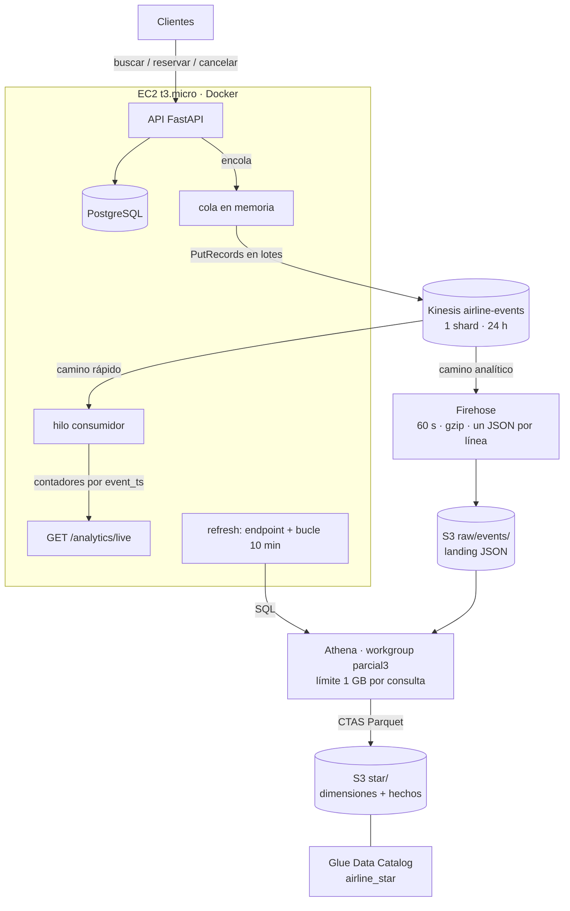
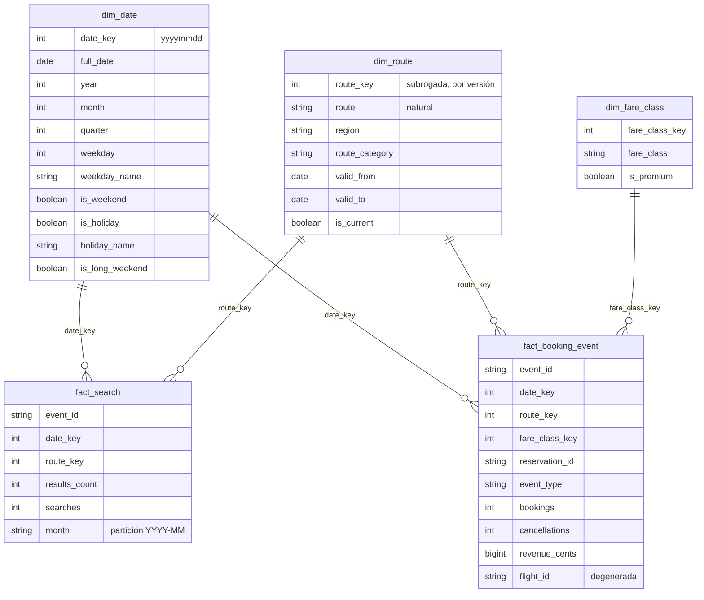

# 5. Decisiones y su justificación

Cada decisión cita el requisito que la exige y los pilares del AWS Well-Architected Framework que
la sostienen: **OE** (excelencia operacional), **SEC** (seguridad), **REL** (fiabilidad), **PERF**
(eficiencia de rendimiento), **COST** (optimización de costos) y **SUS** (sostenibilidad). Las
alternativas descartadas van junto a cada decisión, porque la defensa pregunta por qué no la otra.

## 5.0 Arquitectura

Dos caminos, con latencias y estructuras distintas, alimentados por el mismo stream:

| | Camino rápido | Camino analítico |
|---|---|---|
| Pregunta que responde | ¿Cuánta gente busca y reserva **ahora**? | Historia por fecha, ruta y clase |
| Latencia | segundos (R3: ≤ 10 s) | minutos (R4: ≤ 5 min a S3; refresh ≤ 15 min) |
| Estructura | contadores en memoria por segundo de `event_ts` | modelo estrella en Parquet |
| Lector del stream | hilo consumidor dentro de la API | Firehose |

## 5.1 Qué va al stream y qué no (R1, R2 · REL, PERF)

Cada búsqueda, reserva y cancelación publica **un** evento con el sobre del contrato, `event_ts` del
momento en que ocurrió y la partition key indicada. **Ningún dato personal**: ni el nombre del pasajero
ni nada que lo identifique. El evento va a S3 y a la analítica, que no lo necesita (SEC).

**Por qué las búsquedas encajan en Kinesis.**
- Son muchas, chicas y valiosas en agregado.
- Que se pierda una no le cambia nada a nadie.
- Que la búsqueda se vuelva lenta sí: el cliente se va.

Por eso la API **no le habla a Kinesis desde la request** (decisión D2). Encola el evento en
memoria, lo que lleva microsegundos, y un hilo publica en lotes de hasta 500 registros o 200 ms con
`PutRecords`. Si Kinesis responde que falló una parte del lote, se reintentan **sólo los registros
fallidos**, con espera exponencial. Reintentar el lote entero duplicaría los que sí entraron, y R2
exige exactamente 200 eventos para 200 búsquedas. Si la cola se llena, se descartan búsquedas y se
cuentan.

**Por qué las reservas son delicadas.**
- Son transacciones de negocio: una reserva sin su evento deja la analítica sin ese ingreso.
- Un evento sin reserva sería un ingreso inventado.
- Por eso el evento se encola **después del commit** de PostgreSQL. Nunca se anuncia algo que la
  base no guardó, y la reserva espera lugar en la cola hasta 2 s y se reintenta hasta 50 veces.

**El hueco que queda, y cómo se cierra en producción.**
- Si el proceso muere entre el commit y la publicación, ese evento se pierde: la cola está en memoria.
- La solución estándar es el ***transactional outbox***: la reserva y su evento se escriben en la
  **misma transacción**, el evento en una tabla `outbox`.
- Un publicador lee la tabla, publica en Kinesis y marca el evento como enviado.
- Si se cae a mitad, al volver reenvía lo no marcado. Puede duplicar, pero nunca pierde, y los
  consumidores deduplican por `event_id`.
- No se implementó porque el enunciado pide describirlo. Su costo es una escritura más por reserva.

**Medido:**

| Prueba | Resultado |
|---|---|
| Ráfaga de 200 búsquedas con 50 en paralelo | p95 de **0,094** s en AWS (8 ms en local) |
| Eventos en el stream tras la ráfaga | 200 de 200 |
| Llamadas a Kinesis | 250 eventos salieron en 7 lotes en local |

## 5.2 Dos caminos (R3, R8 · PERF, COST)

**Por qué la vista en vivo lee el stream y no Athena** (decisión D3):
- Athena tarda segundos por consulta, cobra un mínimo de 10 MB por consulta y lee la estrella, que
  se refresca cada ~10 min. La vista en vivo necesita lo que pasó hace 3 segundos.
- Un hilo dentro de la API lee el shard con `GetRecords` cada ~1 s y suma en baldes de **un segundo
  de `event_ts`**. Ignora los eventos fuera de la ventana: el replay del harness, con fechas de 2025,
  no se cuenta aunque llegue recién.
- Recuerda los `event_id` del último horizonte, para no contar dos veces una reentrega: Kinesis
  entrega "al menos una vez".
- Si la API se reinicia, la memoria se pierde, pero al arrancar relee el stream desde hace 60 min
  (la retención es de 24 h) y la vista se reconstruye sola.
- Alternativa descartada: una Lambda con trigger que escriba en DynamoDB. Suma dos servicios que
  pagar y justificar, y en el taller del 03/11 un trigger con `LATEST` tardó más de un minuto en
  empezar a leer, lo que pone en riesgo los 10 s de R3.
- Medido: la vista reflejó las nuevas búsquedas, reservas y cancelaciones en **1,5** s en AWS, y
  después del replay de 17.000 búsquedas viejas contaba sólo las del momento.

**Por qué la estrella se refresca cada pocos minutos y no por evento** (D8):
- Un modelo estrella está hecho para leer mucho, no para escribir de a una fila. En S3 cada
  escritura es un **archivo**.
- Actualizarla por evento generaría miles de archivos de pocos bytes por hora: el *small files
  problem*. Athena tarda y cobra por abrirlos; el mínimo de 10 MB por consulta, por ejemplo,
  multiplicaría el costo.
- Un evento de cancelación obligaría a reescribir su partición entera.
- La deduplicación y los eventos tardíos exigen mirar el conjunto, no el evento suelto.

Por eso la estrella se reconstruye en **micro-lotes**:
- Un bucle dentro de la API mira cada 10 min si llegaron objetos nuevos a la landing (un LIST de
  S3) y sólo entonces reconstruye.
- Además, `POST /admin/refresh-star` lo hace a pedido.
- Sin ese control, un refresh de ~9 sentencias cada 5 min durante el mes costaría ~US$4,30 sólo por
  el mínimo de 10 MB por consulta. Con él, una hora sin tráfico cuesta un LIST.

## 5.3 Landing zone (R4 · OE, COST)

Los eventos llegan a `s3://aerolinea-p3-<cuenta>/raw/events/AAAA/MM/DD/HH/` con **Amazon Data
Firehose** (decisión D4), un servicio de entrega gestionado:
- **Fuente y buffer:** lee del stream y junta 60 s o 1 MB, lo que pase primero.
- **Formato:** comprime en gzip y agrega un salto de línea entre registros (procesador
  `AppendDelimiterToRecord`).
- **Reintentos:** si no puede escribir, reintenta solo; lo que falla va a `errores-firehose/`.

| | Firehose (elegido) | Consumidor propio en la API |
|---|---|---|
| Código propio | ninguno (un script de configuración) | checkpoints, reintentos, archivos, rotación |
| Latencia | 60-120 s (buffer de 60 s) | la que se programe (p. ej., 60 s) |
| Costo | US$0,029/GB, con cada registro redondeado a 5 KB: ~US$0,003 por replay de 20.509 eventos; ~US$0,03/mes en el perfil de prueba | US$0 extra |
| Si la API se reinicia | no afecta | hay que retomar desde el último checkpoint |
| Lecturas del shard | 1 lector más (5 GetRecords/s compartidos) | 1 lector más |

**El salto de línea es obligatorio, no cosmético.**
- Sin él, Firehose deja los JSON pegados (`{…}{…}{…}`), porque los registros del replay del harness
  no traen `\n`.
- El SerDe JSON de Athena lee **un registro por línea**, así que perdería eventos en silencio.
- Se verificó en AWS: un objeto con 5 búsquedas trae 5 JSON separados por 4 saltos de línea.

Medido: los **19.912 eventos distintos** del replay (de 20.509 registros con duplicados) estaban en S3 **61 s** después de inyectarlos, contra un límite de 300 s.

## 5.4 Diseño del modelo estrella (R5, R6, R7 · PERF)

El diseño parte de las preguntas de negocio. Para cada una, la medida, el hecho y las dimensiones:

| Pregunta | Medida | Hecho | Dimensiones (atributo) |
|---|---|---|---|
| Q1 ingreso neto por mes y clase | `SUM(revenue_cents)` | `fact_booking_event` | fecha (`year`, `month`) · clase (`fare_class`) |
| Q2 reservas y cancelaciones por ruta | `SUM(bookings)`, `SUM(cancellations)` | `fact_booking_event` | ruta (`route`) |
| Q3 reservas por día de la semana | `SUM(bookings)` | `fact_booking_event` | fecha (`weekday_name`) |
| Q4 top 10 rutas por ingreso neto | `SUM(revenue_cents)` | `fact_booking_event` | ruta (`route`) |
| Q5 ingreso por categoría vigente | `SUM(revenue_cents)` | `fact_booking_event` | ruta (`route_category` **de la versión**) · fecha (`year`, `month`) |
| Q6 búsquedas y reservas por ruta | `COUNT(*)` / `SUM(searches)`, `SUM(bookings)` | **los dos** | ruta (conformada) |
| Q7 festivos vs. el resto | búsquedas y reservas | **los dos** | fecha (`is_holiday`, conformada) |
| Q8 reservas en días de puente | `SUM(bookings)` | `fact_booking_event` | fecha (`is_long_weekend`) |

**Matriz bus** (hechos y preguntas contra dimensiones):

| | `dim_date` | `dim_route` | `dim_fare_class` |
|---|:---:|:---:|:---:|
| `fact_search` | ✔ | ✔ | — |
| `fact_booking_event` | ✔ | ✔ | ✔ |
| Q1 | ✔ | | ✔ |
| Q2, Q4 | | ✔ | |
| Q3, Q8 | ✔ | | |
| Q5 | ✔ | ✔ (versión) | |
| Q6 | | ✔ (los dos hechos) | |
| Q7 | ✔ (los dos hechos) | | |

**Grano:**
- **`fact_search`:** una fila por **evento de búsqueda distinto**. Está particionada por `month`
  (`YYYY-MM` de `event_ts`), así que una consulta de un mes sólo abre esa carpeta (R10).
- **`fact_booking_event`:** una fila por **evento de reserva distinto**, de creación o de cancelación.
  Es un hecho de transacción con medidas aditivas: una creación suma `bookings = 1` y `+precio`; una
  cancelación, `cancellations = 1` y `−precio`. Así el ingreso neto es un simple `SUM` en
  cualquier corte. No hace falta cruzar la cancelación con su reserva.

**Dimensiones conformadas.**
- `dim_date` y `dim_route` son **las mismas tablas, con las mismas claves**, para los dos hechos.
- Eso permite el *drill-across* de Q6 (conversión) y Q7: cada hecho se agrega por su lado con el
  mismo atributo de la dimensión, y los resultados se pueden poner lado a lado.

**Atributos agregados, además del contrato:**

| Tabla | Atributo | Por qué |
|---|---|---|
| `dim_date` | `day_of_month`, `month_name`, `year_month` | Jerarquía de fechas legible para reportes, sin funciones de fecha en cada consulta |
| `dim_route` | `version` | Muestra en qué versión de la SCD está cada fila |
| `dim_route` | fila `-1 UNKNOWN` | Miembro desconocido (D7): un evento con una ruta fuera del catálogo (alguien busca BOG-XXX) se conserva apuntando a ella, sin huérfanos (R6) |
| `dim_fare_class` | `is_premium` | Agrupa cabinas; incluye `-1 UNKNOWN` por la misma razón |
| `fact_booking_event` | `flight_id` | Dimensión degenerada: permite bajar al vuelo sin una dimensión de vuelos |

**`dim_date`: el calendario enriquecido.**
- Tiene 1.826 días (2023–2027), generados con SQL (`sequence`), y los festivos de `holidays_ref.csv`.
- **Puente:** el festivo que cae viernes o lunes, más el sábado y el domingo de ese fin de semana.
  Como la serie de días es continua, "¿fue festivo ayer, anteayer, mañana o pasado?" sale con
  `lag`/`lead` sobre la fecha.
- Hay una discrepancia: el texto de `contract/STAR.md` habla de *"plus the Monday/Friday that
  completes the three days"*, pero el enunciado (§4.3) y el código del oráculo (`calendar_dates()`)
  sólo marcan el festivo y el fin de semana. Se siguió el código, que es contra lo que se compara:
  **201 días de puente**.

## 5.5 ETL: el mejor proceso para esta carga (R8 · COST, OE, PERF, SUS)

Entre la landing y la estrella hay una transformación:
- deduplicar por `event_id`;
- poner la fecha según `event_ts`;
- resolver las claves subrogadas y la versión de la ruta vigente ese día;
- escribir Parquet y registrar las particiones.

El harness sólo mira el resultado, así que la elección se hizo comparando las alternativas
(decisión D5). El volumen es el de un replay: ~20.500 eventos, ~5 MB de JSON.

| Criterio | **Athena CTAS orquestado por la API** (elegido) | Lambda + DuckDB/pandas | Glue job (Spark G.1X ×2) | DuckDB dentro de la EC2 |
|---|---|---|---|---|
| Costo por corrida | DDL gratis; 2 CTAS × 10 MB mínimo = **~US$0,0001** | 1 GB × ~20 s ≈ US$0,0003 | 2 DPU × mín. 1 min × US$0,44/DPU-h ≈ **US$0,015**; real, con arranque, ~US$0,03 | US$0 extra |
| Costo por mes (150 refrescos) | **~US$0,02** | ~US$0,05 | ~US$2,2–4,5 | US$0 |
| Arranque vs. los 15 min | segundos | ~1-5 s (arranque en frío) | ~1 min | inmediato |
| Medido | refresh completo (dimensiones existentes + 2 hechos) en **20 s** en AWS, con el replay entero | — | — | — |
| Crecimiento de volumen | serverless: escala solo hasta TB | tope de 15 min y 10 GB de RAM | escala agregando workers | 1 GB de RAM: no escala |
| Operación | nada que desplegar; SQL legible; estado vía la API | empaquetar DuckDB, guardar el estado, registrar el catálogo a mano | job, rol, script en S3; estado con `get_job_run` | acopla el ETL al servidor web |
| Catálogo y particiones | **CTAS los registra solo** (R5) | a mano (API de Glue) | con el *sink* del catálogo | a mano |
| Idempotencia | rebuild: `DROP` + vaciar la ubicación + `CTAS` | sobrescribir la salida | modo `overwrite` | sobrescribir |

**Por qué Athena.** Es la única opción que no agrega un servicio de cómputo: el SQL corre donde ya
están los datos, y CTAS deja la tabla en Parquet y registrada en el catálogo de un solo paso.
- **Costo:** dos órdenes de magnitud menos que Glue para este volumen (~US$0,02 contra US$2–4 al mes).
- **Arranque:** está muy por debajo de los 15 min de R8.
- **Sostenibilidad:** nada queda prendido entre refrescos.
- **Defensa:** el SQL es lo más fácil de mostrar y modificar en vivo.

**Rebuild completo** (decisión D6): cada refresh relee toda la landing y reescribe los hechos.
- Es **idempotente por construcción**: correrlo dos veces da lo mismo.
- Los eventos tardíos y desordenados caen solos en su fecha.
- Antes de cada CTAS se vacía su `external_location`, porque Athena no escribe sobre datos que ya
  existen.
- Las dimensiones son estáticas (D11): se construyen una vez y se rehacen sólo si cambia `ref/`.

**Cuándo cambiaría la decisión:**
- **Volumen:** si la landing pasa de ~10 GB, el rebuild completo escanea cada vez más y se acerca a
  los 15 min y a costos que importan. Ahí conviene un ETL **incremental**: procesar sólo lo llegado
  desde el último refresh y reescribir únicamente las particiones de fecha afectadas, con tablas
  **Iceberg** y `MERGE` en Athena o con Glue Spark.
- **Lógica:** si la transformación dejara de ser expresable en SQL (por ejemplo, un enriquecimiento
  con un modelo), un job de Glue.

## 5.6 Dimensiones lentamente cambiantes (R9 · REL)

**Por qué tipo 2 para la categoría de la ruta.**
- La categoría (REGIONAL o TRUNK) cambia en el tiempo: con la semilla 12345, CLO-CTG, BOG-SMR y
  BAQ-CUC cambian el 2025-02-01.
- Q5 pide el ingreso por la categoría **que la ruta tenía el día del evento**.
- Con **tipo 2**, cada cambio es una fila nueva (`valid_from` inclusivo y `valid_to` exclusivo; la
  vigente cierra en 9999-12-31 con `is_current`). La clave subrogada `route_key` identifica la
  **versión**, y cada hecho apunta a la versión vigente en su fecha, con un *as-of join*:
  `valid_from <= fecha < valid_to`.

**Qué respondería mal una tipo 1.** Una tipo 1 sobrescribe la categoría: la historia queda
reescrita con la categoría actual. Se calculó con el oráculo del harness:

| Mes | Categoría | Tipo 2 (correcto) | Tipo 1 (historia reescrita) | Error |
|---|---|---:|---:|---:|
| 2025-01 | REGIONAL | 2.621.376 | 3.637.804 | **+38,8 %** |
| 2025-01 | TRUNK | 2.393.590 | 1.377.162 | **−42,5 %** |
| 2025-02 y 03 | ambas | = | = | 0 % |

Enero queda mal por 1.016.428 unidades de ingreso (274 eventos de reserva de las tres rutas que
cambiaron): la tipo 1 los cuenta como si siempre hubieran tenido la categoría nueva.

**Versión para un evento tardío.**
- La versión se elige por la **fecha del evento** (`event_ts`), nunca por la de llegada ni por
  `is_current`.
- Un evento de enero que llega en marzo se une con la versión vigente en enero.
- Como el refresh es un rebuild completo, el resultado no depende del orden de llegada.

## 5.7 Eventos sucios (R8 · REL)

El replay trae 3 % de duplicados, 2 % de eventos tardíos y 1 % de eventos desordenados: 20.509
llegadas para 19.912 eventos distintos.

| Problema | Qué se hace |
|---|---|
| **Duplicados** | Kinesis entrega "al menos una vez" y la landing es *append-only*. Al construir cada hecho, `row_number() OVER (PARTITION BY event_id)` se queda con una copia. Grano: una fila por `event_id` (R6) |
| **Tardíos** | `date_key` y la partición `month` salen de `event_ts`, no de la hora de llegada. Un evento tardío cae en su fecha. Con un ETL incremental habría que reescribir particiones viejas; con el rebuild completo no hace falta |
| **Desordenados** | No cambian nada: no hay lógica que dependa del orden de llegada. La vista en vivo también cuenta por `event_ts` |

**La trampa del replay de la defensa.**
- El harness del profesor corre con un `probe_salt` secreto, y sus eventos reutilizan **los mismos
  `event_id`** que nuestras corridas de prueba, con otro contenido. Medido: 19.634 de 19.912 ids
  coinciden, con otra fecha, ruta y precio.
- Si la landing conserva las corridas de prueba, la deduplicación mezcla las dos versiones.
- Se midió en la simulación local: el bloque de la estrella baja de **41 a 20 puntos** (R7 queda en 0).
- Por eso, antes de la defensa se **archiva** la landing (decisión D12, `infra/80-archivar-landing.sh`):
  `raw/events/` se mueve a `archive/<fecha>/`, fuera de `raw_events_uri`, sin borrar la evidencia, y
  se reconstruye la estrella.
- Con la landing archivada, la simulación vuelve a 41 de 41.
- En producción no pasa: un `event_id` es un UUID y no se reutiliza. Es un artefacto del entorno de
  prueba, y se trata como el reinicio de ese entorno.

## 5.8 Costos y ciclo de vida (R11, R12 · COST, SUS)

**Qué existe siempre y qué sólo mientras se prueba:**

| Recurso | Ciclo de vida | Cobra |
|---|---|---|
| Stream de Kinesis (1 shard, R11) | **sólo durante las pruebas**: `infra/01` lo crea, `infra/90` lo borra al terminar | US$0,015 por hora que existe |
| Firehose | con el stream (su fuente) | sólo por GB entregado |
| EC2 t3.micro (API, base, consumidor, refresh) | siempre (la del P2, D1) | US$0,0104/h + EBS + IPv4 |
| S3 (landing, estrella, ref) | siempre | centavos |
| Glue Data Catalog, workgroup | siempre | gratis a este volumen |
| Athena | por consulta | US$5/TB, mínimo 10 MB |

**Servicios, por qué y la alternativa descartada:**

| Servicio | Para qué | Alternativa descartada | Pilar |
|---|---|---|---|
| Kinesis Data Streams, provisionado, 1 shard | El stream de eventos | On-demand: cobra por hora de stream más por GB y sale más caro a este volumen. Más shards: 1 alcanza para 1.000 registros/s | COST |
| Amazon Data Firehose | Entrega gestionada a S3 | Consumidor propio (§5.3) | OE |
| EC2 (la del P2) | API + PostgreSQL + consumidor + orquestación | Lambda + API Gateway + RDS: más piezas y RDS cobra aparte | COST |
| S3 | Landing JSON gzip y estrella Parquet | — | COST, SUS |
| Athena + Glue Data Catalog | ETL (CTAS) y consultas | Glue jobs, Redshift: cobran por cómputo prendido | COST |

**`cost_projection.yaml`** (decisión D9: perfil de prueba):

| Línea | US$/mes |
|---|---:|
| Kinesis: 1 shard × ~200 h de prueba + PUT units | 3,01 |
| EC2 t3.micro × 730 h | 7,59 |
| Firehose: ~1 GB facturable (5 KB por registro) | 0,03 |
| S3 | 0,05 |
| Athena: ~15 GB facturables por mínimos de 10 MB | 0,08 |
| Glue Data Catalog | 0,00 |
| **Total que calcula el harness** | **10,76** |

**Narrativa del costo.**
- **El shard es lo que más pesa del camino nuevo, y cobra exista o no tráfico.** Por eso no vive
  todo el mes: se crea al empezar cada sesión de pruebas y se borra al terminarla. Un shard olvidado
  un mes son US$10,95, más que todo lo demás del parcial junto.
- **No declarados:** el disco EBS de 8 GB (US$0,64) y la IPv4 pública (US$3,65) de la EC2, que ya
  existían para el P2, se dejan fuera de los *line items* con el mismo criterio del P2. Con ellos, el
  perfil de prueba cuesta **~US$15,05/mes**.
- **Producción 24×7:** con el stream siempre arriba, son **~US$23/mes** (US$10,95 de shard +
  US$11,88 de EC2, EBS e IPv4 + ~US$0,2 del resto). Sigue lejos del tope de US$50.

**Sostenibilidad.**
- Nada de cómputo queda prendido sin uso, salvo la EC2.
- Parquet particionado y columnar hace que una consulta de un mes escanee **3.798 B** en vez de los 11.177 B de todos los meses (0,34, medido en AWS por R10).
- La landing va comprimida en gzip.
- La retención del stream es la mínima (24 h).

## 5.9 Seguridad y límites (R10 · SEC, COST)

- **Workgroup propio `parcial3`, con límite de 1 GB por consulta** (`BytesScannedCutoffPerQuery`).
  Ninguna consulta, ni siquiera un error, puede costar más de ~US$0,005. No se tocó `primary`, que
  usan las otras prácticas.
- **`EnforceWorkGroupConfiguration = false`, a propósito.** Lo encontramos en AWS el 24/11: con
  `true`, Athena rechaza todo CTAS con `external_location` (*"…enforces a centralized output
  location…"*). El rebuild necesita ubicaciones fijas para poder vaciarlas. El límite por consulta
  es un control del workgroup y se aplica igual.
- **Sin credenciales en el código ni en el repo.** La EC2 usa el instance profile (`LabRole`, el
  único rol del Learner Lab), y CloudShell usa las credenciales de la sesión.
- **Datos personales.** El nombre del pasajero queda en PostgreSQL. No viaja en los eventos, no
  llega a S3 ni a la analítica.
- **Superficie expuesta.**
  - Desde afuera sólo se ve el 8000, que lo necesita el harness del profesor; PostgreSQL no publica puertos.
  - El 22 sólo está abierto a EC2 Instance Connect.
  - El bucket es privado, con *Block Public Access*.
