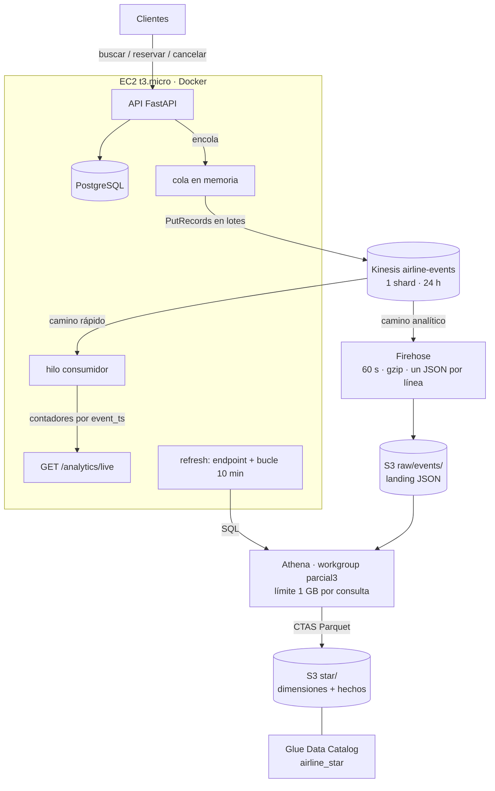
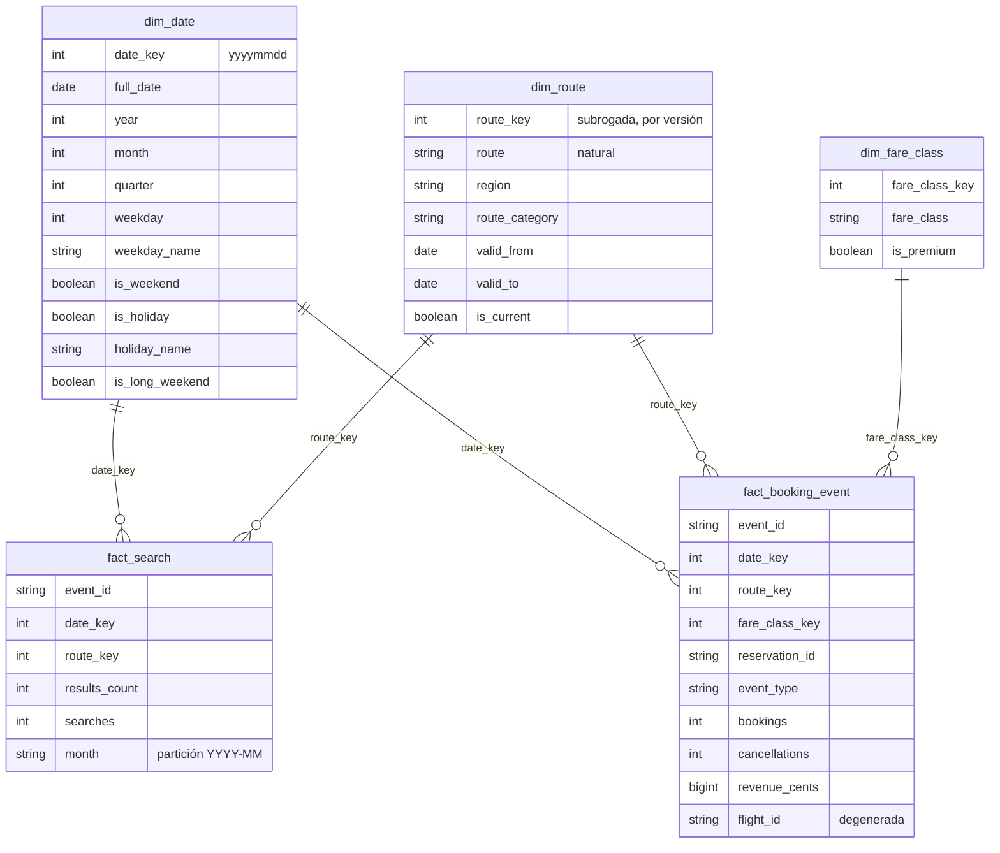

# Parcial 3 — Eventos, vista en vivo y modelo estrella

**Big Data e Ingeniería de Datos (PCIA 5010)** · Universidad Sergio Arboleda

**Estudiante:** Andres Felipe Cespedes Rondon · **Modalidad:** individual · **Semilla:** 12345 · **Fecha:** 24 de noviembre de 2026

**Repositorio:** <https://github.com/Pipelol0723/bigdata-ing-datos> — carpeta `entregas/parcial-3-eventos-estrella/`

> Archivo generado por `entrega/construir_documento.py` a partir de `documento/`.

# Cómo leer este documento

Responde la entrega final del tercer parcial (§7 del enunciado): las **secciones 5 y 6**, con la
misma numeración del enunciado, y el registro de prompts como anexo obligatorio. Antes va una
introducción con la **matriz de trazabilidad** de R1 a R12, y al final dos anexos más: qué partes se
tocan ante un cambio en vivo (para la defensa) y el reporte del harness sin editar.

| Parte | Qué contiene |
|---|---|
| Introducción | El sistema, el resultado (70/70) y cada requisito con su pieza y su medición |
| 5 · Decisiones | Arquitectura, qué va al stream, los dos caminos, la landing zone, el modelo estrella (matriz bus y grano), la comparación de ETL, la SCD, los eventos sucios y los costos, cada uno con su requisito y su pilar de Well-Architected |
| 6 · Harness | Cómo se corrió (en local y en AWS), qué dio y lo que enseñó el Learner Lab |
| Anexo A | Registro de prompts |
| Anexo B | Impacto de cambios: qué se toca si el profesor pide una medida, un atributo o un evento nuevo |
| Anexo C | `report.md` del harness, tal cual |

El código, los scripts y la evidencia están en <https://github.com/Pipelol0723/bigdata-ing-datos>, carpeta `entregas/parcial-3-eventos-estrella/`.

# Introducción: el sistema y la trazabilidad

## Qué se construyó

El sistema de reservas de los parciales anteriores ahora **reacciona a los eventos a medida que
ocurren**:

1. **Eventos.** Cada búsqueda, reserva y cancelación de la API publica un evento en un stream de
   **Amazon Kinesis** de un shard. Se publica desde una cola en memoria, así que publicar no frena a
   quien busca.
2. **Camino rápido (segundos).** Un consumidor del stream dentro de la API cuenta los eventos de los
   últimos minutos por **cuándo ocurrieron**, y responde `GET /analytics/live`.
3. **Camino analítico (minutos).** **Amazon Data Firehose** lleva los mismos eventos a una landing
   zone en S3. Cada pocos minutos, **Athena** reconstruye con SQL un **modelo estrella** en Parquet:
   deduplica, ubica los eventos tardíos en su fecha y elige la versión de la ruta vigente ese día.
   Las tablas quedan registradas en el **Glue Data Catalog** y se consultan con Athena.

La API, la base y el frontend son los del parcial 2, en la misma EC2. El enunciado fija que lo más
barato que cumpla es lo mejor: cada pieza es la versión mínima que pasa su requisito, y todas se
midieron contra el harness del profesor, primero en local y después en AWS.

**Semilla asignada: 12345** (individual). Son las mismas 10 rutas del parcial 2; tres cambian de
categoría el 2025-02-01.

## Resultado

| Aspecto | Valor |
|---|---|
| Harness del profesor contra lo desplegado (24/11/2026) | **70,0 / 70,0**: 29 tests en 2 min 46 s, en la primera corrida completa |
| Antes de AWS, en local y gratis | 63 de 70 con los mismos tests (DuckDB en lugar de Athena, moto en lugar de Kinesis); R4 y R11 sólo se pueden medir en AWS |
| Replay sucio del harness | 20.509 registros → **19.912 eventos distintos**, todos en S3 a los 61 s; estrella reconstruida en 20 s |
| Costo de la sesión de AWS del parcial | ~US$0,10 (stream ~1 h, Firehose, Athena y la EC2 que ya existía) |
| Proyección mensual declarada | **US$10,76** (perfil de prueba); ~US$15 con EBS e IPv4; ~US$23 en producción 24×7 |

## Matriz de trazabilidad

Cada requisito, la pieza que lo cumple, dónde está y la medición del harness en AWS
(`evidencia/harness-2026-11-24_0632/report.md`).

| Req | Pts | Cómo se cumple | Dónde | Medición en AWS |
|---|---|---|---|---|
| R1 · un evento válido por acción | 7 | Sobre del contrato; `event_ts` del momento de la acción; partition key `session_id` (búsquedas) o `flight_id` (reservas); sin datos personales; la reserva publica después del commit | `app/main.py`, `app/eventos.py` | 30 eventos para 30 búsquedas; 4 para 3 reservas + 1 cancelación |
| R2 · sin pérdida, API rápida | 6 | Cola en memoria + hilo con `PutRecords` en lotes; se reintentan sólo los registros fallidos | `app/eventos.py` | 200 de 200 eventos; p95 **0,094 s** con 50 en paralelo |
| R3 · vista en vivo por tiempo del evento | 7 | Consumidor del stream en la API; baldes por segundo de `event_ts`; ignora lo viejo y lo duplicado | `app/en_vivo.py` | deltas exactos en **1,5 s**; el replay de 17.000 búsquedas viejas no se contó |
| R4 · todo llega a S3 en ≤ 5 min | 4 | Firehose: buffer de 60 s, gzip, un JSON por línea | `infra/01-bucket-stream-firehose.sh` | **19.912 / 19.912** en 61 s |
| R5 · tablas del contrato | 7 | CTAS de Athena a Parquet, registradas en Glue; `fact_search` particionada por `month`; `dim_date` 2023–2027 con festivos y puentes | `app/sql/10_dimensiones.sql`, `20_hechos.sql` | columnas, tipos, Parquet, particiones y las 1.826 filas de `dim_date` correctas |
| R6 · integridad | 5 | Claves subrogadas únicas; miembro `UNKNOWN` (-1) contra huérfanos; dedup por `event_id` | `app/sql/*.sql` | sin duplicados ni huérfanos |
| R7 · Q1, Q2, Q3, Q4, Q6, Q7, Q8 | 11 | Medidas aditivas (`bookings`, `cancellations`, `revenue_cents` con signo); dimensiones conformadas | `app/sql/20_hechos.sql` | las 7 preguntas iguales al oráculo |
| R8 · sucios y refresh ≤ 15 min | 6 | Rebuild completo idempotente; dedup; fecha por `event_ts`; `POST /admin/refresh-star` y su estado | `app/estrella.py` | refresh en **20 s**; conteos por evento y por fecha exactos |
| R9 · SCD tipo 2 | 8 | Versiones con `valid_from` / `valid_to` / `is_current`; *as-of join* por la fecha del evento | `app/sql/10_dimensiones.sql`, `20_hechos.sql` | versiones y Q5 correctas |
| R10 · poda y límite | 4 | Partición por mes en Parquet; workgroup `parcial3` con 1 GB por consulta | `infra/02-athena-y-dimensiones.sh` | un mes escaneó **3.798 B** contra 11.177 B (0,34) |
| R11 · stream mínimo | 3 | Provisionado, 1 shard, 24 h, sin EFO; se crea y se borra por script | `infra/01`, `infra/90` | `PROVISIONED`, 1 shard, 24 h, 0 consumidores |
| R12 · proyección | 2 | `cost_projection.yaml` con Kinesis, EC2, Firehose, S3, Athena y Glue | `cost_projection.yaml` | US$10,76 ≤ US$50 |

## Cómo está organizado el repositorio

| Carpeta | Contenido |
|---|---|
| `app/` | API (FastAPI): `main.py`, `eventos.py` (publicador), `en_vivo.py` (consumidor), `estrella.py` (refresh) y `sql/` (el ETL en SQL de Athena) |
| `infra/` | Scripts de CloudShell: `01`–`03` levantan la sesión (`10` los corre en orden), `20` corre el harness, `80` archiva la landing antes de la defensa, `90` baja el stream al terminar y `99` audita. Sólo leen salvo con `--confirmo` |
| `local/` | Pruebas a US$0 con el harness original: `sim_local.py` (estrella con DuckDB) y `sim_api.py` (API con moto) |
| `harness/` | El harness del profesor, intacto, más `config.yaml` (sin credenciales) |
| `evidencia/` | `report.md` de cada corrida en AWS |
| `cost_projection.yaml` | La proyección mensual (R12) |

# 5. Decisiones y su justificación

Cada decisión cita el requisito que la exige y los pilares del AWS Well-Architected Framework que
la sostienen: **OE** (excelencia operacional), **SEC** (seguridad), **REL** (fiabilidad), **PERF**
(eficiencia de rendimiento), **COST** (optimización de costos) y **SUS** (sostenibilidad). Las
alternativas descartadas van junto a cada decisión, porque la defensa pregunta por qué no la otra.

## 5.0 Arquitectura

Dos caminos, con latencias y estructuras distintas, alimentados por el mismo stream:

| | Camino rápido | Camino analítico |
|---|---|---|
| Pregunta que responde | ¿Cuánta gente busca y reserva **ahora**? | Historia por fecha, ruta y clase |
| Latencia | segundos (R3: ≤ 10 s) | minutos (R4: ≤ 5 min a S3; refresh ≤ 15 min) |
| Estructura | contadores en memoria por segundo de `event_ts` | modelo estrella en Parquet |
| Lector del stream | hilo consumidor dentro de la API | Firehose |

## 5.1 Qué va al stream y qué no (R1, R2 · REL, PERF)

Cada búsqueda, reserva y cancelación publica **un** evento con el sobre del contrato, `event_ts` del
momento en que ocurrió y la partition key indicada. **Ningún dato personal**: ni el nombre del pasajero
ni nada que lo identifique. El evento va a S3 y a la analítica, que no lo necesita (SEC).

**Por qué las búsquedas encajan en Kinesis.**

- Son muchas, chicas y valiosas en agregado.
- Que se pierda una no le cambia nada a nadie.
- Que la búsqueda se vuelva lenta sí: el cliente se va.

Por eso la API **no le habla a Kinesis desde la request** (decisión D2). Encola el evento en
memoria, lo que lleva microsegundos, y un hilo publica en lotes de hasta 500 registros o 200 ms con
`PutRecords`. Si Kinesis responde que falló una parte del lote, se reintentan **sólo los registros
fallidos**, con espera exponencial. Reintentar el lote entero duplicaría los que sí entraron, y R2
exige exactamente 200 eventos para 200 búsquedas. Si la cola se llena, se descartan búsquedas y se
cuentan.

**Por qué las reservas son delicadas.**

- Son transacciones de negocio: una reserva sin su evento deja la analítica sin ese ingreso.
- Un evento sin reserva sería un ingreso inventado.
- Por eso el evento se encola **después del commit** de PostgreSQL. Nunca se anuncia algo que la
  base no guardó, y la reserva espera lugar en la cola hasta 2 s y se reintenta hasta 50 veces.

**El hueco que queda, y cómo se cierra en producción.**

- Si el proceso muere entre el commit y la publicación, ese evento se pierde: la cola está en memoria.
- La solución estándar es el ***transactional outbox***: la reserva y su evento se escriben en la
  **misma transacción**, el evento en una tabla `outbox`.
- Un publicador lee la tabla, publica en Kinesis y marca el evento como enviado.
- Si se cae a mitad, al volver reenvía lo no marcado. Puede duplicar, pero nunca pierde, y los
  consumidores deduplican por `event_id`.
- No se implementó porque el enunciado pide describirlo. Su costo es una escritura más por reserva.

**Medido:**

| Prueba | Resultado |
|---|---|
| Ráfaga de 200 búsquedas con 50 en paralelo | p95 de **0,094** s en AWS (8 ms en local) |
| Eventos en el stream tras la ráfaga | 200 de 200 |
| Llamadas a Kinesis | 250 eventos salieron en 7 lotes en local |

## 5.2 Dos caminos (R3, R8 · PERF, COST)

**Por qué la vista en vivo lee el stream y no Athena** (decisión D3):

- Athena tarda segundos por consulta, cobra un mínimo de 10 MB por consulta y lee la estrella, que
  se refresca cada ~10 min. La vista en vivo necesita lo que pasó hace 3 segundos.
- Un hilo dentro de la API lee el shard con `GetRecords` cada ~1 s y suma en baldes de **un segundo
  de `event_ts`**. Ignora los eventos fuera de la ventana: el replay del harness, con fechas de 2025,
  no se cuenta aunque llegue recién.
- Recuerda los `event_id` del último horizonte, para no contar dos veces una reentrega: Kinesis
  entrega "al menos una vez".
- Si la API se reinicia, la memoria se pierde, pero al arrancar relee el stream desde hace 60 min
  (la retención es de 24 h) y la vista se reconstruye sola.
- Alternativa descartada: una Lambda con trigger que escriba en DynamoDB. Suma dos servicios que
  pagar y justificar, y en el taller del 03/11 un trigger con `LATEST` tardó más de un minuto en
  empezar a leer, lo que pone en riesgo los 10 s de R3.
- Medido: la vista reflejó las nuevas búsquedas, reservas y cancelaciones en **1,5** s en AWS, y
  después del replay de 17.000 búsquedas viejas contaba sólo las del momento.

**Por qué la estrella se refresca cada pocos minutos y no por evento** (D8):

- Un modelo estrella está hecho para leer mucho, no para escribir de a una fila. En S3 cada
  escritura es un **archivo**.
- Actualizarla por evento generaría miles de archivos de pocos bytes por hora: el *small files
  problem*. Athena tarda y cobra por abrirlos; el mínimo de 10 MB por consulta, por ejemplo,
  multiplicaría el costo.
- Un evento de cancelación obligaría a reescribir su partición entera.
- La deduplicación y los eventos tardíos exigen mirar el conjunto, no el evento suelto.

Por eso la estrella se reconstruye en **micro-lotes**:

- Un bucle dentro de la API mira cada 10 min si llegaron objetos nuevos a la landing (un LIST de
  S3) y sólo entonces reconstruye.
- Además, `POST /admin/refresh-star` lo hace a pedido.
- Sin ese control, un refresh de ~9 sentencias cada 5 min durante el mes costaría ~US$4,30 sólo por
  el mínimo de 10 MB por consulta. Con él, una hora sin tráfico cuesta un LIST.

## 5.3 Landing zone (R4 · OE, COST)

Los eventos llegan a `s3://aerolinea-p3-<cuenta>/raw/events/AAAA/MM/DD/HH/` con **Amazon Data
Firehose** (decisión D4), un servicio de entrega gestionado:

- **Fuente y buffer:** lee del stream y junta 60 s o 1 MB, lo que pase primero.
- **Formato:** comprime en gzip y agrega un salto de línea entre registros (procesador
  `AppendDelimiterToRecord`).
- **Reintentos:** si no puede escribir, reintenta solo; lo que falla va a `errores-firehose/`.

| | Firehose (elegido) | Consumidor propio en la API |
|---|---|---|
| Código propio | ninguno (un script de configuración) | checkpoints, reintentos, archivos, rotación |
| Latencia | 60-120 s (buffer de 60 s) | la que se programe (p. ej., 60 s) |
| Costo | US$0,029/GB, con cada registro redondeado a 5 KB: ~US$0,003 por replay de 20.509 eventos; ~US$0,03/mes en el perfil de prueba | US$0 extra |
| Si la API se reinicia | no afecta | hay que retomar desde el último checkpoint |
| Lecturas del shard | 1 lector más (5 GetRecords/s compartidos) | 1 lector más |

**El salto de línea es obligatorio, no cosmético.**

- Sin él, Firehose deja los JSON pegados (`{…}{…}{…}`), porque los registros del replay del harness
  no traen `\n`.
- El SerDe JSON de Athena lee **un registro por línea**, así que perdería eventos en silencio.
- Se verificó en AWS: un objeto con 5 búsquedas trae 5 JSON separados por 4 saltos de línea.

Medido: los **19.912 eventos distintos** del replay (de 20.509 registros con duplicados) estaban en S3 **61 s** después de inyectarlos, contra un límite de 300 s.

## 5.4 Diseño del modelo estrella (R5, R6, R7 · PERF)

El diseño parte de las preguntas de negocio. Para cada una, la medida, el hecho y las dimensiones:

| Pregunta | Medida | Hecho | Dimensiones (atributo) |
|---|---|---|---|
| Q1 ingreso neto por mes y clase | `SUM(revenue_cents)` | `fact_booking_event` | fecha (`year`, `month`) · clase (`fare_class`) |
| Q2 reservas y cancelaciones por ruta | `SUM(bookings)`, `SUM(cancellations)` | `fact_booking_event` | ruta (`route`) |
| Q3 reservas por día de la semana | `SUM(bookings)` | `fact_booking_event` | fecha (`weekday_name`) |
| Q4 top 10 rutas por ingreso neto | `SUM(revenue_cents)` | `fact_booking_event` | ruta (`route`) |
| Q5 ingreso por categoría vigente | `SUM(revenue_cents)` | `fact_booking_event` | ruta (`route_category` **de la versión**) · fecha (`year`, `month`) |
| Q6 búsquedas y reservas por ruta | `COUNT(*)` / `SUM(searches)`, `SUM(bookings)` | **los dos** | ruta (conformada) |
| Q7 festivos vs. el resto | búsquedas y reservas | **los dos** | fecha (`is_holiday`, conformada) |
| Q8 reservas en días de puente | `SUM(bookings)` | `fact_booking_event` | fecha (`is_long_weekend`) |

**Matriz bus** (hechos y preguntas contra dimensiones):

| | `dim_date` | `dim_route` | `dim_fare_class` |
|---|:---:|:---:|:---:|
| `fact_search` | ✔ | ✔ | — |
| `fact_booking_event` | ✔ | ✔ | ✔ |
| Q1 | ✔ | | ✔ |
| Q2, Q4 | | ✔ | |
| Q3, Q8 | ✔ | | |
| Q5 | ✔ | ✔ (versión) | |
| Q6 | | ✔ (los dos hechos) | |
| Q7 | ✔ (los dos hechos) | | |

**Grano:**

- **`fact_search`:** una fila por **evento de búsqueda distinto**. Está particionada por `month`
  (`YYYY-MM` de `event_ts`), así que una consulta de un mes sólo abre esa carpeta (R10).
- **`fact_booking_event`:** una fila por **evento de reserva distinto**, de creación o de cancelación.
  Es un hecho de transacción con medidas aditivas: una creación suma `bookings = 1` y `+precio`; una
  cancelación, `cancellations = 1` y `−precio`. Así el ingreso neto es un simple `SUM` en
  cualquier corte. No hace falta cruzar la cancelación con su reserva.

**Dimensiones conformadas.**

- `dim_date` y `dim_route` son **las mismas tablas, con las mismas claves**, para los dos hechos.
- Eso permite el *drill-across* de Q6 (conversión) y Q7: cada hecho se agrega por su lado con el
  mismo atributo de la dimensión, y los resultados se pueden poner lado a lado.

**Atributos agregados, además del contrato:**

| Tabla | Atributo | Por qué |
|---|---|---|
| `dim_date` | `day_of_month`, `month_name`, `year_month` | Jerarquía de fechas legible para reportes, sin funciones de fecha en cada consulta |
| `dim_route` | `version` | Muestra en qué versión de la SCD está cada fila |
| `dim_route` | fila `-1 UNKNOWN` | Miembro desconocido (D7): un evento con una ruta fuera del catálogo (alguien busca BOG-XXX) se conserva apuntando a ella, sin huérfanos (R6) |
| `dim_fare_class` | `is_premium` | Agrupa cabinas; incluye `-1 UNKNOWN` por la misma razón |
| `fact_booking_event` | `flight_id` | Dimensión degenerada: permite bajar al vuelo sin una dimensión de vuelos |

**`dim_date`: el calendario enriquecido.**

- Tiene 1.826 días (2023–2027), generados con SQL (`sequence`), y los festivos de `holidays_ref.csv`.
- **Puente:** el festivo que cae viernes o lunes, más el sábado y el domingo de ese fin de semana.
  Como la serie de días es continua, "¿fue festivo ayer, anteayer, mañana o pasado?" sale con
  `lag`/`lead` sobre la fecha.
- Hay una discrepancia: el texto de `contract/STAR.md` habla de *"plus the Monday/Friday that
  completes the three days"*, pero el enunciado (§4.3) y el código del oráculo (`calendar_dates()`)
  sólo marcan el festivo y el fin de semana. Se siguió el código, que es contra lo que se compara:
  **201 días de puente**.

## 5.5 ETL: el mejor proceso para esta carga (R8 · COST, OE, PERF, SUS)

Entre la landing y la estrella hay una transformación:

- deduplicar por `event_id`;
- poner la fecha según `event_ts`;
- resolver las claves subrogadas y la versión de la ruta vigente ese día;
- escribir Parquet y registrar las particiones.

El harness sólo mira el resultado, así que la elección se hizo comparando las alternativas
(decisión D5). El volumen es el de un replay: ~20.500 eventos, ~5 MB de JSON.

| Criterio | **Athena CTAS orquestado por la API** (elegido) | Lambda + DuckDB/pandas | Glue job (Spark G.1X ×2) | DuckDB dentro de la EC2 |
|---|---|---|---|---|
| Costo por corrida | DDL gratis; 2 CTAS × 10 MB mínimo = **~US$0,0001** | 1 GB × ~20 s ≈ US$0,0003 | 2 DPU × mín. 1 min × US$0,44/DPU-h ≈ **US$0,015**; real, con arranque, ~US$0,03 | US$0 extra |
| Costo por mes (150 refrescos) | **~US$0,02** | ~US$0,05 | ~US$2,2–4,5 | US$0 |
| Arranque vs. los 15 min | segundos | ~1-5 s (arranque en frío) | ~1 min | inmediato |
| Medido | refresh completo (dimensiones existentes + 2 hechos) en **20 s** en AWS, con el replay entero | — | — | — |
| Crecimiento de volumen | serverless: escala solo hasta TB | tope de 15 min y 10 GB de RAM | escala agregando workers | 1 GB de RAM: no escala |
| Operación | nada que desplegar; SQL legible; estado vía la API | empaquetar DuckDB, guardar el estado, registrar el catálogo a mano | job, rol, script en S3; estado con `get_job_run` | acopla el ETL al servidor web |
| Catálogo y particiones | **CTAS los registra solo** (R5) | a mano (API de Glue) | con el *sink* del catálogo | a mano |
| Idempotencia | rebuild: `DROP` + vaciar la ubicación + `CTAS` | sobrescribir la salida | modo `overwrite` | sobrescribir |

**Por qué Athena.** Es la única opción que no agrega un servicio de cómputo: el SQL corre donde ya
están los datos, y CTAS deja la tabla en Parquet y registrada en el catálogo de un solo paso.

- **Costo:** dos órdenes de magnitud menos que Glue para este volumen (~US$0,02 contra US$2–4 al mes).
- **Arranque:** está muy por debajo de los 15 min de R8.
- **Sostenibilidad:** nada queda prendido entre refrescos.
- **Defensa:** el SQL es lo más fácil de mostrar y modificar en vivo.

**Rebuild completo** (decisión D6): cada refresh relee toda la landing y reescribe los hechos.

- Es **idempotente por construcción**: correrlo dos veces da lo mismo.
- Los eventos tardíos y desordenados caen solos en su fecha.
- Antes de cada CTAS se vacía su `external_location`, porque Athena no escribe sobre datos que ya
  existen.
- Las dimensiones son estáticas (D11): se construyen una vez y se rehacen sólo si cambia `ref/`.

**Cuándo cambiaría la decisión:**

- **Volumen:** si la landing pasa de ~10 GB, el rebuild completo escanea cada vez más y se acerca a
  los 15 min y a costos que importan. Ahí conviene un ETL **incremental**: procesar sólo lo llegado
  desde el último refresh y reescribir únicamente las particiones de fecha afectadas, con tablas
  **Iceberg** y `MERGE` en Athena o con Glue Spark.
- **Lógica:** si la transformación dejara de ser expresable en SQL (por ejemplo, un enriquecimiento
  con un modelo), un job de Glue.

## 5.6 Dimensiones lentamente cambiantes (R9 · REL)

**Por qué tipo 2 para la categoría de la ruta.**

- La categoría (REGIONAL o TRUNK) cambia en el tiempo: con la semilla 12345, CLO-CTG, BOG-SMR y
  BAQ-CUC cambian el 2025-02-01.
- Q5 pide el ingreso por la categoría **que la ruta tenía el día del evento**.
- Con **tipo 2**, cada cambio es una fila nueva (`valid_from` inclusivo y `valid_to` exclusivo; la
  vigente cierra en 9999-12-31 con `is_current`). La clave subrogada `route_key` identifica la
  **versión**, y cada hecho apunta a la versión vigente en su fecha, con un *as-of join*:
  `valid_from <= fecha < valid_to`.

**Qué respondería mal una tipo 1.** Una tipo 1 sobrescribe la categoría: la historia queda
reescrita con la categoría actual. Se calculó con el oráculo del harness:

| Mes | Categoría | Tipo 2 (correcto) | Tipo 1 (historia reescrita) | Error |
|---|---|---:|---:|---:|
| 2025-01 | REGIONAL | 2.621.376 | 3.637.804 | **+38,8 %** |
| 2025-01 | TRUNK | 2.393.590 | 1.377.162 | **−42,5 %** |
| 2025-02 y 03 | ambas | = | = | 0 % |

Enero queda mal por 1.016.428 unidades de ingreso (274 eventos de reserva de las tres rutas que
cambiaron): la tipo 1 los cuenta como si siempre hubieran tenido la categoría nueva.

**Versión para un evento tardío.**

- La versión se elige por la **fecha del evento** (`event_ts`), nunca por la de llegada ni por
  `is_current`.
- Un evento de enero que llega en marzo se une con la versión vigente en enero.
- Como el refresh es un rebuild completo, el resultado no depende del orden de llegada.

## 5.7 Eventos sucios (R8 · REL)

El replay trae 3 % de duplicados, 2 % de eventos tardíos y 1 % de eventos desordenados: 20.509
llegadas para 19.912 eventos distintos.

| Problema | Qué se hace |
|---|---|
| **Duplicados** | Kinesis entrega "al menos una vez" y la landing es *append-only*. Al construir cada hecho, `row_number() OVER (PARTITION BY event_id)` se queda con una copia. Grano: una fila por `event_id` (R6) |
| **Tardíos** | `date_key` y la partición `month` salen de `event_ts`, no de la hora de llegada. Un evento tardío cae en su fecha. Con un ETL incremental habría que reescribir particiones viejas; con el rebuild completo no hace falta |
| **Desordenados** | No cambian nada: no hay lógica que dependa del orden de llegada. La vista en vivo también cuenta por `event_ts` |

**La trampa del replay de la defensa.**

- El harness del profesor corre con un `probe_salt` secreto, y sus eventos reutilizan **los mismos
  `event_id`** que nuestras corridas de prueba, con otro contenido. Medido: 19.634 de 19.912 ids
  coinciden, con otra fecha, ruta y precio.
- Si la landing conserva las corridas de prueba, la deduplicación mezcla las dos versiones.
- Se midió en la simulación local: el bloque de la estrella baja de **41 a 20 puntos** (R7 queda en 0).
- Por eso, antes de la defensa se **archiva** la landing (decisión D12, `infra/80-archivar-landing.sh`):
  `raw/events/` se mueve a `archive/<fecha>/`, fuera de `raw_events_uri`, sin borrar la evidencia, y
  se reconstruye la estrella.
- Con la landing archivada, la simulación vuelve a 41 de 41.
- En producción no pasa: un `event_id` es un UUID y no se reutiliza. Es un artefacto del entorno de
  prueba, y se trata como el reinicio de ese entorno.

## 5.8 Costos y ciclo de vida (R11, R12 · COST, SUS)

**Qué existe siempre y qué sólo mientras se prueba:**

| Recurso | Ciclo de vida | Cobra |
|---|---|---|
| Stream de Kinesis (1 shard, R11) | **sólo durante las pruebas**: `infra/01` lo crea, `infra/90` lo borra al terminar | US$0,015 por hora que existe |
| Firehose | con el stream (su fuente) | sólo por GB entregado |
| EC2 t3.micro (API, base, consumidor, refresh) | siempre (la del P2, D1) | US$0,0104/h + EBS + IPv4 |
| S3 (landing, estrella, ref) | siempre | centavos |
| Glue Data Catalog, workgroup | siempre | gratis a este volumen |
| Athena | por consulta | US$5/TB, mínimo 10 MB |

**Servicios, por qué y la alternativa descartada:**

| Servicio | Para qué | Alternativa descartada | Pilar |
|---|---|---|---|
| Kinesis Data Streams, provisionado, 1 shard | El stream de eventos | On-demand: cobra por hora de stream más por GB y sale más caro a este volumen. Más shards: 1 alcanza para 1.000 registros/s | COST |
| Amazon Data Firehose | Entrega gestionada a S3 | Consumidor propio (§5.3) | OE |
| EC2 (la del P2) | API + PostgreSQL + consumidor + orquestación | Lambda + API Gateway + RDS: más piezas y RDS cobra aparte | COST |
| S3 | Landing JSON gzip y estrella Parquet | — | COST, SUS |
| Athena + Glue Data Catalog | ETL (CTAS) y consultas | Glue jobs, Redshift: cobran por cómputo prendido | COST |

**`cost_projection.yaml`** (decisión D9: perfil de prueba):

| Línea | US$/mes |
|---|---:|
| Kinesis: 1 shard × ~200 h de prueba + PUT units | 3,01 |
| EC2 t3.micro × 730 h | 7,59 |
| Firehose: ~1 GB facturable (5 KB por registro) | 0,03 |
| S3 | 0,05 |
| Athena: ~15 GB facturables por mínimos de 10 MB | 0,08 |
| Glue Data Catalog | 0,00 |
| **Total que calcula el harness** | **10,76** |

**Narrativa del costo.**

- **El shard es lo que más pesa del camino nuevo, y cobra exista o no tráfico.** Por eso no vive
  todo el mes: se crea al empezar cada sesión de pruebas y se borra al terminarla. Un shard olvidado
  un mes son US$10,95, más que todo lo demás del parcial junto.
- **No declarados:** el disco EBS de 8 GB (US$0,64) y la IPv4 pública (US$3,65) de la EC2, que ya
  existían para el P2, se dejan fuera de los *line items* con el mismo criterio del P2. Con ellos, el
  perfil de prueba cuesta **~US$15,05/mes**.
- **Producción 24×7:** con el stream siempre arriba, son **~US$23/mes** (US$10,95 de shard +
  US$11,88 de EC2, EBS e IPv4 + ~US$0,2 del resto). Sigue lejos del tope de US$50.

**Sostenibilidad.**

- Nada de cómputo queda prendido sin uso, salvo la EC2.
- Parquet particionado y columnar hace que una consulta de un mes escanee **3.798 B** en vez de los 11.177 B de todos los meses (0,34, medido en AWS por R10).
- La landing va comprimida en gzip.
- La retención del stream es la mínima (24 h).

## 5.9 Seguridad y límites (R10 · SEC, COST)

- **Workgroup propio `parcial3`, con límite de 1 GB por consulta** (`BytesScannedCutoffPerQuery`).
  Ninguna consulta, ni siquiera un error, puede costar más de ~US$0,005. No se tocó `primary`, que
  usan las otras prácticas.
- **`EnforceWorkGroupConfiguration = false`, a propósito.** Lo encontramos en AWS el 24/11: con
  `true`, Athena rechaza todo CTAS con `external_location` (*"…enforces a centralized output
  location…"*). El rebuild necesita ubicaciones fijas para poder vaciarlas. El límite por consulta
  es un control del workgroup y se aplica igual.
- **Sin credenciales en el código ni en el repo.** La EC2 usa el instance profile (`LabRole`, el
  único rol del Learner Lab), y CloudShell usa las credenciales de la sesión.
- **Datos personales.** El nombre del pasajero queda en PostgreSQL. No viaja en los eventos, no
  llega a S3 ni a la analítica.
- **Superficie expuesta.**
    - Desde afuera sólo se ve el 8000, que lo necesita el harness del profesor; PostgreSQL no publica puertos.
    - El 22 sólo está abierto a EC2 Instance Connect.
    - El bucket es privado, con *Block Public Access*.

# 6. El harness: cómo se corrió y qué dio

## 6.1 Resultado final

**70,0 / 70,0 contra lo desplegado en AWS, el 24/11/2026**, en la primera corrida completa: 29 tests
en 2 min 46 s. El `report.md` va íntegro en el Anexo C. Ningún requisito falló, así que no hay fallas
que explicar; sí hubo un hallazgo del Learner Lab que obligó a corregir la configuración (§6.4).

| Medición | Valor | Umbral |
|---|---|---|
| p95 de la búsqueda con 50 en paralelo (R2) | 0,094 s | ≤ 1,0 s |
| Eventos de la ráfaga en el stream (R2) | 200 de 200 | exactos |
| Vista en vivo: tiempo hasta reflejar 10 + 3 + 1 eventos (R3) | 1,5 s | ≤ 10 s |
| Vista en vivo tras el replay de 17.000 búsquedas viejas (R3) | 245 (las del momento) | < 1.700 |
| Eventos del replay en S3 (R4) | 19.912 de 19.912, a los 61 s | ≤ 300 s |
| Refresh de la estrella (R8) | 20 s | ≤ 900 s |
| Bytes de un mes vs. todos (R10) | 3.798 B vs. 11.177 B (0,34) | ≤ 0,6 |
| Stream (R11) | PROVISIONED, 1 shard, 24 h, 0 consumidores EFO | — |
| Proyección (R12) | US$10,76/mes | ≤ US$50 en la copia del alumno |

## 6.2 Cómo se corrió

Desde **CloudShell**, que ya tiene las credenciales del lab, con los scripts de `infra/`:

1. Se arma el paquete en la laptop con `bash infra/empaquetar.sh`.
2. Se sube a CloudShell (Acciones → Cargar archivo) y se descomprime en `~/p3`.
3. Se levanta la sesión: `bash ~/p3/infra/10-levantar-sesion.sh` crea, si falta, lo siguiente:
    - el bucket, el stream y Firehose;
    - el workgroup, `ref/` y las dimensiones;
    - el despliegue de la API en la EC2 por SSM.
4. Se corre el harness: `nohup bash ~/p3/infra/20-correr-harness.sh > harness.log 2>&1 &`.
    - El script escribe `harness/config.yaml` con la IP del día, porque cambia en cada sesión del lab.
    - Crea el venv en `/tmp`.
    - Guarda el reporte en `evidencia/` y una copia en el bucket.
5. Al terminar, `bash ~/p3/infra/90-bajar-stream.sh --confirmo`: el stream cobra por hora.

`nohup` hace falta porque CloudShell se desconecta cuando Chrome no está al frente (lección del P2).

## 6.3 Antes de AWS: el mismo harness en local, a US$0

El harness trae una "costura" para inyectar un AWS simulado (`harness/registry.py`). Se usó sin tocar
ni un test (`local/README.md`):

| Prueba | Qué simula | Resultado |
|---|---|---|
| `local/sim_local.py` | Firehose → carpeta local; Athena → **DuckDB con el mismo SQL** de `app/sql`; refresh → la misma clase `Refresco` de la app | R5–R10 y R12: 23 de 23 tests |
| `local/sim_api.py` | Kinesis → moto; la API real con PostgreSQL local | R1–R3: 4 de 4 tests |
| Trampa 1 (replay del profesor sobre una landing con corridas viejas) | `SIM_SALT=7`, `SIM_LIMPIAR=0` | Estrella **20 / 41** sin archivar; **41 / 41** archivando |

En AWS se agregaron R4 y R11, que no se pueden simular, y no hubo que tocar el SQL ni la API: los
números de AWS coincidieron con los locales.

## 6.4 Lo que el Learner Lab enseñó

- **Workgroup con *enforce* y CTAS no conviven.** El primer intento de construir las dimensiones falló
  con *"…submitted with an 'external_location' property to an Athena Workgroup that enforces a
  centralized output location…"*. Se pasó a `EnforceWorkGroupConfiguration = false`: el límite de
  1 GB por consulta igual se aplica (R10 lo verificó). Está explicado en el script y en la §5.9.
- **Firehose aceptó `LabRole`** y el procesador `AppendDelimiterToRecord` sin parámetros. Se verificó
  que un objeto con 5 búsquedas trae 5 JSON en líneas separadas: el salto va *entre* registros.
- **La EC2 del P2 volvió sola** con la sesión, con IP nueva (34.228.161.170). El despliegue por SSM
  reconstruyó la imagen y conservó la base, porque usa el mismo proyecto de Docker Compose.

## 6.5 Para la defensa (el profesor corre su propia copia)

- El profesor usa un `probe_salt` distinto: sus `event_id` coinciden con los nuestros pero con otro
  contenido (§5.7). Por eso, **antes de la defensa**:
    1. se levanta la sesión con `10-levantar-sesion.sh`;
    2. se archiva la landing y se reconstruye la estrella con `80-archivar-landing.sh --confirmo`;
    3. se actualiza la IP en `config.yaml`.
- **R12 depende de la referencia del profesor**, que la copia del alumno no trae (`reference_monthly_usd`
  es 60). La proyección es de US$10,76: queda dentro de 1,5× cualquier referencia mayor que US$7,17.

# Anexo A — Registro de prompts

El enunciado (§3) permite asistentes de IA con la misma regla de los parciales anteriores: cada
decisión tiene que poder explicarse y defenderse, y el registro de prompts es obligatorio. Lo que se
registra no es el prompt perfecto sino **la iteración**: qué se pidió, qué devolvió la herramienta y
qué hubo que corregir o decidir.

**Asistente utilizado:** Claude (Claude Code, modelo Opus). Tuvo acceso al repositorio, a una
terminal local y al navegador (Claude in Chrome) para operar Moodle, la consola de AWS y CloudShell.
Regla del proyecto: el asistente nunca borra ni apaga recursos de AWS; propone el comando y espera
confirmación.

---

### 12/11 — Lectura del enunciado y del harness

| # | Objetivo | Prompt (resumen) | Qué devolvió | Corrección o decisión |
|---|---|---|---|---|
| 1 | Entender qué se evalúa | Se adjuntaron el `.docx` y el `.zip`: *"revisa la información del parcial y organízala en la carpeta de la materia; revisa el Moodle si hace falta y pregúntame lo que necesites"* | Leyó los 35 archivos del harness, no sólo el enunciado, y armó `PLAN.md` con lo que cada test verifica de verdad y **15 trampas**. Entre ellas: el replay del profesor reutiliza los mismos `event_id` con otro contenido (lo midió: 19.634 de 19.912), Firehose deja los JSON sin salto de línea, el texto de `STAR.md` sobre los días de puente contradice al código del oráculo y R6 cuenta huérfanos en todas las filas | Leer el código de los tests volvió a ser lo que más valió. Respondí lo que sólo yo sabía: semilla 12345, individual, el P2 ya calificado |
| 2 | Fechas | *"revisa el moodle"* (19/11) | La tarea ya mostraba las fechas: examen teórico y defensa el 26/11 para el g01. Comprobó que los adjuntos de Moodle eran idénticos (mismo SHA-256) a los recibidos | Confirmé que soy del g01 |

### 19/11 — Decisiones (antes de construir)

| # | Objetivo | Prompt (resumen) | Qué devolvió | Corrección o decisión |
|---|---|---|---|---|
| 3 | Elegir la arquitectura | *"iniciemos las decisiones"* | 12 decisiones (D1–D12) en tres bloques, como los de la defensa. Cada una con sus alternativas, su costo, el requisito que toca y una recomendación | **Las elegí yo** con las alternativas a la vista. Tomé las recomendadas: reutilizar la EC2 del P2, cola en memoria para publicar, consumidor dentro de la API, Firehose, Athena CTAS con rebuild completo, miembro `UNKNOWN`, refresh cada 10 min sólo si hay datos, workgroup propio, dimensiones por SQL y archivar la landing antes de la defensa |
| 4 | Verificar una suposición | (el asistente, antes de recomendar Athena) | Buscó en la documentación de AWS si Firehose agrega el salto de línea sin *dynamic partitioning*: sí, con `AppendDelimiterToRecord` | Quedó como "a verificar en el lab". Se verificó el 24/11 (#9) |
| 5 | Costos | (D9) | Tres perfiles: stream sólo en pruebas (~US$11), producción 24×7 (~US$23) y todo sólo en pruebas (~US$5). Recordó que en el P2 R12 falló con US$12,65 | Elegí el que sigue el ejemplo del enunciado (*"only while testing"*), con la narrativa completa en la §5.8 |

### 23/11 — Desarrollo en la laptop (US$0)

| # | Objetivo | Prompt (resumen) | Qué devolvió | Corrección o decisión |
|---|---|---|---|---|
| 6 | Construir el camino analítico sin gastar | *"inicia el desarrollo del parcial"* | El ETL en SQL de Athena (`app/sql`), `estrella.py` y una simulación que corre **los tests originales del harness** con DuckDB en lugar de Athena. Usa la costura `registry.py` del propio harness, sin editarlo | 23 de 23 tests en la primera corrida. Antes de darlo por bueno, el asistente revisó en el reporte que cada test comparara contra el oráculo y no pasara en vacío |
| 7 | Medir la trampa 1 | (el asistente) | Simuló el replay del profesor (`probe_salt = 7`) sobre una landing con nuestras corridas: el bloque de la estrella bajó de 41 a **20** puntos. Archivando la landing, 41/41 | Confirmó la decisión D12 con un número, no con una sospecha |
| 8 | La API | (mismo pedido) | Publicador con cola y lotes, consumidor de la vista en vivo, cancelación, endpoints de refresh. Probado con la API real, PostgreSQL local y Kinesis simulado con moto: R1–R3 en verde. Cancelación: 200, 409 y 404 probados a mano | Se agregó `price_cents` a la reserva, para que la cancelación lleve el mismo precio que la creación aunque el vuelo cambie de precio |

### 24/11 — AWS y documento

| # | Objetivo | Prompt (resumen) | Qué devolvió | Corrección o decisión |
|---|---|---|---|---|
| 9 | Desplegar y medir | *"realiza todo lo que falta ahora"* | Arrancó el lab, subió el paquete a CloudShell y corrió `10-levantar-sesion.sh` | **Falló el primer CTAS:** un workgroup con *enforce* rechaza `external_location`. Se pasó a `EnforceWorkGroupConfiguration = false` (el límite de 1 GB sigue). Antes del harness hizo una prueba de humo: 5 búsquedas, que la vista en vivo contó, y un objeto de Firehose con 5 JSON en 5 líneas |
| 10 | El harness en AWS | (mismo pedido) | **70,0 / 70,0** en la primera corrida completa: 29 tests en 2 min 46 s, con R4 (61 s) y R11, que no se podían simular | El reporte se copió a `evidencia/` y al bucket |
| 11 | Documento | (mismo pedido) | Las secciones 5 y 6, la trazabilidad, este registro y el anexo de cambios. Para la §5.6 calculó con el oráculo cuánto se equivocaría una SCD tipo 1: enero de 2025, +38,8 % REGIONAL y −42,5 % TRUNK | Pendiente de mi revisión antes de entregarlo: lo defiendo yo |

---

**Lo que la herramienta no decidió:**

- La semilla, la modalidad y las 12 decisiones de diseño.
- Cuándo gastar en AWS.
- Bajar el stream y los restos del P2: se pidieron con confirmación explícita.
- Entregar en Moodle.

# Anexo B — Qué se toca si cambia algo

El enunciado (§8) anticipa que en la defensa se puede pedir un cambio en vivo y preguntar qué parte
del pipeline, de las tablas y de los tests se ve afectada; por ejemplo, agregar una medida a un hecho
o un atributo a una dimensión.

El diseño apunta a que cada cambio toque **un solo lugar**:

- El ETL entero es SQL en tres archivos: entradas, dimensiones y hechos.
- Cada refresh reconstruye los hechos desde la landing: un cambio en el SQL se aplica a toda la
  historia sin migraciones.
- La landing guarda el evento **completo**: una medida nueva puede salir de un campo que ya viajaba,
  sin tocar la API.

| Cambio pedido | Pipeline / código | Tablas | Tests del harness | Costo / tiempo |
|---|---|---|---|---|
| **Medida nueva en un hecho**: anticipación de la compra, `lead_days` = `flight_date − fecha del evento` | Una columna en `app/sql/20_hechos.sql` (`date_diff('day', …)`). El evento ya trae `flight_date`: la API no cambia | `fact_booking_event` gana una columna en el próximo refresh, con toda la historia | Ninguno: el contrato permite columnas extra | Un refresh (~20 s, ~US$0,0001) |
| **Atributo nuevo en una dimensión**: `distance_km` o `is_international` en `dim_route` | Columna en `ref/routes_ref.csv` y en `ref_routes` (`00_base.sql`), y en el `SELECT` de `dim_route` (`10_dimensiones.sql`). Si el atributo **cambia en el tiempo**, decidir tipo 1 o 2 (§5.6) | `dim_route` se reconstruye con `infra/02 --forzar`; los hechos no cambian (apuntan por `route_key`) | Ninguno si las versiones siguen siendo las de `route_category_history` (R9) | DDL + 1 CTAS |
| **Pregunta nueva sobre lo que ya hay**: ingreso por región y trimestre | Ninguno: es una consulta (`dim_route.region`, `dim_date.quarter`) | — | — | Una consulta de Athena |
| **Tipo de evento nuevo**: `payment_completed` | Contrato, la API publica el evento (`eventos.evento(...)`), columnas nuevas en `raw_events` y, según el grano, un hecho nuevo `fact_payment` o una fila más en `fact_booking_event`. La vista en vivo suma un contador | Tabla nueva o columnas | R1 cuenta los eventos de cada `reservation_id`: un evento extra por reserva lo rompería. Habría que filtrarlo por tipo o acordar el contrato | Código + DDL |
| **Refresh más seguido** (cada 2 min) | Variable `REFRESH_CADA_MIN` del `.env` | — | — | Más consultas de Athena: ~US$0,0001 por refresh |
| **Refresh por evento** | No conviene: archivos chicos, costo y deduplicación imposible por evento (§5.2) | — | — | — |
| **Diez veces más tráfico** | Ver si 1 shard alcanza (1.000 registros/s, 1 MB/s de escritura). Si no, más shards con `update_shard_count`; el consumidor ya relista shards tras un *reshard* | — | R11 exige 1 shard: sería un cambio de requisito | US$0,015/h por shard |
| **Landing de 10 GB o más** | ETL incremental en vez de rebuild: Iceberg + `MERGE`, o Glue (§5.5) | Particiones por fecha de evento reescritas a pedido | R8 sigue igual si el resultado no cambia | Glue ~US$0,015-0,03 por corrida |
| **No perder reservas aunque se caiga la API** | *Transactional outbox*: tabla `outbox` en la misma transacción + publicador (§5.1) | Tabla nueva en PostgreSQL | Ninguno | Una escritura más por reserva |
| **`region` como tipo 2** | Archivo de historia por región; las versiones de `dim_route` pasan a ser la combinación de las dos historias | `dim_route` con más versiones | R9 compara las versiones con `route_category_history`: fallaría si cambian las fechas de versión | Rehacer `dim_route` |

**Regla general para responder en vivo.** Seguir este orden:

1. **El camino.** ¿Es el rápido (memoria de la API, segundos) o el analítico (S3 → Athena, minutos)?
2. **El grano.** ¿Una fila por evento sigue siendo correcta?
3. **La tabla.** ¿Es una medida en un hecho, un atributo en una dimensión o una tabla nueva?
4. **Los tests.** Recién ahí, qué tests del harness lo notarían. El contrato permite columnas
   extra; lo que no se puede cambiar es el grano ni los valores de las medidas del contrato.

# Anexo C — Reporte del harness (sin editar)

Salida de `pytest` del 24/11/2026 contra lo desplegado en AWS, copiada sin cambios de `evidencia/harness-2026-11-24_0632/report.md`.

## Harness report - andres-cespedes

Automated score: **70.0 / 70.0**

| Req | Title | Status | Points |
|---|---|---|---|
| R1 | Every API action emits one valid event | passed | 7.0/7 |
| R2 | No event loss under burst, API stays fast | passed | 6.0/6 |
| R3 | Live view fed by the stream (event time) | passed | 7.0/7 |
| R4 | Events reach the S3 landing zone | passed | 4.0/4 |
| R5 | Star schema tables per contract | passed | 7.0/7 |
| R6 | Star integrity (keys, orphans, duplicates) | passed | 5.0/5 |
| R7 | Business queries return the right numbers | passed | 11.0/11 |
| R8 | Dirty events handled, refresh in time | passed | 6.0/6 |
| R9 | Slowly changing dimension (type 2) | passed | 8.0/8 |
| R10 | Partition pruning and scan limit | passed | 4.0/4 |
| R11 | Minimal Kinesis stream | passed | 3.0/3 |
| R12 | Cost projection | passed | 2.0/2 |

### R1 Every API action emits one valid event - passed

- passed: `test_each_action_emits_one_valid_event` 
- evidence: 30 search events for 30 calls; 4 reservation events for 3 reservations + 1 cancel

### R2 No event loss under burst, API stays fast - passed

- passed: `test_burst_no_loss_and_fast_api` 
- evidence: 200 searches, concurrency 50: p95=0.094s, status codes [200]
- evidence: 200 events in the stream for 200 requests

### R3 Live view fed by the stream (event time) - passed

- passed: `test_live_reflects_new_events` 
- passed: `test_live_uses_event_time` 
- evidence: live deltas after 1.5s: searches 10/10, reservations 3/3, cancellations 1/1
- evidence: live searches after replaying 17000 old events: 245

### R4 Events reach the S3 landing zone - passed

- passed: `test_events_reach_landing_zone` 
- evidence: 19912/19912 distinct replay events found in S3 after 61s

### R5 Star schema tables per contract - passed

- passed: `test_tables_have_required_columns` 
- passed: `test_tables_are_parquet` 
- passed: `test_fact_search_partitioned_by_month` 
- passed: `test_dim_date_is_enriched_correctly` 

### R6 Star integrity (keys, orphans, duplicates) - passed

- passed: `test_dimension_keys_unique` 
- passed: `test_no_orphan_foreign_keys` 
- passed: `test_fact_grain_one_row_per_event` 

### R7 Business queries return the right numbers - passed

- passed: `test_q1_revenue_by_month_and_fare_class` 
- passed: `test_q2_cancellations_per_route` 
- passed: `test_q3_bookings_per_weekday_name` 
- passed: `test_q7_holidays_vs_other_days` 
- passed: `test_q8_long_weekends` 
- passed: `test_q4_top10_routes_by_revenue` 
- passed: `test_q6_conversion_inputs_per_route` 
- evidence: conversion (bookings / searches) per route matches the oracle

### R8 Dirty events handled, refresh in time - passed

- passed: `test_refresh_finishes_in_time` 
- passed: `test_duplicates_removed` 
- passed: `test_late_events_use_event_date` 
- evidence: refresh state SUCCEEDED in 20s

### R9 Slowly changing dimension (type 2) - passed

- passed: `test_route_dimension_is_type2` 
- passed: `test_q5_revenue_uses_category_valid_at_event_date` 

### R10 Partition pruning and scan limit - passed

- passed: `test_one_month_query_scans_less` 
- passed: `test_workgroup_has_scan_limit` 
- evidence: one month scanned 3798 B vs 11177 B for all (0.34)

### R11 Minimal Kinesis stream - passed

- passed: `test_stream_is_minimal` 
- evidence: stream: {'mode': 'PROVISIONED', 'open_shards': 1, 'retention_hours': 24, 'consumers': 0}

### R12 Cost projection - passed

- passed: `test_projection_within_budget` 
- passed: `test_projection_lists_the_services_used` 
- evidence: declared 10.76 USD/month; limit 50.00
