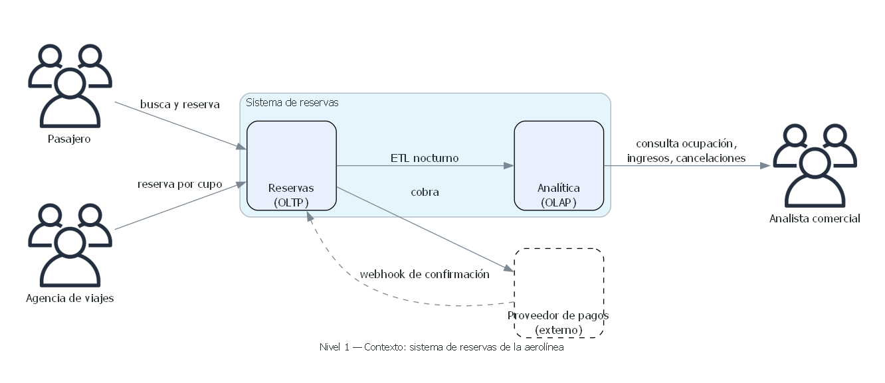
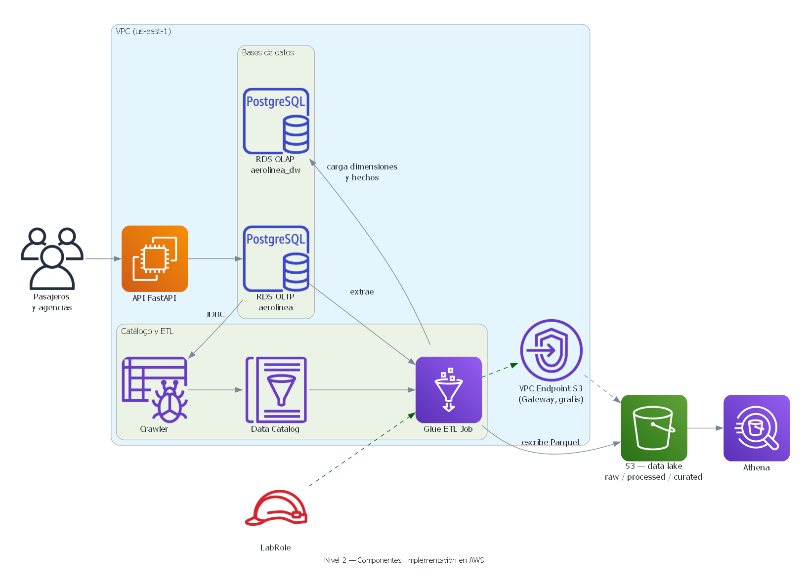

# Session 3 — Diagramación de arquitecturas AWS y anatomía de un ADR

**Curso:** Big Data e Ingeniería de Datos (PCIA 5010) · Semana 2 · Sesión 3
**Tema:** notación oficial de iconos · **niveles de abstracción** · anatomía de una ADR
**Caso:** sistema de reservas de la aerolínea (`entregas/parcial-1-aerolinea/`)

---

## 1. Notación oficial de iconos

AWS publica un kit oficial ([aws.amazon.com/architecture/icons](https://aws.amazon.com/architecture/icons/))
y la razón de usarlo no es estética: **es que el diagrama se lea sin leyenda**. Quien conoce la
iconografía identifica el servicio de un vistazo; con cajas genéricas y texto hay que leer cada
una.

Reglas de la notación que apliqué:

| Elemento | Qué significa |
|---|---|
| **Icono de servicio** (cuadrado con color de categoría) | un servicio de AWS: Glue morado (analytics), RDS azul (database), S3 verde (storage) |
| **El color es la categoría**, no la decoración | dos iconos del mismo color pertenecen a la misma familia; cambiarlo rompe la convención |
| **Grupos / contenedores** (recuadros punteados) | límites de red y de confianza: la VPC, no una agrupación visual arbitraria |
| **Flechas** | flujo de datos, no llamadas de función |
| **Línea punteada** | en mis diagramas, lo que **no** es flujo de datos: permisos y rutas de red |

⚠️ Detalle que importa y suele hacerse mal: **S3 y Athena van FUERA del recuadro de la VPC.**
Son servicios regionales, no viven dentro de la red. Dibujarlos adentro es cómodo y es falso —
y justamente por eso el diagrama necesita el VPC Endpoint: sin él los workers de Glue, que sí
están dentro de la VPC y sin IP pública, no llegan a S3. **El diagrama correcto hace visible el
problema; el diagrama cómodo lo esconde.**

---

## 2. Niveles de abstracción

Un diagrama no es "el" diagrama del sistema: es **una respuesta a una pregunta concreta**. Si
una sola imagen tiene que servirle al gerente comercial y al que configura los Security Groups,
va a fallarle a los dos. La idea de niveles —popularizada por el modelo **C4**— es dibujar el
mismo sistema varias veces, cada vez con más detalle, y decir explícitamente qué se omite.

Entrego **el mismo sistema en dos niveles**:

### Nivel 1 — Contexto



| | |
|---|---|
| **Pregunta que responde** | ¿quién usa esto y con qué se integra? |
| **Audiencia** | negocio, docente, alguien que llega nuevo |
| **Qué omite a propósito** | **todo AWS.** Ningún servicio, ninguna red |

Lo que este nivel deja ver y el otro esconde: que el proveedor de pagos es **externo** y
responde por webhook. O sea que la confirmación llega **desordenada y repetida**, y que por eso
el endpoint de pago tuvo que ser idempotente. Es una decisión de diseño que nace de una frontera
visible sólo acá.

### Nivel 2 — Componentes



| | |
|---|---|
| **Pregunta que responde** | ¿con qué servicios se implementa y por dónde viajan los datos? |
| **Audiencia** | quien va a construirlo o pagarlo |
| **Qué omite a propósito** | esquemas de tablas, código, reglas de los Security Groups |

Acá aparecen las decisiones que cuestan plata o rompen el sistema: RDS separadas para OLTP y
OLAP, el catálogo desacoplado del cómputo, y el **VPC Endpoint de S3 tipo Gateway** — que es
gratis, mientras que resolver lo mismo con un NAT Gateway cuesta $0,045/h.

### Por qué dos y no uno

| | Nivel 1 | Nivel 2 |
|---|---|---|
| Cambia cuando… | cambia el negocio | cambia la implementación |
| Vida útil | años | meses |
| Sirve para | acordar el alcance | estimar costo y construir |

**Un diagrama que mezcla los dos niveles envejece a la velocidad del más rápido.** Separarlos
permite que el de contexto siga siendo cierto aunque mañana se reemplace Glue por EMR.

---

## 3. Anatomía de un ADR

Un **Architecture Decision Record** es un documento corto que registra *una* decisión
arquitectónica y, sobre todo, **por qué se tomó y qué se descartó**. La referencia del curso es
la guía de AWS Prescriptive Guidance
([docs.aws.amazon.com/prescriptive-guidance/…/architectural-decision-records](https://docs.aws.amazon.com/prescriptive-guidance/latest/architectural-decision-records/welcome.html)).

### Las secciones y para qué sirve cada una

| Sección | Qué contiene | Por qué existe |
|---|---|---|
| **Título** | la decisión en una línea | debe poder citarse: *"según el ADR-01…"* |
| **Estado** | propuesta / aceptada / rechazada / **reemplazada por ADR-nn** | un ADR **nunca se edita ni se borra**: se marca reemplazado. El historial es el valor |
| **Contexto** | las fuerzas en juego: requisitos, restricciones, presupuesto | sin esto, dentro de un año la decisión parece arbitraria |
| **Opciones consideradas** | las alternativas reales, con sus trade-offs | es lo que separa una decisión de una costumbre |
| **Decisión** | qué se eligió, en voz activa | — |
| **Consecuencias** | lo bueno **y lo malo** que se acepta | un ADR sin consecuencias negativas no es un ADR: es publicidad |

### La parte que suele faltar

Dos errores típicos:

1. **Escribirlo después**, cuando la decisión ya está tomada. Ahí las "alternativas" son
   coartadas escritas hacia atrás para justificar lo que ya se hizo.
2. **Omitir las consecuencias negativas.** Toda decisión arquitectónica cambia una cosa mala por
   otra. El ADR sirve para que la próxima persona sepa *cuál* eligió cargar.

### Un ADR es también una unidad de cambio

Si la restricción de negocio cambia —*"ahora se permite overbooking del 5 %"*— el ADR dice
exactamente qué hay que revisar: se marca reemplazado y se escribe el siguiente. Sin ADRs hay
que reconstruir por qué el sistema es como es leyendo el código, que registra **qué** hace pero
nunca **qué se descartó**.

> El **ADR #1 del proyecto** —esquema de particionado del data lake— se entrega como documento
> aparte: *Session 5 — ADR #1: esquema de particionado*.

---

## 4. Cómo se generaron los diagramas

Con la librería [`diagrams`](https://diagrams.mingrammer.com/) de Python, que usa los assets
oficiales de AWS. Fuente en `generar.py`, adjunto:

```bash
pip install diagrams          # requiere Graphviz en el PATH
python generar.py             # regenera los cinco diagramas del curso
```

| Decisión | Alternativa descartada | Por qué |
|---|---|---|
| Diagramas **como código** | draw.io | quedan versionados en git junto al sistema que describen y se regeneran con un comando: no se desincronizan en silencio. **Costo aceptado:** no se puede acomodar una caja a mano, el layout lo decide Graphviz |
| Dos niveles de abstracción | un único diagrama detallado | la consigna pide niveles; y un diagrama solo le miente a alguna de sus dos audiencias |
| Punteado = permisos y red | todo con la misma línea | distinguir flujo de datos de flujo de autorización evita leer `LabRole` como si fuera un origen de datos |

---

## 5. Qué generó la IA y qué corregí

| # | Qué propuso el asistente | Qué corregí | Por qué |
|---|---|---|---|
| 1 | Un único diagrama con todos los servicios | Separar en contexto y componentes | La consigna pide **niveles de abstracción**; un diagrama plano no los tiene |
| 2 | Dibujar S3 y Athena **dentro** de la VPC | Sacarlos afuera | Es incorrecto: son servicios regionales. Y al sacarlos, el VPC Endpoint deja de ser un adorno y se entiende para qué está |
| 3 | Aristas iguales para datos y para el rol de IAM | Punteado y color distinto para permisos | Con una sola notación, `LabRole` se lee como si fuera una fuente de datos |
| 4 | `import diagrams; diagrams.__version__` para verificar la instalación | Verificar importando un nodo real | El paquete no expone `__version__` y el chequeo fallaba con un error que no tenía nada que ver con la instalación |
