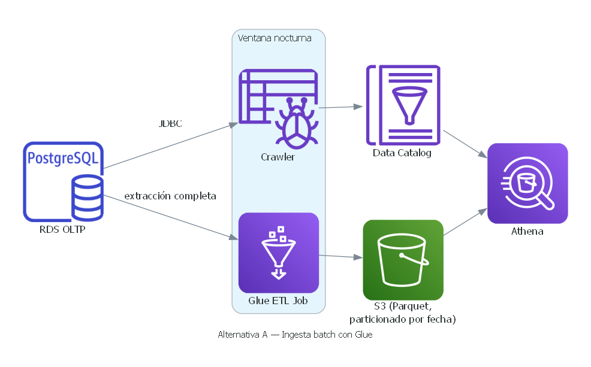
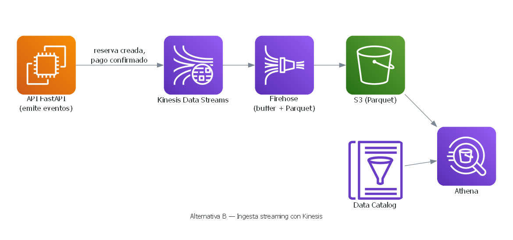

# Session 4 — Taller: configuración del entorno y dos arquitecturas alternativas

**Curso:** Big Data e Ingeniería de Datos (PCIA 5010) · Semana 2 · Sesión 4
**Tema:** setup del entorno (CLI, LabRole) + primer ejercicio de diseño de arquitecturas alternativas
**Caso:** sistema de reservas de la aerolínea (`entregas/parcial-1-aerolinea/`)

---

# Parte 1 — El entorno

## 1.1 Herramientas instaladas

Salida real de la máquina de trabajo:

```console
$ aws --version
aws-cli/2.36.15 Python/3.14.6 Windows/11 exe/AMD64

$ python --version
Python 3.11.9          # venv en C:\Users\pipel\venvs\bigdata

$ dot -V
dot - graphviz version 13.1.2 (20250808.2320)

$ git --version
git version 2.55.0.windows.5

$ docker --version
Docker version 29.5.2, build 79eb04c
```

| Herramienta | Para qué en este curso |
|---|---|
| AWS CLI v2 | crear y auditar recursos sin pasar por la consola |
| Python 3.11 + venv | `boto3`, `awswrangler`, `duckdb`, `pyarrow`, `diagrams` |
| Graphviz | motor de los diagramas generados por código |
| Docker | **replicar la topología de AWS en local antes de gastar presupuesto** |
| Git + GitHub privado | historial y respaldo del trabajo |

⚠️ El venv está **fuera de OneDrive** a propósito: son miles de archivos chicos y sincronizarlos
es lento e inútil.

## 1.2 LabRole: el único rol disponible

El Learner Lab **no permite crear roles ni usuarios de IAM**. Todo lo que necesite un rol de
servicio —Glue, Lambda, EMR— usa el rol preexistente **`LabRole`**, y EC2 usa
`LabInstanceProfile`.

**Trampa verificada en clase:** al crear un crawler eligiendo cualquier otro rol, Glue responde

```
Service is unable to assume provided role. Please verify role's TrustPolicy
```

La cuenta tiene ~25 roles y es fácil errarle. Sólo `LabRole` tiene `glue.amazonaws.com` en su
trust policy — comprobado con `aws iam get-role`.

## 1.3 Manejo de credenciales — decisión de seguridad

Las credenciales del lab duran ~4 horas y se leen en **AWS Details → AWS CLI**.

| Opción | Qué hace | Decisión |
|---|---|---|
| `aws configure` | escribe las claves **en texto plano** en `~/.aws/credentials` | ❌ **descartada**: ese directorio está dentro del perfil de usuario, que **se sincroniza a OneDrive**. Las claves saldrían de la máquina |
| Variables de entorno por terminal | viven en memoria y mueren al cerrar la terminal | ✅ **elegida** — `scripts/cargar-credenciales.ps1` |
| CloudShell | credenciales ya inyectadas por AWS | ✅ vía por defecto para scripts |

**Ninguna credencial se escribe en el repositorio.** El `.gitignore` bloquea `.pem`, `.env` y
`credentials`, pero la regla es no escribirlas en ningún archivo.

## 1.4 Desarrollar en local, ejecutar en AWS

La decisión de entorno con más impacto en el presupuesto. Los dos PostgreSQL del proyecto corren
en Docker (`docker-compose.yml`, puertos 15432/15433) replicando la topología OLTP/OLAP de RDS.

El pipeline completo —esquema, datos, API, ETL y las tres vistas— se validó localmente **antes de
crear un solo recurso en AWS**. Depurar contra RDS encendida habría costado varios dólares del
presupuesto de 50 USD; depurar en Docker costó **$0**.

> Mismo principio para Athena: cobra **$5 por TB escaneado**. Un `SELECT *` de prueba se hace en
> DuckDB sobre los mismos Parquet, gratis, y recién cuando la query funciona se corre en Athena.

---

# Parte 2 — Dos arquitecturas alternativas

## 2.1 El caso

> La aerolínea necesita responder tres preguntas: **ocupación por ruta**, **ingresos por tipo de
> tarifa** y **patrones de cancelación**. Los datos nacen en la base transaccional de reservas.
> ¿Cómo llegan desde ahí hasta una herramienta de consulta analítica?

Las dos alternativas resuelven exactamente eso y difieren en **cuándo** se mueven los datos.

## 2.2 Alternativa A — Ingesta batch con Glue



Un job de Glue lee la base OLTP por JDBC una vez por noche, escribe Parquet particionado a S3 y
el crawler actualiza el catálogo. Athena consulta.

**Costo estimado mensual**

| Componente | Cálculo | USD/mes |
|---|---|---|
| Glue ETL Job | 2 DPU × 10 min/noche × 30 × $0,44/DPU-h | ~$4,40 |
| Crawler (on demand) | ~$0,12 por corrida, 4 al mes | ~$0,50 |
| S3 | < 1 GB | ~$0,02 |
| Athena | Parquet + particionado, escaneos de pocos MB | ~$0,00 |
| **Total** | | **~$5** |

## 2.3 Alternativa B — Ingesta streaming con Kinesis



La API emite un evento por cada reserva creada y cada pago confirmado. Kinesis Data Streams los
recibe, Firehose los agrupa y los escribe a S3 en Parquet. Athena consulta.

**Costo estimado mensual**

| Componente | Cálculo | USD/mes |
|---|---|---|
| Kinesis Data Streams | 1 shard × 730 h × $0,015/shard-h | **$10,95** |
| Firehose | volumen < 1 GB | ~$0,03 |
| S3 | < 1 GB | ~$0,02 |
| **Total** | | **~$11** |

⚠️ **El shard cobra por existir, no por usarse.** Con cero reservas en un mes, la factura es la
misma. Es el patrón que ya nos costó plata en este curso: de $1,70 gastados en una semana, $0,77
fueron *storage* de recursos que nadie tocó. **El gasto peligroso no es el pico, es el piso.**

## 2.4 Matriz de decisión

| Criterio | A · Batch con Glue | B · Streaming con Kinesis |
|---|---|---|
| **Latencia del dato** | hasta 24 h | segundos |
| **Costo mensual** | **~$5** | ~$11 |
| **Costo con tráfico cero** | **~$0** (sólo corre si se dispara) | ~$11 (el shard cobra igual) |
| **Complejidad operativa** | un job y un crawler | productor, shard sizing, buffering, reintentos |
| **Modo de falla** | el job falla → se vuelve a correr, la fuente sigue intacta | evento perdido → **hueco permanente**: la fuente ya no lo tiene |
| **Reproceso histórico** | trivial: se relee la fuente | difícil: los eventos ya expiraron |
| **Límites del Learner Lab** | Glue: máx. 10 workers, concurrencia 1 → alcanza de sobra | shard-horas consumen presupuesto de forma continua |
| **Encaje con las 3 preguntas** | ✅ ninguna se decide minuto a minuto | ⚠️ resuelve una urgencia que no existe |

## 2.5 Decisión

**Se elige la Alternativa A — ingesta batch con Glue.**

El argumento no es que el streaming sea peor, sino que **paga por una latencia que nadie
necesita**. Las tres preguntas del negocio se responden en reuniones de planificación, no en
tiempo real: la ocupación de ayer sirve igual a las 3 a.m. que a las 9. Pagar el doble y aceptar
un modo de falla con pérdida permanente de datos, para adelantar un dato que nadie va a mirar
hasta la mañana, no se sostiene.

Y hay un argumento de reversibilidad: **el batch tolera errores y el streaming no**. Si el job
falla, la base OLTP sigue teniendo todo y se vuelve a correr. Si se pierde un evento en Kinesis,
se perdió: no hay dónde ir a buscarlo.

### Cuándo habría que revisar esta decisión

| Disparador | Por qué cambiaría la respuesta |
|---|---|
| **Precios dinámicos según búsquedas** | exige reaccionar a eventos que no se guardan en la base transaccional. Es el escenario que en la Sesión 1 multiplicaba el volumen por 100 |
| Alertas operativas de sobreventa en vuelo | 24 h de latencia sería inútil |
| Consumo del dato por otro sistema en línea | el batch no puede alimentar decisiones sincrónicas |

Ninguno aplica hoy. **La decisión se documenta con su disparador para que la próxima persona
sepa cuándo dejó de ser válida** — que es exactamente lo que hace un ADR.

---

## 3. Qué generó la IA y qué corregí

| # | Qué propuso el asistente | Qué corregí | Por qué |
|---|---|---|---|
| 1 | Comparar las alternativas por latencia y complejidad | Agregar **costo con tráfico cero** como fila propia | Es la diferencia que decide: $5 vs $11 no impresiona, pero "cobra aunque no lo uses" sí, y es el error que ya cometimos en este curso |
| 2 | Recomendar streaming por ser "más moderno" | Invertir la recomendación | Ninguna de las tres preguntas del negocio se decide en tiempo real. Elegir por modernidad es elegir sin criterio |
| 3 | Capturas de pantalla genéricas para el setup | Pegar la **salida real** de los comandos | Una versión inventada es falsa y se nota; la real se puede reproducir |
| 4 | Omitir el modo de falla en la comparación | Agregarlo | Es asimétrico y decisivo: en batch la fuente sobrevive al error, en streaming el evento perdido no vuelve |

**Precios de referencia:** us-east-1, on-demand, tabla del `CLAUDE.md` del proyecto. Son órdenes
de magnitud para decidir, no una cotización.
