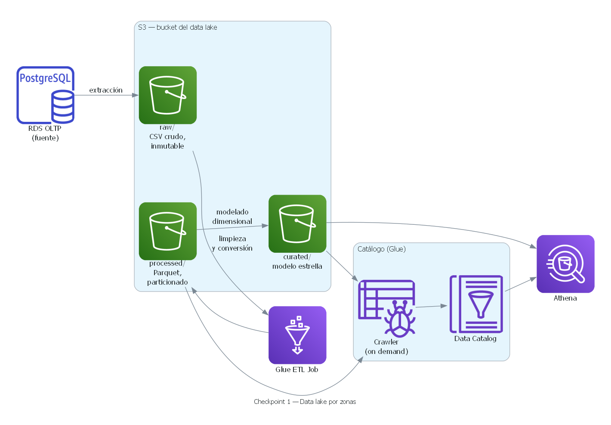

# Checkpoint 1 — Data lake: diagrama, ADR e implementación

**Curso:** Big Data e Ingeniería de Datos (PCIA 5010) · Semana 4 · Sesión 8
**Nota de:** **proyecto** (no de talleres)
**Consigna:** *"diagrama de arquitectura del data lake + ADR + implementación del bucket/crawler,
defendido oralmente"*

---

## Las tres piezas

| Pieza | Dónde está | Estado |
|---|---|---|
| **Diagrama** de arquitectura del data lake | esta carpeta + [`_comun/diagramas/generar.py`](../../_comun/diagramas/generar.py) | ✅ |
| **ADR** | [ADR #1 — esquema de particionado](../../semana-03/sesion-05-adr-01-particionado/) | ✅ |
| **Implementación** del bucket | [`crear-data-lake.sh`](crear-data-lake.sh) | ✅ **ejecutado 08/09** → `datalake-aerolinea-936980625651` |
| **Implementación** del crawler | [Sesión 7](../sesion-07-glue-catalog-crawlers/) | ✅ **ejecutado 08/09** → 8 tablas catalogadas |
| **Defensa oral** | §4 de este documento | ✅ preparada |

---

## 1. Arquitectura del data lake



El flujo, y qué garantiza cada paso:

| Paso | Qué hace | Qué garantiza |
|---|---|---|
| RDS OLTP → `raw/` | extracción fiel, CSV, sin transformar | que un error de procesamiento sea **reversible** |
| `raw/` → `processed/` | limpieza, tipado, Parquet particionado | que Athena escanee bytes y no archivos |
| `processed/` → `curated/` | modelo estrella, dos tablas de hechos | que la pregunta de negocio se responda con un `SELECT`, no con un `JOIN` de siete tablas |
| Crawler → Data Catalog | esquema y particiones | que el dato deje de ser un archivo y pase a ser una tabla |
| Catálogo → Athena | consulta SQL | que cualquier motor lea lo mismo sin redefinir nada |

Vistas de contexto y de componentes del sistema completo: [`n1-contexto.png`](n1-contexto.png) ·
[`n2-componentes.png`](n2-componentes.png) — el porqué de los dos niveles está en la
[Sesión 3](../../semana-02/sesion-03-diagramacion-y-adr/).

---

## 2. ADR

**[ADR #1 — Particionar por fecha de vuelo con granularidad mensual](../../semana-03/sesion-05-adr-01-particionado/)**

En una línea: se particiona por **fecha de vuelo** porque es lo que filtran las tres consultas del
negocio, y con granularidad **mensual** porque a 294 filas por día la partición diaria produce
archivos de 15 KB. **Con criterio de revisión explícito: bajar a diaria cuando una partición
supere ~128 MB.**

---

## 3. Implementación

```bash
cd entregas/semana-04/checkpoint-1
bash crear-data-lake.sh
```

Crea el bucket, bloquea el acceso público, activa versionado, aplica la política de ciclo de vida
revisada y crea las tres zonas. Termina imprimiendo la verificación, que es lo que se captura como
evidencia.

Después, el crawler según el procedimiento de la [Sesión 7](../sesion-07-glue-catalog-crawlers/) —
con las cuatro trampas ya documentadas: URL JDBC con `://` y puerto, SG auto-referenciado, VPC
Endpoint de S3 (gratis, no NAT), y `LabRole`.

### Costo

| Componente | USD/mes |
|---|---|
| S3 (< 1 GB) | ~$0,02 |
| Crawler on demand (~4 corridas) | ~$0,50 |
| Glue ETL Job (si se automatiza) | ~$4,40 |
| Athena (Parquet + particionado) | ~$0,00 |

⚠️ **El bucket no se borra** al cerrar la sesión: lo necesitan el Checkpoint 2, Athena y el resto
del curso. Lo que sí se borra son las RDS, que cobran storage aunque estén detenidas.

---

## 4. Preparación de la defensa oral

El criterio de esta materia no es si el sistema funciona: es **si el diseño absorbe un cambio no
previsto**. Banco de respuestas, cada una anclada a una decisión ya documentada.

| Pregunta probable | Respuesta corta | Dónde está justificada |
|---|---|---|
| **¿Por qué tres zonas y no dos?** | `raw/` es lo que hace reversible un error de procesamiento. Sin ella, corregir un bug de limpieza obliga a re-extraer de una fuente que ya cambió | Sesión 5 §1.1 |
| **¿Por qué mensual y no diario?** | 294 filas/día ⇒ archivos de 15 KB: *small files problem*. Mensual da cientos de KB. Y hay umbral de revisión: 128 MB | ADR #1 |
| **¿Y si las consultas fueran por fecha de reserva?** | No reparticiono: agrego una tabla derivada. Reparticionar rompe todas las consultas actuales para arreglar una nueva | ADR #1, consecuencias |
| **Ahora necesito ocultar el precio a los analistas** | No se puede con IAM: los permisos del catálogo son por tabla, no por columna. O materializo una vista sin esa columna —duplicando datos— o entra Lake Formation | Sesión 7 §4 |
| **¿Por qué Glue y no un script en EC2?** | El script exige una instancia encendida y administrada; Glue cobra sólo mientras corre. A 10 min por noche, EC2 pierde | Sesión 4 §2 |
| **Volumen ×100** | Particionado y Parquet ya están: el layout aguanta. Lo que primero se rompe es la partición mensual, y el umbral está escrito | ADR #1 |
| **×100 en *búsquedas*, no en reservas** | Eso sí cambia la arquitectura: es el escenario de ~1.000 millones de filas/año y el disparador declarado para revisar batch vs streaming | Sesión 1 §2 · Sesión 4 §2.5 |
| **Se cae el ETL a mitad** | Es recarga completa: se vuelve a correr. La fuente sigue intacta. Ese es justamente el modo de falla por el que se descartó streaming | Sesión 4 §2.4 |
| **¿Por qué no NAT Gateway?** | El VPC Endpoint de S3 tipo Gateway resuelve lo mismo y es gratis; el NAT cuesta ~$32/mes | Sesión 7 §3 |
| **¿Por qué versionado si nadie borra a mano?** | El ETL de recarga completa reescribe todo en cada corrida. Sin expiración de versiones no vigentes, el costo crece con cada ejecución sin que se vea en la consola | Sesión 6 §2 |
| **¿Cuánto cuesta y qué pasa si lo olvidás prendido?** | ~$5/mes. Lo caro no es S3: son las RDS, que cobran storage aun detenidas y se reinician solas a los 7 días | Sesión 4 §2 |

### La pregunta que hay que saber contestar mal

> *"¿Esto es Big Data?"*

**No.** 8.821 filas caben en un teléfono. Lo que se construyó es la **arquitectura** que hace
falta cuando lo sea, y el trabajo de la Sesión 1 calcula dónde está ese punto: alrededor de los
mil millones de filas anuales, y no se llega por vender más pasajes sino por empezar a guardar las
búsquedas que no terminan en compra.

Responder "sí" para quedar bien es la respuesta que no se puede sostener dos preguntas más
adelante.

---

## 5. Qué generó la IA y qué corregí

| # | Qué propuso el asistente | Qué corregí | Por qué |
|---|---|---|---|
| 1 | Un diagrama con las tres zonas como cajas dentro de un rectángulo "S3" | Modelarlas como **prefijos con flujo entre ellas** | Las zonas no son almacenes separados: son estados del mismo dato, y el flujo es lo que se defiende |
| 2 | Preparar la defensa como resumen del trabajo | Convertirla en **banco de preguntas con respuesta anclada** | Lo que se evalúa es reaccionar a un cambio no previsto, no recitar lo hecho |
| 3 | Script que además borraba el bucket al terminar | Quitarlo | El bucket lo necesitan el Checkpoint 2 y el resto del curso. Y los comandos destructivos van aparte, para copiar a mano |
| 4 | Afirmar que el proyecto "aplica Big Data" | Sostener que **no lo es todavía** | Es verificable con los números propios, y es la versión defendible |
