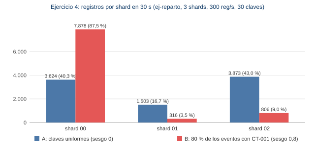

# Ejercicios adicionales: productores y consumidores propios en Kinesis Data Streams

**Big Data e Ingeniería de Datos (CC-IA-02)** · Universidad Sergio Arboleda · **Andres Felipe Cespedes Rondon** · 3 de noviembre de 2026

> **Cómo se hizo.** Learner Lab (us-east-1, `LabRole`), todo desde **CloudShell** con Python + boto3.
> Cada ejercicio lo corre un orquestador (`infra/20-ejercicios.sh` y las corridas extra de
> `infra/21-extras.sh`) que guarda la salida en CSV; las tablas de este informe salen de esos archivos.
> Antes de usar el lab, los scripts se probaron gratis en la laptop contra **moto** (un simulador local de
> AWS). Se hicieron los 5 ejercicios, el **6 (opcional)** y el **reto final**.

## Antes de empezar: las dos competencias, medidas

| Límite por shard (provisionado) | Valor | Dónde se vio |
|---|---|---|
| Escritura | 1 MB/s o 1.000 registros/s | Ej. 1: a 5.000/s pedidos, el shard dejó pasar ~1.160/s |
| Lectura compartida | 2 MB/s | Ej. 2: los 3 consumidores reciben todo, pero comparten la capacidad |
| `GetRecords` compartidas | 5 llamadas/s | Ej. 2: errores recién por encima de ~5 llamadas/s en total |

Con `GetRecords`, **los consumidores no se reparten los registros**: cada uno lee el shard entero.
Compiten por la **capacidad**. Para **repartir el trabajo** hay que asignar shards distintos a cada
consumidor (Ej. 3), que es lo que KCL hace con sus *leases* (reto final).

## Ejercicio 1 — Productor parametrizable

`codigo/productor_param.py` (Anexo A) recibe `--stream --tasa --duracion --claves --sesgo` y:

1. arma `tasa` eventos por segundo y los manda en lotes de **hasta 500** (`put_records`);
2. revisa **`FailedRecordCount`** y el `ErrorCode` de cada registro, y **reenvía sólo los fallidos**,
   con *backoff* exponencial con *jitter* (50 ms, 100, 200… hasta 3,2 s, con un factor aleatorio de
   0,5 a 1);
3. imprime cada segundo los enviados, los reintentados y los fallidos definitivos, y al final la
   **tasa real**: si mandar "un segundo" de registros tarda más de un segundo, la tasa efectiva queda
   por debajo de la pedida.

Dos corridas sobre `ej-compite` (1 shard), 8 claves, 20 "segundos" de producción:

| Corrida | Tasa pedida | Enviados | Reintentados | Fallidos al final | Tasa real |
|---|---|---|---|---|---|
| 1 | 1.500/s | 30.000 | **0** | 0 | (la primera versión no la medía) |
| 1b | **5.000/s** | 100.000 | **62.877** | **0** | **1.159/s** (en 86,3 s) |

La primera corrida no tuvo ningún rechazo: Kinesis tolera ráfagas cortas por encima de 1.000/s, y
mandar "un segundo" de 1.500 registros tardaba más de un segundo, así que la tasa efectiva quedaba más
baja que la pedida. Por eso se agregó al productor la medición de la tasa real y se repitió a 5.000/s.

En la corrida 1b, el **primer segundo entró completo** (0 reintentos: la ráfaga inicial). Desde el
segundo 3, cada lote de 5.000 tuvo entre 3.000 y 3.500 registros rechazados parcialmente, que el
productor reintentó con backoff **hasta que entraron todos**: 0 fallidos definitivos. El shard dejó pasar
en promedio **1.159 registros/s**, apenas sobre su límite nominal de 1.000/s. CloudWatch registró
`WriteProvisionedThroughputExceeded` sólo en los dos minutos de esa corrida (15:29 y 15:30).

**¿Por qué no basta con revisar si la llamada lanzó excepción?** Porque `put_records` puede **fallar
parcialmente sin lanzar nada**: responde HTTP 200 con `FailedRecordCount > 0` y, por cada registro
rechazado, un `ErrorCode` (`ProvisionedThroughputExceededException`, `InternalFailure`). Un código que
sólo atrapa excepciones descarta esos registros en silencio: en la corrida a 5.000/s habrían sido 62.877.

**¿Qué pasa con el orden al reintentar?** Se pierde. Un registro que falla y se reenvía llega
**después** que otros de la misma clave que se mandaron más tarde pero entraron a la primera. Dentro de
un shard, el orden es el de llegada, no el de envío. Si el orden por clave importa, hay dos caminos:
mandar de a uno con `put_record` y `SequenceNumberForOrdering` (mucho más lento), o no mandar el lote
siguiente de esa clave hasta que el anterior entre completo.

## Ejercicio 2 — Consumidores que compiten por un shard

Stream `ej-compite` (1 shard), productor a 200 registros/s con 8 claves; cada corrida dura 60 s y lee
desde `LATEST`. Además de las corridas A, B y C de la guía, se agregaron C2 y C4 para empujar el límite,
y la fila del Ej. 6 para comparar:

| Corrida | Consumidores | Pausa | Registros/s **por consumidor** | Llamadas/s **en total** | Errores que vio la app | Rechazos en CloudWatch* |
|---|---|---|---|---|---|---|
| A | 1 | 1,0 s | 196,7 | 0,98 | 0 | 0 |
| B | 3 | 1,0 s | 196,7 · 200 · 200 | 2,93 | 0 | ~0 |
| C | 3 | 0,4 s | 196,7 · 203,3 · 200 | **5,21** | 0 | **30 + 40** |
| C2 | 3 | 0,1 s | 203,3 · 206,6 · 200 | **5,29** | 1 | 49 + 132 |
| C4 | **6** | 0,2 s | 200 a 213 c/u | **5,47** | 7 | **192** |
| EFO (Ej. 6) | 2 | push | 203,3 · 203,3 | (no usa `GetRecords`) | 0 | — |

\* `ReadProvisionedThroughputExceeded`, suma por minuto, en los minutos de cada corrida
(`resultados/ejercicios/cloudwatch_ej-compite.txt`).

**Lo que mostraron las mediciones:**

- **La hipótesis de la guía para C (≈ 7,5 llamadas/s) no se cumplió tal cual.** Cada `GetRecords` desde
  CloudShell tardaba ~0,2 a 0,4 s, así que con pausa 0,4 cada consumidor hizo entre 1,6 y 1,9 llamadas/s:
  **5,2 en total**, apenas sobre el límite.
- **Aun así hubo saturación, y boto3 la escondía.** La aplicación vio 0 errores en C, pero CloudWatch
  registró 70 lecturas rechazadas en esos minutos. **boto3 reintenta automáticamente**
  `ProvisionedThroughputExceededException` antes de devolverla, así que la aplicación sólo ve el error
  cuando se agotan los reintentos (C2: 1; C4: 7). El síntoma visible es otro: **las llamadas se vuelven
  más lentas**.
- **El total de llamadas se clava en ~5/s, no importa cuántos consumidores haya.** Con 3 consumidores,
  ~1,8 llamadas/s cada uno; con 6 (C4), ~0,9 cada uno, y el total siguió en 5,47. Esa es la competencia
  por capacidad: el shard reparte sus 5 lecturas/s entre todos los que las piden.
- Una corrida intermedia (C3: 3 consumidores **sin pausa**) se descartó. Los tres bucles sin espera
  dejaron sin CPU al productor en la misma CloudShell, que llegó al "segundo" 77 de 150. En CloudWatch se
  ve `GetRecords.Records = 0` en ese minuto. Es un artefacto del entorno, no del servicio.

**En la corrida B, ¿cada consumidor recibe todos los registros o sólo una parte?** **Todos**: cada uno
recibió ~200 registros/s, la tasa completa del productor. `GetRecords` no reparte: cada consumidor
tiene su propio iterador y lee el shard entero.

**Si el objetivo es dividir el trabajo entre 3 procesos, ¿sirve tener 3 consumidores sobre 1 shard?**
**No.** Los tres procesan los mismos registros (triplican el trabajo, no lo dividen) y además se
estorban por las 5 llamadas/s. Para dividir el trabajo hacen falta 3 shards con un consumidor cada
uno (Ej. 3).

**¿Qué métrica de CloudWatch muestra la saturación?** `ReadProvisionedThroughputExceeded`, del namespace
`AWS/Kinesis`, por stream. Para la escritura, `WriteProvisionedThroughputExceeded`.

Medido sobre `ej-compite`: `ReadProvisionedThroughputExceeded` dio 0 en los minutos de las corridas A y
B, **30 y 40** en los de la C, y **132 a 192 por minuto** en C2 y C4. Es la métrica que conviene alarmar,
porque la aplicación, por los reintentos de boto3, casi no ve los errores.

## Ejercicio 3 — Un shard por consumidor

Stream `ej-reparto` (3 shards), productor a 300 registros/s con 30 claves, 3 consumidores (uno por
shard) con pausa 0,4 durante 60 s:

{{csv:resultados/ejercicios/ej3_resumen.csv}}

La suma da ≈ **296 registros/s**, la tasa del productor, **sin errores**: cada shard recibe 2,4
llamadas/s, lejos de 5. Contra la corrida C del Ej. 2, que tenía las mismas pausas pero los tres
consumidores en un solo shard, acá **cada consumidor procesa un tercio distinto** en lugar del total
repetido.

El reparto **no salió parejo** (120 / 50 / 127 registros/s): con sólo 30 claves, el hash MD5 no las
distribuye en tercios exactos entre los 3 rangos de *hash key*. Algunos rangos se quedaron con más claves
o con claves más frecuentes. Con miles de claves (ids de dispositivos reales), el reparto tiende a ser
parejo.

**¿Cuántos consumidores útiles puede tener un grupo con 3 shards?** **3**, uno por shard. **¿Y un
cuarto?** Se queda **ocioso**: no hay shard libre para asignarle, o, si se lo pone a leer uno ya
ocupado, compite con el que está (Ej. 2) sin repartir nada. Para sumar consumidores útiles hay que
sumar shards.

**¿Por qué importa la clave para que el reparto sea parejo?** Porque el shard se elige por el hash de
la clave. Con pocas claves, o con una clave que concentra el tráfico, unos shards reciben mucho más que
otros, y la capacidad total del stream queda limitada por el shard más cargado (Ej. 4).

## Ejercicio 4 — Shard caliente

Mismo `ej-reparto` (3 shards), 30 claves y 300 registros/s durante 30 s. En la corrida A, claves
uniformes (sesgo 0); en la B, el 80 % de los eventos usa `CT-001` (sesgo 0,8). Se contó por shard sólo
cada corrida (`AT_TIMESTAMP`):

{{csv:resultados/ejercicios/ej4_shards.csv}}

**¿Qué porcentaje del tráfico recibe el shard caliente en la corrida B?** El shard 0, donde cae
`CT-001`, recibió **7.878 de 9.000 registros: el 87,5 %**. Es el 80 % de `CT-001` (7.213 registros) más
la parte que le toca del 20 % restante, que se reparte entre las 30 claves: 12 de ellas, incluida
`CT-001`, caen en ese shard. Los otros dos
shards quedaron casi ociosos (3,5 % y 9 %).

Incluso **sin sesgo** (corrida A) el reparto no es parejo: 40 % / 17 % / 43 %, porque el hash dejó 12, 5 y
13 claves en cada shard. Con 30 claves, el azar del hash pesa mucho.

La consecuencia práctica: **el stream rinde lo que rinde su shard más cargado**. En la corrida B, el
shard 0 llegaría a su límite de 1.000 registros/s cuando el stream entero apenas recibiera ~1.140/s,
aunque se paguen 3 shards (3.000/s de capacidad nominal).

**Dos soluciones, y qué orden se pierde en cada una:**

1. **Sufijo aleatorio en la clave caliente** (`CT-001#0` … `CT-001#9`): los eventos de `CT-001` se
   reparten entre varios shards. Se pierde el **orden total de `CT-001`**: sólo queda ordenado dentro de
   cada sufijo, y quien necesite el orden tiene que reordenar por `timestamp`.
2. **Cambiar la granularidad de la clave**, por ejemplo `contenedor + sensor` o `contenedor + minuto`:
   reparte la carga de un mismo contenedor. Se pierde el orden **entre sensores** (o entre minutos) del
   mismo contenedor; se conserva dentro de cada combinación.

(Una tercera opción, si la clave caliente es legítima y estable: dedicarle un shard propio con
`split_shard` justo en el rango de su hash.)

## Ejercicio 5 — Reshard en caliente

Stream `ej-reshard` creado con **2 shards**. El productor mandó 50 registros/s durante 240 s. A los 100 s
se ejecutó `update_shard_count(TargetShardCount=4, ScalingType='UNIFORM_SCALING')` y se esperó a que el
stream volviera a ACTIVE. Los shards quedaron así:

{{csv:resultados/ejercicios/ej5_shards.csv}}

Los dos shards originales quedaron **cerrados** (tienen `EndingSequenceNumber`, ya no aceptan datos) y
cada uno tiene **dos hijos abiertos** (con `ParentShardId`). El consumidor (`consumidor_reshard.py`)
**lee un shard recién cuando su padre se leyó entero**, y al agotar un padre (`NextShardIterator` vacío)
sigue con los hijos.

**Verificación.** El productor numera los eventos de cada clave (`n` = 1, 2, 3…):

| Medida | Resultado |
|---|---|
| Enviados según el productor | **12.000** (tasa real 50/s durante 240 s) |
| Leídos | **12.000** |
| Faltantes | **0** |
| Duplicados | **0** |
| Registros fuera de orden por clave | **0** |

**¿Qué pasa con los datos que ya estaban en los padres?** Se quedan ahí, legibles hasta que venza la
retención. El reshard no los mueve: lo nuevo va a los hijos.

**¿Por qué leer el padre hasta el final antes que los hijos?** Porque una misma clave tiene sus registros
**viejos en el padre y los nuevos en un hijo**. Si se leyera el hijo primero, o en paralelo, se
procesarían eventos nuevos antes que viejos de la misma clave: se rompe el orden por clave. La
verificación de arriba lo prueba: 0 registros fuera de orden.

**¿Cuándo `split_shard` en lugar de `update_shard_count`?** `update_shard_count` reparte **todo el
espacio de claves en partes iguales** (uniforme), pensado para escalar de forma pareja. `split_shard`
parte **un shard puntual en el valor de hash que se elija**: sirve para aislar un *hot shard* (Ej. 4)
sin tocar el resto. Además, `update_shard_count` tiene límites de cuántas veces se puede usar por período
y no puede más que duplicar el número de shards en una llamada.

## Ejercicio 6 (opcional) — Enhanced fan-out

Sobre `ej-compite` (1 shard, productor a 200/s) se registraron 2 consumidores con
`register_stream_consumer` y cada uno leyó con `subscribe_to_shard` (push por HTTP/2, suscripciones de
~5 min que se renuevan desde `ContinuationSequenceNumber`). La fila **EFO** de la tabla del Ej. 2 lo
resume: **cada consumidor recibió los 200 registros/s, con 0 errores**.

Con *enhanced fan-out*, cada consumidor tiene **2 MB/s dedicados por shard** y **no hace `GetRecords`**:
no compite por las 5 llamadas/s. Es la solución cuando varias aplicaciones necesitan leer el mismo
stream completo y con baja latencia. Cuesta extra: ~US$0,015 por consumidor-shard-hora, más la lectura
por GB. En el Learner Lab funcionó con `LabRole`.

## Reto final — Grupo de consumidores con leases en DynamoDB

`codigo/leases.py` (Anexo A) implementa la idea de KCL en ~180 líneas. La tabla `kinesis-leases`
(DynamoDB on-demand) tiene un ítem por shard con `propietario`, `expira_en` (vencimiento del lease) y
`checkpoint` (último número de secuencia procesado). Además, cada consumidor deja un ítem de **latido**.
En cada ciclo, cada consumidor:

1. late y **renueva** sus leases con una escritura **condicional** (`propietario = yo`); si falla, otro
   se lo quitó;
2. calcula su **cuota** = ⌈shards abiertos ÷ consumidores vivos⌉. Si tiene de más, **libera** (con
   checkpoint); si tiene de menos, **toma** shards libres o vencidos con otra escritura condicional
   (`attribute_not_exists OR expira_en < ahora`). Si dos compiten por el mismo shard, DynamoDB deja
   ganar a uno solo;
3. lee sus shards desde el checkpoint (`AFTER_SEQUENCE_NUMBER`) y guarda checkpoint cada 50 registros.

**Pruebas** sobre los 4 shards abiertos de `ej-reshard`, con un productor a 40 registros/s y 16 claves.
Los leases duran 15 s y se renuevan cada 4 s:

| Momento | Qué pasó (log de cada consumidor) | Estado de la tabla |
|---|---|---|
| 15:24:30 | A arranca solo: **toma los 4 shards** (cuota 4) | — |
| 15:24:36 | Aparece B: A ve 2 consumidores vivos, su cuota baja a 2 y **libera los shards 4 y 5** con checkpoint | — |
| 15:24:40 | **B toma los shards 4 y 5** desde el checkpoint que dejó A | A: shards 2 y 3 · B: shards 4 y 5 · vivos: A, B |
| ~15:25:05 | **`kill -9` a B** (no alcanza a liberar ni a guardar checkpoint) | — |
| 15:25:25 | Los leases de B vencen (15 s); A ve 1 vivo, su cuota sube a 4 y **toma los shards 4 y 5 desde el último checkpoint de B** | A: los 4 shards · vivos: A |
| ~15:25:38 | **`kill -9` a A**, y se reinicia con el mismo nombre | — |
| 15:25:41 | El A reiniciado **retoma los 4 shards desde sus checkpoints** | A: los 4 shards |

| Medida | Resultado |
|---|---|
| Registros procesados (A + B + A reiniciado) | 10.388 (A: 4.674 · B: 3.674 · A reiniciado: 2.040) |
| Números de secuencia únicos | 10.264 |
| **Procesados dos veces** | **124**, todos entre el último checkpoint y un `kill -9`: **106** por el reinicio de A (14, 33, 25 y 34 en los shards 2 a 5, todos por debajo de 50, el intervalo de checkpoint) y **18** por la caída de B (en el shard 5; en el 4, B acababa de guardar checkpoint). El traspaso ordenado de A a B **no generó ninguno**, porque A guarda checkpoint antes de liberar |

**Respuestas:**

- **Con 4 shards y 2 consumidores, ¿cada uno toma 2?** Sí. El primero que arranca toma los 4, porque
  está solo. Cuando aparece el segundo, el primero ve 2 consumidores vivos, su cuota baja a 2 y **libera
  2**, que el segundo toma.
- **Mate un consumidor: ¿el otro toma sus shards?** Sí. Con `kill -9` a B, sus leases dejan de
  renovarse y vencen a los 15 s. A ve un solo consumidor vivo, su cuota sube a 4 y toma los shards de B
  **desde el checkpoint que B dejó**.
- **Reinicie un consumidor: ¿continúa desde el checkpoint sin repetir muchos registros?** Sí: retoma
  desde su último checkpoint. Los registros procesados entre ese checkpoint y la caída **se procesan dos
  veces**: es la entrega "al menos una vez". Con checkpoint cada 50 registros, son como máximo 49 por
  shard y por caída. En la prueba, con dos caídas, fueron los duplicados de la tabla. Bajar el intervalo
  de checkpoint reduce los duplicados a cambio de más escrituras en DynamoDB. Eliminarlos del todo
  requiere un consumidor idempotente.

## Anexo A — Código

{{codigo:codigo/comun.py}}

{{codigo:codigo/productor_param.py}}

{{codigo:codigo/consumidor_shard.py}}

{{codigo:codigo/contador_por_shard.py}}

{{codigo:codigo/consumidor_reshard.py}}

{{codigo:codigo/efo.py}}

{{codigo:codigo/leases.py}}

## Anexo B — Orquestadores (CloudShell)

{{codigo:infra/20-ejercicios.sh}}

{{codigo:infra/21-extras.sh}}
